# iOS meal widget

**TL;DR:** The subscriber widget shows the first shuffled search result and requests another timeline in two hours.

The local `withMealWidget` Expo config plugin generates and embeds `FitsyMealWidget`, adds the React Native bridge to the app, and gives both targets `group.com.fitsy.mobile.widget`.
It uses the existing Expo config-plugin and Xcode dependencies without adding a native package.
`expo prebuild --platform ios --no-install` regenerates the project; generated `ios/` files are not source files to edit.
Small and medium widgets require iOS 17 or later.
The app remains compatible with its existing minimum iOS version.
Both sizes use the first result's restaurant photo as a full-bleed background with a fixed dark gradient and explicit white text in light and dark appearance.
The dish name, restaurant and all four estimated nutrition ranges sit over the photo, using the search hero's `kcal`, `P`, `C` and `F` notation.
The small size uses two macro rows; medium uses one.
A missing or failed photo uses a solid dark card, including setup, empty and access guidance states.

```mermaid
flowchart LR
  A[App Supabase session] --> B[POST /api/widget/token]
  B --> C[Protected App Group configuration]
  C --> D[WidgetKit timeline and URLSession]
  D --> E[GET /api/restaurants?shuffle=1]
  E --> F[Existing subscription gate and RevenueCat re-check]
  F --> G[First result and optional photoUrl]
  G --> H[App Group snapshot and bounded photo cache]
  H --> I[Photo with dark gradient or solid dark card]
  I --> J[Dish deep link or existing paywall routing]
```



## Account and data boundaries

The widget receives a random 256-bit capability, never the Supabase access or refresh token.
`WidgetToken` stores only a SHA-256 digest, is account/device scoped, expires after 30 days, and is replaced on renewal.
Its additive migration retains default-deny RLS and grants only the existing application role access.
No new environment variables are required.
Only the unpaginated shuffle search accepts the `Widget` authorization scheme; normal authentication remains mandatory for token issuance, revocation and every other route.
Deleting the account cascades its capabilities.
The foreground app renews within seven days of expiry and attempts revocation on logout; offline logout always clears local configuration and dish data.
An offline revocation attempt cannot invalidate a remote capability until it expires or is replaced.

The shared files use iOS complete-until-first-user-authentication protection so background refresh can run after the device has been unlocked.
They contain the last settled search area, saved discovery targets and the scoped capability.
The extension never requests background location access.
Configuration and cache are bound to account, API origin, targets and area.
Target or area changes invalidate the previous cached dish; logout and known access denial remove it.
HTTP 401/403 and malformed access responses cannot display cached paid data.
Offline, rate-limit and server outages may retain the last dish for the same context until the capability expires, with its original update time.
The timeline includes an expiry entry to remove the dish even if another refresh is delayed.
Requests time out after 20 seconds and refuse redirects.
The optional restaurant `photoUrl` travels with the dish in the existing App Group `snapshot.json`; old snapshots without this field remain readable.
The extension downloads HTTPS photos without credentials, cookies or redirects, using an eight-second request timeout and a streamed five-MiB limit.
ImageIO downsamples photos to at most 1024 pixels per side and stores one compressed photo in protected `photo.json`, keyed by its exact source URL.
The matching disk photo is reused without a network request, including offline; a changed URL never borrows another restaurant's photo.
Account, target, area and access invalidation clear the photo alongside the dish, and the provider checks for configuration changes after both requests before writing either file.
The displayed nutrition ranges are approximate UI estimates, using the existing confidence category with 10%, 20% or 30% bounds for HIGH, MEDIUM or LOW/unknown, respectively; they are not clinical confidence intervals.

Profile links to illustrated Home Screen setup, and the same screen routes locked widget taps through the existing account-aware paywall flow.
The widget does not add an onboarding requirement.
WidgetKit controls actual refresh scheduling; two hours is a requested cadence.

## Verification

`npm run test:widget -w apps/mobile` tests the real Xcode target model and, on macOS, compiles and executes the actual Swift fetcher with a URLSession HTTP fixture.
The photo suite uses a real encoded image and URLSession fixtures to verify downsampling, persisted offline reuse, credential-free requests, corrupt/missing images and download limits.
Three negative controls mutate production code in temporary files: choosing the last result, sending an unscoped credential and borrowing another restaurant's photo must fail those same assertions.
`lib/widgetNative.test.ts` runs this entrypoint during the existing mobile Jest suite; Linux still checks target generation while macOS executes the native regressions.
`lib/widgetSync.test.ts`, `components/WidgetJourney.test.tsx`, and `apps/api/app/api/widget/widget.test.ts` cover account transitions, saved inputs, the actual root consumer, guidance/paywall routing, capability scope, expiry, rotation, revocation and live RevenueCat reconciliation.
External JWT, HTTP, storage and native boundaries are fixtures; the Fitsy selection, synchronization and routing implementations are real.

The generated extension can be compiled locally without signing or publishing:

```sh
xcodebuild -project apps/mobile/ios/Fitsy.xcodeproj -scheme FitsyMealWidget \
  -destination 'generic/platform=iOS' -configuration Debug \
  -derivedDataPath /private/tmp/fitsy-widget-derived CODE_SIGNING_ALLOWED=NO
```

The canonical impact plan includes `widget-setup.yaml` and expands native/auth/root changes to the full simulator suite.
Use a Ready nonproduction preview containing the candidate API and migration for Metro, Maestro and all fixtures.
Keep `dev.fitsy.org` pinned to `dev`.
Run the existing native builder and simulator gate under the required shared lock:

```sh
lockf -t 3600 ~/fitsy-refactor/loop/sim.lock node --env-file=apps/mobile/.env.development.local scripts/sim/product-flow.mjs build UDID --test-store
lockf -t 3600 ~/fitsy-refactor/loop/sim.lock node --env-file=apps/mobile/.env.development.local scripts/sim/ci.mjs --scope=full --udid=UDID
```

Maestro covers the app's setup journey but cannot prove a WidgetKit Home Screen rendering.
While holding that same simulator lock, manually add each widget size and verify the following outcomes:

1. A subscribed account sees one fitting dish, readable estimated ranges, and a tap opens its selected menu item.
2. A subscriber with no results sees the empty state; an account without a subscription sees only the locked state and the appropriate paywall on tap.
3. An offline widget retains the same dish and original update time; changing targets or area does not reuse the old context.
4. Signing out removes all dish data; signing into another account cannot inherit it.
5. A foreground target/area/subscription change requests a reload, and credential expiry replaces the dish with sign-in guidance.
6. In light and dark appearance, both sizes show the restaurant photo edge to edge, readable dish text and `kcal`, `P`, `C` and `F` ranges, including a long dish name and a bright photo.
7. No image URL, a failed download and an offline cache miss each show a solid dark card; an offline cache hit keeps the matching photo.

Capture the actual Home Screen widget before applying the native change and after installing the local candidate binary, with matching data, widget size and appearance.
Attach those simulator screenshots to the PR; a Swift type check, an app setup screenshot or a design mockup cannot replace them.
This change needs a new TestFlight build; do not start one as part of widget verification.

Before native work in a restricted worker, preflight access to the required shared lock with `lockf -t 3600 ~/fitsy-refactor/loop/sim.lock true`.
If that fails, keep the original failure, run the host Swift/data tests that remain available, and leave native rendering and screenshot capture with the existing simulator owner through the same locked entrypoints.
Do not drive mobile MCP or another device surface to bypass the lock.

## Release impact

This is a native extension and bridge change that requires a future approved binary and matching runtime-compatibility checks.
An OTA update cannot install the extension into an existing TestFlight binary.
TestFlight and App Review purchases continue to use the existing production API RevenueCat sandbox acceptance and backend re-check; a production-mode sandbox regression covers this widget caller.
Provisioning must include the App Group for both identifiers when an approved signed build is prepared.
No EAS build, upload, submission, production OTA, Apple account change or production configuration change is performed by prebuild or these tests.
