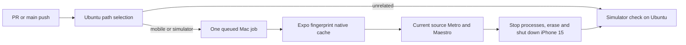

# Simulator CI

The `Simulator` workflow result comes from `.github/workflows/simulator.yml` on every PR and main push.
It does not define or change protected branch requirements.
An Ubuntu selector uses the complete Git comparison, including deletions and renames.
Only `apps/mobile/**`, `scripts/sim/**`, `scripts/verify/**`, the native fingerprint helper or this workflow starts the Mac.
Other changes pass on Ubuntu; failed classification, missing fixtures, failed flows, cancellation and an unexpectedly skipped Mac job never pass.

PR pushes cancel superseded work on the same PR.
The repository-wide `fitsy-simulator` concurrency group queues different PRs with `queue: max`, allowing one Mac job at a time.
The Mac job has a 30-minute deadline, one Xcode build worker, one Metro worker, a 2 GB Node heap and a 768 MB Java heap.
That deadline starts after assignment and does not bound a queue with no registered runner.
Keep only one runner registered with `fitsy-sim` and leave the old local publisher paused.
Manual native work must respect the existing `scripts/sim/sim` claim; CI refuses to boot alongside another booted simulator.
Run the media integration gate after releasing the native lane: its host-isolation test also acquires the canonical OS lock, so running it concurrently with an owned Maestro session causes a real lock timeout.

Normal PRs run `cold-start-welcome`, `signin-options` and `paywall-access`, including real DEV sign-in and paid-access assertions.
Main and PRs labeled `full-sim` retain the existing Test Store-compatible hosted selection, reporting incompatible journeys as separate `UNVERIFIED` manual acceptance rather than passing them.
The `subscription-restore-expired` Apple receipt-history journey requires its genuine fixture or a separately approved release exception; Test Store cannot prove Apple history transfer.
For the map/#746 release only, owner comment6716597294 explicitly excepts that one flow on the published PR754 head.
The local caller accepts `--release-exception=6716597294`; the hosted caller checks the same grant for PR754 and records `EXCEPTED`, its reason, owner URL and actual source separately from passed flows.
Changed approval text, another PR/source or changed fixture/store tags fail admission, and all other flows remain required.
The local full selection and the release's hosted full selection contain28 flows, with27 required executions and one exception, never28 passes.
Ordinary hosted smoke selection and unrelated releases keep their existing scope; the release grant does not create a new Apple-history gate for them.
The label expands a relevant change's suite; it does not start a simulator for an unrelated change.
Full runs still fail if the deadline or any fixture/flow assertion fails.
The local full-run caller now checks31GiB free before acquiring the native lane, preserving the8GiB floor after the measured23GiB attachment-growth projection.
This is capacity admission, not permission to delete files or weaken assertions.

The narrowly approved #755 duplicate cleanup uses `scripts/delivery/cleanup.py <sealed-proposal> --approved-attachments --dry-run`, then `--apply --dry-run-receipt <private-json-output>` only after independent review of the frozen cleanup source.
It accepts only proposalSHA `aabf2e5d48ae01c9124263384a1c93efd345aa156d15736dfcb17385b3c17245` and the unchanged owner6716597294 grant, checking native locks, device ownership, open files, exact identities and retained PNG bytes before removal.
Historical cleanup retains its existing age/integration rules; this exception grants no future outside-path retention cleanup.

## Pending Mac capacity preflight

At setup and the first pending Mac checkpoint, run `node scripts/verify/simulator-actions.mjs --preflight` locally with the existing authorized `gh` identity.
It reads the actual workflow labels and all runner inventory pages, exits nonzero for absent/offline matching capacity, and distinguishes unavailable inventory from an empty list.
Busy online matching runners remain valid serialized capacity; inspect the actual job owner before any cancellation or native work.
A passing capacity check is not a native execution result.
Record a failed preflight and its concrete owner action instead of silently waiting, while continuing independent authorized work.

The [runner inventory API](https://docs.github.com/en/rest/actions/self-hosted-runners#list-self-hosted-runners-for-a-repository) requires repository Administration read permission.
The workflow's ordinary `GITHUB_TOKEN` cannot request that permission, so this local diagnostic is not added to the Ubuntu selector or hooks as a broken credential-dependent gate.
Do not add a token, register a runner or change settings without the separate owner's authorization.
The original migration in #704 already recorded zero registered runners and an unverified Mac run; a later empty inventory alone does not prove removal or identify a removal actor.

## One-time Mac setup

1. Install Xcode and its iOS Simulator runtime, accept the Xcode license, and finish first launch.
   Install Node 22, CocoaPods, Java 17 or newer, Maestro, and Tesseract with English data.
   Verify `xcodebuild -version`, `pod --version`, `java -version`, `maestro --version` and `tesseract --version` from the runner account.
2. In GitHub, open **Settings > Actions > Runners > New self-hosted runner**, select macOS and the Mac's architecture, and follow GitHub's download/checksum instructions in a dedicated runner directory.
   Register using `./config.sh --url https://github.com/dgmolla/fitsy --labels fitsy-sim --name fitsy-mac` and enter the short-lived registration token interactively.
   Before starting this public repository's runner, set **Actions > General > Fork pull request workflows > Require approval for all external contributors**.
   A fork can edit its workflow, so the workflow's same-repository condition alone is not a host security boundary; do not approve fork execution on this Mac.
   Review and move needed fork changes to a trusted same-repository branch.
   Use a dedicated non-admin macOS account without production credentials or unrelated source checkouts.
3. From that directory, run `./svc.sh install`, `./svc.sh start`, then `./svc.sh status` to install and verify GitHub's launchd service.
   Configure the service's `.path` with the installed Homebrew, Java and Maestro executable directories, then restart it with `./svc.sh stop` and `./svc.sh start`.
   Keep the runner account logged in and the Mac awake while jobs execute.
   Use `./svc.sh stop` whenever the daily machine needs all its resources.
4. Create one dedicated **iPhone 15** in Xcode's Devices and Simulators, name it `Fitsy CI iPhone 15`, then shut it down.
   Copy its identifier from `xcrun simctl list devices available` into repository Actions variable `FITSY_SIM_UDID`.
   Do not select a personal simulator: CI erases this device's data after every job and reuses the same device next time.
5. Set the secrets below under **Settings > Secrets and variables > Actions**.
   Run a mobile PR once, then rerun unchanged native inputs to confirm a cache hit and current-source Maestro execution.
   Preserve the repository's existing protected contexts; runner setup does not authorize changing required checks.
   Do not resume the old poller or manually post a success status.

GitHub documents [runner service installation](https://docs.github.com/en/actions/how-tos/manage-runners/self-hosted-runners/configure-the-application?platform=mac) and [concurrency queues](https://docs.github.com/en/actions/how-tos/write-workflows/choose-when-workflows-run/control-workflow-concurrency).
The pinned actionlint version predates `queue`; `.github/actionlint.yaml` suppresses only that unsupported-key diagnostic for this workflow, with the queue contract covered by the workflow tests.

## Actions secrets

| Name | Value |
| --- | --- |
| `DEV_SUPABASE_URL` | The `fitsy-dev` Supabase project URL; the runner rejects other projects. |
| `DEV_SUPABASE_ANON_KEY` | That project's anon or publishable key, never a service-role key. |
| `REVENUECAT_TEST_KEY` | The RevenueCat Test Store public SDK key beginning with `test_`. |
| `SIM_E2E_FIXTURES` | JSON mapping fixture names to `email` and `password`, described below. |

`SIM_E2E_FIXTURES` contains `unsubscribed-dev`, `entitled-dev`, `empty-store` and `expired-subscription`, each with a distinct disposable `@fitsy.dev` account.
Smoke needs only `unsubscribed-dev`; full needs all four.
Use this shape with actual credentials entered directly into GitHub: `{"unsubscribed-dev":{"email":"<disposable DEV account>","password":"<password>"},"entitled-dev":{"email":"<different DEV account>","password":"<password>"},"empty-store":{"email":"<different DEV account>","password":"<password>"},"expired-subscription":{"email":"<different DEV account>","password":"<password>"}}`.
Provision accounts and onboarding state through the existing DEV fixture procedure in the E2E guide.
The empty account must never have purchased; the expired account needs a genuinely expired Test Store purchase before the job starts.
The existing active-entitlement helper may renew the entitled account through a real simulated Test Store purchase and verifies the API's entitlement verdict.
No database credentials, entitlement fabrication, production data, Apple credentials, EAS publishing or App Store distribution are used.

Only the flow step receives runtime secrets; dotenv loading is disabled throughout.
The native cache contains the keyless Debug `.app`, keyed by Expo's iOS native fingerprint plus the Xcode SDK and build recipe.
It has no fallback key or cached test verdict.
Before installation, Expo regenerates public RevenueCat configuration in a disposable app copy and the runner preserves its simulator entitlements when signing it.
Each job starts Metro from the checked-out candidate with current fixture credentials.
Job logs name passed or failed flows; raw Maestro output and temporary bundles are removed during cleanup rather than uploaded with credentials.
The always-run cleanup stops owned Metro, erases and shuts down only the claimed device, and removes generated iOS/build/temp data without deleting the reusable device.
If the Mac loses power, stop the runner service, reconcile its existing simulator claim, shut down that dedicated device and restart the service before rerunning the failed check.
