**TL;DR:** Only chosen C alternate remains active; earlier galleries below preserve retired comparisons.

Owner [6713988813](https://github.com/dgmolla/fitsy/issues/755#issuecomment-6713988813) retired A, B and baseline C on November7, superseding their active comparison and acceptance matrix.
The current Debug entrypoint `com.fitsy.mobile://search?mapDebug=1` always opens chosen C alternate with Macros, Shuffle, real meal/confidence overlays and pin-style options only.
Retired layout parameters cannot restore rejected variants.
The prior native comparison explicitly selected B and ended on B Peek, explaining the observed vertical screen rather than proving a stale default or stall.
Current acceptance retains C pan/area, Shuffle, Macros, retry, bounds/filter consistency, auth/subscriptions and the actual impact-selected native scope, including its genuine Apple-history prerequisite.
Removed retired subjourneys are not counted as passed.
Production availability and rollout remain unauthorized.

## Historical comparison and evidence

**TL;DR:** Three dev-only map layouts are captured for comparison; pin visibility still needs work.

> **Status:** proposed · **Last verified:** 2026-11-06

Open `com.fitsy.mobile://search?mapDebug=1&mapTray=C` in the configured Debug iOS app.
The tray controls switch to A or B without replacing Discovery's search state.
B's grabber cycles Peek, Half and Full, responds to vertical drags, and exposes adjustable accessibility actions.
The existing development-only gate remains in force; this is not a production design selection.

| Variant | What to compare | Tradeoff |
| --- | --- | --- |
| C: Carousel | Floating search, one readable restaurant card and a visible next-card edge. | Keeps more map context but shows fewer dish details at once. |
| A: Discovery list | Compact HeroCard followed by existing RestaurantSection cards and nutrition. | Most familiar to current Discovery users; leaves less visible map. |
| B: Grabber sheet | Useful thumbnail preview at Peek and name-first cards at Half/Full. | More flexible browsing; the small screen leaves less difference between Half and Full. |

C feels least cookie-cutter in this comparison because Fitsy's cream, serif restaurant names and food photography remain prominent without hiding the map.
This is a recommendation for Dawit's review, not a pick or authorization to promote #746.
The reference direction comes from the existing curated Honest Greens, Shake Shack, Starbucks, DoorDash and Uber screenshots; no third-party reference screenshots are copied here.

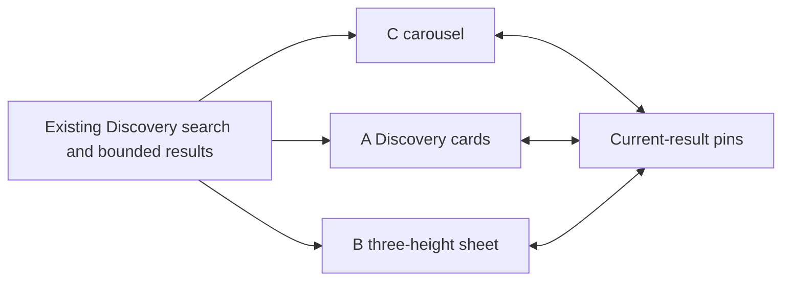

The two trend extras are editable chips backed by the existing meal targets and simple numbered pins synchronized with cards.
Pins are a subset of the actual loaded results, and camera movement never fetches restaurants.
Counts come from the current results; card distances come from the API.
No new radius label, backend, nutrition ranking, provider or production flag is introduced.
The baseline API uses three miles and twenty rows per page; the POCs retain its existing pagination and access rules.

Screenshots below are original Simulator PNGs, with no compositing or retouching.
Normal is iPhone 15 at 393 × 852 points; small is iPhone SE (third generation) at 375 × 667 points, both iOS 17.5.
Dense areas still have overlapping pins, and the selected label can truncate long names.
These captures and rendered tests do not establish frame-rate, memory, physical-device performance, Release acceptance or production uptake.

| Layout | Normal | Small |
| --- | --- | --- |
| C | 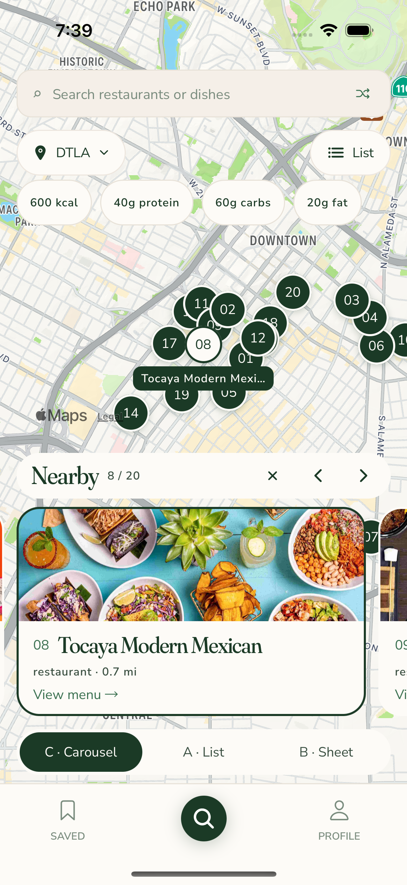 | 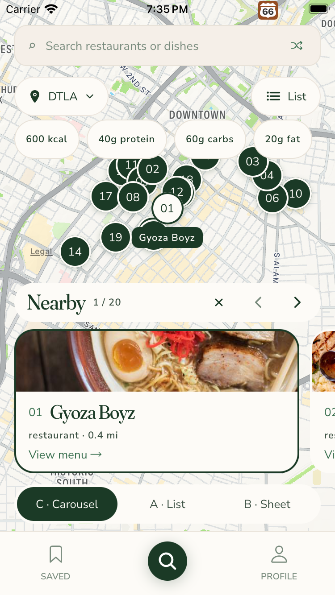 |
| A | 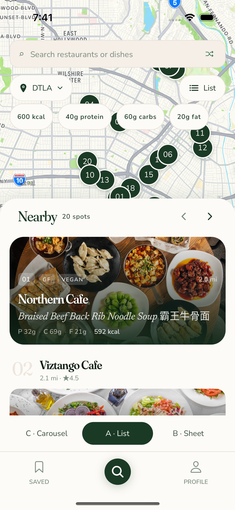 | 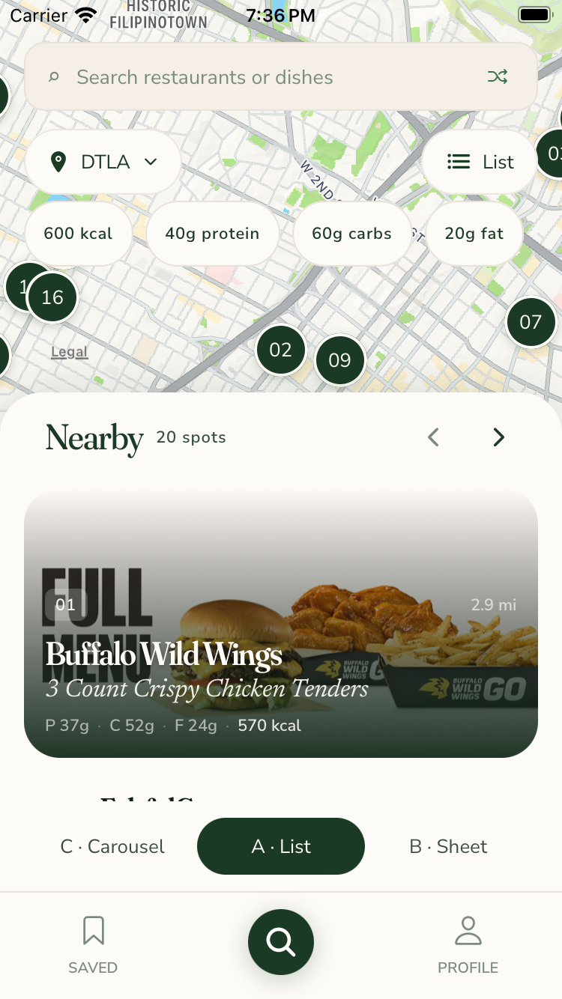 |
| B Half | 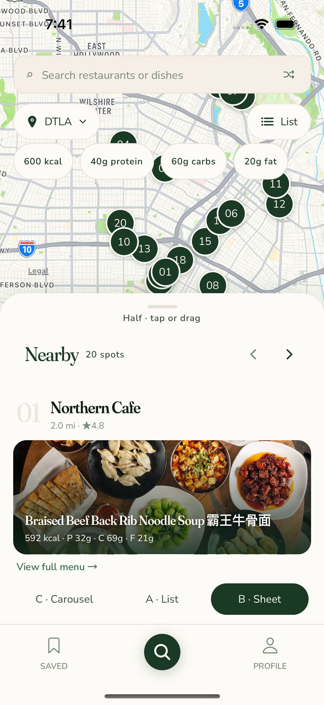 | 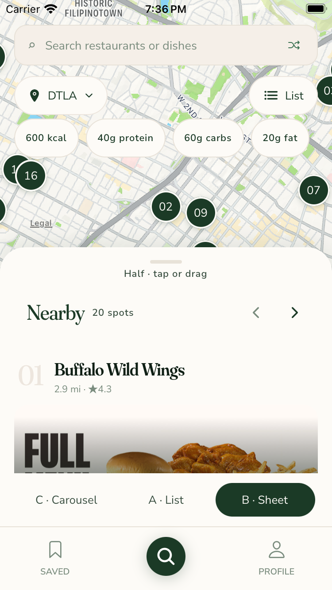 |
| B Full | 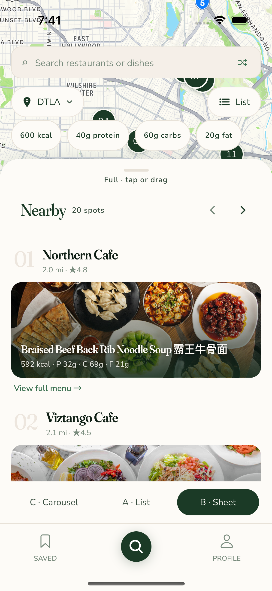 | 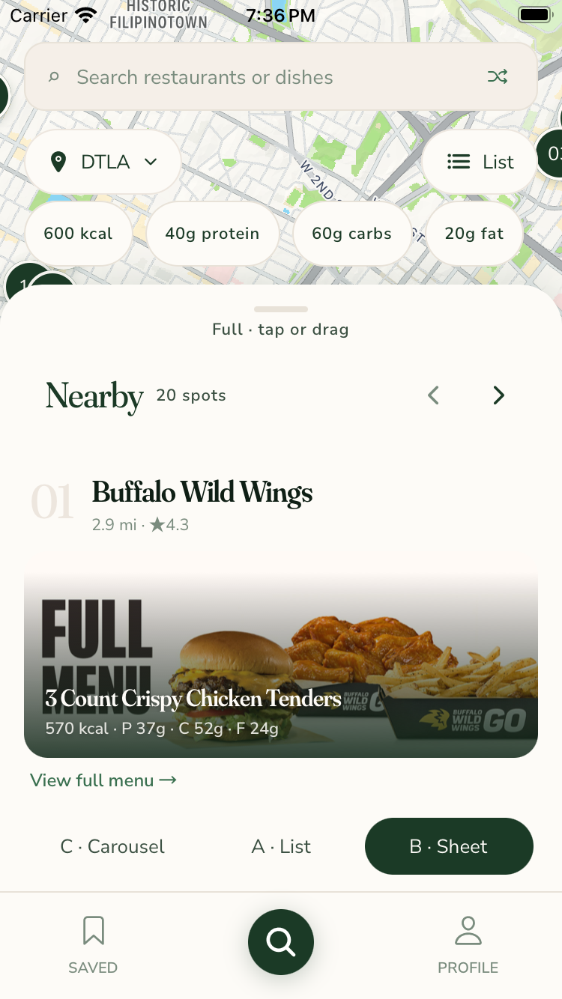 |
| B Peek | 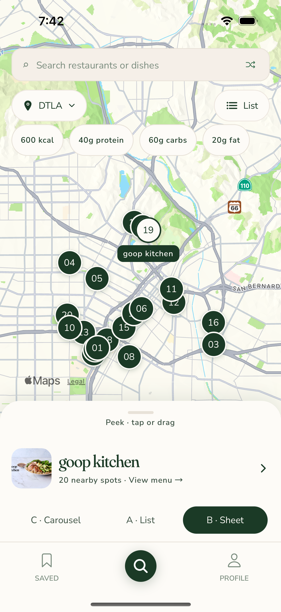 | 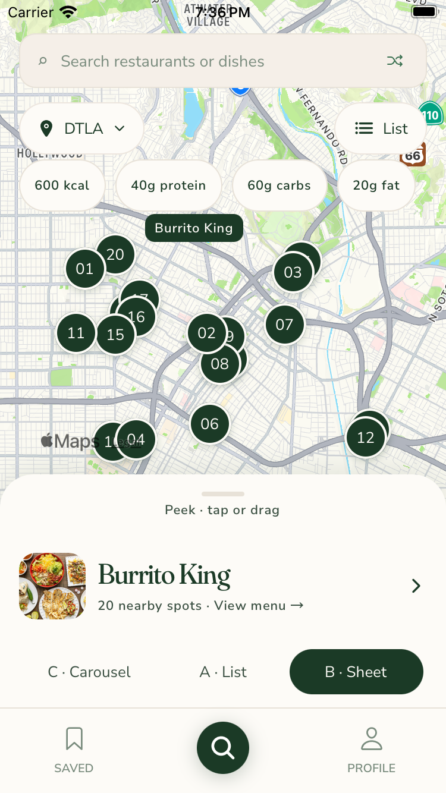 |

[Original baseline](baseline-normal.png) preserves the rejected tray and overlapping photo pins at main `4f63c7b8f1d68d5a370a8b1374cf0e606ec88595`.
[Carousel swipe](normal-c-swiped.png) shows the second card and matching pin, and [last-card retention](normal-b-last.png) shows the repaired clamped-scroll selection.
The complete maintained `map-search` journey passed on both layouts, including menu opening, search, List round-trip, filters, Shuffle, carousel swipe, B heights, last-card retention and subsequent real-drag selection.
Live results and Shuffle order differ between captures; compare layout rather than restaurant ranking.

The separate denied-location run did not pass.
Its [failure capture](normal-location-denied-failure.png) shows the first pin beneath the floating controls without the required preview after tapping it.
Hollywood selection and fallback dismissal passed, but later search state and pin interaction remain unproven.
The full impact selection also includes the separately deferred real Apple-history journey, so these scoped POC runs are not a full native acceptance result.
[Issue #748](https://github.com/dgmolla/fitsy/issues/748) and [PR #751](https://github.com/dgmolla/fitsy/pull/751) hold the current owner, attempts, independent verdict and next action.

The POC captures used Debug native app SHA-256 `2c078f14e0c376db6c28f9f74600eb527eb7ade17839c2321d5bd1fa1c1ee374` and served bundle SHA-256 `d6049a4fe37407d6bcb5f2f69a342ca561c45ab080d581aebd589658291b707d`.
Original native command receipts, configuration, failures and the exact served bundle remain private under `~/fitsy-wt/issue-748-evidence/`.
The source and image digests below identify this capture set without exposing that configuration.

| Runtime source | SHA-256 |
| --- | --- |
| `apps/mobile/components/DiscoveryMap.tsx` | `a7c84278a5ecfe30da934d5b067f69422a2ce2a4b71f7d5fc02c126788f24fa8` |
| `apps/mobile/components/DiscoveryMap.styles.ts` | `980f69e151eadacf225c91b0d9abf1fea6eda9480fc376a88995372b7f9f9868` |
| `apps/mobile/components/DiscoveryCards.tsx` | `68058cfb7453714ccc0de9d19cb9168c28e156c6952dcde3fafb10f0e9a59e32` |
| `apps/mobile/e2e/flows/map-search.yaml` | `3599ed487f10354ca1921a8b8ecd13c334c96c2fe9a02cc6a0faeba5d6cc3b5b` |
| `apps/mobile/e2e/flows/map-search-location-denied.yaml` | `631174528a0610f5bad003b35d074db9b1386b777ab9e1299a2278c15598f1a5` |
| `apps/mobile/e2e/helpers/map-search-setup.yaml` | `0822aa9ba46fb302a0095d866f30a9b61c2c5b0613e1f302534d3088abd0f728` |

| Original PNG | Pixels | SHA-256 |
| --- | --- | --- |
| [normal-c.png](normal-c.png) | 1178 × 2556 | `a5135bc1471e4da5fa7729a650f12b9d0a5eb255fba45cbb43455ed11c386146` |
| [normal-a.png](normal-a.png) | 1178 × 2556 | `5a47069cd27a16839c44630f642e1460a63f3270a1b2d8119f120fb16a4c2ba3` |
| [normal-b-half.png](normal-b-half.png) | 1178 × 2556 | `f05763aba403c03cb341561f91d11164a778a729309931a2e050d2233c32abac` |
| [normal-b-full.png](normal-b-full.png) | 1178 × 2556 | `66fab8325ffb146c1de08f06af363e921a720561833c9e6c419217769ada3afc` |
| [normal-b-peek.png](normal-b-peek.png) | 1178 × 2556 | `827a9b1d9d94f16ff8e88e7386491b2c8ce322e8853d609b036f158e5b3cb32f` |
| [small-c.png](small-c.png) | 750 × 1334 | `c62718143be6a8224e0c534a68e7f8091f765aa8747d36e867f428c24a8b6c05` |
| [small-a.png](small-a.png) | 750 × 1334 | `a068c7042868a35a7260feec18248e300da56e025a344792496c9bff880f81a3` |
| [small-b-half.png](small-b-half.png) | 750 × 1334 | `895ad433cb2efa948cf81c25fd2ebbd538e39873654e35ed3ffa675f18a57fbf` |
| [small-b-full.png](small-b-full.png) | 750 × 1334 | `48462d1532696610d68fd9170b74dbfc1dc08ed9504014e0ea9a849796ef447f` |
| [small-b-peek.png](small-b-peek.png) | 750 × 1334 | `827aec426fc246226b9c389258eb908d453e167bf73ec3b5db334913595c968a` |
| [normal-c-swiped.png](normal-c-swiped.png) | 1178 × 2556 | `fdeb8b898dcfd4a6b45a78db05a867be611c8e8d9fb30e425ec5d59cb7395030` |
| [normal-b-last.png](normal-b-last.png) | 1178 × 2556 | `707425c63ae7366199911ff0fdba764dcabfaec1c6f499c41f4f2ded1cf2bf54` |
| [baseline-normal.png](baseline-normal.png) | 1178 × 2556 | `79703c96455f99af74cff518dbdc79f75a9c8c1eed5af0faccc871913db37fc9` |
| [normal-location-denied-failure.png](normal-location-denied-failure.png) | 1178 × 2556 | `234d9068983adc23f7f6e299536f91ddcd7f979c897853818e5d39175d645273` |
