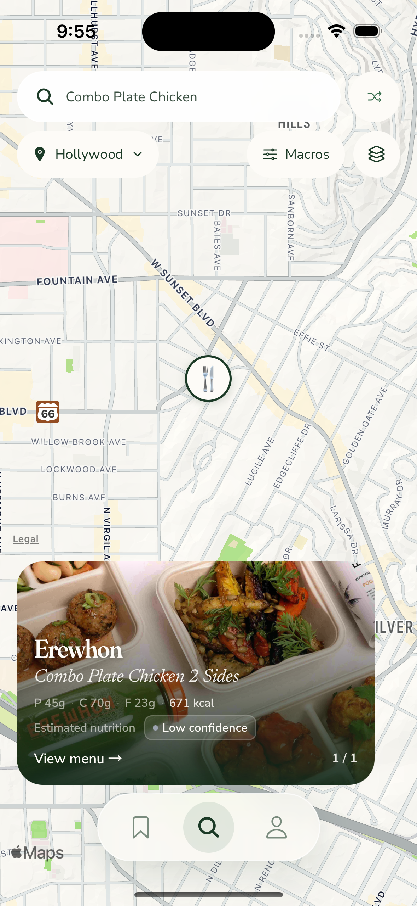
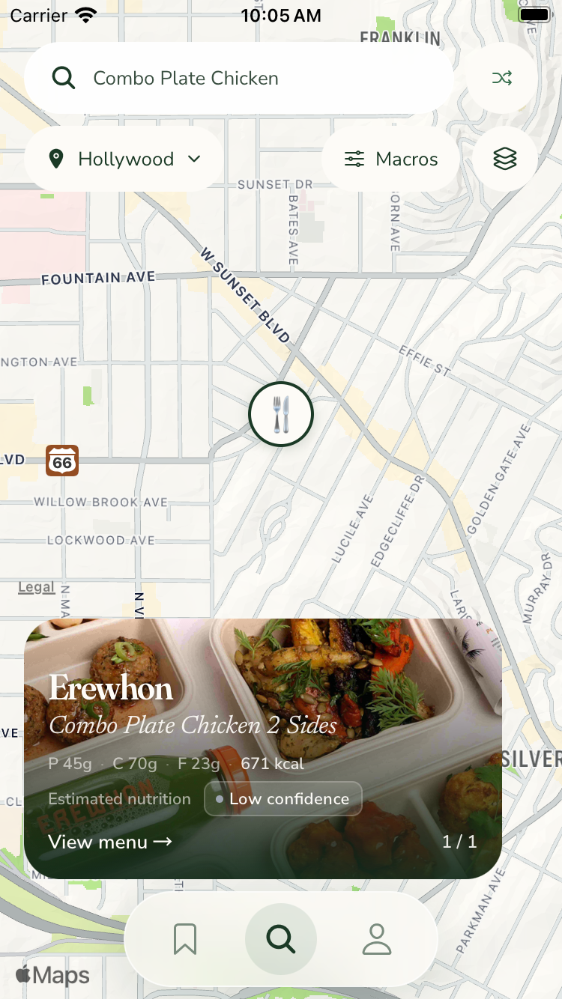
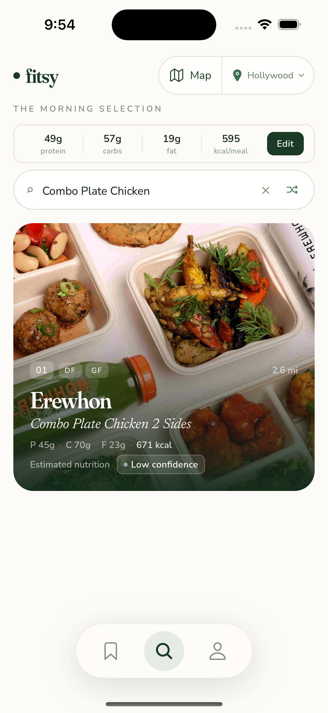
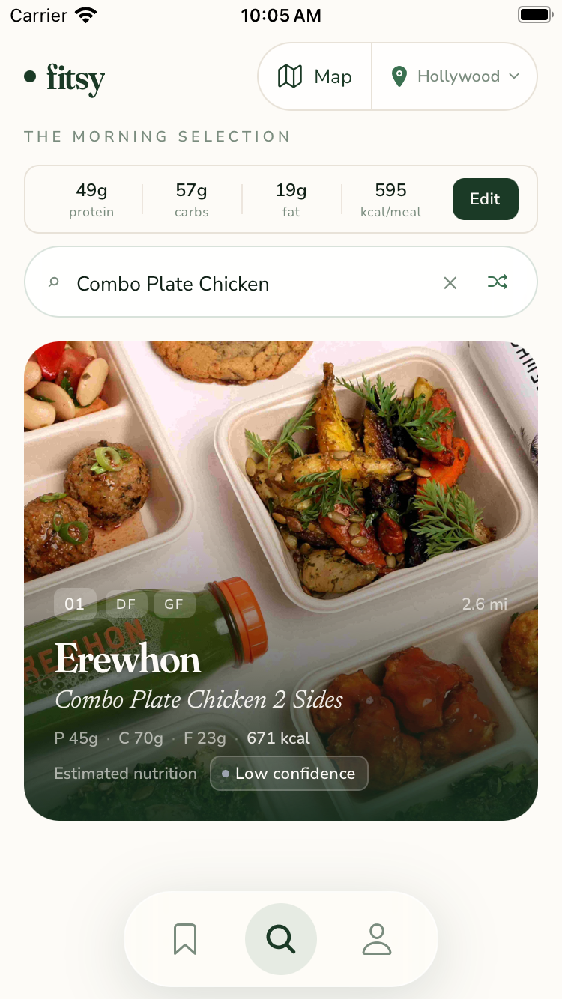
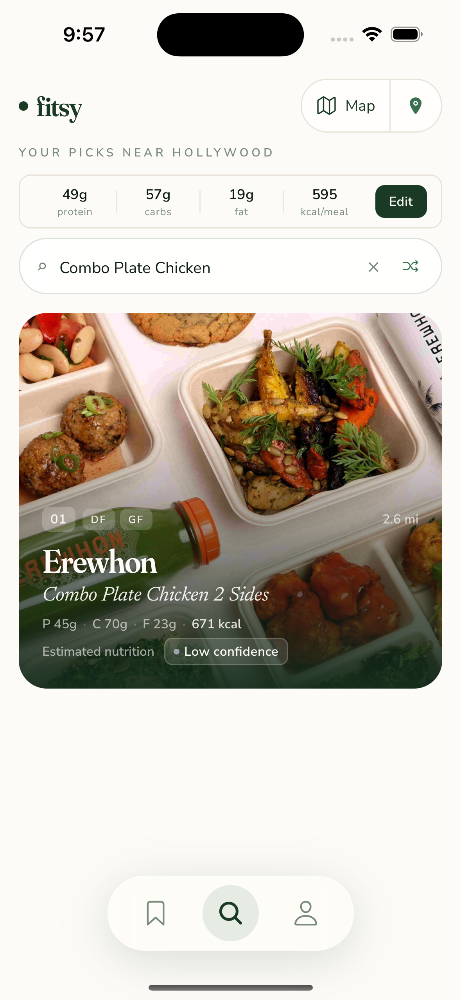
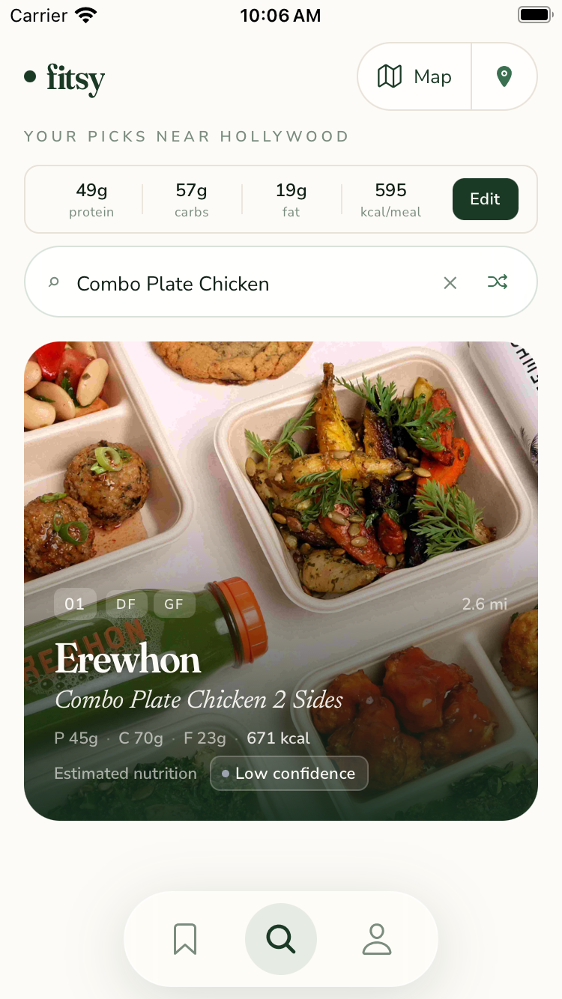
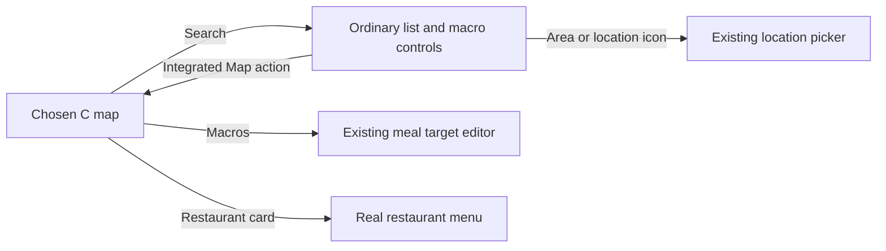

**TL;DR:** Chosen C and both list treatments now show real meals with visible nutrition confidence.

Dawit's [#755 choice](https://github.com/dgmolla/fitsy/issues/755) remains C alternate with the compact Macros editor, called G in the debug controls.
This successor gallery records additive repair batch 6 after the complete review of `9fc3518d` found missing estimate qualification.
The [preceding chosen-C gallery](../chosen-c/README.md) remains unchanged historical evidence.
Production map availability and pin selection remain separate from this prototype choice.

Map previews and legacy Search share the actual restaurant, `bestMatch` dish, protein, carbohydrate, fat and calorie fields.
They now also share nutrition provenance and confidence, including qualified accessibility text.
The existing confidence badge has a readable photo treatment; no provider, calculation, data or icon source changed.
Published nutrition stays labeled Published, and locked or missing meals do not expose hidden values.

| Chosen map | iPhone 15 | iPhone SE |
| --- | --- | --- |
| C alternate with Macros |  |  |

Both list directions integrate Map access into the existing location-control position.
The installed blur surface keeps the same white tint while idle, focused and submitted, with a readable focus border.

| List treatment | Tradeoff | iPhone 15 | iPhone SE |
| --- | --- | --- | --- |
| 1: Map + area | Recommended because both actions are named in one capsule, making location changes explicit. |  |  |
| 2: Compact Map + location icon | More compact, with the current area in the existing subtitle; the location icon is less explicit. |  |  |

The comparison recommends a prototype treatment, not production rollout.
Focused search captures include the keyboard: [List 1 normal](normal-list-1-split-focused.png), [List 1 small](small-list-1-split-focused.png), [List 2 normal](normal-list-2-compact-focused.png) and [List 2 small](small-list-2-compact-focused.png).

On both sizes, actual UI interactions confirmed native Enter, real dish results, both list controls, map return, Macros editing, location changing and restaurant-menu navigation.
Erewhon's Combo Plate Chicken 2 Sides showed 45g protein, 70g carbohydrate, 23g fat and 671 kcal with LOW confidence in both map and list.
The single-result selected pin, visible card and 1/1 counter agreed, and the opened menu contained the same meal values.
Actual MEDIUM examples were also observed in map and list on both sizes, with Estimated nutrition visible and accessibility calories qualified as approximately.
Changing protein from 49g to 54g changed the editor's calorie target from 595 to 615, then the original values were restored.

On the small device, denied location showed the real Silver Lake fallback, and selecting Hollywood removed the fallback while keeping search and location changing usable.
An overlapping multi-result marker tap selected Que Ricos rather than the requested Subway marker; its selected pin, visible Burrito card and 11/20 counter agreed.
After a real Que Ricos search reduced results to one, tapping pin 0 selected its matching preview and 1/1 counter.
This evidence does not claim unique hit targeting for overlapping markers.

The retained B restaurant Peek fits the additional confidence row on both sizes.
Its successful empty response keeps Adjust meal targets and Clear search inside the content-sized tray above navigation.
Both actions were exercised on both sizes: adjustment opened the editor, and clearing restored actual restaurant results.
These are source-bound native UI observations, not a passing automated native suite.

The causal audit confirmed that extracting the legacy renderer had retained its `paywallPreview` condition around provenance, so normal map and Search cards omitted confidence.
The first caller regression covered unequal numeric values but only HIGH confidence, missing the qualification and accessibility contract.
The repaired real map/list caller now covers LOW and MEDIUM estimates, explicit published nutrition, locked meals and missing meals; the existing paywall test also rejects hidden estimated calories in accessibility text.
The earlier restaurant-only metadata was a visual-scope implementation gap addressed by #755's new explicit content requirement, not a retroactive failure of the older visual brief.

All ten images are original, unedited Simulator PNGs from app source `c74d407b4f60b89dba615b1fe83d7fe2cfcffe8f`.
The [manifest](capture-manifest.json) records source, capture time, device, dimensions, bytes, PNG hash, JavaScript input hash, served bundle, native identity and installed app hash.
JavaScript input is `b681179c7ce18d8b077b283f8725a6a4ab5b0ca3d3f451cecd98d907e2d869de`, with unchanged served readback `53454ac6f5a13129ed6ddad41918517d474c31190b042d7285c679eb19808abd` on both devices.
Originals and the identical manifest remain at `/Users/dawitmolla/fitsy-wt/issue-755-evidence/chosen-c-c74d407b/` for direct chat attachment outside the checkout.

The actual native selection remains 28 flows.
The retained XCTest hierarchy stall and unavailable Apple-history prerequisite remain unresolved, with no unchanged failed setup rerun, transferred waiver or new Apple identity request.
The issue and draft PR record final checks and the complete independent verdict separately; no deployment, full automated native pass or production map enablement is claimed here.
