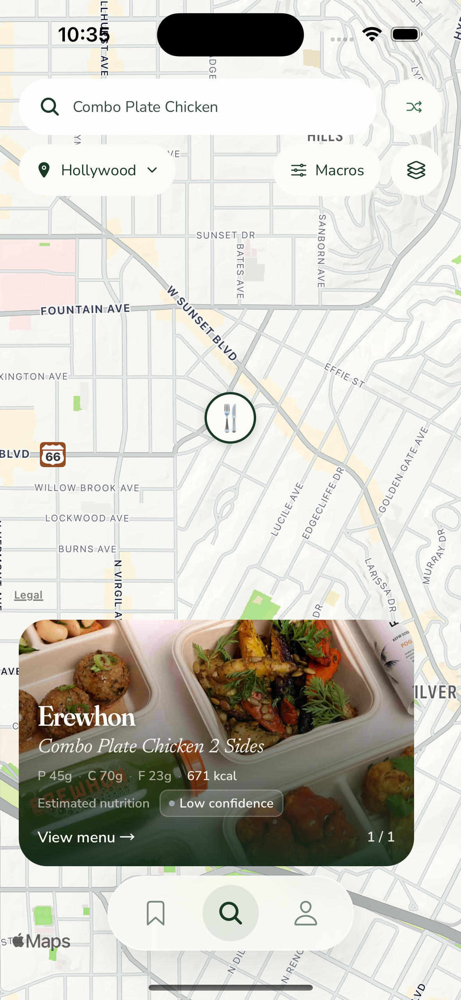
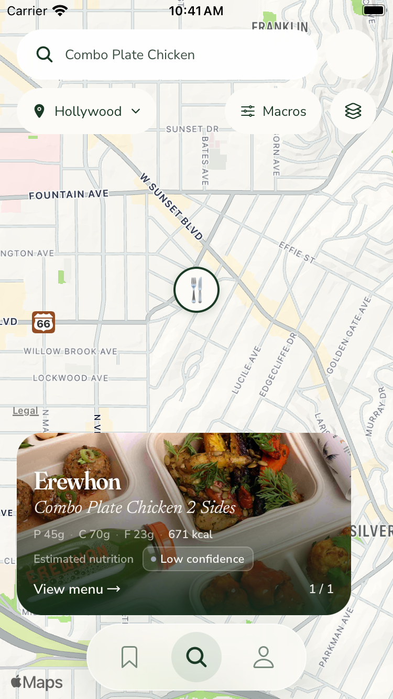
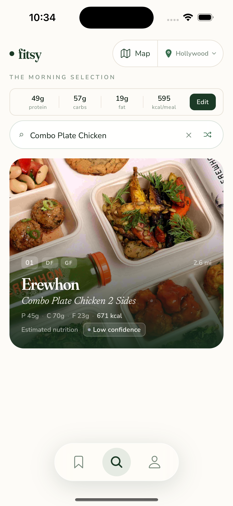
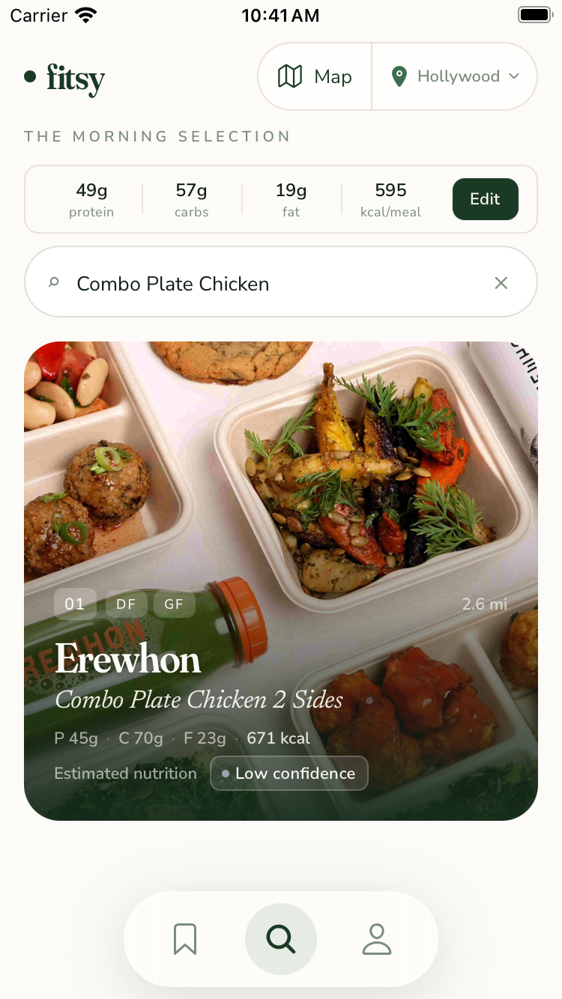
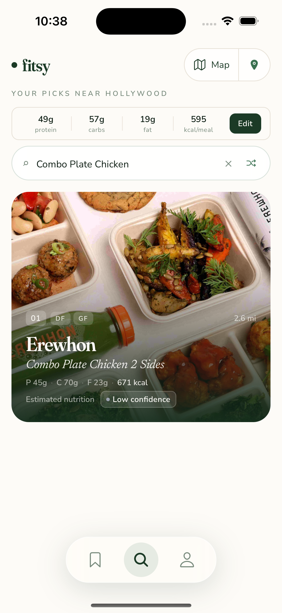
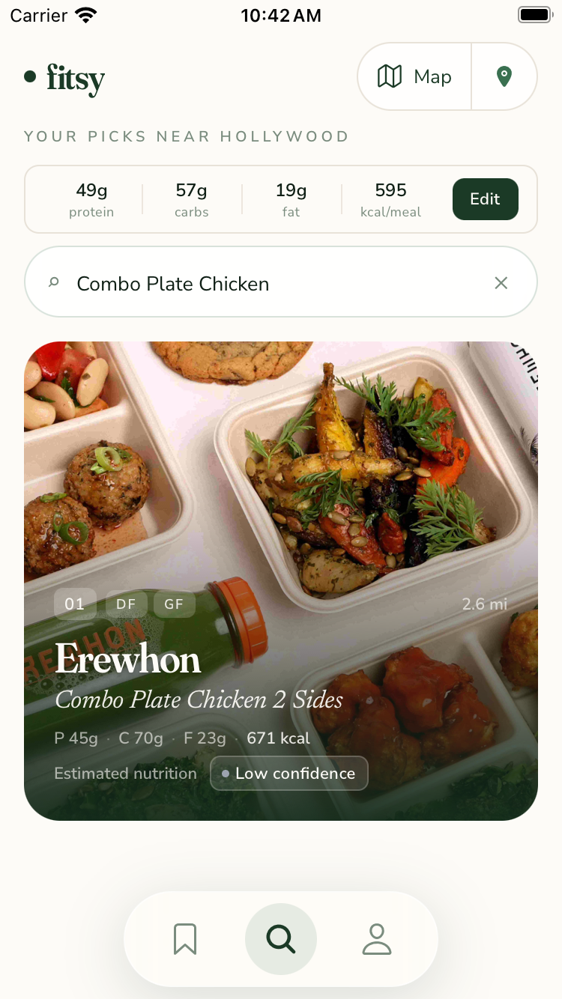
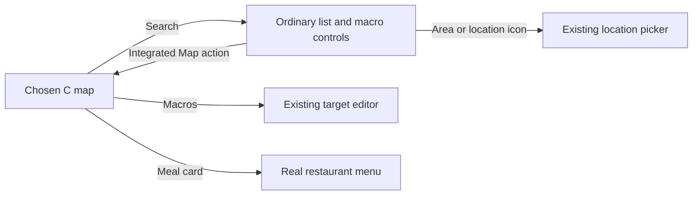

**TL;DR:** Chosen C keeps Macros and real meal overlays, with two integrated Map/location list treatments.

Dawit's [#755 decision](https://github.com/dgmolla/fitsy/issues/755) selects C alternate, called G in the existing debug controls.
Production availability and pin selection remain separate decisions.
The [original chosen-C](../chosen-c/README.md) and [confidence correction](../chosen-c-confidence/README.md) galleries remain unchanged historical evidence.

Map previews and legacy Search share restaurant name, the actual best-match dish, protein, carbohydrate, fat, calories, nutrition provenance and confidence.
The full-photo treatment keeps readable text without a green card border.
Both list directions put Map access in the existing location-control position and retain the existing picker.
The installed blur surface keeps its white tint while focused and submitted.

| Current chosen map | iPhone 15 | iPhone SE |
| --- | --- | --- |
| C alternate with Macros |  |  |

| List treatment | Tradeoff | iPhone 15 | iPhone SE |
| --- | --- | --- | --- |
| 1: Map + area | Recommended because both actions are named in one capsule. |  |  |
| 2: Compact Map + location icon | Uses less width and names the area in the existing subtitle, but the location icon is less explicit. |  |  |

On both sizes, actual Simulator interactions confirmed native Enter, real search results, both list treatments, map return, Macros editing and restaurant-menu navigation.
Erewhon's Combo Plate Chicken 2 Sides showed 45g protein, 70g carbohydrate, 23g fat and 671 kcal with Estimated nutrition and Low confidence in map and list.
The selected pin, visible meal and 1/1 counter agreed, and the real menu contained the same meal values.
Changing protein from 49g to 54g changed the calorie target from 595 to 615, then the original targets were restored and applied.
The compact location control changed the normal device's area through the existing picker.
On the small device, denied location showed the Silver Lake fallback; selecting Hollywood removed the notice and restored real results.

Additive repair batch 7 addresses the complete review's confirmed carousel retry defect.
Loading and error states unmounted the horizontal carousel while retaining a later selected restaurant, so retrying unchanged results could remount the visible card at row one.
The existing vertical list had restoration, but the horizontal carousel lacked it.
The carousel now restores the current selected offset after layout and content sizing, without changing subsequent user-scroll ownership.
The regression exercises the actual Search route, real hooks and external HTTP boundary for both C and G: later pin selection, failed Shuffle, retry with unchanged rows, remounted scroll offset, actual meal name, selected pin, counter and subsequent user scrolling.
Both cases failed before the fix and pass afterward.
The attempted native comparison-route transition reset selection itself, so it did not reproduce the failed-HTTP trigger and is retained as a negative diagnostic rather than proof of that failure.
No native network fault injection or passing full automated suite is claimed.

The earlier audit found that the visual-only full-photo implementation retained restaurant metadata instead of sharing legacy meal content.
#755 supplied the explicit dish/macros requirement, and sharing the maintained renderer removed that source gap without duplicating calculations.
A subsequent review found that the extracted renderer retained a paywall-only provenance condition; the corrected real map/list caller now covers LOW and MEDIUM estimates, published nutrition, locked meals and missing meals.
The maintained shipping lesson now requires restoration checks on both scroll axes across loading, error and detent remounts.

All six images are original, unedited Simulator PNGs from app source `3636dbae98f6308c162b048f4596c67eb95ef48e`.
The [manifest](capture-manifest.json) records source, capture time, device, dimensions, bytes, PNG hash, JavaScript input, served bundle, native identity and installed app hash.
JavaScript input is `724c6fcd3a19cfe2a957cfa7273a6bd8605412c6af2b6777a89fce9a7b3b81ff`, with unchanged served readback `d18515089daf08595bbea49690d114d9188bdc73148586ec06bff70c9779c14c` on both devices.
Originals and the identical manifest remain at `/Users/dawitmolla/fitsy-wt/issue-755-evidence/chosen-c-3636dbae/` for direct chat attachment outside the checkout.

The actual native plan still selects 28 flows.
The retained XCTest hierarchy stall and unavailable Apple-history prerequisite remain unresolved, with no unchanged setup retry, transferred waiver or new Apple identity request.
These native UI observations and rendered regressions do not establish automated full-scope acceptance.
Final checks and the complete independent verdict belong to the exact final PR head and are recorded on #755 and draft PR754.
