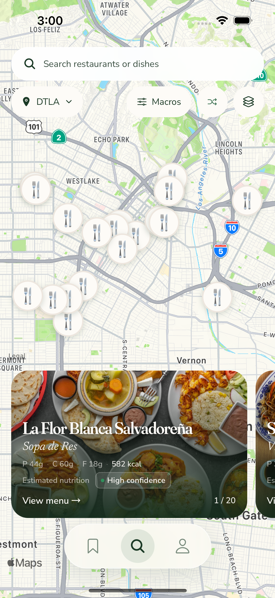
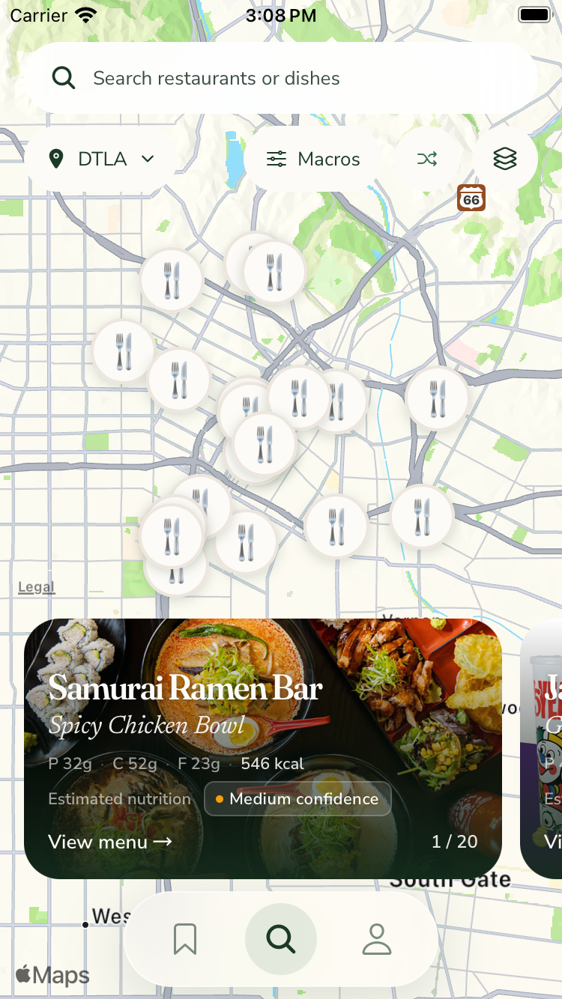
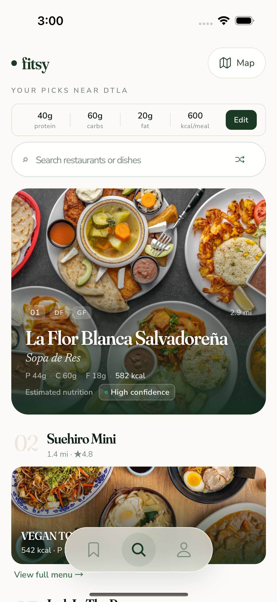
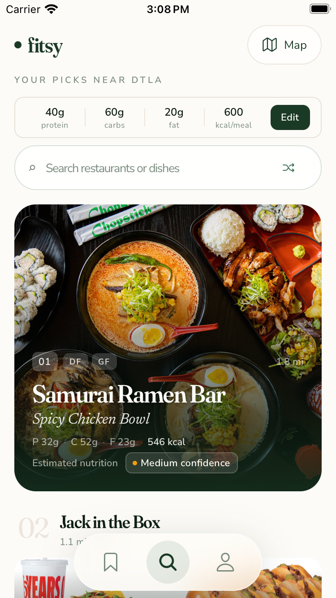

**TL;DR:** Chosen C keeps Macros and visible Shuffle, with one Map control in the editable list.

Owner [6713988813](https://github.com/dgmolla/fitsy/issues/755#issuecomment-6713988813) retired A, B and baseline C from the active implementation and capture matrix.
Only chosen C alternate remains; old layout links cannot restore rejected variants, and options now select pin style only.
The earlier galleries remain unchanged historical comparisons, and retired subjourneys are removed by owner decision rather than counted as passes.
Production availability, pin selection and rollout are not inferred.

| Current surface | Normal iPhone 15 | Small iPhone SE |
| --- | --- | --- |
| C alternate after Shuffle |  |  |
| Same results in the editable list |  |  |

Shuffle stays beside Macros on the map and inside the existing list search surface.
The white frosted search surface, legacy restaurant/dish/macros/confidence content and full-picture cards remain readable on both sizes.
City changes remain on the map, adding one transition from list in exchange for a simpler list header.
Dense restaurant pins can overlap; the retained numbered, utensils, cuisine and installed-icon choices are prototype comparisons, not an owner pin pick.

All four PNGs are unedited Simulator captures from app source `b7aacb293b679ef826583ad8ad4a21d2b0a9fc56`.
The [manifest](capture-manifest.json) records exact source, JavaScript input/served readback, native/app identities, device, capture time, dimensions, bytes and SHA256 for each original.
Originals and the direct-attachment index are retained outside the checkout at `/Users/dawitmolla/fitsy-wt/issue-755-evidence/chosen-c-shuffle-b7aacb29/`.
No image was drawn, stitched, retouched or relabeled as a later capture.

The maintained C-only native journey passed on both sizes with 252 commands each: 248 completed, two legitimate conditional skips and two absent optional warnings.
All required assertions and screenshot-content checks passed, including Enter/list/macros, real menu navigation, visible Shuffle with changed results, city selection, real pan and explicit area confirmation, final visible card/name/pin/counter agreement, reverse scrolling and empty recovery.
The small denied-location journey also passed with 71 commands: 67 completed, two conditional skips and two optional warnings.
It selected Hollywood through the settled picker, recovered a tappable pin, submitted pizza in list and returned to the matching map card.
Rendered real-caller tests separately retain failed-request retry restoration after both pin and drag selection; these are not relabeled as native HTTP-failure proof.
The actual full native plan still selects 28 flows, including the independently unavailable real Apple-history prerequisite.
Scoped native passes do not establish that aggregate, hosted runner execution, Release acceptance or production uptake.
