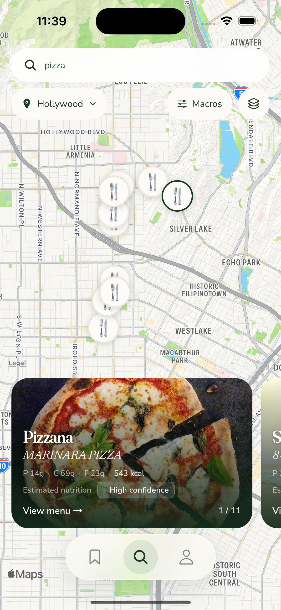
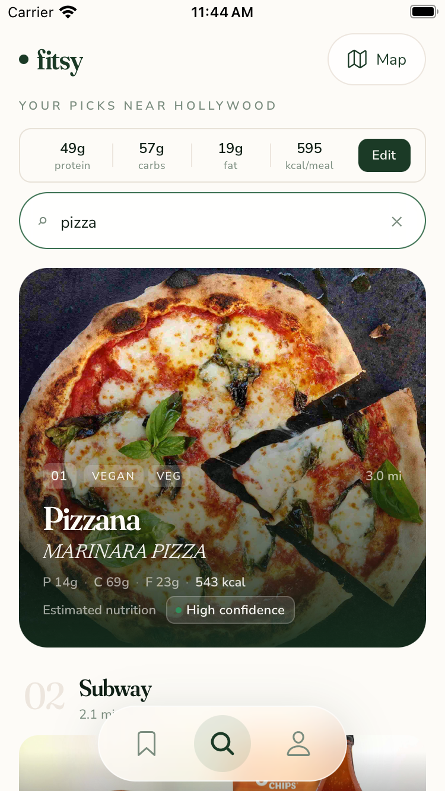
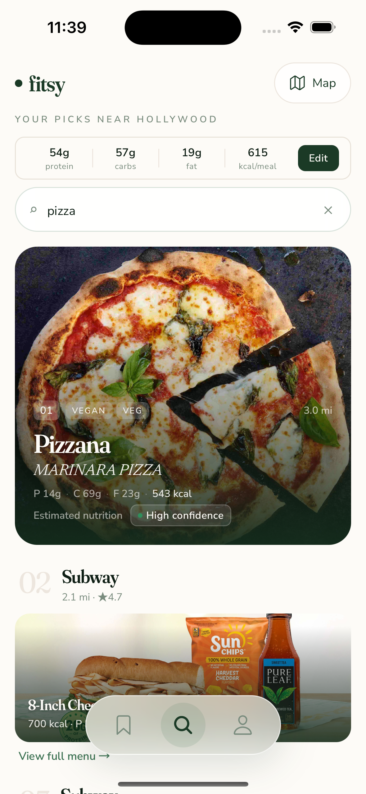
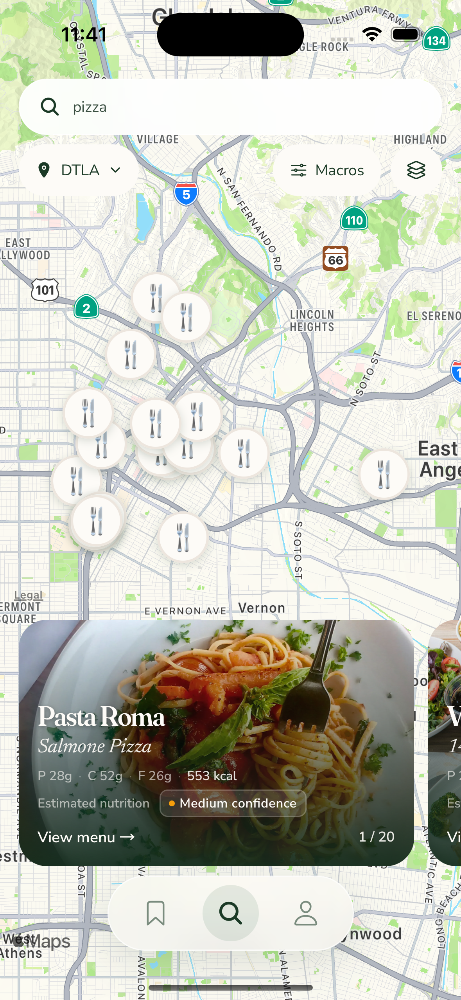
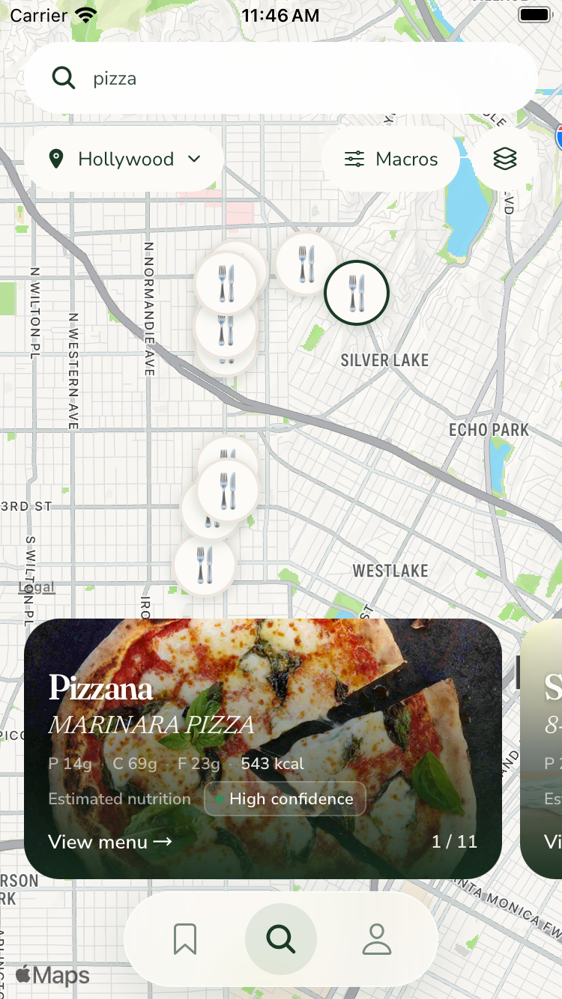

**TL;DR:** The chosen map now pairs with one list Map control; native area-drag acceptance remains unresolved.

Dawit's [latest refinement](https://github.com/dgmolla/fitsy/issues/755#issuecomment-6711565662) supersedes the earlier two combined Map/location list treatments.
List now has one Map button in the existing location-control position.
City selection stays on the chosen C alternate map, called G in the existing debug controls, beside the Macros chip.
This keeps the list compact, with the tradeoff that changing city requires entering map view.
Production availability and pin selection remain separate decisions.
The [prior combined-control gallery](../chosen-c-final/README.md) and all older captures remain unchanged historical evidence.

| Current treatment | iPhone 15 | iPhone SE |
| --- | --- | --- |
| Chosen C, Macros and city picker |  |  |
| Single Map, focused search |  |  |
| Single Map, submitted results |  |  |
| City-picker results |  |  |

Map and legacy Search share the actual restaurant name, best-match dish, protein, carbohydrate, fat, calories, nutrition provenance and confidence.
The full-photo treatment has no green card border, and focused/submitted search keeps its white blur surface.
No values, photographs, ranking or nutrition calculations were invented.
The visual-only full-photo predecessor reused photo/gradient styling but retained restaurant-only metadata; #755 made the dish/macros requirement explicit, and the maintained meal renderer now serves both callers.

On this app source, actual UI interactions on both sizes confirmed Enter, list results and targets, Map return, matching selected pin/card/counter, Macros editing and loaded restaurant menus.
Pizzana's MARINARA PIZZA displayed 14g protein, 69g carbohydrate, 23g fat and 543 kcal in map and list, with the same meal present in its menu.
Normal city selection changed to DTLA and returned results.
Small current-location access showed the real Location off fallback; settled Hollywood selection removed it and returned 11 pizza results with a tappable matching preview.
These observations are not a passing automated full native run.

Area search is explicitly confirmed after a settled pan, using the existing location/search hook, unchanged radius/count defaults and stale-response protection.
The installed small-device trace initially delivered touch endpoints and region completion but omitted onPanDrag, so the handler now supports those observed endpoints as well.
An incomplete gesture no longer latches the camera against later measured fits.
The real Search regression failed before that correction and passes afterward.
However, final-source desktop drags did not visibly move the map on either device.
The normal trace received displaced touch endpoints without camera completion; the underlying recognizer/input cause remains unproven.
Earlier small-device Search this area and changed-result captures at `459cf2de` are retained privately as historical proof, not promoted to this source's acceptance.

All eight gallery images are original, unedited Simulator PNGs from app source `6539edab846a2464a8d6d3f6574b622835831af7`.
The [manifest](capture-manifest.json) records capture time, device, dimensions, bytes, PNG hash, JavaScript input, served readback, native identity and app hash.
Both devices served `0a9ee98d6f42f21369c4a91dca11e22110e105a5a9efa416a4ab02fc44af9934` from JavaScript input `455101b0e14fecfaf4d89be1586f7392e8da7ad7f99eff95b386dc1bd8a0bdbb`.
Originals and the identical manifest remain at `/Users/dawitmolla/fitsy-wt/issue-755-evidence/single-map-6539edab/` for direct chat attachment outside the checkout.

The gallery source's local cheap checks passed 209 focused tests and 10 checks, with only non-applicable migrations skipped.
The later complete review found that A/B retained a previous drag's ownership after a failed request remounted the list, preventing restoration of the selected row.
Batch 11 resets that ownership only when a new native list mounts and covers both pin and drag selection across A/B/C/G in the real rendered retry caller.
Both A/B regressions failed before the correction; afterward 51 map tests and 215 focused tests passed.
At successor app source `1492762996a08d2ab1df430f3d9d62aaf999b162`, normal-device button selection showed the third card and counter together, and B retained that visible card through Full, Peek and Half.
Those separate diagnostics do not relabel this gallery, prove native failed-request retry, or establish user-drag restoration: desktop drag opened a menu and desktop scroll left the list unchanged.
The actual native plan still selects 28 flows, including the unavailable real Apple-history prerequisite; the retained XCTest setup boundary also remains unresolved.
No unchanged setup retry, native waiver, transferred exception or production rollout is claimed.
Final Verify and the complete trusted review belong to the exact PR head and remain tracked on #755/#753 and draft PR754.
