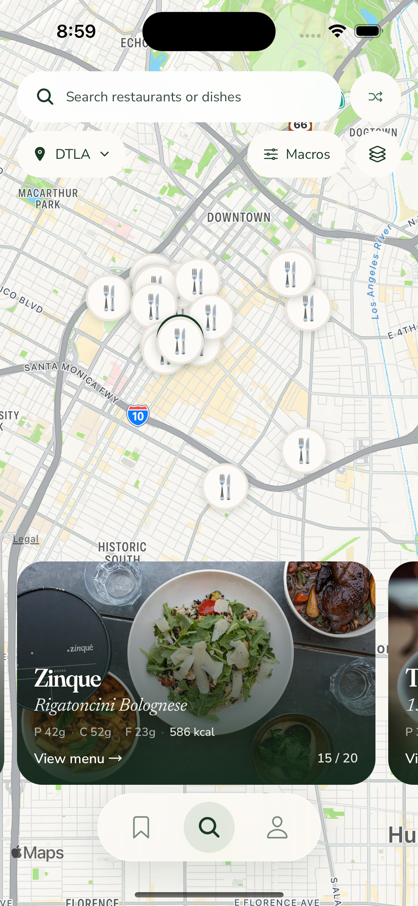
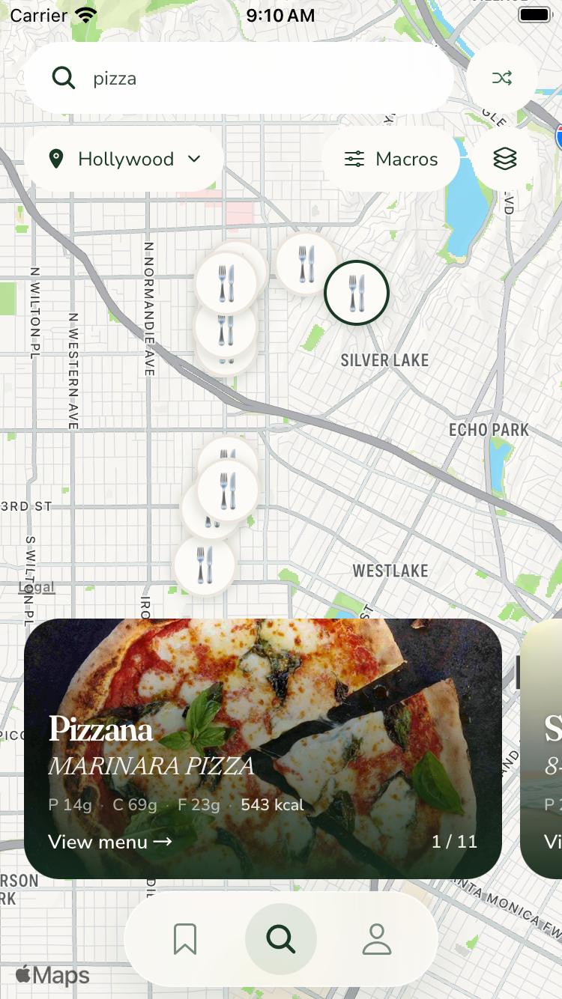
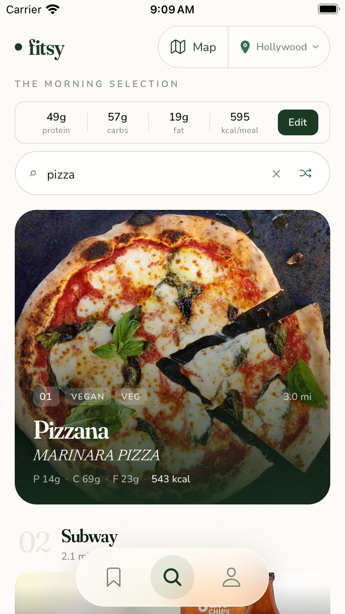
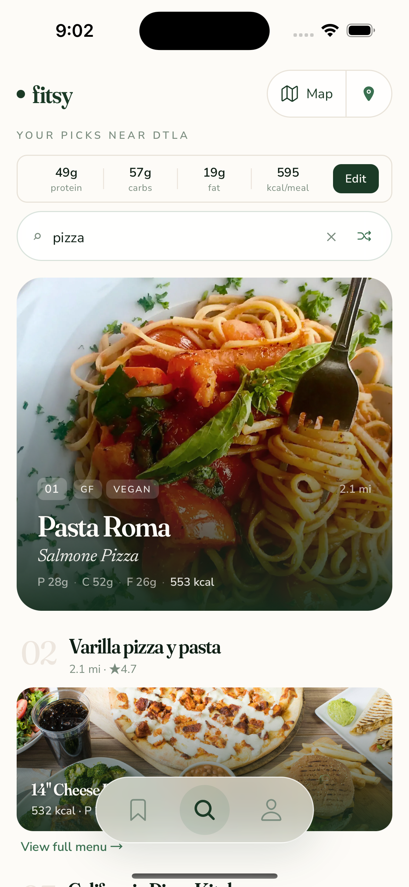
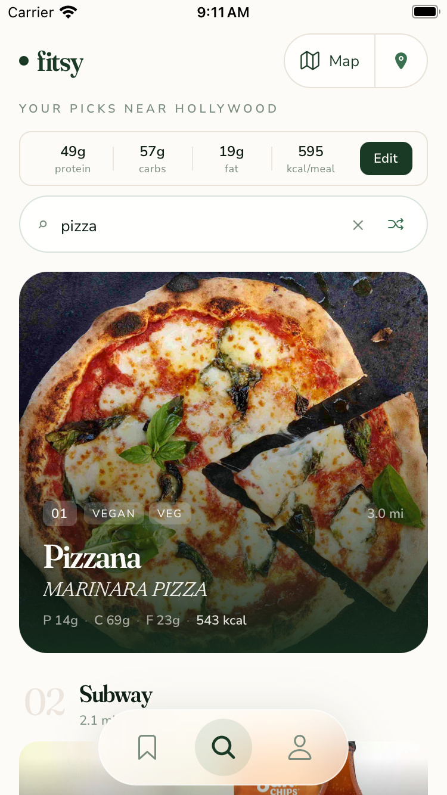

**TL;DR:** C alternate now shows Macros and real meal content, with two integrated Map/location list treatments.

Dawit selected C alternate in [#755](https://github.com/dgmolla/fitsy/issues/755), continuing [#753 / draft #754](https://github.com/dgmolla/fitsy/pull/754).
The code calls this direction G; the compact editor chip is now labeled Macros.
The layout choice is resolved for [#746](https://github.com/dgmolla/fitsy/issues/746#issuecomment-6709706193), while pin preference and production availability remain separate.
This gallery keeps the current navigation and the dev-only `mapDebug=1` gate.

The map and legacy Search now use the same meal-content renderer: restaurant name, actual `bestMatch` dish and its protein, carbohydrate, fat and calorie fields.
Locked or missing meals retain their existing states instead of fabricated values.
Full-photo backgrounds, readable overlays, menu navigation and C's borderless treatment remain.

| Chosen map | iPhone 15 | iPhone SE |
| --- | --- | --- |
| C alternate with Macros |  |  |

Both list directions integrate Map into the existing location-control position without adding a row.
Search uses the installed blur surface with a stable white tint when idle, focused and submitted.
The keyboard retains native Enter submission and the focused border remains readable.

| List treatment | Tradeoff | iPhone 15 | iPhone SE |
| --- | --- | --- | --- |
| 1: Map + area | Recommended for explicit location discoverability; the area and Map each have a named action in one capsule. |  |  |
| 2: Compact Map + location icon | Gives Map more emphasis and keeps the area in the existing subtitle; the location icon is less explicit. |  |  |

The recommendation is a prototype comparison, not production rollout approval.
Focused search is captured for [List 1 normal](normal-list-1-split-focused.png), [List 1 small](small-list-1-split-focused.png), [List 2 normal](normal-list-2-compact-focused.png) and [List 2 small](small-list-2-compact-focused.png).
The small captures include the software keyboard; the Map/location control remains reachable and the floating navigation yields to it.

Actual UI observations on both sizes confirmed search to list, visible meal macros, native Enter, return to map with the query retained, location changing, Macros editing and real restaurant-menu navigation.
On the normal device the selected Zinque pin, card and counter agreed; on the small device Pizzana pin 0, preview and counter 1/11 agreed, and its menu showed the same MARINARA PIZZA and 14g protein, 69g carbohydrate, 23g fat and 543 kcal.
Changing protein from 49g to 54g changed the meal target from 595 to 615 kcal and persisted on reopening; it was then restored.
With location denied on the small device, the actual fallback was disclosed as Silver Lake, and the compact location action still selected Hollywood and returned to the map with the query intact.
B's retained empty-state recovery was also checked on the small device: both actions fit above navigation, and Clear search restored a full-photo Burrito King card with its actual Asada Bowl and macros.
These are observed native UI outcomes, not a passing automated native suite.

The content audit found that the preceding visual revision reused the legacy photograph and gradient but kept a separate restaurant-only metadata renderer.
Dish and macro content is a new explicit refinement in #755, so the earlier visual evidence remains valid for its original scope.
Sharing `HeroMealContent` now keeps both callers on the maintained data and locked-state contract, with unequal meal values exercised through the real rendered map/list caller.
The dynamic native-flow consumer retains Enter, list results/macros and explicit return-to-map selection assertions.
The small picker observation also showed DTLA below the visible rows, so both maintained list journeys now use the existing centered-scroll pattern and immediately assert the selected area.
Those updated automated steps remain unexecuted while the retained XCTest boundary is unresolved.

All ten images are unedited original PNGs from app source `0adba31bf3567f45f12b0def3ebdb89f29fd9ff7`.
The [manifest](capture-manifest.json) records each capture time, device, dimensions, bytes, PNG hash, JavaScript input hash, served-bundle readback, native identity and installed app hash.
The originals and identical manifest remain at `/Users/dawitmolla/fitsy-wt/issue-755-evidence/chosen-c-0adba31b/` for direct chat attachment outside the disposable checkout.
Live results differ between captures; no ranking or nutrition data was invented for the comparison.

The [full-photo gallery](../v2-full-photo/README.md), [original v2 gallery](../v2/README.md) and [#748 gallery](../README.md) remain historical source-bound evidence.
The current issue and PR record fresh checks and the complete independent verdict separately from those old results.
The actual native plan still selects 28 flows, with the prior XCTest hierarchy stall and unavailable real Apple-history prerequisite unresolved.
No unchanged failed setup was retried, no old waiver was transferred, and no new production feature or release is claimed.
