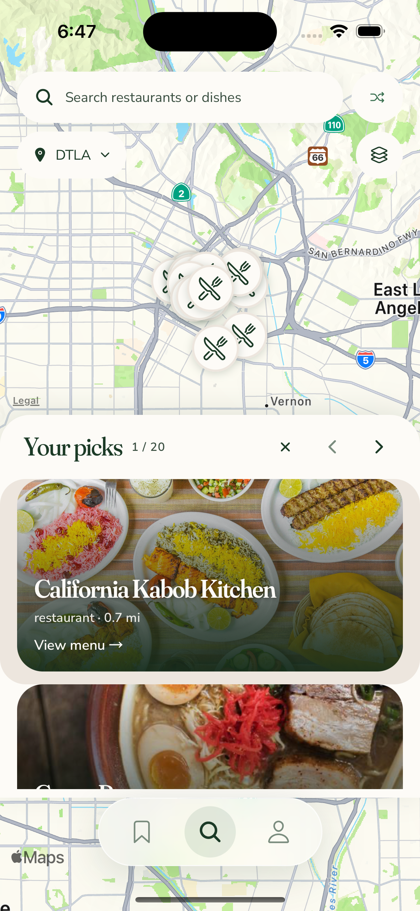
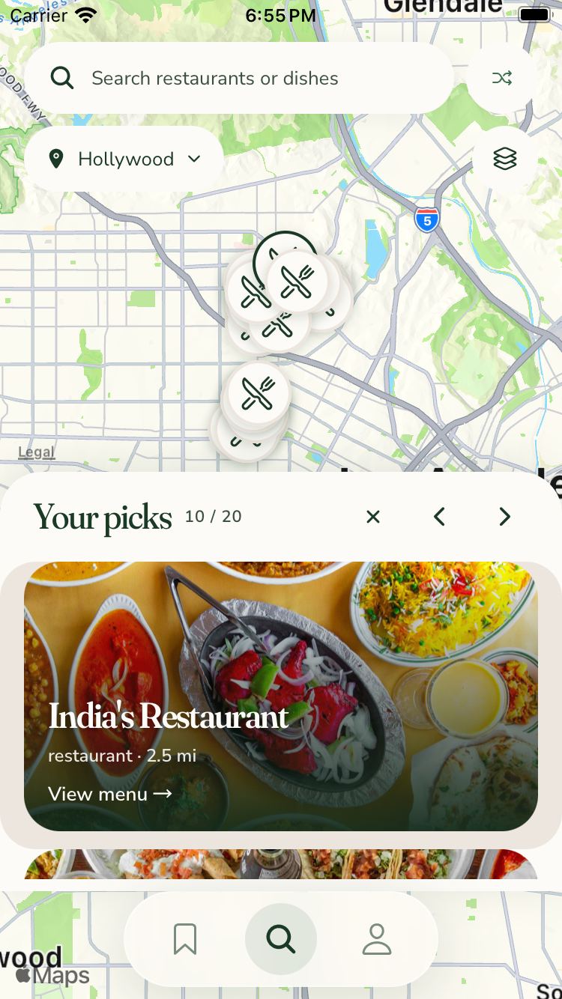
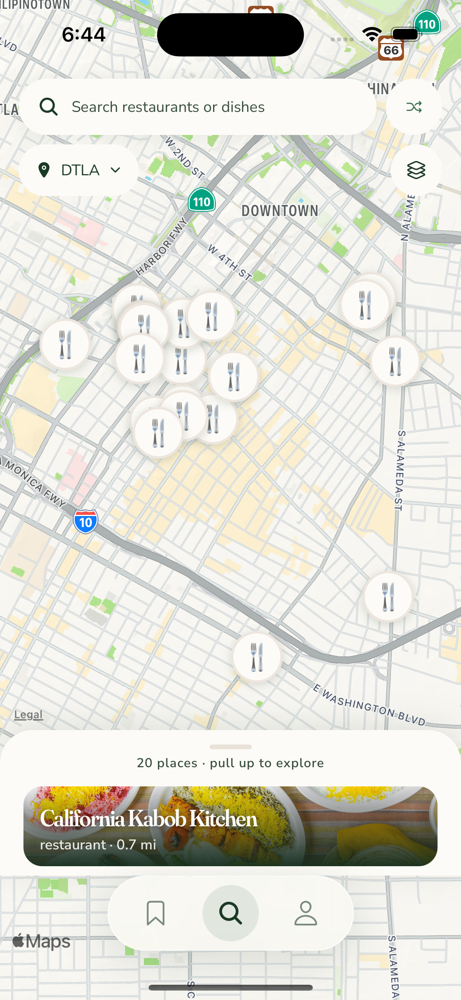
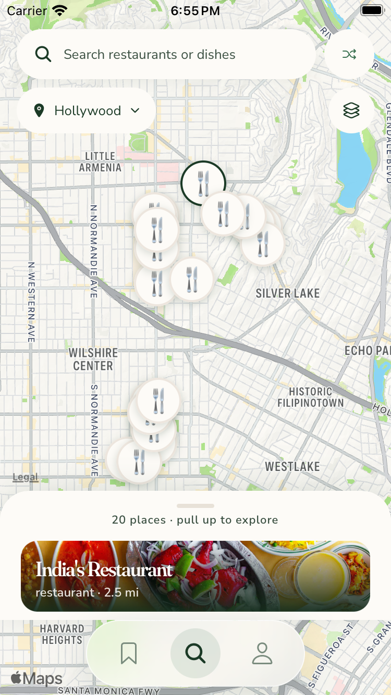
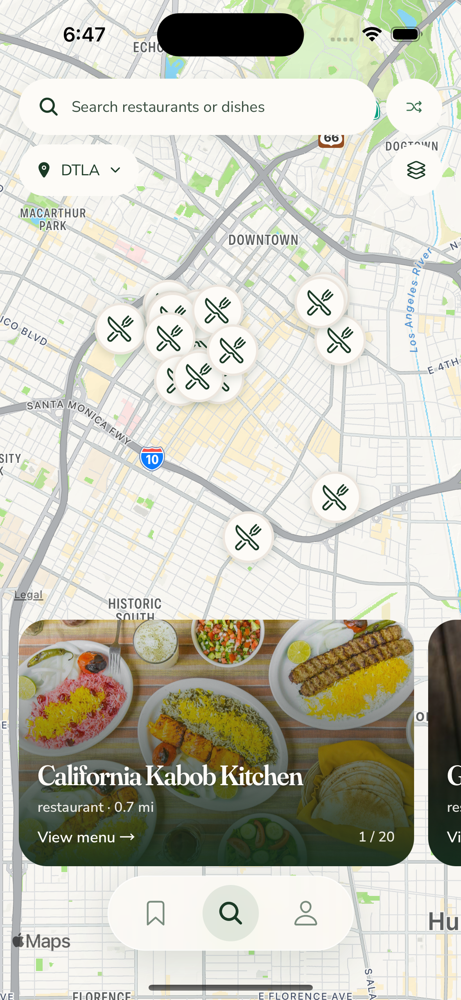
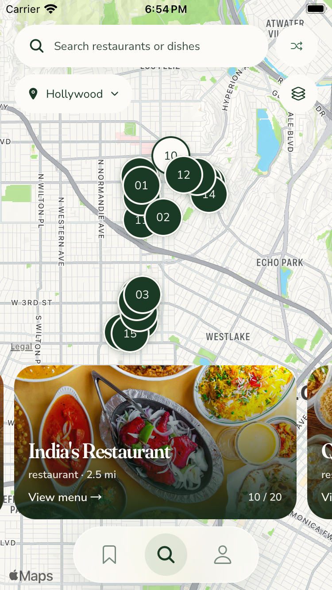
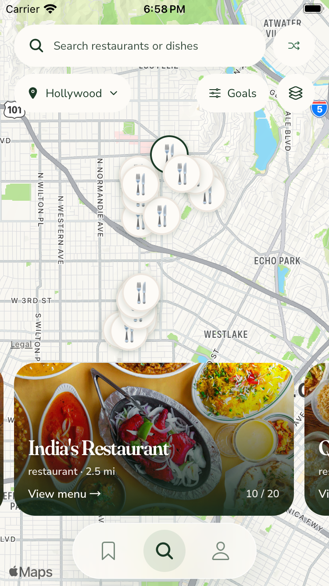
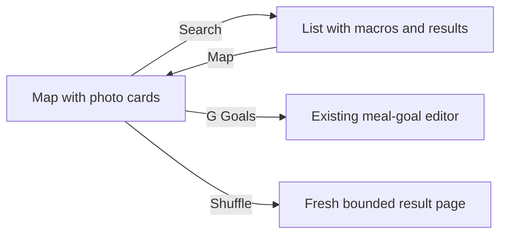

**TL;DR:** Four dev-only directions now use full-photo restaurant cards with readable legacy Search overlays.

These are the November 6 full-photo revisions for [#753 / draft #754](https://github.com/dgmolla/fitsy/pull/754), on main `195d5a60` with current navigation.
The [original v2 gallery at f0300765](https://github.com/dgmolla/fitsy/blob/f0300765f965755f0851dbc33c8593eb9d8224df/docs/design/map-tray-pocs/v2/README.md) and [blocked #748 gallery](https://github.com/dgmolla/fitsy/blob/73274c1eb18ce249935375447691d4b093ec0276/docs/design/map-tray-pocs/README.md) remain historical evidence.
[#746](https://github.com/dgmolla/fitsy/issues/746) still awaits Dawit's explicit layout and pin choice; no production design is selected or enabled.

Every restaurant preview in A/B/C/G uses the main restaurant picture across the whole card, with the existing Search gradient, typography and text overlay.
The photo remains the menu hit target, and C/G have no green card border, nearby strip or macro pills.
The images below are original Simulator PNGs, also retained outside the checkout for direct chat attachments.

| Direction | Compare | iPhone 15 | iPhone SE |
| --- | --- | --- | --- |
| A: Map + list | A short tray exposes photo rows; search reveals macros. |  |  |
| B: Slim sheet | Thin photo Peek leaves the most map; Half shows rows and Full adds macros. |  |  |
| C: Search to list | A borderless photo carousel keeps the map clear; search opens the usual list. |  |  |
| G: Quick goals | C plus one compact Goals button that opens the editor directly. |  |  |

[C search with native Enter, results and macros](normal-c-search-list-macros.png) hides the map.
[The explicit return to map](normal-c-search-pin-selection.png) preserves the query and synchronizes the actually tapped pin with its photo card.
G opens the same editor on [normal](normal-g-goals-editor.png) and [small](small-g-goals-editor.png) screens without entering list mode.
Shuffle, result limits, API radius and `tracksViewChanges={false}` after paint are retained.

Utensils emoji and the installed Ionicons `restaurant-outline` are two alternatives beyond numbered circles.
Cuisine mode reads existing category fields and falls back to utensils when the provider supplies only generic `restaurant` tags, as in these captures.
The icon comes from installed `@expo/vector-icons` 15.1.1 / Ionicons under MIT; no new dependency, artwork, custom path or external icon research was added.
Dense clusters can still overlap one another; the larger C/G/Peek map gives them more room.

B's status content now sizes to its content instead of inheriting the fixed 124-point restaurant Peek height.
Both recovery actions were exercised through the real UI after an empty successful search response.
Normal-device Adjust and Clear bounds end at y670 and y722, above navigation at y746; small-device bounds end at y519 and y571, above navigation at y595.
The [normal empty panel](normal-b-empty.png) and [small empty panel](small-b-empty.png) recover to [normal results](normal-b-empty-recovered.png) and [small results](small-b-empty-recovered.png).

Final-row continuity was checked through the actual Next control and all three detents, including the visible restaurant name rather than only the counter.
Normal [Full](normal-b-full-final-row.png), [Peek](normal-b-peek-final-row.png) and [Half](normal-b-half-final-row.png) retain George's Greek Grill and selected pin 19, with 20/20 in the expanded states.
Small [Full](small-b-full-final-row.png), [Peek](small-b-peek-final-row.png) and [Half](small-b-half-final-row.png) retain Kimbap Paradise with the same agreement.
The small-device denied-location journey also chose the settled Hollywood picker row, immediately confirmed the area, and tapped an unobstructed pin to open its matching preview.

These 24 captures prove the observed Debug UI states, not a passing automated native scope or a production rollout.
The repaired Saved caller separately passed 54 native commands before the card revision; the final-source XCTest setup then stalled in hierarchy inspection before login and was stopped by the existing inactivity guard.
The actual impact plan still selects 28 flows, including the unavailable real Apple-history prerequisite, with no waiver transferred from another issue.
The [issue](https://github.com/dgmolla/fitsy/issues/753) and [PR](https://github.com/dgmolla/fitsy/pull/754) hold current checks, the complete independent review and remaining acceptance boundaries.
The [capture manifest](capture-manifest.json) records source `bbeae80f`, exact JavaScript/native/app/bundle hashes, unedited PNG hashes and pixel dimensions.
Live restaurant results differ between captures; compare layout rather than ranking.
