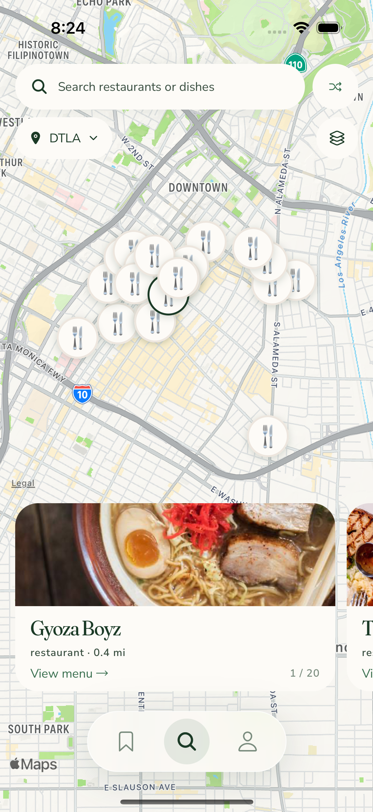
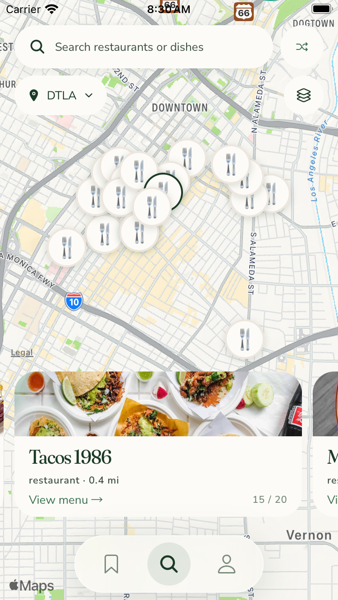
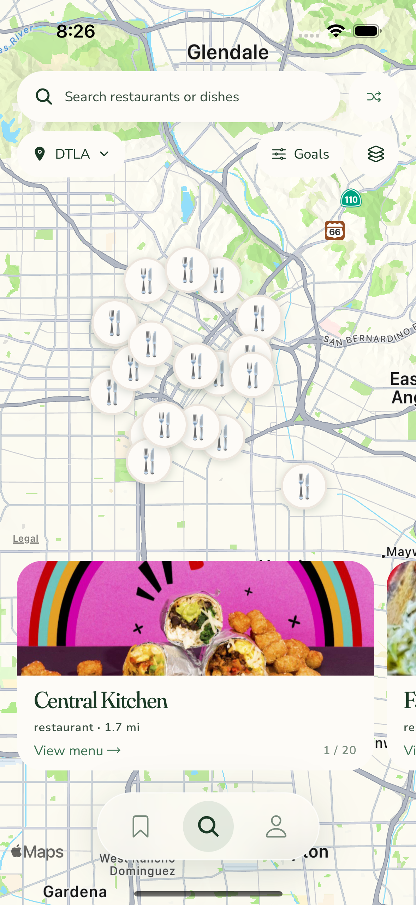
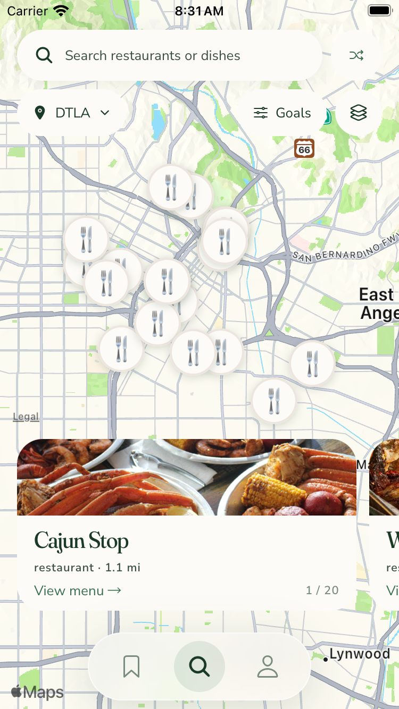
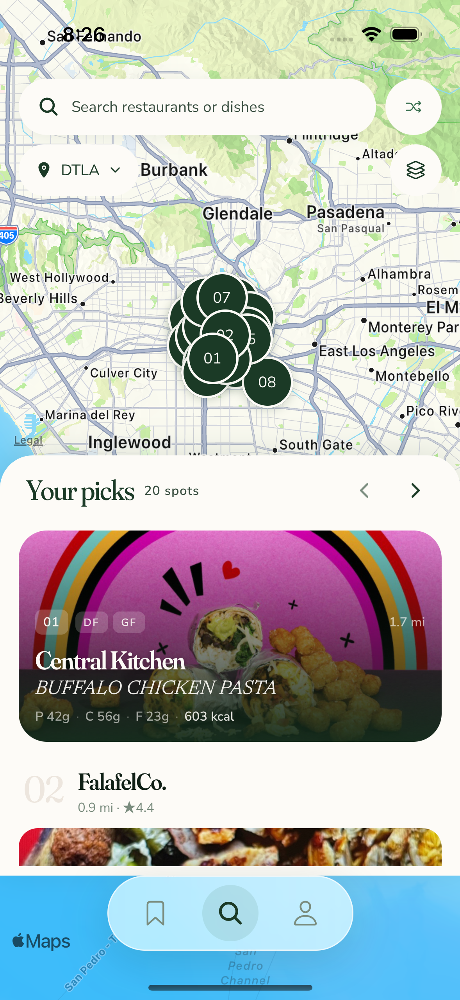
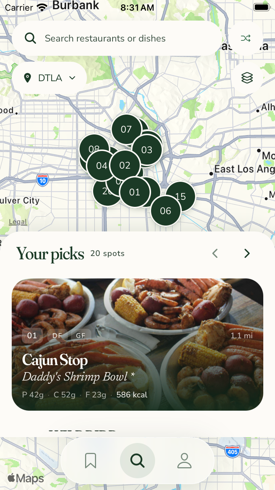
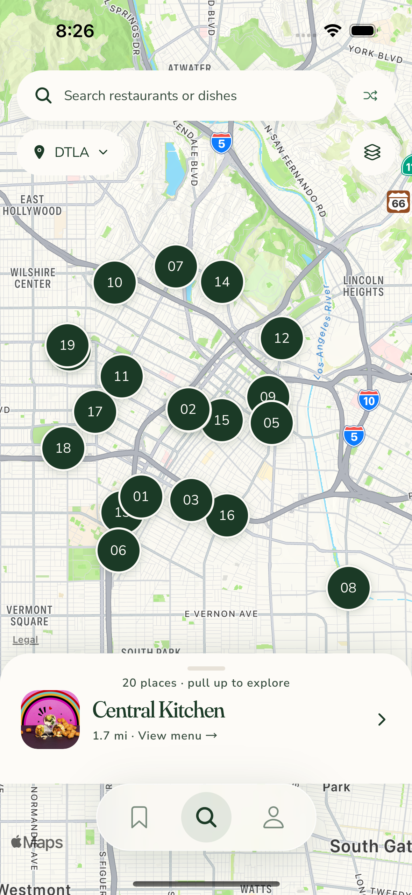
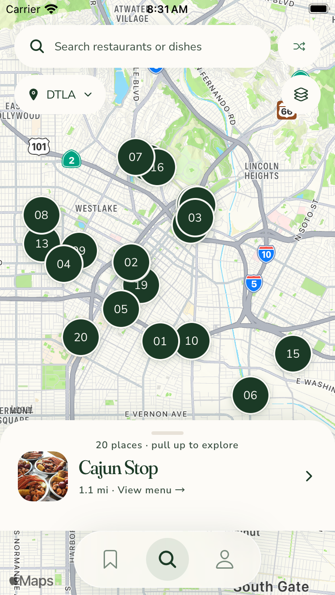

**TL;DR:** Four dev-only directions remove macro chrome and compare clearer paths to goals, lists, and menus.

This is the successor to the [blocked original gallery](../README.md), restacked onto main `195d5a603be56a581bbd40b2fd144df8a5fdc608` before visual changes.
The original README and 14 PNGs remain unchanged; #748 and draft #751 remain blocked.
[#753](https://github.com/dgmolla/fitsy/issues/753) owns this separate iteration and its verification history.
[#746](https://github.com/dgmolla/fitsy/issues/746) still awaits Dawit's explicit future pick; no production design has been selected or enabled.

Open `com.fitsy.mobile://search?mapDebug=1&shuffleDebug=1&floatingNavDebug=1&mapTray=C&mapPin=utensils` in the configured Debug iOS app.
The layers button switches layout and pin style without changing Discovery's query or meal targets.

| Direction | What changed | Tradeoff to compare |
| --- | --- | --- |
| C: Search to list | No macro pills, nearby strip or green card border; Search hides the map and opens the ordinary list with macros. | Cleanest map, but editing goals requires discovering the search/list path. |
| G: Quick goals | C plus one compact Goals control opening the existing editor directly over the map. | Clearer macro discovery for one additional control. |
| A: Map + list | Shorter tray with existing food cards and no macro controls on the map. | Nutrition is visible at rest; the remaining map shows a tighter cluster. |
| B: Slim sheet | Thin Peek with one restaurant; Half shows the list; Full adds the macro strip. | Most map at rest, with more interaction and less map in Full. |

| Direction | iPhone 15 | iPhone SE |
| --- | --- | --- |
| C |  |  |
| G |  |  |
| A |  |  |
| B Peek |  |  |

[Search → list with macros](search-list-macros.png) and [B Full with macros](b-full-macros.png) show the two expanded editing contexts.
Shuffle stays on the map and replaces the current bounded restaurant page through the existing API.
The current floating navigation is visible in every direction.

| Pin treatment | Capture and source |
| --- | --- |
| Utensils | 🍴 on a neutral marker, visible in C and G above; existing Unicode emoji rendered by iOS. |
| Cuisine | [Dynamic category pass](pins-cuisine.png); uses existing cuisine tags, with 🍴 when tags are generic or unknown. |
| Icon | [Installed restaurant-outline](pins-icon.png), from Ionicons in [@expo/vector-icons](https://github.com/expo/vector-icons) 15.1.1, MIT. |
| Numbers | [Numbered baseline](pins-numbered.png) for comparison. |

The live DEV provider returned generic `restaurant` tags in the cuisine capture, so it honestly shows the fallback rather than invented cuisine data.
The installed icon and utensils are two visibly different alternatives beyond numbers; no dependency, custom icon path, generated artwork or external icon research was added.
Dense restaurant clusters still overlap, especially with an expanded tray; compare the pins in the larger C/G/Peek map area.
Pins remain a subset of current results, settle `tracksViewChanges` to false after paint, and map movement does not fetch another page.

Both complete maintained `map-search` journeys passed on iPhone 15 and iPhone SE: 219 completed commands each, plus two conditional skips and two optional warnings.
That includes search/list/macros, G Goals, detail return, unchanged area and query, Shuffle, all four layouts, pin treatments, carousel scrolling and B's actual final-row retention.
The [Full](b-full-last.png), [Peek](b-peek-last.png), [Half](b-half-last.png), and [small Half](small-b-half-last.png) captures keep restaurant 20 and its focused pin aligned; [real scrolling](b-user-scroll.png) then moves selection to the visible leading row.
The separate denied-location journey passed 62 commands, including [the pin after Hollywood selection](denied-area-pin.png) and [search with that area retained](denied-search.png).
Its final hierarchy measured 11 pin hit bounds entirely between the controls and tray, with zero obscured by either overlay.

These are scoped Debug Simulator results, not a passing full native suite, Release acceptance, performance benchmark or production rollout.
The actual impact plan selects 28 flows and includes the separately deferred real Apple-history prerequisite; issue #753 records the exact full-run and CI disposition.
The original failed reproductions, repair attempts and native identities remain private under `~/fitsy-wt/issue-753-evidence/`.
All gallery PNGs are unedited Simulator captures from iOS 17.5: iPhone 15 at 393 × 852 points and iPhone SE at 375 × 667 points.
Live results and Shuffle order differ; compare layout rather than restaurant ranking.
The [capture manifest](capture-manifest.json) records original pixel sizes, SHA-256 digests, runtime source hashes, native app identity and the exact served Debug bundle.
