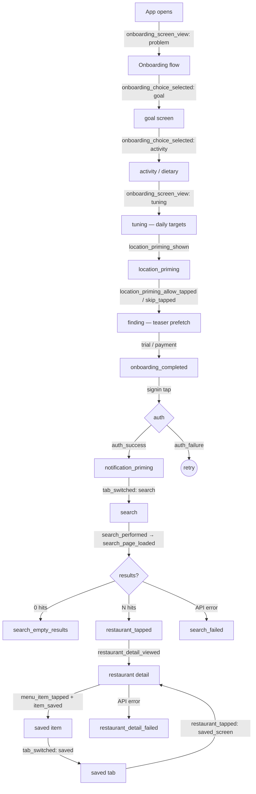

# Analytics event taxonomy

Launch contract updated: 2026-11-05 (#735).

The runtime contract lives in `apps/mobile/lib/analytics.ts` and `analyticsPrivacy.ts`.
The [dated audit](launch-analytics-audit.md) inventories the current callers and which legacy taxonomy fields are filtered out.
The launch contract below supersedes older table entries where they differ.
Names use `snake_case`; unknown properties, precise location, IP, nutrition, free text and nested objects remain denied.
The final sanitizer always supplies the non-identifying `$ip=0.0.0.0` placeholder and `$geoip_disable=true`, including identity events.
Omitting `$ip` alone lets PostHog [populate it from the capture connection](https://posthog.com/tutorials/web-redact-properties#hiding-customer-ip-address); GeoIP disabling alone does not prevent that IP enrichment.
Caller-supplied IP addresses never pass through, and no project-wide privacy setting is changed.

## Launch measurement contract

No new custom event name is needed for #735.
Every accepted capture, including SDK identity updates, carries `analytics_contract=1`, `distribution_channel`, `$internal_or_test_user` and `la_cohort` through the final privacy filter.
The boolean fields accept only actual booleans; the channel accepts only `development`, `testflight`, `production` or `unknown`.

| Gap | Contract | Limitation |
| --- | --- | --- |
| Staff/test exclusion | DEV/preview API origins, Debug/Metro/development distributions, the existing review account, `app_metadata.fitsy_internal_or_test=true`, or a dev-only test-account control mark the person `$internal_or_test_user=true`. | TestFlight by itself is not an internal account; existing staff must choose exclusion or receive the explicit administrator metadata through an authorized account-management process. |
| Distribution | Debug/Metro is `development`; otherwise the configured Expo Update channel supplies `testflight` or `production`; preview/e2e/development channels are `development`; unrecognized channels are `unknown`. | This records deployment configuration, not an independently attested installation source; historical builds cannot be relabeled from their `kind` value. |
| Meaningful use | `restaurant_detail_viewed` includes boolean `unlocked` and `has_macros` after the focused, loaded menu passes its access guards; `menu_item_tapped` includes `unlocked`. | An unlocked menu containing macros is an activity proxy, not proof of reading every item or eating a meal. |
| Save continuation | `item_saved`, `action=save`, `entry_point=purchase_continuation` fires after the existing post-purchase save succeeds. | An already-known bookmark, failed save or unsave is not a newly completed save. |
| LA cohort | The app's MVP scope is LA-only (`apps/mobile/lib/locations.ts`) - every resolvable search area is LA, so `la_cohort=true` is derived automatically for every identified, non-internal/test account. There is no self-report opt-in. | This is a forward-compatible cohort label, not evidence of real engagement; it needs a real area-based check before any non-LA city ships. |
| Identity | The Supabase account UUID is the distinct ID on initial sign-in, token refresh and user updates; direct account switches and sign-out clear the previous SDK identity. | Two different provider accounts are not automatically merged; genuine physical-device continuity and adopted customer behavior need separate observation. |

Test-account exclusion is intentionally one-way for an account.
The app never sends `$internal_or_test_user=false` as a person update, so another device cannot silently remove a known test classification.
An excluded account can still exercise menu journeys for controlled evidence.
No production account metadata is backfilled by this change, and previously retained private properties are not erased.
Any historical data cleanup remains separately owned and authorized.

The dev-only exclusion write uses the authenticated Supabase user endpoint with the initiating account's captured token, then refreshes the persisted session and analytics identity.
A concurrent account switch cannot retarget the write to the new account.
An already-running second device receives account metadata on its next auth refresh.
Neither LA cohort nor internal/test metadata grants application access or entitlement.

The existing `kind` on `subscription_check` and `client_error` retains #605's monitoring meaning.
Launch SQL must use `distribution_channel` instead of excluding `kind=development`, which also labels TestFlight monitoring traffic.
The existing weekly scoreboard remains an all-event operational measure and is not the qualified LA launch metric.

### Default launch SQL filters

PostHog [internal-user filtering](https://posthog.com/tutorials/filter-internal-users) requires explicit SQL exclusion.
Do not rely on a project toggle or infer staff eligibility from email or subscription status.
Use both the cohort and direct person/event booleans so a cohort refresh delay cannot admit a known test event.
PostHog documents [daily dynamic-cohort recalculation](https://posthog.com/docs/data/cohorts#how-often-are-dynamic-cohorts-updated); direct booleans take effect without waiting for that refresh.
The `la_cohort` checks below stay in the query for forward compatibility with a non-LA city; in the current LA-only MVP every identified, non-internal account already satisfies them.
Missing contract, channel or access fields are ineligible.

```sql
-- Two completed Monday-Sunday weeks in Los Angeles; named timezone handles DST.
-- Counts distinct LA calendar days, never sessions or raw event totals.
WITH toStartOfWeek(toDate(toTimeZone(now(), 'America/Los_Angeles')), 1) AS week_end
SELECT count() AS meaningful_people,
       countIf(qualifying_weeks = 2) AS active_two_days_each_week
FROM (
  SELECT person_id, countIf(active_days >= 2) AS qualifying_weeks
  FROM (
    SELECT person_id,
           toStartOfWeek(toDate(toTimeZone(timestamp, 'America/Los_Angeles')), 1) AS la_week,
           uniqExact(toDate(toTimeZone(timestamp, 'America/Los_Angeles'))) AS active_days
    FROM events
    WHERE timestamp >= now() - INTERVAL 22 DAY
      AND toDate(toTimeZone(timestamp, 'America/Los_Angeles')) >= week_end - INTERVAL 14 DAY
      AND toDate(toTimeZone(timestamp, 'America/Los_Angeles')) < week_end
      AND properties.analytics_contract = 1
      AND properties.distribution_channel IN ('testflight', 'production')
      AND properties.$internal_or_test_user = false
      AND coalesce(person.properties.$internal_or_test_user, false) = false
      AND person_id NOT IN COHORT 233968
      AND properties.la_cohort = true AND person.properties.la_cohort = true
      AND ((event = 'restaurant_detail_viewed' AND properties.unlocked = true AND properties.has_macros = true)
           OR (event = 'item_saved' AND properties.action = 'save'))
    GROUP BY person_id, la_week
  )
  GROUP BY person_id
)
```

The query cannot demonstrate two completed eligible weeks until the contract is adopted and those weeks have elapsed.
The #735 worker owns controlled emission and insight setup; the launch owner owns real LA participant enrollment and the first completed-week interpretation after deployment.
Saved insight and measured execution receipts belong in the audit follow-up and issue/PR proof.
Project-wide defaults, existing insight rewrites, feature flags, paid add-ons and retained-data deletion are outside this change.

If you add an event, update three places in lockstep:
1. add a `track*` helper in `apps/mobile/lib/analytics.ts`,
2. add a test in `apps/mobile/lib/analytics.test.ts`,
3. add a row to the relevant table below.

PostHog ingestion config (S-222 baseline): `flushAt: 1`, `flushInterval: 5000`.
Events should land in PostHog within ~5 seconds during the pre-launch period;
revert to defaults (`flushAt: 20`, `flushInterval: 30000`) before public
launch — frequent flushes increase battery use.

## Funnel diagram



Each labelled edge is the event that fires at that transition. Drop-off
between any two edges is measurable as a PostHog funnel step.

## Identity

| Event | When | Properties | Question it answers |
|-------|------|------------|---------------------|
| `$identify` / `$set` (via `identifyAnalyticsUser`) | Account sign-in, refresh or metadata update | `email?`, `la_cohort`, `$internal_or_test_user=true?` | Stitch the same account and apply the LA-cohort label and test classification; nutrition and other person fields remain denied |
| SDK reset (via `resetAnalyticsSession`) | Sign-out or account switch | no captured `$reset` event | Drop the previous identity from subsequent activity |

## Onboarding

| Event | When | Properties | Question it answers |
|-------|------|------------|---------------------|
| `onboarding_screen_view` | On mount of every `app/welcome/*` screen | `screen_name: string` | Per-step drop-off across the 15-screen onboarding |
| `onboarding_choice_selected` | User picks an option on `goal`, `activity`, or `dietary` | `screen: string`, `value: string` | Which goals / activity levels / dietary tags do testers actually pick? |
| `onboarding_completed` | Tap "Start Free Trial" on `payment` | `goal?`, `activity_level?`, `has_weight: boolean`, `has_height: boolean` | Conversion: of those who started, how many completed onboarding? |

### Onboarding API failures (S-221)

| Event | When | Properties | Question it answers |
|-------|------|------------|---------------------|
| `stats_fetch_failed` | `/api/stats` errors during `data-scale` | `error_message?` | Frequency of stats endpoint failures during onboarding |
| `preview_fetch_failed` | `/api/restaurants` preview call errors during `finding` / `results` | `error_message?` | Frequency of preview endpoint failures |
| `save_macro_targets_failed` | AsyncStorage write fails persisting macro targets | `error_message?` | Frequency of macro persistence failures (linked to retry dialog) |

## Auth

| Event | When | Properties | Question it answers |
|-------|------|------------|---------------------|
| `auth_success` | `/api/auth/*` returns a session for Apple / Google / dev login | `provider: 'apple' \| 'google' \| 'dev'`, `is_new_user: boolean` | New-user vs returning-user split per provider |
| `auth_failure` | Any auth provider call rejects (excluding user cancellation) | `provider`, `error_message?` | Reliability of each auth path |

## Session (S-228)

| Event | When | Properties | Question it answers |
|-------|------|------------|---------------------|
| `session_refreshed` | Supabase `onAuthStateChange` rotates the access token | `user_id: string` | Background refresh frequency / token TTL |
| `session_refresh_failed` | Refresh token rejected → SIGNED_OUT | `user_id: string` | Forced-logout rate — refresh-token reuse / expiry frequency |

## Location (S-224, S-225, S-227)

| Event | When | Properties | Question it answers |
|-------|------|------------|---------------------|
| `location_permission_denied` | `useLocation` falls back from a denied OS permission | `had_last_known: boolean` | Permission denial rate; whether we still served a usable last-known location |
| `location_timeout` | `useLocation` GPS lookup exceeds the timeout | `had_last_known: boolean` | Slow-GPS rate per platform |
| `location_error` | GPS lookup throws (catch-all) | `error_message?` | Rare iOS/Android GPS errors |
| `location_manual_override_opened` | User taps the location chip in the search masthead | none | Discoverability of the manual-override sheet |
| `location_manual_override_picked` | User chooses a preset neighborhood | `neighborhood: string` | Which presets get used; whether we need more |
| `location_manual_override_cleared` | User taps "Use current location" | none | How often manual users return to GPS |

### Notification priming (S-226b)

| Event | When | Properties | Question it answers |
|-------|------|------------|---------------------|
| `notification_priming_shown` | Mount of `welcome/notification-permission` | none | Reach of the priming screen |
| `notification_priming_allow_tapped` | User taps "Allow notifications" | none | Click-through rate to the OS dialog |
| `notification_priming_skip_tapped` | User taps "Skip" | none | Skip rate at the priming step |
| `notification_permission_granted` | OS dialog returns `granted` | none | Permission opt-in conversion |
| `notification_permission_denied` | OS dialog returns `denied` | none | Permission opt-out rate |

## Tab navigation (S-222)

| Event | When | Properties | Question it answers |
|-------|------|------------|---------------------|
| `tab_switched` | User taps a tab in the bottom bar | `tab: 'saved' \| 'search' \| 'profile'`, `from_tab: TabId \| null` | Top-level engagement: which tabs do users actually visit? |

## Search (S-230, S-222)

| Event | When | Properties | Question it answers |
|-------|------|------------|---------------------|
| `search_performed` | `/api/restaurants` first-page request resolves (success or error) | `has_protein_target`, `has_carbs_target`, `has_fat_target`, `has_calories_target`, `cuisine_filter`, `result_count`, `location_source`, `success` | Search volume, target/cuisine combos, success rate |
| `search_page_loaded` | Each page (initial + paginated) lands | `page_index`, `result_count`, `cursor: string \| null` | Pagination depth distribution |
| `search_pagination_end_reached` | `nextCursor` flips to null | `total_results`, `pages_loaded` | How often do users exhaust the result set? |
| `search_empty_results` | Search succeeded but returned 0 rows | `cuisine_filter`, `has_protein_target`, `has_carbs_target`, `has_fat_target`, `has_calories_target` | Filter-too-aggressive rate (distinct from network failures) |
| `search_failed` | `/api/restaurants` throws / errors | `cuisine_filter`, `error_message?` | Search-API reliability |
| `cuisine_selected` | User taps a cuisine chip in the search masthead | `cuisine: string` | Which cuisines drive engagement |
| `macro_targets_edited` | User applies the FilterPopup (search or profile) | `entry_point: 'search' \| 'profile'`, `has_protein`, `has_carbs`, `has_fat`, `has_calories` | How often do users actually tune macros after onboarding? |

## Restaurant detail (S-229, S-222)

| Event | When | Properties | Question it answers |
|-------|------|------------|---------------------|
| `restaurant_tapped` | User taps a restaurant card | `restaurant_id`, `restaurant_name`, `position`, `entry_point: 'hero' \| 'dish_card' \| 'section' \| 'saved_screen'`, `best_match_calories?` | Click-through rate by entry surface / list position |
| `restaurant_detail_viewed` | Focused menu finishes loading and passes UI access guards | `restaurant_id`, `item_count`, `unlocked`, `has_macros` | Separate unlocked menu exploration from locked samples and empty/macro-less menus |
| `restaurant_detail_failed` | `fetchMenu` returns null (network or non-2xx) | `restaurant_id`, `error_message?` | Detail-API reliability |
| `menu_search_typed` | User types in the menu search input (throttled: emit on first/clear/every 5 chars) | `query_length: number` | Whether menu search is discoverable & used |
| `menu_filter_chip_toggled` | User taps a filter chip on the detail screen | `chip: string`, `on: boolean` | Which dietary / macro chips drive filtering |
| `menu_sort_changed` | User picks a sort option | `sort: string` | Match vs Protein vs Calories vs Price preference |
| `menu_item_tapped` | User taps a menu item card | `menu_item_id`, `restaurant_id`, `position`, `unlocked` | Separate locked teaser taps from unlocked item engagement |

## Saving items

| Event | When | Properties | Question it answers |
|-------|------|------------|---------------------|
| `item_saved` | `/api/saved-items` create or delete succeeds, including a purchase continuation | `menu_item_id`, `restaurant_id`, `action: 'save' \| 'unsave'`, `entry_point: 'restaurant_detail' \| 'saved_screen' \| 'purchase_continuation'` | Completed saves by initiating surface |
| `save_failed` | `/api/saved-items` create or delete fails | `menu_item_id`, `restaurant_id`, `action`, `entry_point`, `error_message?` | Save-API reliability |

## Profile (S-222)

| Event | When | Properties | Question it answers |
|-------|------|------------|---------------------|
| `profile_field_edited` | User taps any editable stat in profile | `field: 'goal' \| 'activity' \| 'height' \| 'weight' \| 'age'` | Which fields get adjusted post-onboarding? |
| `profile_logout_tapped` | User taps "Log out" | none | Explicit-logout rate (vs forced-logout via session_refresh_failed) |
| `profile_account_deleted` | `DELETE /api/user` resolves | `success: boolean` | Account-deletion volume + delete-API reliability |

## Naming conventions

- Event names: `snake_case`, verb-led where possible
  (`restaurant_tapped`, `search_performed`, `save_failed`).
- Property names: `snake_case`. Booleans use `has_*` or `is_*` prefixes.
- `entry_point` is reserved for events that fire from multiple surfaces:
  use it whenever the same logical action can be reached from more than
  one screen, so funnels can split by surface without re-deriving from
  screen-view sequences.
- Failure events end in `_failed` (e.g. `auth_failure` is the historical
  exception kept for backward compatibility — do not rename).
- Screen-view events use `_view` (singular) for the legacy
  `onboarding_screen_view` pattern; new ones should use `_viewed` (past
  tense) — see `restaurant_detail_viewed`.

## History

The original S-102 baseline (2026-04-08) defined 5 events: `search_performed`, `restaurant_tapped`, `restaurant_detail_viewed`, `item_saved`, and `$identify`. That spec is archived at `docs/engineering/archive/posthog-analytics-spec.md`.

Sprint 12 (ending 2026-05-09) extended the taxonomy to 30+ events covering onboarding, auth, session refresh, location, notification priming, tab navigation, search pagination, restaurant detail interactions, and saving — the full set documented in this file.

## Out of scope

- Paywall events ship with S-217 (subscription gating). Don't pre-instrument here.
- This doc tracks the mobile client; backend events (Vercel logs) live in `docs/engineering/backend/`.
