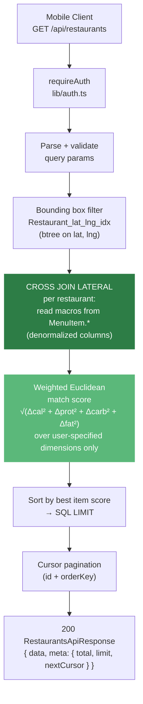

# API Reference

> **Status:** living · **Last verified:** 2026-06-12

Merged reference for all Fitsy API routes. Supersedes the archived `api-endpoints-spec.md` (S-12/S-13) and `jwt-middleware-spec.md` (S-57). See `docs/engineering/architecture/auth.md` for the full auth architecture.

---

## Authentication and rate limits

All data routes require a verified, expiring Supabase account JWT for this project's issuer and the `authenticated` audience.
Missing, invalid, expired, anonymous-user and service-role tokens return 401 before query validation, cached data or database reads.
`optionalSubscription` makes the subscription optional, never authentication; signed-in free/lapsed users retain the existing locked samples.
`requireAuth` shares limits of 120 requests per user and 300 per client IP per minute across data endpoints.
IP quotas use only Vercel's platform `x-vercel-forwarded-for` on actual Vercel deployments; other hosts ignore forwarding headers and share an `unknown` bucket.
429 includes `Retry-After` in seconds, and API responses are private with no shared caching.
All deployed quotas use atomic, bounded Upstash Redis sliding windows shared across instances and cold starts.
Store operations have one-second deadlines and fail closed with private 503 responses and `Retry-After: 1` on outages or missing deployment configuration.
See [shared API quotas](../backend/api-rate-limits.md) for configuration, every quota, proxy trust, storage bounds and real-Redis verification.
Health and the exact login/signup credential exchanges remain public; the write-only website waitlist remains an explicit exception with its existing abuse controls.
RevenueCat validates its configured webhook Authorization secret using constant-time comparison, and internal jobs retain `CRON_SECRET` authentication.
`apps/api/app/api/auth-coverage.test.ts` discovers all route handlers and is the maintained public allowlist.

## Route Table

| Path | Method | Auth | Purpose |
|---|---|---|---|
| `/api/health` | GET | None | Health check + DB probe |
| `/api/auth/apple` | POST | None | Apple Sign-In |
| `/api/auth/google` | POST | None | Google Sign-In |
| `/api/auth/register` | POST | None | Dev fixtures only; production returns 403 (use Apple/Google) |
| `/api/auth/login` | POST | None | Production demo reviewer only; dev fixtures allowed |
| `/api/restaurants` | GET | Bearer JWT | Search nearby restaurants |
| `/api/restaurants/preview` | GET | Bearer JWT | Onboarding teaser |
| `/api/restaurants/stats` | GET | Bearer JWT | Onboarding aggregate stats |
| `/api/restaurants/[id]/menu` | GET | Bearer JWT | Restaurant detail + menu |
| `/api/saved-items` | GET, POST | Bearer JWT | List / save items |
| `/api/saved-items/[id]` | DELETE | Bearer JWT | Unsave item |
| `/api/flags` | GET | Bearer JWT | Mobile feature flags |
| `/api/user/profile` | GET, PATCH | Bearer JWT | User profile |
| `/api/user/push-token` | POST | Bearer JWT | Register push token |
| `/api/user` | DELETE | Bearer JWT | Delete account |
| `/api/subscriptions/status` | GET | Bearer JWT | Server-trusted entitlement state |
| `/api/subscriptions/sync` | POST | Bearer JWT | Re-read entitlement from RevenueCat |
| `/api/revenuecat/webhook` | POST | `REVENUECAT_WEBHOOK_AUTH` header | RevenueCat event webhook |
| `/api/feedback` | POST | Bearer JWT | Submit feedback |
| `/api/internal/audit-macro-drift` | GET | `CRON_SECRET` Bearer | Vercel cron — macro drift audit |
| `/api/internal/feedback-digest` | POST | `CRON_SECRET` Bearer | Vercel cron — feedback digest |

---

## Read Path Architecture

### Query Design (Post-2026-04-25 Perf Rewrite)

The restaurant search uses a **LATERAL join** over **denormalized macro columns on `MenuItem`**. This is the critical architectural detail to understand: macros are **not** fetched via a `MacroEstimate` join at query time. The four columns (`calories`, `proteinG`, `carbsG`, `fatG`) are stored directly on the `MenuItem` row, written by the pipeline.

The `MacroEstimate` table is retained as an **estimation audit log** (confidence tier, source, reasoning, `estimatedAt`) but is not read in the hot search path.

**Measured impact (3-mile Silver Lake search, LIMIT 20, `EXPLAIN ANALYZE` on staging):**

| State | Cold cache | Plan |
|---|---|---|
| Before (DISTINCT ON + MacroEstimate join) | 7,400 ms | Full table scan |
| After (LATERAL + denormalized MenuItem) | **123 ms** | Geo index + per-restaurant LATERAL |

Cumulative speedup: **60×**.



The `MacroEstimate` join still exists in the menu detail path (`GET /api/restaurants/[id]/menu`) to return confidence and metadata for individual items, but even there macros are read from `MenuItem` first and the `MacroEstimate` is fetched via `Memoize` in the query plan.

**Source:** `apps/api/lib/restaurantService.ts` · **Handoff doc:** `docs/engineering/backend/perf-and-security-handoff-2026-04-25.md`

---

## Endpoint Details

### GET /api/health

**Auth:** None  
**File:** `apps/api/app/api/health/route.ts`

```json
{
  "status": "ok",
  "db": "connected",
  "version": "1.0.0",
  "timestamp": "2026-06-12T00:00:00.000Z"
}
```

Returns `503` with `{ "status": "error", "db": "unreachable" }` if the DB ping fails.

> Note: SEC-10 (parked) — this endpoint leaks DB connectivity and package version to unauthenticated callers.

---

### POST /api/auth/apple

**Auth:** None · **Rate limited:** Yes (`authLimiter`)  
**File:** `apps/api/app/api/auth/apple/route.ts`

See `docs/engineering/architecture/auth.md` for full flow and request/response shapes.

---

### POST /api/auth/google

**Auth:** None · **Rate limited:** Yes (`authLimiter`)  
**File:** `apps/api/app/api/auth/google/route.ts`

See `docs/engineering/architecture/auth.md` for full flow and request/response shapes.

---

### GET /api/restaurants

**Auth:** Bearer JWT; macro matches require an entitled account.

**File:** `apps/api/app/api/restaurants/route.ts`

#### Query Parameters

| Parameter | Type | Required | Default | Constraints |
|---|---|---|---|---|
| `lat` | float | Yes | — | Valid latitude (-90 to 90) |
| `lng` | float | Yes | — | Valid longitude (-180 to 180) |
| `radius` | float | No | 3 | Miles, > 0 |
| `calories` | int | No | — | Target calories |
| `protein` | float | No | — | Target protein (g) |
| `carbs` | float | No | — | Target carbs (g) |
| `fat` | float | No | — | Target fat (g) |
| `proteinG`, `carbsG`, `fatG` | float | No | — | Aliases for the short names; duplicate values must agree |
| `cuisineType` | string | No | — | Exact match on cuisine tags |
| `chainOnly` | boolean | No | — | `true` / `false` |
| `dietary` | string | No | — | Dietary tag filter |
| `maxPriceLevel` | string | No | — | Must be one of the valid price levels |
| `minRating` | float | No | — | 0–5 |
| `q` | string | No | — | Free-text menu search (capped length) |
| `limit` | int | No | 20 | 1–50 |
| `cursor` | string | No | - | Opaque pagination cursor from previous page |
| `shuffle` | boolean flag | No | 0 | `1` requests a fresh restaurant page; `0` keeps ranked search |
| `seed` | string | No | Random | Nonempty, at most 100 characters; requires `shuffle=1` |
| `excludeRestaurantIds` | string | No | None | Up to 1,000 comma-separated restaurant IDs, at most 128 characters each; requires `shuffle=1` |

Active macro targets must be finite numbers from 0.01 through 100,000. Zero disables a dimension; blank, negative, or conflicting targets return 400.

#### Macro Match Scoring

For each restaurant the query uses a `CROSS JOIN LATERAL` to find the best-matching menu item. Match score is weighted Euclidean distance across only the macro dimensions the user specified:

```
score = sqrt(
  ((cal - target_cal) / target_cal)^2 +
  ((prot - target_prot) / target_prot)^2 +
  ((carb - target_carb) / target_carb)^2 +
  ((fat - target_fat) / target_fat)^2
)
```

Lower score = better match. Restaurant score = the **lowest** item score across its menu. If no macro targets are specified, results sort by distance.

Macros are read from denormalized `MenuItem` columns — not from a `MacroEstimate` join.

#### Response Shape

```json
{
  "data": [
    {
      "id": "cuid",
      "name": "Guerrilla Tacos",
      "address": "2000 E 7th St, Los Angeles, CA 90021",
      "lat": 34.0346,
      "lng": -118.2229,
      "distanceMiles": 0.8,
      "cuisineTags": ["mexican"],
      "chainFlag": false,
      "bestMatch": {
        "menuItemId": "cuid",
        "name": "Shrimp Tostada",
        "calories": 610,
        "proteinG": 38,
        "carbsG": 55,
        "fatG": 21,
        "confidence": "HIGH",
        "matchScore": 0.09
      }
    }
  ],
  "meta": { "total": 42, "limit": 20, "nextCursor": "<opaque>" }
}
```

`bestMatch` is present on entitled responses; its `matchScore` is null when no target is active.
Restaurants without a complete macro record are omitted.
Missing provenance falls back to LOW confidence.
Unentitled responses set `bestMatch` to null and `meta.locked` to true.

#### Error Responses

| Status | Body | Trigger |
|---|---|---|
| 400 | `{ "error": "lat and lng are required" }` | Missing lat/lng |
| 400 | `{ "error": "Invalid lat/lng values" }` | Non-numeric |
| 400 | `{ "error": "lat must be between -90 and 90" }` | Out of range |
| 400 | `{ "error": "limit must be between 1 and 50" }` | limit out of range |
| 400 | `{ "error": "minRating must be between 0 and 5" }` | minRating out of range |
| 400 | `{ "error": "maxPriceLevel must be one of: …" }` | Invalid price level |
| 400 | `{ "error": "Invalid cursor" }` | Malformed cursor token |
| 400 | `{ "error": "Invalid macro target" }` | Blank, non-finite, out-of-range, or conflicting macro target |
| 500 | `{ "error": "Internal server error" }` | Unhandled exception |

---

### Shuffle search mode

Use `GET /api/restaurants?shuffle=1` with the same location, targets, text query, filters and limit as ordinary search.
The response is the existing `RestaurantsApiResponse`: a `data` array and `meta` containing `total`, `limit`, `nextCursor` and `locked`.
The default page contains up to 20 restaurants, each with its best eligible dish.
For entitled shuffle calls, every active macro dimension must be within the shared 20% close-fit tolerance.
Zero disables a dimension, just as in ordinary search.
Incomplete, retired, negative and non-finite dish nutrition is excluded.
Without active targets, all otherwise eligible restaurants participate.
Ordinary search continues to rank relevant meals by macro fit and distance.

Supply a fresh `seed` and the shown restaurant IDs in `excludeRestaurantIds` for each shuffle.
The mobile client retains up to 1,000 recently shown restaurant IDs for the current search.
Unseen restaurants appear first in uniform seeded order.
Previously shown restaurants only fill the page when there are not enough new matches, with no duplicate restaurant within a page.
Fallback never widens targets, filters or radius.
A fixed seed produces a stable order for an unchanged eligible pool.
Continue pagination with the same seed, exclusions and search inputs plus `cursor`.
If the first call omits the seed, the cursor carries the generated seed for later pages.
A cursor from a different mode, seed, exclusions, targets or filter context returns 400.
An empty pool uses the ordinary search empty shape, `data: []` with `nextCursor: null`.

Shuffle requires a verified account session and uses the same paywall rules as search.
For a caller whose stored entitlement denies access, search retains the live RevenueCat reconciliation before selecting shuffle results.
The reconciliation uses the verified JWT subject and rechecks persisted proof so a newer webhook or account deletion wins.
Fresh active proof stays a database-only read; provider failure preserves stored proof and grants nothing without an active verdict.
Locked shuffle selection ignores nutrition targets and strips every `bestMatch`, preventing target-membership probes.
The shared `shuffle-user` limiter allows 30 shuffle requests per user per minute before RevenueCat work, including repeated seeds and pagination.
429 responses include `Retry-After` in seconds.
Successful search responses use `Cache-Control: private, no-store`.
There is no shuffle response cache or weighted dish lottery.

The small search-field button replaces the list through this endpoint behind the existing PostHog boolean `shuffle` flag.
The Debug-only `shuffleDebug=1` override enables the button locally.
The future widget in #547 uses the same endpoint and displays `data[0]`, respecting `meta.locked`; widget implementation follows this rework.
The retired `/api/restaurants/shuffle` single-dish route has no remaining runtime callers.

```mermaid
flowchart LR
    A[Same search inputs plus shuffle and shown IDs] --> B[Session and shuffle rate limit]
    B --> C[Current entitlement with live recovery when denied]
    C --> D[Search filters and eligible dishes]
    D --> E[Unseen restaurants in seeded random order]
    E --> F[Fill shortages from seen restaurants]
    F --> G[Search page with the same locked rules]
    G --> H[App replaces list or widget takes first result]
```



---

### GET /api/restaurants/preview

**Auth:** Bearer JWT
**File:** `apps/api/app/api/restaurants/preview/route.ts`

Used in the onboarding teaser screen after sign-in and before subscribing.
Accepts the same `lat`, `lng`, and macro target params as the main search but returns only `{ id, name, cuisineTags, distanceMiles, photoUrl? }` for the legacy teaser.
The bounded guided sample also exposes meal summaries; neither grants full-menu entitlement.

---

### GET /api/restaurants/stats

**Auth:** Bearer JWT; private, no-store
**File:** `apps/api/app/api/restaurants/stats/route.ts`

Returns aggregate stats for the onboarding data-scale screen.

```json
{ "totalDishes": 6791, "indiePercent": 64 }
```

---

### GET /api/restaurants/[id]/menu

**Auth:** Bearer JWT required  
**File:** `apps/api/app/api/restaurants/[id]/menu/route.ts`

#### Path Parameters

| Parameter | Type | Required |
|---|---|---|
| `id` | string (CUID) | Yes |

#### Response Shape

```json
{
  "data": {
    "restaurantId": "cuid",
    "restaurantName": "Guerrilla Tacos",
    "menuItems": [
      {
        "id": "cuid",
        "name": "Shrimp Tostada",
        "description": "gulf shrimp, avocado, chipotle aioli",
        "category": "Starters",
        "price": 14.00,
        "macros": {
          "calories": 610,
          "proteinG": 38,
          "carbsG": 55,
          "fatG": 21,
          "confidence": "HIGH",
          "hadPhoto": false,
          "estimatedAt": "2026-03-24T00:00:00Z"
        }
      }
    ]
  }
}
```

`macros` is `null` when no macro data exists for the item. Macros are sourced from denormalized `MenuItem` columns; `confidence` / `hadPhoto` / `estimatedAt` come from the latest `MacroEstimate` record for that item.

#### Error Responses

| Status | Body | Trigger |
|---|---|---|
| 401 | `{ "error": "Unauthorized" }` | Missing / invalid JWT |
| 404 | `{ "error": "Restaurant not found" }` | Unknown restaurant ID |
| 500 | `{ "error": "Internal server error" }` | Unhandled exception |

---

### GET/POST /api/saved-items

**Auth:** Bearer JWT required  
**File:** `apps/api/app/api/saved-items/route.ts`

- `GET` — Returns the authenticated user's saved menu items with restaurant context.
- `POST` — Saves a menu item. Body: `{ menuItemId: string }`.

### DELETE /api/saved-items/[id]

**Auth:** Bearer JWT required  
**File:** `apps/api/app/api/saved-items/[id]/route.ts`

Deletes the saved item by its ID. Returns 404 if not found or not owned by the caller.

---

### GET/PATCH /api/user/profile

**Auth:** Bearer JWT required  
**File:** `apps/api/app/api/user/profile/route.ts`

- `GET` — Returns `{ id, email, name, macroTarget, subscription }`.
- `PATCH` — Updates editable profile fields and/or macro targets.

---

### DELETE /api/user

**Auth:** Bearer JWT required  
**File:** `apps/api/app/api/user/route.ts`

Permanently deletes the account. Cascade order (all in a `$transaction`):
1. `SavedItem` → `MacroTarget` → `Subscription` → `User`
2. Best-effort Supabase Admin `deleteUser` (non-blocking if it fails)

Returns `204` on success.

---

### GET /api/subscriptions/status

**Auth:** Bearer JWT required  
**File:** `apps/api/app/api/subscriptions/status/route.ts`

The server's entitlement verdict, which the mobile app gates on at every launch (the on-device RevenueCat state is only a hint that triggers a sync).
Returns `{ active, verdict, status, expiresAt, lastRcVerifiedAt, stale }` from the authenticated user's `Subscription` row plus the dev/demo bypass.
`verdict` is `active`, `expired`, `never_subscribed`, or `unknown`; the same classification controls paid access and mobile paywall selection.
`status` retains the raw stored row state for support, while `lastRcVerifiedAt` is the latest applied RevenueCat event or REST snapshot time.
A proof older than 24 hours, a missing row, or an active period whose expiry has passed without a newer proof yields `unknown` with `stale: true` until reconciliation.
The mobile app holds and offers retry for `unknown`; it never treats failed or missing lookup as a first subscription.
Replaced the old stubbed `/api/subscriptions/verify` receipt endpoint: clients never send receipts, RevenueCat validates and notifies the webhook.

---

### POST /api/subscriptions/sync

**Auth:** Bearer JWT required  
**File:** `apps/api/app/api/subscriptions/sync/route.ts`  
**Env:** `REVENUECAT_PUBLIC_API_KEY` (the app's public SDK key; RevenueCat's v1 subscriber read accepts it)

Use the public key from the same RevenueCat project as the mobile SDK.
For dev Test Store builds, configure its `test_` key; the service sends `X-Is-Sandbox: true`, matching [RevenueCat's SDK routing](https://github.com/RevenueCat/purchases-ios/pull/7624).
Platform store keys retain the existing request behavior; no client header or query parameter selects sandbox access.

Pull path for entitlement state: asks RevenueCat for the caller's `pro` entitlement (`services/revenuecatService.ts`) and upserts the `Subscription` row.
Optional JSON body `{ reason }` with one of `boot` | `purchase` | `restore` | `restore_history` | `sign_in` | `mismatch` (unknown values are ignored).
For `purchase` and `restore` the server never persists a downgrade: an inactive RevenueCat read is re-read every 1 s for up to 6 s, and if still inactive nothing is written and a `[subscription]` warning is logged, because RevenueCat's REST view can lag StoreKit by seconds right after a purchase.
For `restore_history`, an inactive restored receipt triggers the same bounded re-read until RevenueCat confirms prior Pro history for the authenticated Fitsy user ID.
Confirmed inactive history persists `expired`; missing history or a failed lookup leaves existing proof untouched and returns `synced: false`.
The phone's restored products trigger reconciliation but never establish expired status or introductory eligibility themselves.
An unresolved historical Restore holds the mobile route for retry and invalidates an older never-subscribed cache while preserving known expired history and newer verified access.
Returns the same status fields plus `synced`; `synced: false` means RevenueCat could not be consulted, restored history remains unconfirmed, or a purchase/restore downgrade was withheld, so the existing proof remains in effect.
An RC-confirmed empty account is recorded as `never_subscribed`; an expired `pro` entitlement is recorded as `expired` even when its webhook was missed.
A successful sync stamps the row's `lastEventAt` with RevenueCat's `request_date_ms` (falling back to a time captured before the read), so a webhook event generated earlier but delivered later is ignored while one emitted after the read is still applied (see the webhook below).
The mobile client calls it right after a purchase or restore, on every sign-in, and when the device says Pro while the API serves locked responses.
This covers the cases the webhook alone cannot: `TRANSFER` events carry no product/expiry, the first search after purchase can race webhook delivery, and a missed delivery would otherwise lock a paying user out until the next renewal.

---

### POST /api/revenuecat/webhook

**Auth:** `REVENUECAT_WEBHOOK_AUTH` header (constant-time compare)  
**File:** `apps/api/app/api/revenuecat/webhook/route.ts`

Push path for RevenueCat subscription lifecycle events (purchase, renewal, cancellation, expiration, billing issue).
`TRANSFER` (same Apple ID moved to a new Fitsy account) re-reads both sides from RevenueCat via the same sync as above and returns 500 if the new owner cannot be read, so RevenueCat retries.
Its optional `environment` field may be absent, in which case production-scoped REST reads determine access.
Explicit sandbox transfers are acknowledged without changing production subscriptions.
Purchases made under an anonymous pre-login id resolve to the merged account via the event's `aliases`.
`billing_issue` rows stay entitled until `expiresAt` passes (store grace period), in both write paths.
Idempotent: each row records the `event_timestamp_ms` of the newest event applied (`Subscription.lastEventAt`), and a lifecycle event older than that is acked with 200 without writing, so out-of-order deliveries cannot regress the row (equal timestamps re-apply the same payload harmlessly).
If a stale event would have produced a different status or `expiresAt` than the stored row, the handler logs a `[subscription]` warning and re-reads RevenueCat via the same sync as the tiebreaker; if RevenueCat cannot be read it returns 500 so RevenueCat retries, exactly as `TRANSFER` does.
A stale event that agrees with the row is acked without any lookup.
An event without a timestamp is applied as "now" rather than dropped.
Bodies are limited to 256 KiB of actual bytes, and modeled events validate nested fields before any provider lookup or database write.
Identifier strings are bounded to 1,024 characters and identity/entitlement arrays to 100 entries each; event types are bounded to 128 characters.
Present lifecycle dates must be positive integer epoch milliseconds representable by JavaScript `Date`; omitted/null expiration still means lifetime, and omitted/null event time still falls back to now.
Malformed modeled payloads return `400 { error: "Invalid webhook payload" }`, invalid JSON returns `400 { error: "Invalid JSON body" }`, and oversized bodies return `413 { error: "Request body too large" }`.
Additional provider fields are ignored, and future/TEST event types are acknowledged without inspecting their identity or lifecycle fields or changing subscription state.
Every status transition from either write path logs one `[subscription] status <from> -> <to> (<webhook|sync>)` info line, using only known status labels and no account identifier.
Degraded paths log fixed codes and safe retry counts/durations, without account IDs, transaction IDs, lifecycle dates or raw provider/database errors.

---

### POST /api/feedback

**Auth:** Bearer JWT required  
**File:** `apps/api/app/api/feedback/route.ts`

Accepts in-app feedback submissions.

---

### POST /api/user/push-token

**Auth:** Bearer JWT required  
**File:** `apps/api/app/api/user/push-token/route.ts`

Registers an Expo push token for the authenticated user.

---

### GET /api/internal/audit-macro-drift

**Auth:** `CRON_SECRET` Bearer (Vercel cron header)  
**File:** `apps/api/app/api/internal/audit-macro-drift/route.ts`  
**Schedule:** `0 14 * * *` (Vercel cron)

Compares denormalized `MenuItem` macro columns against `MacroEstimate` records. Posts to Slack `C0ASM3865AA` if any disagreement is found. This guards against silent drift between the two tables caused by a pipeline run that only wrote one side.

---

## Error Response Shape

All errors follow the same shape:

```json
{ "error": "Human-readable message" }
```

HTTP status codes used: `400` (bad input), `401` (unauthenticated), `404` (not found), `429` (rate limited), `500` (server error), `503` (DB unreachable).

---

## Auth Middleware

`requireAuth` is documented in full at `docs/engineering/architecture/auth.md`. The short version: extract `Bearer <token>` from `Authorization` header → `verifyToken` via `jose` against Supabase JWKS (ES256) → returns `JwtPayload { sub, email }` or `NextResponse(401)`.

---

## Implementation Files

| File | Purpose |
|---|---|
| `apps/api/lib/auth.ts` | `requireAuth` middleware |
| `apps/api/lib/restaurantService.ts` | `findNearbyRestaurants` — LATERAL + denorm query |
| `apps/api/lib/macroScoring.ts` | Pure match scoring function |
| `apps/api/services/authService.ts` | `verifyToken` — jose JWKS verification |
| `packages/shared/src/types/index.ts` | Shared request/response types |

---

## Source History

- `docs/engineering/archive/api-endpoints-spec.md` — S-12/S-13 original spec (stale: described MacroEstimate join, not denormalized MenuItem read)
- `docs/engineering/archive/jwt-middleware-spec.md` — S-57 `requireAuth` spec (stale: described HS256/JWT_SECRET, not JWKS)
- `docs/engineering/backend/perf-and-security-handoff-2026-04-25.md` — authoritative perf handoff (60× speedup, LATERAL + denorm architecture)
