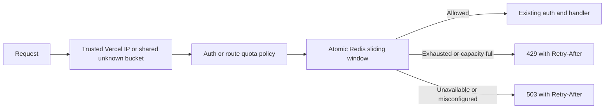

# Shared API quotas and trusted client IPs

All deployed API limiters use the same Upstash Redis REST database through `apps/api/services/rateLimitStore.ts`.
`apps/api/lib/rateLimit.ts` owns policy and denial responses; `apps/api/lib/clientIp.ts` owns proxy trust.
Existing authentication, subscription checks and quota amounts remain in place.



## Configuration and trust

Set `UPSTASH_REDIS_REST_URL` and `UPSTASH_REDIS_REST_TOKEN` through the existing Vercel environment workflow.
Use a writable REST token and HTTPS URL, with one database shared by every instance and region of an environment.
Use separate databases for production and nonproduction, with eviction disabled so live buckets cannot disappear under memory pressure.
Do not add a replica, per-instance prefix, caller-controlled namespace or local allow cache.
Upstash's [REST API](https://upstash.com/docs/redis/features/restapi) supports the single `EVAL` operation used here.
No PostgreSQL migration or application-table grant is needed.
Guarded Vercel development, preview, and production builds run `scripts/deploy/rate-limit-preflight.ts` before migrations and compilation.
The shared environment manifest first checks required bindings by name, without logging values.
The probe uses the request handler's configuration parser and never logs credential values.
It exercises the runtime `EVAL` with a separate `deployment-readiness` namespace, a unique identity and one-second TTLs, without consuming user quotas.
Missing, unsafe or partial configuration, read-only tokens, provider failures, invalid responses and timeouts stop the build.
Ordinary `next dev` requests can still use local quotas without Redis; guarded deployment builds require configured bindings.
Request quota namespaces include stable `prod:`, `preview:`, or `dev:` prefixes so a shared provider store cannot mix their counters.
Operational readiness keys use their own expiring namespaces and never consume user quotas.
See [routine production recovery](../devops/routine-production.md) for credential restoration and exact-source release verification.

Only `VERCEL=1` together with deployment-provided `VERCEL_ENV=production` or `preview` establishes the supported proxy boundary.
Within that boundary, accept only one valid IP from `x-vercel-forwarded-for`, which [Vercel supplies at ingress](https://vercel.com/docs/headers/request-headers#x-vercel-forwarded-for).
Reject lists, ports, zone identifiers, invalid addresses and missing values into the same `unknown` bucket.
Normalize equivalent IPv6 representations and IPv4-mapped IPv6 so formatting cannot create extra identities.
Never fall back to `x-forwarded-for`, `x-real-ip`, a request host or a caller-supplied Vercel marker.
Outside that deployment boundary, ignore every forwarding header and use `unknown` because NextRequest exposes no authenticated socket peer.
This conservatively shares IP quotas on unsupported hosts; per-user quotas still apply after successful JWT verification.
Do not imitate Vercel's environment variables on another publicly reachable host.
Supporting another proxy requires an authenticated ingress contract and tests before enabling its headers.

## Quotas and storage bounds

| Namespace | Identity | Requests | Rolling window |
|---|---|---:|---|
| `auth` | Trusted IP | 10 | 1 minute, across Apple, Google, login and enabled registration |
| `data-ip` | Trusted IP | 300 | 1 minute, across authenticated data routes |
| `data-user` | Verified JWT subject | 120 | 1 minute, across authenticated data routes |
| `preview-ip` | Trusted IP | 30 | 1 minute, guided preview |
| `shuffle-user` | User principal | 30 | 1 minute, search calls with `shuffle=1`, including repeated seeds and pagination |
| `feedback-user` | Verified JWT subject | 5 | 5 minutes |
| `waitlist-ip` | Trusted IP | 5 | 10 minutes, public website form |

One atomic Lua script uses Redis server time, prunes expired entries, checks capacity and consumes a request.
Each namespace admits at most 10,000 live identities plus one sorted-set index.
Each identity stores at most its allowed request count, and identity names are fixed-size SHA-256 digests rather than raw IPs or user IDs.
Both index and buckets have TTLs; denied requests do not extend bucket lifetimes or evict live identities.
At capacity, existing identities retain their quotas and new identities receive 429 until capacity expires.
Stable namespaces and a common Redis cluster hash tag per namespace preserve atomicity across workers and cold starts.

## Failure and response contract

Each store operation has a one-second deadline covering the request and response body, with abort, no redirects and no retries.
An ambiguous timeout can consume quota, so the request returns 503 and a later retry may have less quota remaining.
Missing or partial deployment credentials, provider errors, malformed replies and timeouts all fail closed with `{ "error": "Service unavailable" }` and `Retry-After: 1`.
They never fall back to process-local enforcement.
Genuine quota exhaustion and identity-cap exhaustion return 429 with an integer `Retry-After` rounded up to seconds.
Every limiter denial uses `Cache-Control: private, no-store`.
Outage logs contain only the policy name and are bounded to once per minute per policy per worker; provider bodies, credentials and identities are omitted.
Every route emits handled 503 status/latency through the [production monitoring path](../devops/monitoring-alerting.md).

Undeployed development/tests may use the bounded local sliding window only when both store variables are absent.
Setting either variable enables shared-store enforcement, including fail-closed behavior, even in development.
Public shallow health remains a database probe; authenticated `?deep=1` exercises Redis readiness separately.
Use an invalid-body auth request against an isolated nonproduction deployment to exercise the limiter without creating an account.
Do not run quota probes against production as part of ordinary implementation validation.

## Verification and recovery

When simulator preflight receives 503, inspect the matching deployment's runtime logs before replaying account journeys.
If the shared store is unconfigured, restore the dedicated nonproduction URL and writable token through Vercel's environment settings, redeploy the same candidate and verify anonymous/invalid-session 401s plus fixture login 200 before rerunning the complete selected flows.
An existing deployment retains its original environment until redeployed.
If provisioning requires accepting new provider terms or granting new integration access, retain that concrete boundary for the authorized account owner; do not substitute production credentials or relax fail-closed quotas.
The build regression in `scripts/deploy/routine-release.test.py` runs the actual deployment entrypoint with synthetic external CLIs and proves missing configuration cannot reach migrations or the build in either Preview or Production.

The API suite includes deterministic external REST fixtures and independently loaded API worker processes.
It proves provider-wide auth quotas, cold-start persistence, waitlist quotas, per-user limits across IPs, forged-header resistance, concurrent admission and capacity/expiry behavior.
The fixtures replace only external Redis and JWKS transport; handlers, token signing/verification, IP selection and limiters run as application code.
Run the real Lua journeys against a disposable Redis container with:

```sh
npm run test:rate-limits -w apps/api
node scripts/verify/run.mjs --only=rate-limit-store --runs=local
```

The blocking `rate-limit-store` registry check runs through existing local and CI L2 entrypoints.
It creates a named, labeled, network-isolated `redis:7.4-alpine` container with no persistence or host ports and removes only the returned owned container ID.
It reuses the same independent-worker journeys, executing the actual script through Redis rather than the reference REST fixture.
The pre-push hook retains cheap checks; `run.mjs` and Verify's existing L2 job discover this check from the registry.
The existing `scripts/deploy/routine-release.test.ts` suite also drives the actual Vercel build and migration callers through a substituted external Redis transport.
It proves missing/unwritable store bindings stop migrations and builds, guards run before Redis, healthy stores proceed in order, and guarded development also requires the manifest bindings.
These tests run in the existing scripts group through `run.mjs`, the pre-push focused selection and Verify; no new credential-bearing CI check is needed.
Docker startup, socket permissions or image-pull failures are environment failures, never passing shared-store evidence.
Inspect retained verifier diagnostics, restore supported Docker access in the existing worker environment, and rerun this entrypoint without weakening the check or using production credentials.
Simulator journeys and Maestro flows are unchanged because this change adds no mobile navigation or interaction.
