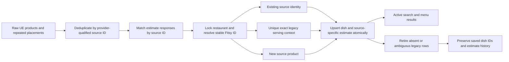

# Idempotent menu persistence

**TL;DR:** Source product IDs preserve same-name variants and stable Fitsy dish references across imports.

This is the current persistence contract for issue #501.
It replaces the former title-only strategy.
The LA source-collision measurement and its limits are in [the audit report](../pipeline/menu-source-collisions-2026-10-24.md).

## Identity

`MenuItem.id` remains the public Fitsy dish ID and the target of `SavedItem.menuItemId`.
`StructuredMenuItem.sourceItemId` carries a provider-qualified product ID, such as `ubereats:<uuid>`.
Its scope is a restaurant, independent of macro provenance such as `haiku` or `official`.
The database enforces unique `(restaurantId, sourceItemId)` values.
Without a source ID, ingestion falls back to the decoded, case-insensitive item name, retaining the first occurrence.
The database also maintains a partial unique `(restaurantId, name)` index for active rows without source IDs.
Two different source IDs never merge merely because their names, descriptions or prices match.
Repeated placements of one source ID still produce one item.
Sources that expose no stable product ID, including the legacy markdown/JSON-LD readers, retain the name fallback.

## Reconciliation and history

Both `persistItemsInTx` and `persistHexBulkInTx` call `resolveMenuItemIds` in `scripts/menu-item-identity.ts`.
Established source identities are reserved before legacy reconciliation.
A legacy row can acquire a source ID only when its decoded name, description, section, category and price uniquely match one incoming serving context.
Ambiguity creates new source rows and retires the old row instead of guessing a binding.
A retired row remains addressable through its existing saved dish reference and retains its original estimates.
Source-bound rows reactivate under their original Fitsy ID if the product reappears.
Discovery, guided preview, menu pagination, public counts, dietary aggregation and sitemap generation exclude retired rows.
An empty input does not retire existing rows.

Restaurant locks are ordered consistently with the reviewed chain write guard.
The resolver marks each locked parent as written without changing its data, forcing an older concurrent serializable snapshot to retry before resolving identities.
The existing bounded `chainTransaction` retry policy handles known serialization aborts.
The unique indexes remain the final duplicate guard.
All item writes, estimate writes, retirement and hex checkpoints remain atomic.
Macro provenance and winner selection retain their existing trust ordering.

Estimation requests carry source IDs and require the model to echo them.
Reordered results align by source ID, while missing, duplicate or mismatched identities cannot be copied across same-name variants.
An ambiguous result becomes null for the existing validation/recovery path.
Legacy name/position response matching remains available for unambiguous names.
Versioned incremental hashes include source identity and serving context, so old name-only hashes cannot suppress the first repaired import.

## Migration and coordinated cutover

`20261024120000_source_item_identity` adds nullable source IDs and retirement timestamps without rewriting or deleting menu IDs, saved references or estimates.
It replaces restaurant/name uniqueness with source identity and the partial fallback index in one transaction with a ten-second lock timeout.
Stop offline ingestion, reruns and menu backfills before applying this migration.
Old writers depend on the removed name conflict target and must remain stopped.
Deploy readers that understand retirement and use the updated writers together before resuming ingestion.
Use a bounded canary with a fresh run ID and `--force` so freshness and completed-hex checkpoints do not skip the repair.
Compare every preexisting saved reference and the canary's source IDs, prices and served macros before expanding the refresh.
The migration alone cannot reconstruct products discarded by earlier imports; source menus must be refreshed.

The adjacent `down.sql` restores the old constraint before removing the new columns.
It deliberately refuses rollback when any duplicate names exist, including retained historical rows.
Do not delete products to make rollback pass or restart an old writer after the cutover.
Use a compatible forward repair or a separately reviewed data recovery plan after same-name products have been imported.
Production target checks and the repository migration procedure remain unchanged.

## Verification

`apps/api/services/menuSources/menuItemIdentity.test.ts` replays a captured Panini individual/family collision and tests hashes and repeated placements.
`apps/api/services/macroEstimationService.test.ts` exercises reordered same-name estimates and missing or contradictory product IDs through the real estimator with only the external provider mocked.
`scripts/menu-item-identity.test.ts` covers safe legacy adoption, ambiguous contexts, scope, reactivation and macro pairing.
`apps/api/tests/db/menuSourceIdentity.db.test.ts` covers both writers, served menus, saved references, empty inputs, concurrent imports, renaming, retirement and reactivation against PostgreSQL.
`apps/api/tests/db/menuSourceIdentityMigration.db.test.ts` executes the real up/down DDL in a private fixture schema and checks IDs and uniqueness failures.
The existing API/scripts suites discover these tests automatically through the current registry, runner, hooks and Verify workflow.
No new verification lane or release exception is introduced.
