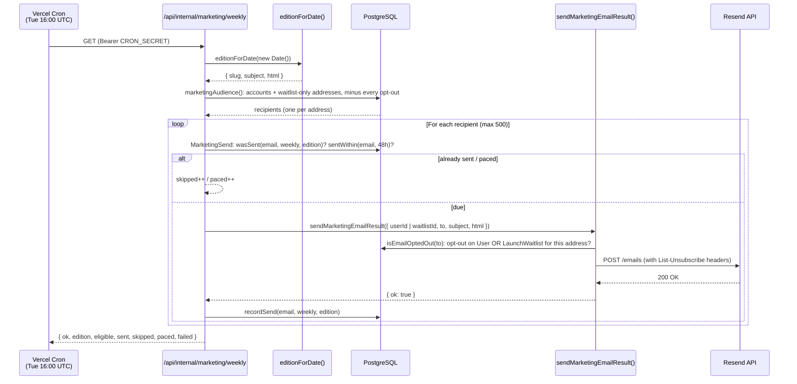

# Marketing Emails

## Overview

Fitsy sends two categories of marketing email: a one-time city-launch blast and a recurring weekly editorial.
Both share the same brand shell, compliance pipeline, send primitive, and the `MarketingSend` ledger.
Scheduling, audience, and pacing rules live in [email-automation.md](email-automation.md).
All compliance requirements (suppression check, unsubscribe URL, postal address, RFC 8058 one-click headers) are enforced inside `sendMarketingEmail` - callers only supply a recipient (`userId` or `waitlistId`), `to`, `subject`, and `html`.
Suppression is keyed on the address across both the `User` and `LaunchWaitlist` tables (see [launch-waitlist.md](launch-waitlist.md)).

---

## Architecture



---

## Brand Shell

`brandEmailShell()` in `apps/api/lib/emailTemplates.ts` generates email-safe HTML with inline styles only.
It renders correctly in Gmail, Apple Mail, and Outlook.
Visual spec:

- Page background: cream `#FDFBF7`
- Card: white `#FFFFFF`, 1px `#E8E2D8` border, 16px border-radius, 36px padding, max-width 560px
- Wordmark: "fitsy." in Georgia serif, 26px, `#1B3A26`
- Headings: Georgia serif, `#1B3A26`
- Body text: `-apple-system/Segoe UI/Roboto` sans, 15px/1.65, `#3A4F41`
- Optional hidden preheader span (Gmail preview text)
- Optional CTA button: `#1B3A26` background, `#FDFBF7` text, 32px border-radius

The shell does not include unsubscribe footer or postal address.
`sendMarketingEmail` appends the CAN-SPAM-required footer before sending.

---

## Launch Email

`launchEmailContent(city: string | null)` in `apps/api/lib/emailTemplates.ts` generates the city-launch notification.
It is re-exported from `apps/api/lib/marketingEmail.ts` for backward compatibility.
Triggered via `POST /api/internal/waitlist/notify` — see [launch-waitlist.md](launch-waitlist.md) for the full flow.

Subject: `Fitsy just launched in <city>` (falls back to "in your city" when city is null).
CTA: "Open Fitsy" → `https://fitsy.org`.

---

## Weekly Editorial

### Edition Rotation

Eight editions are defined in `WEEKLY_EDITIONS` in `apps/api/lib/emailTemplates.ts`.
`editionForDate(date)` picks deterministically:

```
weekIndex = Math.floor((date.getTime() - Date.UTC(2026, 0, 5)) / (7 * 86400e3))
idx = ((weekIndex % 8) + 8) % 8
```

Week 0 begins Monday, January 5, 2026.
The rotation repeats every 8 weeks indefinitely.

### Current Editions

| # | Slug | Subject |
|---|------|---------|
| 0 | `restaurant-calorie-gap` | Why restaurant calories are almost always higher than you think |
| 1 | `protein-first-ordering` | The protein-anchor method for ordering out |
| 2 | `sauce-math` | Where 300–500 hidden calories actually live |
| 3 | `menu-language` | A short glossary of menu words that matter |
| 4 | `cut-vs-bulk-dining` | How eating out changes when you're cutting vs. building |
| 5 | `healthy-halo` | The "healthy bowl" trap — why salads often beat burgers |
| 6 | `chain-vs-indie` | Chains publish macros. Indie spots don't. Here's how to handle both. |
| 7 | `consistency-not-perfection` | One restaurant meal never ruins a week. Here's the math. |

### Adding an Edition

1. Add a new object to `WEEKLY_EDITIONS` with a unique `slug`, `subject`, and `build()` function.
2. Update the rotation modulus (`% 8` → `% N`) in `editionForDate`.
3. Editions use `brandEmailShell()` for consistent rendering.
4. Body copy should be 180–280 words: editorial-first (genuine fitness/restaurant education), with Fitsy mentioned briefly at the end.

---

## Weekly Cron Route

**File:** `apps/api/app/api/internal/marketing/weekly/route.ts`
**Schedule:** every Tuesday at 16:00 UTC (`0 16 * * 2` in `vercel.json`)
**Auth:** `CRON_SECRET` Bearer header (same pattern as all internal cron routes)

### Send cap

The route walks the whole audience not yet sent this edition, within a wall-time budget and a hard ceiling of 500 sends.
The cron fires once a week, so the run is not paged: anything it does not reach is reported as `unsent` and alerted to Slack, and a manual re-run resumes because already-sent addresses are excluded at query time.

### Audience

`marketingAudience()` in `apps/api/lib/marketingAudience.ts`: accounts that have not opted out anywhere, plus waitlist-only addresses (no account) that have not opted out, one recipient per address.
The recipient kind (`userId` or `waitlistId`) decides which unsubscribe link is minted.

### Ledger

`MarketingSend` (Prisma model, `apps/api/lib/marketingLedger.ts`) records every marketing send by normalized address, campaign, and step.
The weekly cron uses campaign `weekly` with `<edition slug>:w<week index>` as the step, so an edition recurs on the next eight-week rotation but a retry within the same week is a no-op.
A row is written only after `sendMarketingEmailResult` returns `{ ok: true }`; a failed send is never recorded, so the next run retries it.
Before sending, the cron also skips any address that heard from any campaign within the last 48 hours (`paced`), so a lifecycle email and an edition never land back to back.
Addresses already recorded for this edition's step are excluded from the audience query itself.
The migration that introduced the ledger copied the old `_marketing_send` history into it, week-stamping each row from its `sent_at` so it matches the new key; the old table is dropped in a later contraction migration.

### Dry run

`GET /api/internal/marketing/weekly?dryRun=1` returns `{ ok, dryRun: true, edition, eligible }` (the audience not yet sent this edition) without sending any email.
Useful for verifying audience size and edition selection before a live run.

### Response

```json
{
  "ok": true,
  "edition": "restaurant-calorie-gap",
  "eligible": 1200,
  "sent": 500,
  "paced": 4,
  "failed": 3,
  "unsent": 693
}
```

---

## Audience Definition

Eligible users are those with `emailOptOutAt IS NULL` in the `User` table.
Because `emailOptOutAt` was added via migration after the shared Prisma client was generated, all queries touching it use `prisma.$queryRawUnsafe` with explicit row types — never the Prisma typed client.

---

## Compliance

All compliance requirements are enforced inside `sendMarketingEmail` in `apps/api/lib/marketingEmail.ts`.
Callers do not need to handle any of the following:

- **Suppression check:** `sendMarketingEmail` re-checks `emailOptOutAt` per-send before calling Resend, even if the audience query ran seconds earlier.
- **Unsubscribe URL:** HMAC-signed one-click unsubscribe URL appended to every email footer.
- **Postal address:** `FITSY_POSTAL_ADDRESS` env var appended to every email footer.
- **RFC 8058 one-click headers:** `List-Unsubscribe` and `List-Unsubscribe-Post` headers set on every Resend API call.
- **CAN-SPAM footer:** "You're receiving this because you have a Fitsy account and joined our launch list." appended to every send.

`sendMarketingEmail` is fail-closed: if any compliance env var is missing or the suppression check fails, it returns `false` without sending.

### Failure diagnostics and safe recovery

`sendMarketingEmailResult` applies the same compliance and suppression gates and returns either `{ ok: true }` or `{ ok: false, reason, status? }`.
The existing `sendMarketingEmail` boolean interface remains available for launch and confirmation callers.
Resend requests go through `apps/api/services/resendService.ts`, retaining the existing eight-second attempt timeout and one capped `Retry-After` retry for HTTP 429 with the same idempotency key and body.

The weekly route aggregates fixed reason categories and HTTP status counts into its existing Slack alert.
It never includes recipients, record IDs, unsubscribe URLs, idempotency keys, API keys, raw provider bodies or exception messages.
No per-recipient alert or additional Slack publisher is added.
The HTTP 200 response means the cron executed; operators must inspect `failed` and `unsent` to determine whether delivery completed.

| Reason | Meaning and next action |
|--------|-------------------------|
| `domain_unverified` with HTTP 403 | Resend returned its documented unverified-domain rejection; the authorized configuration operator must reconcile the sender and verified domain. |
| `provider_rejected` with HTTP status | Another provider rejection, including unknown or malformed error bodies; inspect the provider through existing authorized access without inferring a domain problem from HTTP 403 alone. |
| `rate_limited` | Both bounded attempts returned HTTP 429; plan any later replay using the existing ledger and delivery window. |
| `network_error` or `timeout` | Provider acceptance is unknown; retain idempotency safeguards and do not treat this as successful delivery. |
| `missing_api_key`, `missing_unsubscribe_secret`, `missing_postal_address` | A required configuration value is absent; no provider send was attempted. |
| `undeliverable_address` or `suppressed` | Recipient safety gate prevented sending, including opt-out after audience selection. |
| `suppression_unavailable` | The opt-out lookup failed; fail closed without sending or exposing database error details. |

[Issue #445](https://github.com/dgmolla/fitsy/issues/445#issuecomment-6040216734) retains the original alert evidence, provider rejection and configuration handoff.
Production DNS/domain changes and live marketing cron replays are separate operator actions, not diagnostic probes.
After an authorized domain repair, validate provider acceptance using only a labeled `delivered@resend.dev` synthetic recipient as described in [Resend's test-email documentation](https://resend.com/docs/dashboard/emails/send-test-emails).
Successful synthetic provider acceptance does not establish real-recipient delivery.
Do not invoke the production cron as a diagnostic probe; any deliberate replay needs its delivery window and existing suppression, frequency cap and idempotency safeguards checked.

The route transport regression runs real application modules with only the database SDK and external HTTP replaced.
`apps/api/tests/db/marketingWeekly.db.test.ts` additionally exercises real audience queries, opt-out, failure/recovery, cross-campaign pacing and ledger replay with the worktree-owned disposable database.
It verifies actual container ownership before fixture mutations and each route invocation, and replaces Resend and Slack HTTP so no real recipient or channel is contacted.

---

## Related Docs

- [launch-waitlist.md](launch-waitlist.md) — waitlist signup, notify route, and city-launch blast flow
- [perf-and-security-handoff-2026-04-25.md](perf-and-security-handoff-2026-04-25.md) — security context
