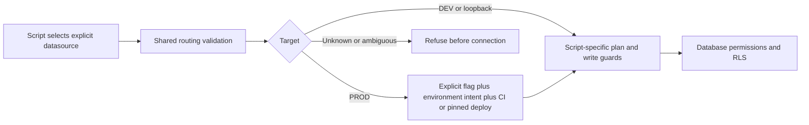

# Database guardrails

**TL;DR:** Script writes require validated targets; DEV has separate audit credentials and legacy landing writes are disabled.

Audited on 2026-10-27 from the isolated `fitsy-guardrails` clone.
PROD is `zaxkmjqozvmbifiwbxps`; DEV is `kegycybiruksmrzvniha`.
PROD findings below come from code, migrations and credential-name metadata only.
No PROD database connection, Supabase management-token query, credential rotation or task-issued SQL write was performed.
DEV catalog checks used its existing SQL credential, followed by the new audit role.



## Credential inventory: names only

The fresh clone initially contained only `.env.example`, with no live local environment file.
The authorized Vercel Development pull created ignored `.env.dev` with mode 0600 for this task.
No Production environment values were pulled.
The local `.vercel` link names `fitsy-api`; it contains project identifiers, not database credentials.

| Location | Observed names |
| --- | --- |
| `.env.example` | `POSTGRES_PRISMA_URL`, `POSTGRES_URL_NON_POOLING`, `SUPABASE_URL`, `SUPABASE_ANON_KEY`, `SUPABASE_SERVICE_ROLE_KEY`, `UPSTASH_REDIS_REST_URL`, `UPSTASH_REDIS_REST_TOKEN`, `REVENUECAT_PUBLIC_API_KEY`, `REVENUECAT_WEBHOOK_AUTH`, `DEMO_REVIEW_EMAILS`, `GOOGLE_PLACES_API_KEY`, `FIRECRAWL_API_KEY`, `ANTHROPIC_API_KEY`, `UE_LOC_COOKIE`, `STRIPE_SECRET_KEY`, `STRIPE_PUBLISHABLE_KEY`, `EXPO_PUBLIC_API_URL` |
| `.env.dev` | `ANTHROPIC_API_KEY`, `CRON_SECRET`, `DEMO_REVIEW_EMAILS`, `FIRECRAWL_API_KEY`, `FITSY_ENV`, `GOOGLE_PLACES_API_KEY`, `NEXT_PUBLIC_POSTHOG_HOST`, `NEXT_PUBLIC_POSTHOG_PROJECT_TOKEN`, `NEXT_PUBLIC_SUPABASE_ANON_KEY`, `NEXT_PUBLIC_SUPABASE_URL`, `POSTGRES_DATABASE`, `POSTGRES_HOST`, `POSTGRES_PASSWORD`, `POSTGRES_PRISMA_URL`, `POSTGRES_URL`, `POSTGRES_URL_NON_POOLING`, `POSTGRES_USER`, `RESEND_API_KEY`, `REVENUECAT_PUBLIC_API_KEY`, `SEARCH_DISTANCE_WEIGHT`, `SUPABASE_ANON_KEY`, `SUPABASE_JWT_SECRET`, `SUPABASE_SERVICE_ROLE_KEY`, `SUPABASE_URL`, `VERCEL_OIDC_TOKEN` |
| `~/Desktop/secrets.env` | Existing lowercase provider names: `seatsaero_key`, `slack_key`, `axiom`, `jev`, `openrouter`, `anthropic`; newly saved `dev_db_url`, `dev_db_readonly_url` |
| GitHub repository secrets | `ANTHROPIC_API_KEY`, `DEV_DATABASE_URL`, `DEV_SUPABASE_URL`, `EXPO_TOKEN`, `JWT_SECRET`, `POSTGRES_PRISMA_URL`, `POSTGRES_URL_NON_POOLING`, `PROD_DATABASE_URL`, `VERCEL_DEV_DEPLOY_HOOK` |

Vercel `fitsy-api` metadata lists these names by environment:

| Environment | Names |
| --- | --- |
| production | `ANTHROPIC_API_KEY`, `ASC_APP_ID`, `ASC_ISSUER_ID`, `ASC_KEY_ID`, `ASC_P8_BASE64`, `AXIOM_TOKEN`, `CRON_SECRET`, `DEMO_REVIEW_EMAILS`, `FIRECRAWL_API_KEY`, `FITSY_FROM_EMAIL`, `FITSY_POSTAL_ADDRESS`, `GOOGLE_PLACES_API_KEY`, `NEXT_PUBLIC_AXIOM_INGEST_ENDPOINT`, `NEXT_PUBLIC_POSTHOG_HOST`, `NEXT_PUBLIC_POSTHOG_PROJECT_TOKEN`, `NEXT_PUBLIC_SUPABASE_ANON_KEY`, `NEXT_PUBLIC_SUPABASE_URL`, `POSTGRES_DATABASE`, `POSTGRES_HOST`, `POSTGRES_PASSWORD`, `POSTGRES_PRISMA_URL`, `POSTGRES_URL`, `POSTGRES_URL_NON_POOLING`, `POSTGRES_USER`, `POSTHOG_PERSONAL_API_KEY`, `POSTHOG_PROJECT_ID`, `RESEND_API_KEY`, `REVENUECAT_PUBLIC_API_KEY`, `REVENUECAT_WEBHOOK_AUTH`, `SEARCH_DISTANCE_WEIGHT`, `SLACK_BOT_TOKEN`, `SUPABASE_ANON_KEY`, `SUPABASE_JWT_SECRET`, `SUPABASE_SERVICE_ROLE_KEY`, `SUPABASE_URL`, `UNSUBSCRIBE_SECRET` |
| preview | `DEMO_REVIEW_EMAILS`, `FITSY_ENV`, `NEXT_PUBLIC_POSTHOG_HOST`, `NEXT_PUBLIC_POSTHOG_PROJECT_TOKEN`, `NEXT_PUBLIC_SUPABASE_ANON_KEY`, `NEXT_PUBLIC_SUPABASE_URL`, `POSTGRES_DATABASE`, `POSTGRES_HOST`, `POSTGRES_PASSWORD`, `POSTGRES_PRISMA_URL`, `POSTGRES_URL`, `POSTGRES_URL_NON_POOLING`, `POSTGRES_USER`, `REVENUECAT_PUBLIC_API_KEY`, `SUPABASE_ANON_KEY`, `SUPABASE_SERVICE_ROLE_KEY`, `SUPABASE_URL` |
| development | `ANTHROPIC_API_KEY`, `CRON_SECRET`, `DEMO_REVIEW_EMAILS`, `FIRECRAWL_API_KEY`, `FITSY_ENV`, `GOOGLE_PLACES_API_KEY`, `NEXT_PUBLIC_POSTHOG_HOST`, `NEXT_PUBLIC_POSTHOG_PROJECT_TOKEN`, `NEXT_PUBLIC_SUPABASE_ANON_KEY`, `NEXT_PUBLIC_SUPABASE_URL`, `POSTGRES_DATABASE`, `POSTGRES_HOST`, `POSTGRES_PASSWORD`, `POSTGRES_PRISMA_URL`, `POSTGRES_URL`, `POSTGRES_URL_NON_POOLING`, `POSTGRES_USER`, `RESEND_API_KEY`, `REVENUECAT_PUBLIC_API_KEY`, `SEARCH_DISTANCE_WEIGHT`, `SUPABASE_ANON_KEY`, `SUPABASE_JWT_SECRET`, `SUPABASE_SERVICE_ROLE_KEY`, `SUPABASE_URL` |

The separate Vercel landing project `fitsy` returned no environment-variable names.
Presence means the name exists; it does not establish validity, role privileges or runtime adoption.
GitHub organization/environment secret inventories were not available through the repository-secret listing and are not claimed audited.

## Application and CI access

- Prisma reads `POSTGRES_PRISMA_URL`; migrations use `POSTGRES_URL_NON_POOLING` from `prisma/schema.prisma`.
- Application SQL goes through Prisma, independently of `SUPABASE_SERVICE_ROLE_KEY`.
- `apps/api/lib/supabase.ts` constructs a server-only service-role client for privileged Auth operations: registration/profile setup, account deletion and waitlist user lookup.
- Mobile uses the public Supabase URL/anon key and account sessions, not the service role.
- `prisma/seed.ts` and `scripts/dev/reset.ts` use the DEV service role for Auth administration when provided; reset also supports direct SQL Auth maintenance.
- `.github/workflows/dev-maintenance.yml` maps `DEV_DATABASE_URL` to DEV reset/drift operations and maps `PROD_DATABASE_URL` only to the read-only snapshot source.
- Hosted Verify uses an owned disposable PostGIS database and data-only seed; repository PROD database secrets are not its test database.
- The existing Vercel Git main production build owns routine production migrations; ordinary CI deployment gates and review remain required.

A service-role client bypasses RLS, and table owners or PostgreSQL BYPASSRLS roles can bypass row policies.
The DEV SQL credential was verified to use `postgres` with BYPASSRLS; PROD SQL role attributes were not queried.
RLS therefore complements credential separation and API authentication rather than constraining an owner credential.
See the [PostgreSQL RLS contract](https://www.postgresql.org/docs/current/ddl-rowsecurity.html).

## Table-level RLS evidence

Migration `20261027170000_server_only_data_access` enables RLS and revokes current/future public table and sequence grants from PUBLIC, anon and authenticated.
It supplies no client policies.
The following DEV live catalog results matched that migration; PROD application of the migration remains unverified in this audit.

| Table | Versioned state | DEV live state |
| --- | --- |
| `User` | RLS enabled; no direct client grants | RLS enabled |
| `MacroTarget` | RLS enabled; no direct client grants | RLS enabled |
| `SavedItem` | RLS enabled; no direct client grants | RLS enabled |
| `Subscription` | RLS enabled; no direct client grants | RLS enabled |
| `Feedback` | RLS enabled; no direct client grants | RLS enabled |
| `FeedbackVote` | RLS enabled; no direct client grants | RLS enabled |
| `LaunchWaitlist` | RLS enabled; no direct client grants | RLS enabled |
| `MarketingSend` | RLS enabled; no direct client grants | RLS enabled |
| `Restaurant` | RLS enabled; no direct client grants | RLS enabled |
| `Brand` | RLS enabled; no direct client grants | RLS enabled |
| `ChainItem` | RLS enabled; no direct client grants | RLS enabled |
| `MenuItem` | RLS enabled; no direct client grants | RLS enabled |
| `MacroEstimate` | RLS enabled; no direct client grants | RLS enabled |
| `PipelineCompletedHex` | RLS enabled; no direct client grants | RLS enabled |
| `_prisma_migrations` | RLS enabled; no direct client grants | RLS enabled |
| `_marketing_send` | RLS enabled; no direct client grants | RLS enabled |
| `_review_watch` | RLS enabled; no direct client grants | RLS enabled |
| `spatial_ref_sys` | PostGIS extension metadata, outside application migration inventory | RLS disabled |

The extension metadata table is not user/application data and was not modified.
Use `scripts/security/supabase-audit.sql` inside its read-only transaction for a future separately authorized live PROD audit with a genuinely read-only credential.

## Script mutation boundary

`scripts/lib/db-target-guard.ts` validates the actual datasource before Prisma construction or a shell migration.
It recognizes direct Supabase hosts, provider-qualified pooler usernames, percent-encoded usernames and the exact Supavisor `options=reference=...` route.
Passwords are never used for target identity.
Conflicting routes, duplicate/unknown routing parameters, unknown remote hosts and unapproved project references fail closed.

DEV and loopback databases work normally for these script mutation entrypoints.
PROD requires both `FITSY_ALLOW_PROD_WRITE=1` and the separate `--prod` argument, followed by cryptographic workload identity verification.
Environment markers alone, including `GITHUB_ACTIONS=true` and copied Vercel deployment markers, cannot authorize writes.
The guard is asynchronous; every script awaits the guarded URL before constructing its client.
Vercel builds must retain the existing pinned `fitsy-api` Git main production identity and supply a valid production OIDC token for the pinned team and project.
GitHub writes require a freshly issued, signed token for `dgmolla/fitsy`, `refs/heads/main`, the manual `prod-fixture-cleanup.yml` workflow, and the existing `production-release` environment on a GitHub-hosted runner.
Only that cleanup job receives `id-token: write`; its protected environment and explicit apply/count requirements remain unchanged.
The token audience, issuer, signature, expiration and identity claims are checked against fixed provider JWKS endpoints, and issuance/network failures abort without printing credentials or provider diagnostics.
Vercel team and global issuer modes use their corresponding JWKS endpoints; an unverified issuer only selects between those two exact trusted locations before signature verification.
See the [Vercel OIDC claims](https://vercel.com/docs/oidc/reference) and [GitHub OIDC reference](https://docs.github.com/en/actions/reference/security/oidc).
The production migration wrapper supplies both explicit intentions only after its existing deploy identity checks.
The old local `FITSY_ALLOW_PROD=1` operator-migration exception is removed.
DEV-only resets, seeds, fixture installation, provisioning and preview migrations forbid PROD unconditionally, including when override variables are present.
Provisioning validates both derived URLs before credential lookup, database probes or Vercel updates.
Automatic project creation is retired; a replacement DEV reference must be reviewed before wiring shared credentials.
Auth mutations independently require the exact DEV Supabase API origin.

| Writer entrypoints | Guarded target |
| --- | --- |
| `preload-ue-first.ts`, `backfill-chain-flag.ts`, `backfill-menu-item-macros.ts` | Exact selected direct URL, with the existing macro-backfill pooled fallback guarded |
| `rerun.ts`, `backfill-photos.ts`, `feedback-digest-dryrun.ts`, `phase1-create-table.ts` | Explicit guarded Prisma URL |
| `phase0-populate-brands.ts`, `preload-chain-identity.ts`, `preload-chain-pilot.ts` | Explicit guarded direct URL; existing plan hashes, journals and chain write guards remain required |
| `prisma/seed.ts`, `scripts/dev/reset.ts`, `snapshot.ts`, `preload-chain-quality-fixture.ts` | DEV-only destination; snapshot source remains session-read-only |
| `provision-audit-role.ts`, `audit-readonly.ts` | Exact DEV project; the audit performs only metadata reads and optional zero-row denial probes |
| `scripts/dev/provision-supabase.sh`, `vercel-build.sh` | Shared DEV-only guard before database migrations |
| `scripts/deploy/migrate-prod.sh` | Shared guard plus existing exact production deploy identity/URL checks |
| `scripts/verify/local-db-control.mjs` | Existing exclusive Docker ownership checks plus shared DEV-only preflight before reset/migration/seed |
| `apps/api/tests/db/goal-preview.performance.ts` | Shared test guard plus its existing localhost-only benchmark rule |

Library writers such as `hex-persist.ts`, `pipeline-utils.ts` and chain services receive clients from these guarded entries or the owned database test harness.
The writer inventory scans tracked and new source files, covering API clients, pipeline clients, SQL, shell/workflow commands, hooks, npm scripts and test clients.
It follows imported aliases and actual datasource properties, rejecting unrelated guards, shadowed bindings and unawaited production guards.
Implicit Prisma test clients require the disposable-database Jest setup; explicit datasource overrides must carry their own guard.
SQL migrations retain their existing guarded deployment owner, DEV role SQL retains its guarded provisioner, and other executable SQL needs a read-only transaction or a reviewed guarded owner.
Existing proposal/audit exceptions cannot gain database mutations.
The guard and inventory do not sandbox arbitrary source changes or hand-written commands outside maintained entrypoints.
The separate DB role lock in issue #588 remains the enforcing boundary for pipeline table writes; this code change does not install roles or authorize production grants.
Database permissions are the enforcing boundary for the audit credential; script guards prevent accidental writes through maintained entrypoints.

Before this change, most preload/backfill/chain entries accepted whichever owner URL was in the environment, and DEV helpers offered a local production override.
The end-user CLI reproduction observed one connection to a loopback-only fake PostgreSQL server carrying a synthetic production username.
After the guard, the same CLI refused before any connection.
The current regression records external Prisma client construction and verifies the recorder with a positive control.
It proves the CLI refuses before creating a database client without requiring a listening socket; real database integration retains its separate owned-Docker gate.

## Runtime project consistency

The API singleton and Supabase Auth clients validate that the selected runtime database and `SUPABASE_URL` name the same allowed project.
DEV Auth with a PROD database, PROD Auth with a DEV database, unknown projects and missing Auth configuration for a remote database abort with `DB/Auth project mismatch` before a client connects.
Disposable loopback fixtures may use local or DEV Auth.
An unconfigured unit-only import receives an invalid explicit datasource, preventing Prisma from silently loading credentials from another environment file.

The deployed smoke command's `--write` mode accepts only the complete `https://dev.fitsy.org` origin or HTTP `localhost`/`127.0.0.1` with a valid optional port.
A trailing slash is normalized; paths, credentials, host suffixes, query strings, fragments and preview/production origins are rejected before HTTP execution.
Read-only smoke remains available for production and previews.

## Database test boundary

API and pipeline Jest configs run `scripts/lib/test-database-guard.ts` before importing suites, including direct workspace test and coverage commands.
All configured database URLs (`POSTGRES_PRISMA_URL`, `POSTGRES_URL_NON_POOLING`, `PIPELINE_DATABASE_URL`) must target a disposable loopback database without a Supabase project route.
Shared DEV, PROD and all other remote targets abort with `DB_TEST_REFUSED`; there is no remote project allowlist or environment override.
Absent URLs preserve the existing unit-only run and skipped DB suites.
This test policy is stricter than the script write policy above and does not change production migration permissions.
The existing worktree-owned PostGIS launcher, locks and inspected container assertions remain required by canonical verification.
See [verification](../../../scripts/verify/README.md) for direct and owned database commands.
The guard regressions exercise the real API and scripts Jest configs with synthetic targets and prove rejected targets cannot import the test body.

## Database roles and credential cutover

Migration `20261028120000_pipeline_writer_roles` creates `fitsy_app`, `pipeline_writer` and `fitsy_audit_readonly` without login credentials.
Only `pipeline_writer` receives INSERT/UPDATE/DELETE on restaurant, brand, menu, macro, chain-nutrition and pipeline-checkpoint tables; the deploy administrator remains their owner.
`fitsy_app` reads those tables and retains account, subscription, feedback, saved-item and marketing writes.
Pipeline commands require `PIPELINE_DATABASE_URL`; runtime or migration credentials never substitute for it.
`POSTGRES_PRISMA_URL` must use `fitsy_app` and match `SUPABASE_URL`; `POSTGRES_URL_NON_POOLING` remains the deploy administrator's session/direct connection.

After the DEV migration, `scripts/dev/provision-audit-role.ts --apply --role=fitsy_app` generates a separate login credential in the existing private `~/Desktop/secrets.env` file.
The same command accepts `--role=pipeline_writer` or defaults to `fitsy_audit_readonly`.
It requires the exact DEV project, the completed migration and safe role attributes.
`dev_db_url` preserves the DEV administrator connection; `dev_app_database_url`, `dev_pipeline_database_url` and `dev_db_readonly_url` hold the corresponding role connections.
Credentials are never stored in Git, audit evidence or logs.
The provisioner refuses an existing credential rather than silently rotating it.

Use the DEV `fitsy_app` credential for Vercel Preview and Development `POSTGRES_PRISMA_URL` bindings before accepting the candidate deployment.
The guarded build activates that login after migrations and withholds the build when activation fails; its diagnostic names the validation stage and allowlisted error code without driver or credential details.
Never resolve a failed activation by restoring administrator runtime access.
`scripts/dev/provision-supabase.sh` consumes `DEV_APP_DATABASE_URL` when wiring those environments; the pipeline credential belongs only in the pipeline operator/worker environment.
Keep `dev.fitsy.org` pinned to `dev`; candidate native acceptance uses the PR's Ready preview URL.

Production migration is owned exclusively by the existing Vercel Git main deploy.
It requires Dawit's explicit approval via `FITSY_PIPELINE_ROLES_APPROVED_SHA256` matching the migration's SHA-256, in addition to the existing signed deployment and target checks.
Provision separate production credentials and bindings through the approved operator path; the DEV provisioner refuses production.
Preparing code and tests does not establish owner approval, production application or successful credential cutover.

### Read-only auditing

Once provisioned, the audit role has LOGIN, NOINHERIT, no role memberships added, no superuser/role-creation/database-creation/replication/RLS-bypass attributes, schema USAGE and table SELECT grants only.
It has `default_transaction_read_only=on`, a 15-second statement timeout and a fixed search path.
Role-specific SELECT policies preserve RLS while enabling DEV auditing; no anon/authenticated policies are added.
Default SELECT grants apply to future tables created by postgres, but future RLS tables still require a reviewed role-specific policy before their rows become visible.
New-role privilege defaults are checked against `pg_roles`; no superuser-only ALTER of role attributes is attempted.
See [PostgreSQL role creation](https://www.postgresql.org/docs/current/sql-createrole.html) and [read-only transaction defaults](https://www.postgresql.org/docs/current/runtime-config-client.html).

Verify the actual saved credential without displaying it:

```sh
node --env-file="$HOME/Desktop/secrets.env" --import tsx scripts/dev/audit-readonly.ts --verify-denials
```

The denial probes use INSERT SELECT WHERE false, UPDATE WHERE false and DELETE WHERE false.
They cannot change application rows even if a grant regresses.
Acceptance checks both the default read-only session and denied DML after the session read-only setting is disabled, because that setting alone is not a privilege boundary.

## Retired landing path

`scripts/phase1-land.ts --apply` and `--apply=...` now refuse before aliases, input files or database access.
The CLI retains proposal-only consolidation.
There is no package-script caller for its old apply path; the historical runbook now identifies it as retired.
Use reviewed `chainWriteGuard` / `chainPilotPlan` application through `preload-chain-pilot.ts` with the existing reviewed batches, target binding, explicit hashes and rollback journals.

## PROD changes awaiting Dawit

No production audit role, credential change or role migration is included.
Creating a production read-only role or rotating/replacing production database/service credentials needs Dawit OK and a separately reviewed PR left open until approval.
Live PROD RLS/role verification remains a follow-up once an authorized read-only credential exists.
Do not use the Supabase CLI full-account keychain token to obtain that evidence.
This Phase A change does not authorize preload execution or any paid provider call.
