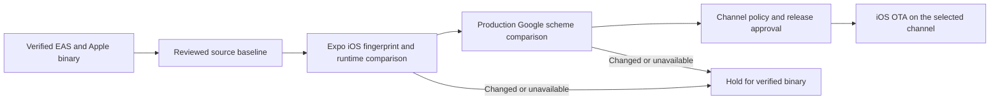

# Verified iOS OTA baseline

The OTA gate compares Expo's iOS native fingerprint with the actual verified binary for the selected channel.
TestFlight build 6 uses runtime `fd98d93926901555764ba66490c9bd9ca170454d`, which matches the local iOS fingerprint with build number `6` and fingerprint package `0.15.4`.
Build 5 has no verified Expo fingerprint and remains blocked on its separate production channel.
An incomplete binary receipt, including a missing IPA hash or verification timestamp, still blocks OTA.
Issue #243 reproduced the false positive in main Deploy run [37685925003](https://github.com/dgmolla/fitsy/actions/runs/37685925003), at source `89c23ce6e5272f7fdc9a599131329e4034b23037`.
That tag predates the actual production binary and therefore cannot establish its native compatibility.



## Actual binary evidence

### TestFlight build 6

Read-only EAS build and submission pages on October 30, 2026 confirmed the completed build and upload.
The local iOS fingerprint matches the EAS runtime after changing only the configured build number from `5` to `6`; no native source drift was found from the recorded build source.

| Identity | Verified value |
| --- | --- |
| EAS build | `87c977bf-ef75-401a-ac97-cef3c6eafb05`, succeeded, iOS store, testflight profile/channel |
| Build source | `44f8280051535cf07d09687f598baf2ebca97076` |
| App identity | `com.fitsy.mobile`, version `1.0.0`, build `6` |
| Runtime and fingerprint | `fd98d93926901555764ba66490c9bd9ca170454d`, fingerprint package `0.15.4` |
| EAS submission | `84491d3e-1a80-4387-a82c-6cb9f5190cef`, succeeded upload to App Store Connect |
| Apple build ID | Unknown; the EAS submission ID is not an Apple build ID |
| IPA SHA-256 | See the binary receipt; `null` means artifact verification is incomplete and OTA remains blocked |

The artifact URL and build evidence are retained in `scripts/deploy/ios-binary-baseline.json`.
A completed EAS upload establishes upload evidence; it does not establish App Review acceptance or public release.

### Historical production build 5

Fresh read-only EAS and App Store Connect requests on October 7, 2026 confirmed the following identities.
The IPA was downloaded from the build's artifact URL and its actual embedded plists were inspected.

| Identity | Verified value |
| --- | --- |
| EAS build | `3391d4bf-905e-4c78-8ae3-4f88f7cbf51b`, FINISHED, IOS, STORE, production profile/channel |
| Build source | `2e515fdc339d27e33110e128379fb16bd3a2d3a5` |
| Apple build | `cc103859-443d-43d9-a165-da04534c952b`, VALID, unexpired, APP_STORE_ELIGIBLE |
| Info.plist | `com.fitsy.mobile`, version `1.0.0`, build `5` |
| Expo.plist | Runtime `1.0.0`, production channel, project `a204190c-0b71-4c31-b126-f3bc62d1c4ee`, updates enabled |
| IPA SHA-256 | `e31663a3f57f715a357ffbd487f4d912fe46ed9b5ac82543d3a87724ed506c56` |

The Google URL scheme compiled into Info.plist is `com.googleusercontent.apps.56878207179-voo8iloc0si51ae7n8illrsu3hapks4d`.
The helper loads the current production environment and rejects a different or missing corresponding client ID before publishing.
The app config's other environment variables affect JavaScript configuration rather than native configuration at this baseline.

## Fingerprint compatibility contract

`scripts/deploy/ios-binary-baseline.json` records the current TestFlight binary.
`scripts/deploy/ios-production-binary-baseline.json` preserves the historical production binary without substituting TestFlight evidence.
`ota-target.mjs` selects the matching receipt for both the compatibility guard and publication helper.
Each receipt retains the source SHA, EAS build ID, IPA SHA-256, bundle/build/runtime/channel identities, Google client ID, verification timestamp and evidence.
Production requires its Apple build ID.
TestFlight may record `asc_build_id: null` with a valid EAS submission ID and `eas_submission_status: "FINISHED"`; missing upload evidence or a fabricated Apple ID fails closed.
It also requires `fingerprint: { "hash": "<40 hex characters>", "package_version": "<exact @expo/fingerprint version>" }` from that actual build's source and environment.
Never stamp the current checkout's hash onto a historical binary receipt.

`native-compatibility.mjs` uses the `@expo/fingerprint` version supplied by the installed Expo SDK through `expo/fingerprint`.
Both the gate and EAS runtime resolution use `apps/mobile/fingerprint.config.cjs` and the iOS platform.
Expo hashes evaluated native app configuration, autolinked native dependencies and native resources rather than raw root package/lockfile or app-config text.
The shared configuration explicitly includes native plugin payloads, patches and build hooks, including Swift files copied by the widget plugin.
Only the runtime `extra` section is skipped because EAS Update delivers it in the JavaScript manifest; schemes, permissions, native resources and updates URL remain covered.
API-only dependency edits, build-time guard changes with identical evaluated native config, JS, styles and arbitrary bundle-only assets do not require a binary.
Native modules, permissions, plugins, icon/splash, Expo SDK and widget/Swift changes do.
Missing ancestry, malformed or missing fingerprints, a different fingerprint package version, partial Expo collection and runtime/bundle mismatches fail closed.
Ignored local native inputs still block publication, including generated iOS directories.
The check repeats inside EAS's production environment and rejects a missing or changed Google URL scheme before export.

## TestFlight baseline and channel policy

The next protected EAS Build workflow uses the `testflight` store profile, production environment and `testflight` channel.
`app.config.ts` selects build number `6` and `runtimeVersion.policy = fingerprint` for compatible TestFlight updates.
This cannot change build 5's embedded runtime `1.0.0` or add its missing widget.
No build, upload, channel/settings mutation, production OTA or Apple submission is authorized by this runbook.

During the next separately authorized build, retain the frozen source and installed lockfile, EAS build ID and output, actual IPA hash, embedded Expo.plist runtime/channel and Apple processing evidence.
On that exact clean source, evaluate `node scripts/deploy/native-fingerprint.mjs` inside the EAS production environment with `EXPO_NO_DOTENV=1` and without repository credentials.
Require its hash to equal the actual fingerprint runtime embedded in the IPA, then record that hash and package version in the channel's reviewed binary receipt.
Run `node scripts/deploy/native-compatibility.mjs --channel=testflight --production-env` with the same environment before adopting the new baseline.
Retain independent workflow-security review of the source-bound receipt.

`ota-policy.json` selects automatic `testflight` OTA after green main Verify, exact production deployment and production smoke.
The publication helper must still verify channel-to-branch isolation and the complete binary receipt before exporting or publishing.
Before any App Store launch, set `app_store_launched` to `true` in the same reviewed change; the policy refuses automatic `production` in that state.
Keep the production baseline bound to the actual App Store binary and the TestFlight baseline bound to its separate binary.
Production updates then require Dawit to dispatch Deploy from main with `approve_production_ota: true`, plus the existing `production-native` environment approval.
The manual path rechecks latest main push Verify, exact Vercel serving identity, production smoke and native compatibility before publication.
Both channels use the production EAS environment and publish iOS only.
Before and after publication, the helper verifies that the selected channel points only to its own named branch without a rollout; TestFlight publication also requires production to remain on its separate production branch.
The first OTA on an empty channel compares mobile inputs with its verified embedded binary source; later runs compare with the newest applied iOS update.

The existing `rollback.sh mobile` is production-only, and the bundle identity helper defaults to the historical production receipt.
For TestFlight recovery, the release owner must separately authorize a channel-specific recovery, retain the shared hold/lease protections and verify the TestFlight runtime and immutable manifest identity; do not run the production rollback against a TestFlight-only failure.

## Complete a TestFlight upload

The protected EAS Build workflow captures the exact finished build ID and production source fingerprint, submits that build, and invokes `scripts/deploy/testflight-post-submit`.
Its preflight checks `ASC_API_KEY_P8`, `TESTFLIGHT_GH_TOKEN` supplied as `GH_TOKEN`, the configured Apple key identity, GitHub write access, EAS CLI and Python before starting a build.
Use a GitHub credential that triggers normal PR workflows; the default Actions token suppresses those events.
Local execution can reuse the Apple API key path and identity in `apps/mobile/eas.json` and the existing `gh` login.

```sh
node scripts/deploy/testflight-post-submit --preflight
# Save native-fingerprint.mjs output under the exact build's production environment.
node scripts/deploy/testflight-post-submit --build=<EAS-BUILD-UUID> --fingerprint=<SOURCE-FINGERPRINT-JSON>
```

The helper downloads and hashes the EAS IPA, reads its actual bundle/build/version, runtime, update channel and Google URL scheme, and matches those identities to the source fingerprint and EAS record.
It polls the exact Apple app/build/marketing version until processing is `VALID`, adds it to the existing internal `Internal` group and confirms membership by reading it back.
It opens a baseline PR updating `ios-binary-baseline.json` and `app.config.ts` buildNumber, retaining a receipt under `.evidence/testflight/`.
Repeated execution reuses an identical existing branch or PR and refuses downgrades, conflicting branches and explicitly closed PRs.
Processing failure, timeout, identity mismatch or unconfirmed membership withholds the PR.
Native compatibility, independent review, Verify and product acceptance remain required before protected merge.
TestFlight distribution uses this exact build; App Review submission and public release retain their separate approvals, and real platform SDK keys continue to support production-mode RevenueCat sandbox entitlements.
The [Apple processing API](https://developer.apple.com/documentation/appstoreconnectapi/get-v1-builds) and [beta-group API](https://developer.apple.com/documentation/appstoreconnectapi/post-v1-betagroups-_id_-relationships-builds) define the external operations.

## Publication and recovery protections

The canonical production helper requires a clean commit on main's first-parent history, verifies source and production environment, and exports iOS only.
The helper fetches main under the release lease and rejects older commits whose bundle inputs differ from current main.
An integrated mobile commit remains publishable when a subsequent API-only commit advances main before its queued Deploy publishes.
Unmerged feature-branch parents of a merge are excluded from that main-line history.
Every surviving main Deploy attempts guarded iOS publication, including API-only pushes.
GitHub concurrency can replace a pending run even with cancellation of active runs disabled, so a per-push mobile filter cannot establish delivery.
The surviving push publishes its current main-line source and includes any mobile changes from replaced pending pushes.
Every surviving push runs production API smoke, including docs-only pushes that may incorporate replaced API changes.
Successful migration and successful smoke remain prerequisites, followed by the native/source/environment gates.
Both local and CI publication share an atomic GitHub ref lease at `refs/tags/fitsy-ios-ota-lock` with rollback.
A unique commit identifies each owner; only that owner deletes the lease.
Rollback opens its hold, waits for an active publisher to finish, then republishes and verifies its recovery group is newest while still holding the lease.
A waiting publisher sees the durable hold after acquiring the lease and skips publication.
Interrupted or uncertain EAS mutations retain the lease and fail closed.
For an abandoned lease, first verify the owner process and EAS mutation are finished and reconcile the served production group, then delete that exact lease ref before retrying recovery.
The release job needs contents-write permission only to coordinate this trusted main release lease.
Checkout does not persist its credentials; dependency installation and EAS CLI preparation run without release secrets.
Only the release helper receives the GitHub write token, and its Git fetch uses an ephemeral GitHub credential helper.
EAS subprocesses do not inherit that repository write token.
Before republishing, the rollback helper creates or reuses an open `release: iOS OTA rollback hold` issue.
CI and local publication read all open release issues through the GitHub API and skip publication while a hold exists.
Failure to read or establish the hold fails closed.
Close the hold only after repaired mobile source passes required checks and independent review and receives explicit production approval.
Unrelated main pushes never clear the hold.
Each publication retains an identity receipt derived from the immutable iOS manifest’s launch hash, asset hashes, runtime and configuration.
Group IDs, timestamps and download URLs are excluded so duplicate publications and republishing preserve bundle identity.
Default rollback scans the latest 20 groups under its lease, skips Android-only groups and identical iOS bundles, and chooses the first verified distinct earlier iOS bundle.
Missing or malformed manifest evidence and an exhausted duplicate history fail closed with the hold still open.
Supply an explicit known-good group when automatic selection cannot establish a distinct prior bundle.
The mobile rollback helper also republishes iOS only, including when the previous group contains both platforms.
There is no verified Android production binary, so this proof grants no Android publication authority.
Replacing the baseline requires actual EAS/Apple binary evidence and independent workflow-security review; a tag alone is insufficient.
Retain the prior baseline and release receipts in Git and on the owning issue.

Processing, OTA publication and observed device uptake are distinct outcomes.
This baseline does not submit to App Review, accept Apple agreements, release an App Store version or complete the human trial acceptance in #431.
The release packet and human approval requirements in #444 remain applicable.
