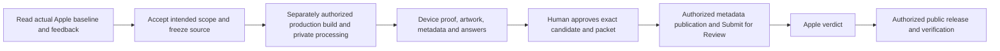

# Fitsy iOS release runbook

**TL;DR:** Prepare and verify one exact candidate, then obtain explicit human approval before publishing metadata or submitting for review.

> **Status:** living
> **Last inspected:** 2026-10-24
> **Next release:** [issue #444 review packet](../../release/next-submission.md)

Follow [shipping.md](shipping.md) and the human-selected ship-branch/verify-fitsy skills for checks, ownership and source-bound evidence.
The GitHub Fitsy Delivery board is the sole queue; the existing release owner coordinates prerequisite acceptance and the human gate.
This runbook is not permission to execute Apple/EAS mutations.
The current task expressly prohibits EAS builds/submissions and any Apple submission; version edits, uploads and publication are also outside this preparation.

## Establish the actual baseline

Read the last submitted App Store version/build, metadata, screenshots, review access, declarations, product/offer configuration, release mode and prior Apple feedback.
Record actual returned IDs, statuses and timestamps; preserve unknown source/native/runtime mappings rather than inferring them from tags.
Compare that submission with current served main/backend, intervening OTA updates and the intended embedded production binary.
A processed build, Git tag, OTA publication or repository listing draft does not prove an App Review submission or public release.

The current [verified binary anchor](../../../scripts/deploy/ios-binary-baseline.json) is version `1.0.0`, build `5`, bundle `com.fitsy.mobile`, runtime `1.0.0`, production channel, source `2e515fdc339d27e33110e128379fb16bd3a2d3a5`.
Its [provenance](ios-ota-baseline.md) establishes historical EAS/Apple processing and actual IPA identity, not the last submission.
Use [app.config.ts](../../../apps/mobile/app.config.ts) and [eas.json](../../../apps/mobile/eas.json) for current repository identity; preserve the established bundle instead of matching obsolete `app.fitsy.mobile` drafts.
Read ASC and EAS allocations before proposing an increasing unused build number.

### Agreement or access failure

For `FORBIDDEN.REQUIRED_AGREEMENTS_MISSING_OR_EXPIRED`, retain the exact read-only refusal and stop unchanged retries.
The account owner resolves the applicable agreement and notifies the existing release owner, who resumes baseline reads after that changed condition.
Do not guess agreement type/terms, accept agreements on the human's behalf, request passwords/keys in chat, or treat missing data as an empty Apple baseline.
The next packet links the retained coordinator receipt and records what was and was not returned.

Assess supported skills/tools before waiting: existing connected readers, bounded CLI reads, retained source-bound receipts and public official sources can still support preparation.
Keep credentials in the existing protected workflow and host-owned account context; workspace network/authentication restrictions do not authorize an alternate private-account access path.
Record the selected skills, attempted recovery, remaining boundary, owner and resume event in the current packet/handoff.
When an execution helper or orchestration hook caused the failure, have its existing owner validate the narrow correction through the actual consumer before another assignment; do not create a second release pipeline.

## Freeze the release scope and production identity

For #444, verify #431, #433, #442 and #443 delivery/acceptance or record an explicit human scope decision for each unresolved item.
Preserve #431's human trial-test ownership and genuine review/UI approvals without granting fresh prerequisite budgets.
Freeze exact source commit/tree, native inputs, lockfile, EAS profile/environment/channel, runtime, configuration identities and eventual binary ID/hash in the packet.
Run applicable cheap/focused checks, matching independent review and trusted exact-source Verify, then retain API/native/device and release evidence under the existing shipping contracts.
Document which checks have actually passed and which remain unknown; old-head CI and Test Store fixtures cannot stand in for final-candidate acceptance.

The production build must use the production backend, Supabase project, real iOS RevenueCat app key and `pro` entitlement, not localhost/dev, keyless or `test_` configuration.
Prepare its EAS public configuration with the [explicit-source uploader](staging-environment.md#eas-public-configuration), using a separate production source and `--env production`.
Review the default dry run before an authorized `--apply`; never copy local DEV credentials into production EAS configuration.
Confirm the evaluated configuration and actual embedded IPA, including Google sign-in scheme, signing/team, bundle, version/build, SDK, runtime and production updates channel.
Do not expose credentials when recording identities.
The next native build uses `runtimeVersion.policy = fingerprint`; build 5 keeps its embedded runtime `1.0.0`.
Record the actual build fingerprint and separate channel baseline using the [native compatibility and channel cutover contract](ios-ota-baseline.md).
Verify both embedded startup and applicable update behavior; an OTA in the same project does not prove the installed store binary received it.

## Build/upload boundary for a later authorized task

The existing [.github/workflows/eas-build.yml](../../../.github/workflows/eas-build.yml) reacts to `v*.*.*` tags or manual dispatch and performs both a store EAS build with the `testflight` profile and an upload under `production-native`.
Creating a version tag can trigger that work; do not tag or dispatch during preparation.
Inspect the actual workflow and installed EAS CLI contract before using them in a later authorized task.
For an authorized upload, select and record the exact frozen build rather than assuming an unrelated latest build is the candidate.
Do not change protected environment/release controls to make a candidate eligible.

An EAS upload is distinct from Apple's processing and from Submit for Review.
Record EAS build ID, source, IPA SHA-256, native/configuration identities, ASC build ID and processing result separately.
Do not claim a binary was built, uploaded or processed without its receipts.
Apple's [current upload requirement](https://developer.apple.com/news/?id=ueeok6yw) is Xcode 26 or later with the iOS 26 SDK or later; inspect the build logs/toolchain and recheck current requirements at execution time.

## Complete the review packet

Prepare actual old Apple value/state -> proposed value/state, reason, evidence and any human decision for every material change.
Label confirmed facts, recommended edits and unknowns; [listing copy](../../product/app-store-listing.md) remains a proposal until approved.
Include onboarding/preview and post-fetch coachmarks, sign-in/payment/resubscribe, eligible/ineligible terms, trial reminders/timeline, linked calorie/macro editing and recommendation claims.
Verify current localized StoreKit/RevenueCat product prices, renewal periods, eligibility and introductory terms; catalog policy alone cannot promise a free trial.
Test working reviewer access and all applicable real-device/billing recovery paths without presenting a reviewer bypass as a paid subscription.

Use [Apple's current screenshot specifications](https://developer.apple.com/help/app-store-connect/reference/app-information/screenshot-specifications/) and actual ASC required slots, rather than a historical device matrix.
The next packet specifies the current iPhone dimensions, proposed scenes and unresolved artwork; capture the exact accepted candidate and inspect it visually.
Verify live privacy/support/terms pages, contact inboxes, review instructions, deletion/restoration and prior-review remedies.
Review actual profile sync and SDK practices before answering [App Privacy](https://developer.apple.com/app-store/app-privacy-details/) questions; do not preserve stale local-only, anonymous-analytics, content-rights or age-rating claims mechanically.
Account/declaration decisions and legal agreements remain explicit human/account-owner choices.

## Human approval and later submission

Do not ask for submission approval until the concrete packet, native candidate, checks, artwork, review access and consequential answers are complete.
Request explicit approval identifying exact source/build/hash, metadata/assets/answers and release mode before publishing metadata or clicking Submit for Review.
Recommended mode is manual release after Apple acceptance, subject to the human's explicit choice and later release authority.
If source, binary or consequential answers change after approval, reconcile that approval with the human before submitting a materially different candidate.

Only after the required approval, the authorized owner follows [Apple's current submission steps](https://developer.apple.com/help/app-store-connect/manage-submissions-to-app-review/submit-an-app/) using the supported ASC tools, selects the exact processed build and records the submission receipt/status.
Adding a version for review is not the final Submit for Review action.
Monitor and retain Apple acceptance/rejection separately from upload/processing, handle review feedback under the same ownership, then perform any separately authorized public release using the approved [release option](https://developer.apple.com/help/app-store-connect/manage-your-apps-availability/select-an-app-store-version-release-option/).
Verify the actual public listing/build and affected production behavior before reporting public release complete.
Do not claim Apple acceptance from an upload, successful CI, private walkthrough or processed build.
