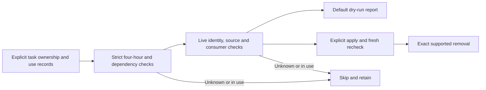

# Local delivery dispatcher

The GitHub project is the only delivery queue.
An issue is eligible when it is Queued, priority Now or Next, labeled `dispatch-ready`, lacks `dispatch-hold`, and every strict `#ID` dependency is Done on the same board.
Readiness starts at the label event or first observation when historical event time is unavailable.

One local host holds an exclusive file lock and writes a durable claim before touching the board or starting a worker.
A claim snapshots the issue acceptance, implementation provider/model/effort, independent reviewer settings, advisory classifier response, and process identity.
A first claim creates an owned Git worktree; an authorized same-issue successor reuses the latest unfinished ended checkout and branch after fresh registration, terminal-receipt, process/group and open-file checks.
Tracked and untracked unfinished work stay in place, and the new claim records its creation claim, predecessor and resumed checkout path.
An uncertain retained checkout parks preparation rather than making a second dependency environment.
Durable claim receipts preserve discovery after the compact in-memory history rolls over.
The worker follows the existing shipping gates and unchanged issue-bound review history.
A live or uncertain worker retains the lane; a proven stopped worker without verified Done is parked with a reason so independent ready work may proceed.

Jev classification is advisory and cached by bounded issue content, model, prompt version and configured profiles.
Low-confidence answers remain unknown, and deterministic risk floors cannot be lowered.
Provider errors fall back deterministically; neither Jev nor issue text can choose executable commands or alter review gates.
The current default implementation profile is Codex with Sol; a trusted configuration can select the supported Claude adapter for a future claim.

The installer starts paused from a clean, current main revision.
Enabling requires that revision's main Verify and Deploy success and no active claim.
The dispatcher posts actionable blocker incidents through the shared Slack limiter with a stable key, history reconciliation and confirmed receipt.
It does not publish the periodic digest.

## Admission and manual cleanup

Admission preserves `min_free_bytes` plus `scratch_reserve_bytes`, defaulting to 8 GiB plus 4 GiB.
Configured execution budgets still require fresh private coordinator observations and sufficient host/Docker capacity.
The dispatcher performs no automatic resource deletion or archival.
Checkout creation persists its exact path and branch intent before Git runs, and crash recovery preserves unfinished source for an authorized successor.
The installer copies only the dispatcher runtime, verifies its digest under `dispatcher.lock`, and leaves it paused.

Run cleanup on demand from this checkout:

```sh
python3 scripts/delivery/cleanup.py /absolute/path/cleanup-records.json --repo /absolute/path/fitsy
# Inspect the dry-run output, then explicitly request deletion:
python3 scripts/delivery/cleanup.py /absolute/path/cleanup-records.json --repo /absolute/path/fitsy --apply
python3 -B scripts/delivery/cleanup.test.py
```

No cron or launchd job is installed by cleanup.
`--dry-run` is the default; `--apply` is the only deleting mode.
The command holds the existing dispatcher and simulator locks, checks each resource again immediately before removal, and skips failed or incomplete inventories.
For a dispatcher configured outside `~/.fitsy-dispatcher`, pass its actual `--state-dir` so the owner check and lock match.
The task owner supplies a private JSON list of exact resource records, updating it under those same locks after actual use and release.
Existing names, creation ages, filesystem access times and legacy claim receipts alone never establish cleanup eligibility.
Do not backfill missing clocks or ownership by guessing.
Keep the original task handoff and required delivery/recovery evidence outside a disposable resource before marking its dependencies empty.

Each record contains these fields:

| Field | Required evidence |
| --- | --- |
| `task` | Exact task identity `fitsy-issue-123-abcdef01` |
| `kind`, `id` | `worktree` and canonical absolute path, `container` and full immutable ID, or `simulator` and exact UDID |
| `head` | Original task source SHA contained in this repository's `origin/main` |
| `inactive`, `shared`, `disposable` | Explicit `true`, `false`, `true` from ended task ownership and dependency checks |
| `pids`, `dependencies` | Known owner PIDs, all now absent, and an explicitly empty list of remaining evidence/recovery/consumer dependencies |
| `last_used`, `released_at` | Actual Unix-second use and subsequent release clocks, both strictly more than 14,400 seconds old |
| `context`, `daemon` | For containers, the original Docker context and daemon ID |

A registered worktree must have the exact task basename and branch `codex/issue-123-abcdef01`, the recorded head, no lock, and no tracked, untracked or ignored files requiring preservation.
This also retains checkouts containing ignored evidence or dependency installations.
Open files or an unavailable ownership tool retain worktrees and simulators.
Containers must match the original context/daemon and full ID, carry labels `com.fitsy.task=<task>`, `com.fitsy.shared=false`, and `com.fitsy.disposable=true`, and be exited for more than four hours with no mounts or writable changes.
Simulators must be named `Fitsy <task>`, be shut down with no owner claim, and have an old device metadata timestamp in addition to the explicit last-use clocks.
Legacy devices without this exact ownership proof stay intact.
No forced removal, broad prune, cache/evidence purge, dirty/unmerged source archival or branch deletion is performed.



### Complete queue reads and quota cooldown

The canonical `snapshot` mode reads the same complete live GitHub queue as dispatch admission.
Use `python3 ~/.fitsy-dispatcher/runtime/local-dispatcher.py snapshot --config ~/.fitsy-dispatcher/config.json` for coordination instead of a separate broad project CLI query.
The transport pages at 100 cards and requests only delivery fields and issue labels; total counts, unique IDs and advancing cursors must agree before dispatch.
A truncated label connection fails closed so a hold cannot disappear through truncation.
The private `github-queue-quota.json` stores observed cost and quota reset timing, never board content or launch permission.
Rate exhaustion defers subsequent reads until the server reset, or a bounded 30-minute fallback when GitHub supplies no timing.
A reset requires a fresh complete read; partial GraphQL results never authorize a claim.
The existing timer retries after cooldown without an additional dispatcher or schedule.

The sole local publisher invokes this installed `snapshot` command before collecting its REST report details.
It consumes the complete fresh snapshot instead of running another nested GraphQL project query.
A dispatcher lock conflict or shared quota cooldown defers the report without a Slack send and preserves the existing slot intent, deduplication, rate limiting and uncertain-send receipts.
The publisher retains its source-bound editorial freshness and board-binding checks.
Final worker launch confirmation requires a fresh complete board read under the existing ownership lock.
