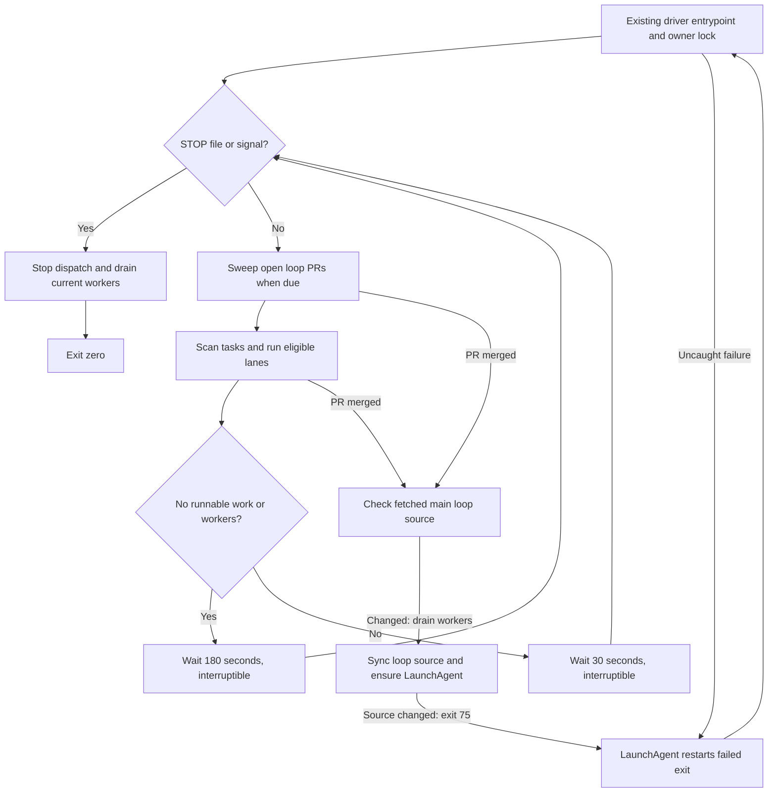

# Keep the existing loop driver alive

The existing host owner installs and operates this change through [loop recovery](../../../scripts/delivery/loop/SKILL.md).
The repository's [driver](../../../scripts/delivery/loop/driver.py) uses [lifecycle.py](../../../scripts/delivery/loop/lifecycle.py) to idle for 180 seconds when no runnable tasks or workers remain, then scan `loop/tasks` again.
It continues scanning when the planner is disabled, returns no task or reports failure; the planner's existing retry interval still applies.
Active scheduling retains its 30-second interval, two lanes, task recovery and merge gates.
The [open-PR helper](../../../scripts/delivery/loop/open_prs.py) runs on scheduling passes before task selection, at most once every 180 seconds, including idle scans and the boundary after a worker finishes.
It reads every page of open PRs and spaces GitHub CLI requests by at least one second.
Only same-repository PRs matching an original task's branch and persisted `state.json` PR number qualify, with `opened_by_loop: true` or the legacy driver's exact PR-creation log event as proof of creation.
Branch prefixes, adopted PRs and follow-up headers alone never establish loop ownership.
Active branch leases remain with their workers.

For eligible PRs, `BEHIND` runs `gh pr update-branch` and waits until another sweep for fresh checks.
`CLEAN` requires completed successful `Verify` and `AI review` results, no failures from the existing `gating_failures` policy, and the driver's existing `Sim scope` and `Simulator` gate before ordinary squash merge with `--match-head-commit`.
GitHub protection still decides whether the merge succeeds.
`DIRTY` queues one existing-branch task with `existing: 1`, `pr: <number>`, the original branch, lane and acceptance context.
An unfinished queued or blocked follow-up suppresses duplicates; a later conflict may get a successor after that follow-up finishes, preserving its history.
A queued original retains the work, while a parked original may receive its first conflict follow-up.
API or merge failures are logged and wait for the normal sweep interval; they do not stop task dispatch.

Git's `pre-push died of signal N` diagnostic requires recovery by the existing host owner before candidate code repair.
It does not establish a failed candidate assertion or authorize another identical publication attempt.
The owner retains Git output and the matching host crash report, diagnoses the launcher, and replays the unchanged hook with both required verifier selections against the same source.
Keep candidate sandbox permissions and release gates unchanged.



## Install reviewed driver source

Use a clean reviewed checkout on the host, with its normal dependencies installed.
Coordinate with the existing owner at a task boundary and retire its old driver restart command before starting the LaunchAgent.
The legacy driver does not understand `STOP`; its owner must arrange the initial shutdown.
The installer refuses to change source under an active or uncertain owner and preserves tasks, state, logs, old entrypoints and a source receipt.
Install the source and load the per-user LaunchAgent with one command at that stopped boundary:

```sh
python3 scripts/delivery/loop/install.py --directory "$HOME/fitsy-refactor/loop" --apply
```

Omit `--apply` to preview the source installation without changing anything.
Repeating the same installation preserves the source, backups and state, and does not bootstrap a second loaded agent, including while the installed owner runs.
The installer changes the external `loop/driver.py` to delegate to its frozen reviewed source, including `lifecycle.py`, `open_prs.py`, `install.py` and the plist template.
For the PR body, include the one-line driver integration below, placed first inside the legacy `if __name__ == '__main__':` block after installation has written `source-receipt.json`.
The supported installer already supplies the equivalent compatibility entrypoint, so no live hand edit is needed:

```python
import os, runpy; os.environ['FITSY_LOOP_DIR'] = L; v = json.load(open(L + '/source-receipt.json'))['version']; sys.path.insert(0, v); runpy.run_path(v + '/driver.py', run_name='__main__'); raise SystemExit(0)
```

## Automatic installation after merge

Both task workers and the open-PR sweep persist an installation request after a successful merge, including an already-merged task PR.
The scheduler fetches `origin/main` through the host's `wt3` checkout and reads only the committed loop runtime files.
Changed source pauses new dispatch and drains both workers under the existing owner lock before installation.
It installs changed Python modules, `SKILL.md` and the plist in a new frozen version, preserving tasks, state, logs, progress files and the previously installed controls and dependency grants.
It never installs the candidate worktree's uncommitted source or copies unrelated repository files.
Changes to controls outside `scripts/delivery/loop/` still require the manual reviewed installation above.
After ensuring the LaunchAgent is installed and loaded, the driver saves the queue and exits 75 so launchd restarts the original entrypoint into the new version.
Unchanged runtime source continues without restarting; installation failures retain the request for another attempt after 180 seconds and allow normal task dispatch meanwhile.

## Verify the per-user LaunchAgent

The [plist template](../../../scripts/delivery/loop/org.fitsy.loop-driver.plist) starts the same `loop/driver.py` at login and restarts unsuccessful exits, with a 60-second crash throttle.
`KeepAlive.SuccessfulExit=false` permits a clean stop to remain stopped.
Both standard output and errors append to `loop/driver.log`, alongside the driver's own log entries.
This is a per-user agent that runs while the user is logged in; see [Apple's launchd guide](https://developer.apple.com/library/archive/documentation/MacOSX/Conceptual/BPSystemStartup/Chapters/CreatingLaunchdJobs.html) and `man launchd.plist`.
The installer renders absolute paths with `plistlib`, enables and bootstraps an unloaded service, and leaves an already-loaded service running.
Verify the installed service:

```sh
plutil -lint "$HOME/Library/LaunchAgents/org.fitsy.loop-driver.plist"
launchctl print "gui/$(id -u)/org.fitsy.loop-driver"
tail -n 30 "$HOME/fitsy-refactor/loop/driver.log"
```

Check `source-receipt.json`, the service PID and `IDLE queue empty` in the log before claiming host adoption.
Queue a normal authorized task and confirm the same driver starts it after an idle scan.

## Stop, resume or remove

Create `~/fitsy-refactor/loop/STOP` to stop dispatch within one second during a scheduling wait.
`SIGINT` and `SIGTERM` wake the wait immediately and also request a clean exit.
An active task finishes its normal checks while the driver retains its owner lock; `STOPPING` records the request and `STOPPED` records the completed drain.
Wait for the PID to exit before unloading the agent, since launchd can otherwise forcibly terminate workers after its shutdown grace period.
Keep the stop file in place to prevent task dispatch on a later login or accidental start:

```sh
touch "$HOME/fitsy-refactor/loop/STOP"
tail -f "$HOME/fitsy-refactor/loop/driver.log" # Wait for STOPPED, then interrupt tail.
launchctl print "gui/$(id -u)/org.fitsy.loop-driver" # Confirm no running PID.
# To unload after the driver has exited:
launchctl bootout "gui/$(id -u)" "$HOME/Library/LaunchAgents/org.fitsy.loop-driver.plist"
# To remove permanently after unloading:
rm "$HOME/Library/LaunchAgents/org.fitsy.loop-driver.plist"
```

To resume a loaded but cleanly stopped agent, remove `STOP` and run `launchctl kickstart "gui/$(id -u)/org.fitsy.loop-driver"`.
If it was unloaded, bootstrap the rendered plist again instead.
Do not use `kickstart -k` on active work or keep the previous restart mechanism running alongside this agent.

## Verify before installation

```sh
python3 -B scripts/delivery/loop/loop.test.py
python3 -B scripts/delivery/loop/worktrees.test.py
python3 -B scripts/delivery/loop/open_prs.test.py
```

The lifecycle tests run the real scheduler in subprocesses with temporary task folders, exercise repeated empty scans and later tasks, drain an active worker under the owner lock, and verify zero exits for `STOP`, `SIGINT` and `SIGTERM`.
The installer regression exercises the original external entrypoint and verifies that its frozen source contains the helper.
The self-install regressions fetch a real Git remote, preserve state and controls, verify repeat installation under an active owner lock, drain both lanes and resume the queued task through the updated compatibility entrypoint.
The sweep suite exercises real task files, branch leases and the GitHub CLI boundary for branch updates, protected merges, conflict-task deduplication, ownership exclusions, pagination, pacing and failure recovery.
The scheduler regression proves repeated idle sweeps and continued task pickup around finished work.
Host-only media validation and current-head independent review and CI retain their existing requirements.
