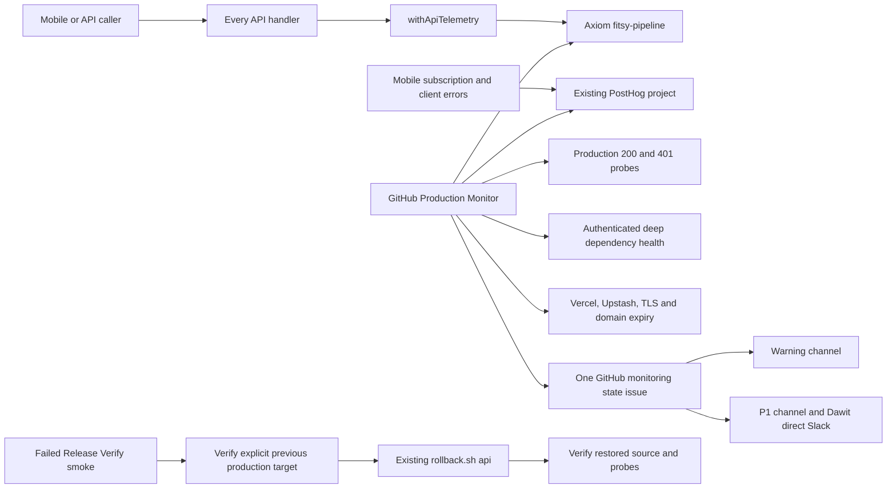

# Production monitoring and alerting

**TL;DR:** API failures and dependency health feed Axiom, external probes, and shared Slack incident transitions.

[Issue #605](https://github.com/dgmolla/fitsy/issues/605) contains the Oct 27 post-mortem, telemetry inventory, and observability decision.
The operating policy is checked into [production-monitor.config.json](../../../scripts/verify/production-monitor.config.json).
A configured workflow and an observed alert/recovery receipt are required before claiming live coverage.

## Flow and ownership



The app lane owns route/client instrumentation, health checks, policy, and probe implementation.
The existing release owner owns recovery execution and activation of GitHub credentials/routing.
Fitsy Data retains pipeline emitters, paid-call budgets, queue leases, and pipeline heartbeat implementation.
The sole delivery coordinator retains Mac/simulator/loop notifications; this monitor does not introduce another delivery publisher.

## Runtime and privacy contracts

Every exported API handler uses `withApiTelemetry(method, staticRoute, handler)`.
The wrapper preserves the response or original thrown error and records a status of 500 for an uncaught throw.
Returned 500/503 responses emit `api_request` with `alert: true`, including rate-limiter failures before authentication.
The discovery regression in `apps/api/app/api/auth-coverage.test.ts` rejects an unwrapped handler.
New fail-closed paths require a health check and a real failure regression under the repository's danger-zone rule.

Events contain only a static route template, method, status, duration, environment, deployment SHA, timestamp, and failure flag.
Dynamic IDs, headers, query strings, request/response bodies, raw errors, IPs, location, and nutrition are excluded.
A safe stdout event remains available if Axiom delivery fails.
The existing Axiom SDK sends to `fitsy-pipeline`; `next/server.after()` retains the flush after the response without adding Slack latency to user requests.
Production queries select `type == 'api_request'` and `environment == 'production'` so pipeline/search-detail events and previews cannot inflate the denominator.
The legacy `reportServerError` hook remains compatible, including its existing per-instance deduplication limitation.
New monitor alerts use shared state outside Vercel and Upstash.

Mobile `subscription_check` events report every completed status/sync attempt, including successful checks for the denominator.
Outcomes distinguish `known`, `unknown`, `server_error`, `client_error`, and `network_error`.
Only source, outcome, HTTP status, duration, and production/development kind survive the privacy filter.
Existing JS `client_error` events now carry the same environment kind so developer crashes cannot page production.
Both emitters require the production API origin and production EAS Update channel, without a debug bundle or local Metro host, before labeling an event production.
Release simulator bundles using dev or PR preview backends remain development telemetry.
This adds no native SDK, entitlement decision, billing grant, or navigation change.
Existing Maestro journeys remain applicable because user interactions are unchanged.

## Checks and thresholds

| Signal | Trigger | Route |
| --- | --- | --- |
| API errors | More than 2% 5xx OR at least 10 5xx in five minutes, including low-volume outages | P1 channel and direct Slack |
| Route latency | At least 20 requests, p95 above 2 seconds and above twice a sufficiently sampled prior baseline; absolute threshold when no baseline exists | P2 channel |
| Telemetry availability | No production route event for 15 minutes despite synthetic traffic | P1 |
| Synthetic requests | `/api/health` must return 200; invalid sessions on `/api/user/profile`, `/api/subscriptions/status`, and `/api/restaurants` must return 401 | P1 on any unexpected status, timeout, or invalid health body |
| Deep health | Authenticated `/api/health?deep=1` must return all dependencies healthy | P1 |
| RevenueCat webhook | At least 10 rejected 4xx deliveries in five minutes; 5xx also enter API error thresholds | P2 rejections; P1 API failure |
| Mobile subscription checks | At least 10 checks, unknown/server/network outcomes above 5% and twice the prior baseline | P2 |
| Mobile JS fatal errors | At least one production fatal `client_error` in five minutes | P1 |
| Production deployment | Latest production Vercel deployment is ERROR, or serving SHA differs from observed main for more than 30 minutes | P1 |
| Upstash daily commands | At least 80% of the explicitly configured daily allowance; at least 95% | P2 then P1 |
| API crons | No successful execution within two schedule intervals plus one hour | P2 |
| TLS/domain expiration | Within 14 days; within three days | P2 then P1 |
| Observer failure | Missing configuration, denied query access, malformed/partial provider results, or unavailable provider API | P2; affected prior incidents remain open |
| Deploy/EAS workflow failure | Failed, timed out, cancelled, or action-required production release | P1 |
| Dev maintenance failure | Failed maintenance workflow | P2 |

Current and baseline API windows are disjoint.
The baseline is the preceding 55 minutes of the one-hour lookback.
Cron monitoring allows an initial observation window before reporting missing historical executions after instrumentation is first enabled.
Expiry data is refreshed hourly.
Provider requests have deadlines and do not log provider bodies or exception strings.
Deep health bounds pool acquisition/query waiting and separately exercises writable Redis EVAL with expiring isolated keys.
RevenueCat reachability deliberately expects an unauthenticated 401 on a documented subscriber route, without creating a customer or reading an entitlement.
It does not prove key validity, webhook delivery, App Store connectivity, or successful purchases.
Shallow public health remains a database/source check and can remain 200 during a Redis outage.

## Configuration and activation

The [environment manifest](../../../scripts/deploy/env-manifest.json) declares required bindings for development, preview, production, monitor, and recovery execution.
Development and Preview require database, authentication, RevenueCat lookup, and writable Redis bindings for app journeys.
Production additionally requires `REVENUECAT_WEBHOOK_AUTH`, `AXIOM_TOKEN`, `CRON_SECRET`, and `SLACK_BOT_TOKEN` for its webhook, scheduled work, and alert delivery.
These production operations bindings are optional in Development and Preview, where unconfigured webhook/cron endpoints remain closed and safe request telemetry still reaches stdout.
The production monitor selects production telemetry; ephemeral previews do not need production alert credentials to build or serve simulator journeys.
`env-manifest` is a blocking local/CI registry check that parses source environment reads, including bracket access and destructuring.
Dynamic selectors require an exact file/expression exception.
A new variable cannot pass CI until declared; optional declarations still require review of whether the binding is operationally required.
The same manifest checks nonempty target bindings before the guarded build's Redis EVAL, migrations, and compilation.
Database target, role approval, and OTA/native compatibility checks retain their existing authority.
Ordinary `next dev` can still use bounded local quotas with both Redis variables absent; guarded Vercel development builds require the declared bindings.

The existing release/cloud owner configures the following through the existing GitHub secret/variable route, without printing values:

| Location | Names and purpose |
| --- | --- |
| GitHub secrets | `AXIOM_TOKEN` with query access to `fitsy-pipeline`; `CRON_SECRET`; `SLACK_BOT_TOKEN`; `VERCEL_TOKEN`; existing `POSTHOG_PERSONAL_API_KEY` with project query-read access |
| GitHub variables | `SLACK_ALERT_USER_ID` for Dawit's direct Slack route; `POSTHOG_PROJECT_ID` for the existing US PostHog project |
| Quota visibility, when supported | Secrets `UPSTASH_EMAIL`, `UPSTASH_API_KEY`; variables `UPSTASH_DATABASE_ID`, `UPSTASH_DAILY_COMMAND_LIMIT` |
| Schedule activation | `FITSY_MONITOR_SCHEDULE_ENABLED=true` only after routing, credential access, and no-charge Actions budget are verified |

The workflow receives only the GitHub permissions needed to read source/workflows and update its single monitoring state issue.
It checks out the protected workflow revision, never failed-release artifacts or candidate PR code.
The shared `fitsy-production-monitor` concurrency group serializes scheduled monitoring and release recovery.
Issue state records each channel/direct delivery separately so a failed DM retries without repeating the successful channel message.
Failures receive reminders at most every 30 minutes; observed recovery sends one resolved transition.
An unavailable metric source cannot resolve an incident from that source.
Skipped, neutral, missing, or unknown workflow conclusions likewise preserve open incidents and reminders until success or a verified release recovery is observed.
Slack errors remain pending and fail execution; a failed state/query/transport cannot be reported healthy.
A crash between Slack acceptance and persistence can still repeat a delivery; deterministic message IDs reduce this unavoidable transport ambiguity.

[Upstash's Developer API](https://upstash.com/docs/devops/developer-api/introduction) requires a native Upstash account.
Do not manufacture quota counts from successful requests, create a paid store, accept new terms, or widen integration access to bypass that boundary.
An unavailable quota source remains an explicit observer warning for the cloud owner.
The daily allowance is operator-supplied because provider plans can change and a shared store includes nonproduction traffic.
Separate production storage remains a cost decision for Dawit.

No paid vendor subscription or new Vercel integration is required by this implementation.
Existing [Axiom Personal](https://axiom.co/pricing) and [PostHog](https://posthog.com/pricing) allowances can cover early traffic, subject to account usage.
A five-minute GitHub schedule runs 288 jobs/day, or 8,640 jobs per 30 days.
For private repositories, [each job's billable time rounds up to a minute](https://docs.github.com/en/actions/how-tos/monitor-workflows/view-job-execution-time), so this can exceed included Actions minutes even with short jobs.
The schedule is therefore opt-in, and enabling paid capacity still requires Dawit's decision.
Manual and release-completion runs remain available for verification.
GitHub also [delays or drops scheduled jobs under load](https://docs.github.com/en/actions/how-tos/troubleshoot-workflows); the schedule is not a guaranteed five-minute detection SLA.
A separately approved external watchdog is the next step if that guarantee is required.

Before activation is accepted, retain a manual workflow run showing expected 401s without alerts, a controlled 503 producing channel/direct messages, deduplication on a second run, and a resolved message after recovery.
The existing CRON_SECRET-protected `/api/internal/alert-test?mode=handled` returns a deliberate 503 through the real telemetry wrapper without disrupting user routes or removing production credentials.
Ten deliberate requests in one window exercise the count threshold even when normal production traffic dilutes the error percentage.
Bind the receipt to the deployed source and actual destinations without including credentials.
Source tests prove these transitions with external HTTP fixtures; they do not prove live installation.

## Release recovery

A failed actual production-safe smoke invokes `production-recovery.mjs` from the trusted workflow revision.
It pages first and continues restoration if alert transport fails.
It checks that production still serves the failed release SHA, selects an explicit older READY production deployment from the correct Vercel project, and runs the same expected 200/401 probes against that immutable URL.
It rechecks serving identity immediately before calling the unchanged `scripts/deploy/rollback.sh api <verified-url>`.
A newer serving source, unknown source, unsafe URL, or unhealthy prior target withholds promotion.
After promotion, public health must report the previous SHA and all probes must pass before a resolved transition is recorded.
Recovery also reruns the existing `api-e2e.sh --prod-safe` contract with the same optional production smoke account as Release Verify.
A failed login, locked or empty entitled search, or unavailable smoke command withholds the recovery receipt even when basic 200/401 probes pass.
A successfully recovered Deploy run does not generate a second generic workflow-failure page.
Failed observation before smoke still pages through the external workflow observer, but does not guess a rollback source.

The existing Git integration still owns normal API production promotion.
This change does not turn Release Verify into a pre-promotion dev/preview/prod gate or change its admission contract.
Strict staged promotion remains with the existing release owner because changing the Git producer/admission path is outside this worker's authorized edits.
Keep `dev.fitsy.org` pinned to `dev`; candidate native validation uses its own immutable PR preview.
No App Store, TestFlight submission, native build, or production configuration mutation is part of local validation.

## Remaining inventory boundaries

| Area | Disposition and next owner |
| --- | --- |
| Pipeline cost/quota/heartbeat | Fitsy Data connects its existing Axiom emitter and paid-call journal to the inventory thresholds; app lane does not edit pipeline-owned files. |
| Mac/loop/simulator capacity | Existing sole coordinator and resource helpers retain ownership and notifications. |
| Supabase pool utilization and slow-query details | Bounded health and request latency detect user impact; cloud owner adds provider-level 80%/95% capacity signals when a supported read-only metrics source is available. |
| Native crashes | Existing JS errors are covered; a native SDK requires the next separately approved binary. |
| Widget refresh | No widget implementation exists in this checkout; app owner adds refresh outcome/age instrumentation when that consumer ships. |
| Other provider spend/quota | Existing provider budgets remain authoritative; cloud/Data owners bind actual allowances and counters before claiming 80%/95% coverage. |

## Verification

```sh
node --test scripts/verify/production-monitor.test.mjs scripts/deploy/production-recovery.test.mjs
node scripts/deploy/env-manifest.mjs
python3 -B scripts/deploy/routine-release.test.py
npm test -w apps/api -- --runInBand --runTestsByPath app/api/monitoring.test.ts app/api/health/deep.test.ts lib/apiTelemetry.test.ts lib/rateLimit.test.ts app/api/subscriptions/sync/route.sandbox.test.ts
npm test -w apps/mobile -- --runInBand --runTestsByPath lib/monitoringEnvironment.test.ts lib/subscriptionMonitoring.test.ts lib/analytics.privacy.test.ts lib/errorReporting.test.ts
```
The Jest release bridge discovers every Python test and runs each with its own bounded deadline, so adding guarded build cases cannot exhaust one aggregate timeout.

The scripts workspace bridge runs the monitoring and recovery regressions through the existing test group.
The initial Oct 27 reproduction must fail if the handled-503 telemetry emission is removed.
The external monitor replay must fail if probe alerting, threshold evaluation, Slack delivery, state deduplication/recovery, or rollback invocation is removed.
Production-mode sandbox entitlement tests retain TestFlight/App Review/RevenueCat sandbox acceptance while asserting the new telemetry.
