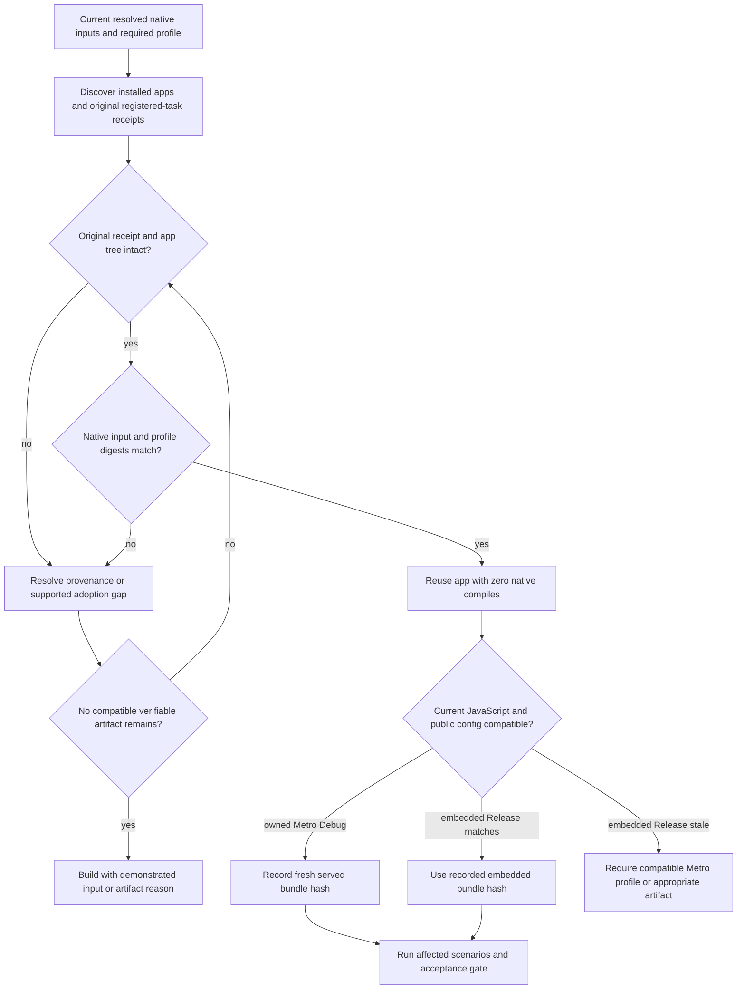

# Native binary reuse cookbook

The simulator CLI uses a verified compatible `.app` by default.
Before planning a compile, inspect the available installed simulator apps and original Debug/Metro build receipts in registered task worktrees, including retained artifacts outside the active checkout.
Run `node --env-file=apps/mobile/.env.development.local scripts/sim/product-flow.mjs build <UDID> [--test-store]` before product flows.
`build` prints `action: reuse` and performs no prebuild, Pod install or Xcode compile when the receipt is compatible.
`run` installs that verified artifact and starts a fresh owned Metro process for a Debug Test Store binary.
Every command uses an explicit booted simulator UDID and the existing simulator ownership claim.



## Discover before rebuilding

Check installed app metadata and Debug/Metro markers, then locate the original build receipt and recorded app in registered task worktrees.
A missing active-checkout receipt and an old embedded Release JavaScript bundle are discovery gaps, not evidence that every existing Debug native shell is incompatible.
Prefer an available task-owned device and artifact; preserve parked work and user-owned devices until their owner explicitly authorizes use.
Verify the original receipt seal and app tree, resolved native packages/autolinking and plugin configuration, generated native inputs, architecture, OS, build profile, Xcode/SDK and recorded compiler recipe.
Separate an actual native input change from a recipe fingerprint changed only by command isolation or transport, and retain the original compiler provenance while the owner resolves that compatibility decision.
Do not rewrite or reseal a historical receipt to make either comparison pass.

The current CLI searches active and retained receipts under its selected product root and requires their apps to remain inside that root's build directory.
It does not automatically discover or import receipts from other registered worktrees.
If a promising intact artifact is outside that supported selection, record its exact receipt/app paths and compatibility evidence for the existing owner to resolve the concrete adoption gap before running the CLI.
Do not call that gap a memory shortage or require a new cloud build/cache system without evidence.
The `build` entrypoint can compile when reuse fails, so run it only after the owner has authorized its actual boundary and resource admission.

After native reuse is established, prove that a fresh owned Metro serves the selected candidate JavaScript and public configuration on the route/port embedded in that app.
Do not attach to another task's server, overwrite its ownership receipt or treat embedded Debug JavaScript as current serving proof.
Retain the current UI approval and run the affected flows plus required final-candidate acceptance against that exact served source.
Use Test Store only for its supported capability; Apple billing and release approvals retain their separate requirements.

## Exact rebuild inputs

The receipt records `nativeIdentity.inputs`, `profileIdentity.inputs`, and `recipeIdentity.inputs` as well as their hashes, and seals its fields with `receiptHash`.
Generated iOS project and app source files are included even though Expo normally ignores them in Git.
The builder checks source and JavaScript before preparation, after Pod resolution, and after Xcode so edits during a build cannot receive a passing receipt.
The decision reports the changed input paths, such as `native input changed: files.apps/mobile/ios/Native.swift` or `binary profile changed: configuration`.
It never uses HEAD age or a general mobile-source hash as a rebuild reason.

| Change | Native action | JavaScript and acceptance action |
| --- | --- | --- |
| Swift/Obj-C source, generated iOS compile source, resolved Expo or React Native autolinking module, Pod graph, native plugin output or native build recipe | Rebuild with each changed file, graph field or recipe step named | Rerun affected scenarios. |
| Resolved entitlements, permissions, plist, URL scheme, bundle ID, native icon/splash/plugin resource or effective native build setting | Rebuild with changed config or resource field named | Rerun affected scenarios. |
| Simulator versus device, OS/architecture compatibility, Debug versus Release, Test Store capability, build flags or Xcode/SDK identity | Select an intact verified artifact for the required profile; rebuild only when none matches, naming each changed field | Use the profile that can serve or embed the required JavaScript. |
| Receipt absent in the current root, legacy or changed receipt, app absent or tree hash changed | Inspect installed apps and original registered-task receipts; resolve supported adoption/provenance, then build only if no compatible verifiable artifact remains | Preserve original receipts and artifacts; establish current JavaScript/configuration and affected acceptance separately. |
| JavaScript/UI or JS-only package and lockfile change | Reuse the binary if resolved native graph and profile still match | Start fresh owned Metro and capture its served bundle/config hash; rerun affected scenarios. |
| Android-only native source change while testing iOS | Reuse the iOS binary | Keep the iOS acceptance decision tied to affected flows. |
| Unit test or reviewer-input change | Reuse the binary | Retain still-valid product-flow evidence; run the relevant unit or review gate. |
| E2E flow change | Reuse the binary | Rerun affected flow acceptance and retain old raw evidence. |
| Public environment change that changes only `extra` or inlined JavaScript | Reuse the binary | Refresh served bundle/config proof and affected scenarios. |
| Public environment change that changes a native scheme, plist, entitlement or plugin result | Rebuild with the changed resolved config path | Rerun affected scenarios. |

An embedded Release app is accepted only when its build-time JavaScript and public configuration identities still match the candidate.
If an older retained Release app has the current embedded JavaScript and config, the CLI selects that intact artifact before requesting a new embedded artifact.
Before a Release compile overwrites its output path, the CLI copies every intact sealed retained artifact still at that path and writes a new receipt for each copy.
The original retained receipts remain as raw evidence, even when their old output path later becomes stale.
The active receipt is archived byte for byte before a separate sealed receipt points to its preserved app copy.
For example, v1 -> v2 -> v1 -> v3 -> v2 reuses the preserved v2 app without another compile.
When switching Debug to Release and back, the CLI searches retained sealed receipts and reactivates an intact compatible Debug artifact without compiling.
The current generated iOS tree must be attested by an intact receipt before a different profile's generated tree can be ignored for this selection.
Manual changes to an unattested generated tree still require a build with the changed file named.
The run report binds the selected simulator UDID; a compatible artifact built on another UDID can be reused and the run-owned device can later be retired with its raw evidence.
Retirement accepts a reactivated profile only when another sealed, intact artifact attests the current generated iOS tree, including after an interrupted delete.
Submission-only `eas.json` fields are outside the local simulator build, served bundle and acceptance identities.
Retirement rechecks the current public configuration before archiving proof or deleting a task simulator.
Public configuration receipts retain hashes per key, so a changed RevenueCat key selects billing acceptance even when its ignored environment file is the only edit.
An accepted owned Metro report can clear those pending keys for its served config and matching app even when the native receipt records an older JavaScript config.
If an older receipt cannot identify changed public keys, the gate requires every product category before accepting new proof.
The flow report also carries changed public keys until final acceptance is checked, so a development run cannot erase the required billing or sign-in scenarios.
Refreshing an embedded Release artifact carries any pending changed public keys into the new build receipt, so a missing prior flow report cannot erase affected acceptance.
That refresh includes pending keys from both the selected retained artifact and the currently active receipt.
Reactivating a retained artifact also seals the pending public-key categories from the prior active receipt into the new active receipt.
If Release evidence is required and the embedded bundle is stale, the default `build` command returns an explicit artifact reason without compiling.
Run `build <UDID> --refresh-embedded-js` to request a new embedded Release artifact with that reason recorded; use an owned Metro Debug profile when it meets the acceptance need.
For Debug, the receipt also binds the Metro URL route and port embedded in the app to the owned server used for evidence.
For newer JavaScript, use an owned Metro Debug binary with the required native capability or build a new embedded Release artifact if that profile is required.
A Test Store key is a Debug capability and cannot be relabeled as Apple sandbox billing proof.

## Example receipts

Reuse decision:

```json
{"action":"reuse","appHash":"<sha256>","nativeIdentity":"<sha256>","profileIdentity":"<sha256>","reason":"verified compatible native artifact"}
```

Permission change:

```json
{"action":"rebuild","reasons":["native input changed: nativeConfig.mods.infoPlist.NSLocationWhenInUseUsageDescription"],"nativeIdentity":"<new-sha256>","profileIdentity":"<same-sha256>"}
```

No artifact:

```json
{"action":"rebuild","reasons":["initial build: no verified compatible native artifact receipt"]}
```

Use `--force-rebuild --reason='specific diagnostic purpose'` only for a deliberate diagnostic compile.
The CLI records that operator reason in the build decision and receipt.
The ordinary `build` command is already the reuse-first entrypoint.
`run` and `check` reject a changed installed app, stale embedded bundle, wrong owned Metro identity, changed acceptance inputs or tampered raw evidence.
Simulator retirement rechecks current native, JavaScript and acceptance identities before it can archive the proof and delete a task device.
Failed and superseded flow reports remain under `.evidence/resume/`, while private publication continues to bind the actual candidate source SHA and artifact hashes.
