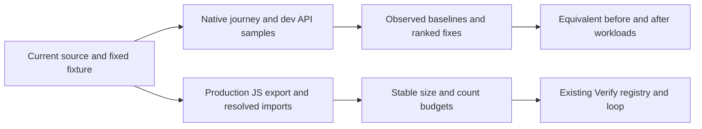

# Performance measurement and budgets

> **Status:** living · **Last verified:** 2026-10-27

**TL;DR:** Measure native journeys and dev requests separately; gate only repeatable sizes, counts and architecture invariants.

Issue [#563](https://github.com/dgmolla/fitsy/issues/563) owns the audit findings and remaining live measurements.
The commands below never publish an OTA, build a native binary, submit to Apple or modify the database.



## Repeatable local checks

```sh
npm run perf:check
npm run perf:bundle
node --test scripts/perf/*.test.mjs
npm test -w @fitsy/mobile -- --runInBand --runTestsByPath components/DiscoveryPerformance.test.tsx
```

`perf:check` enforces zero routed prototype screens and zero preload-provider dependencies reachable from all 11 public read-route modules.
It uses dependency-cruiser with the API's absolute tsconfig path and rejects unresolved local aliases.
This establishes an architectural upper bound of zero runtime macro-estimation calls; it is not provider billing telemetry.
`perf:bundle` exports production minified iOS JavaScript with source maps and no Hermes bytecode, then measures only the metadata-selected JS entry.
Gzip uses level 9; source maps, fonts and images are excluded from the JS size.
Exports and logs stay in fresh `.evidence/performance/export-*` directories with source digests.
The command checks that mobile inputs remain unchanged during the export.
The existing publish-environment override is used only for this deliberately keyless, offline, local export.
Ambient public app variables are removed from the child export environment, and dotenv loading is disabled so local credentials cannot change the measured build.

Budgets live in `scripts/perf/budgets.json`.
The iOS limits are 5,750,000 minified JS bytes and 1,380,000 gzip bytes, approximately 5% above the measured candidate.
These limits detect dependency and route growth, not launch speed.
`DiscoveryPerformance.test.tsx` allows zero additional card-gradient renders when opening and dismissing the meal editor over three loaded restaurants.
It also verifies result, rank, entitlement and callback updates after memoization.
It replaces native/provider boundaries while retaining application components, hooks and navigation.

`performance` runs in Verify layer 1 and `mobile-bundle` in layer 3, locally and in CI.
The ordinary pre-push hook and CI already invoke the registry-driven runner; they need no separate implementation.
The scripts test group runs the new Node harness tests; the mobile group runs the render budget.
Timing, scroll FPS, native memory and internet latency have no blocking budget.

## Dev API and database observations

```sh
mkdir -p .evidence/performance
# Supply FITSY_PERF_TOKEN privately from an entitled dev fixture session.
# Output contains aggregate measurements and raw numeric samples, never bodies or tokens.
npm run --silent perf:api > .evidence/performance/dev-api.json
# Load dev POSTGRES_URL_NON_POOLING and SUPABASE_URL through the existing env setup.
npm run --silent perf:db > .evidence/performance/dev-database.json
```

The API sampler accepts only `https://dev.fitsy.org` or an explicit HTTP loopback origin.
Redirects are forbidden so credentials cannot follow a redirect to another host.
It performs GET requests only and stops on HTTP/auth/entitlement errors, throttling, invalid JSON or transport failure.
It samples 13 workloads covering all 10 public GET routes: health, flags, main search, text search, guided and legacy previews, menu, Shuffle, restaurant stats, saved items, subscription status, profile and feedback.
The first search supplies the menu's restaurant ID; a fixture with no nearby restaurants is rejected.
Each workload retains its first observed request separately and collects 20 warm samples for nearest-rank p50/p95.
Each request waits at least 650 ms after the preceding request, below the shared 120/user/minute cap.
The 21 guided-preview and Shuffle requests also fit their individual 30/minute caps.
Headers time, total body time, decoded body bytes, cache-control, Vercel cache and server-timing observations are retained.
Decoded bytes are not compressed transfer bytes.
Neither the first observed request nor `x-vercel-cache: MISS` proves a Vercel function cold start.
Correlate Vercel invocation traces with fresh instance/startup telemetry before reporting a cold-start number.
Authentication writes, subscription sync, feedback writes, webhooks and internal cron GET handlers are intentionally excluded from repeated sampling because they can change data or send messages.

Database diagnostics reuse the production-target guard and additionally reject production even when `FITSY_ALLOW_PROD=1`.
A remote database must match the supplied dev Supabase project; loopback databases need no Supabase identity.
Every diagnostic transaction is read-only with a bounded statement timeout.
The report includes installed indexes, cumulative scan counters, estimated live rows, and `EXPLAIN (ANALYZE, BUFFERS)` of the canonical guided-preview query for DTLA/chicken with 600 kcal and P40/C60/F20 targets.
Optional `pg_stat_statements` output includes only current-principal query IDs and numeric timing/call counters; unavailable statistics are reported explicitly.
Those counters cover the server's statistics window, not just this run, and never establish p95.
Add an index only after correlating a slow route with its actual plan, cardinality and representative workload.

## Native measurement protocol

Use [native acceptance](shipping.md) and [saved Maestro flows](../../../apps/mobile/e2e/README.md) with an exclusively owned compatible binary, current-source Metro and a populated dev backend.
Record device/model, OS, binary/configuration identity, source digest, account entitlement, selected area, network and cache state.
Use a Release/profile build for launch, scrolling and memory numbers; Debug results remain separately labeled.
Capture at least five cold process launches, defining start at launch request and finish at the first interactive screen.
Measure first results separately from tapping Search to painted restaurant cards, including auth, GPS, debounce, request and render work.
For scrolling, replay the same loaded result set and distance through `shuffle.yaml` and retain a native frame trace with dropped-frame counts.
For images, retain request/decode/display timings and compare first load with warm-cache load, including missing-image fallback.
For memory, record native resident/peak footprint before search, after results, after repeated scrolling and after leaving the screen, with the same image/cache state.
Do not substitute Node heap, React test-renderer duration, CLI startup or a successful screenshot for native measurements.

## Audit baseline, 2026-10-27

| Metric | Before | After | Evidence and limit |
|---|---:|---:|---|
| Production iOS minified JS | 5,538,464 B | 5,500,498 B | Equivalent offline JS exports; 37,966 B removed (0.69%) |
| Same JS, gzip level 9 | 1,311,620 B | 1,306,043 B | 5,577 B removed (0.43%); not Hermes/install size |
| Extra card-gradient renders, open/dismiss editor | 6 | 0 | Three real cards in the component journey; not a native FPS measurement |
| Prototype routes shipped | 4 | 0 | Preserved in `apps/mobile/mockups/`; no production caller references |
| Reachable preload providers from public read routes | 0 | 0 | 11 entry modules, 56 reachable modules after alias resolution; architectural check |

The implemented fixes rank first by observed user-facing work, then by transfer size.

1. Memoize discovery cards and pass a stable result-aware preview callback: six unnecessary gradient renders become zero for one editor open/dismiss cycle.
   Changed results, ranks and entitlement still repaint, and taps use the current restaurant.
2. Move the four unreferenced prototype screens outside Expo Router: remove 37,966 shipped JS bytes while preserving their source for design work.
   This is a small measured bundle reduction; no cold-start improvement is claimed.

First-result latency, query/index work, image decoding and native memory are the next measurement priorities.
They are not ranked as proven fixes until connected/native evidence establishes their costs.

Cold start, first restaurant paint, scrolling FPS, image latency and native memory were not measured in the restricted worker.
CoreSimulator access was denied, and the connected simulator belonged to another task with a different source.
Dev route p50/p95, response payload bytes, Supabase query plans/index usage, cache hit ratios and Vercel cold starts were not measured because worker DNS/network and Docker access were denied.
The audit must retain these gaps until an appropriately connected owner runs the commands and native protocol.

Source inspection shows one application SQL statement for main search and guided preview, two menu reads, and three parallel aggregate reads for stats.
These are implementation counts, excluding auth, subscription and connection health checks, not measured request query counts.
Current search uses preloaded denormalized MenuItem macros and page-bounded estimate metadata joins.
Existing Restaurant location, MenuItem restaurant, and MacroEstimate item/source indexes are declared; their deployed presence and effectiveness require the database report.
The mobile guided-preview cache is account/context keyed, lasts 30 seconds and holds at most 10 contexts; shuffle search has no response cache and reconciles denied entitlement before selection.
There is no new response cache or index in this change.

Macro estimates are persisted by item/source in the preload pipeline.
Preload has a freshness skip before provider fetches and a fresh-menu-hash skip after fetching, with a default seven-day refresh window.
Official/FatSecret facts bypass estimation; unresolved items can still be re-estimated when their restaurant is refreshed, so this is not a universal per-dish content cache.
Use the existing durable preload cost ledger and [spend accounting](../pipeline/runbook.md#ai-spend-accounting-and-resumable-cap) for measured requests, cache tokens, retries and cost.
No live LLM call, provider bill or fresh-menu cache hit ratio was measured in this audit.

## Restricted-worker recovery

If dependencies are absent and npm networking is denied, copy the existing npm cache to checkout-owned evidence and run `npm ci --offline --ignore-scripts` with that private cache.
If offline resolution reports uncached registry metadata, retain the failure without changing peer policy or the lockfile.
A verified existing installation with the identical lockfile can supply a task-owned copy of root and workspace-local `node_modules`; preserve relative workspace links and validate it through current-source Prisma generation and canonical checks.
Then generate the current Prisma client before tests; if Prisma cannot touch the shared cache, copy it into checkout-owned cache storage and set the supported `XDG_CACHE_HOME` for generation/checks.
Preserve failed logs and the successful recovery logs separately.
When GitHub CLI networking is denied, authenticated browser access can recover issue reading and the explicitly requested issue report.
Browser access does not grant dev API timing or an exclusively owned native profiling session.
Keep the existing native/product acceptance gates pending when those resources are unavailable.
