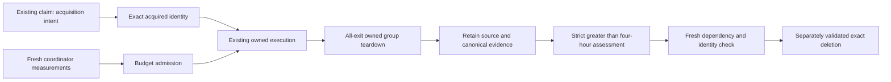

# Claim-bound resource controls

This is the #463 implementation contract for the retained dispatcher adapter.
The selected standalone skills remain the workflow authority. These changes are
uninstalled; behavioral decisions, disposable-runtime proof, independently reviewed
installation and actual #443 shipment must be reported separately.



## Acquisition and admission

`resource_intent` and `resource_acquired` in `scripts/delivery/resource_lifecycle.py`
append identity observations inside the original claim. The adapter records new or
resumed checkout path/head/branch and worker PID/start/group. Interrupted intent
remains `acquiring`; another acquisition cannot overwrite it. Original histories
and durable terminal receipts remain the recovery authority.

The same helpers accept simulator UDID and Docker context/daemon, container/image
IDs, network IDs, and volume/builder name plus creation identity. Callers must
record consumers, unfinished outcome dependencies, actual last use and recreation
argv before a resource can become disposable. Labels and creation age alone do
not establish ownership or last use. Docker/native caller integration and runtime
reconciliation are not established by these helper tests.

The installed coordinator configuration may supply `execution_budget` and a
private `resource_observation_path` outside the writable checkout tree. Neither is
selected through candidate environment variables. Admission requires a host
observation at most 60 seconds old, normal memory pressure, no swap growth, zero
other heavy jobs, the retained disk floor plus scratch reserve, numeric peak
memory/CPU budget and host reserve. Begin with one heavy job, including other
owners; this implementation does not grant measured concurrency expansion.
Without a budget the recorded admission is **light-only**, not permission for a
native build. The coordinator must route heavy commands through measured
admission; a recorded planning restriction alone does not enforce that routing.

For Docker, the observation must contain actual VM memory/swap/CPU allocation,
aggregate reserved container budgets and inspected effective container memory,
memory-plus-swap and CPU limits. Unlimited/default or mismatched limits refuse.
The aggregate must fit the VM, and the VM must leave the host reserve. Failed
inventory remains unavailable. The trusted coordinator supplies real observations;
synthetic dictionaries are local behavioral evidence only.

## Exit, restart and retention

The original launcher stays alive to settle its own group on success, failure,
SIGTERM/SIGINT cancellation and timeout. Fresh PID start/group checks precede
signals; missing or changed ownership retains the claim. Repeated SIGTERM is
ignored during bounded teardown, and the original handler is restored afterward.
An unconfirmed surviving group retains `ownership-uncertain`. Cancellation cannot
produce terminal acceptance. Teardown precedes claim release and review/UI waits.

SIGKILL, interruption during spawn/receipt write, detached descendants and Docker
compute require coordinator reconciliation under the existing lock. The existing
guards retain ambiguous groups; this patch does not prove all crash/all-exit
enforcement installed. The coordinator must observe actual surviving identities
and stopped children before releasing ownership, and preserve interrupted intent
and original review accounting.

Source retirement and scratch deletion require execution release strictly more
than 14,400 seconds ago, even with disk pressure, configured zero grace or an
over-budget cache. Shutting down compute is distinct from deleting data. Booted
simulator shutdown retains its supported separate policy; simulator erasure and
evidence deletion still need their own dependency/evidence safeguards.

`docker_retention` assesses containers, images, volumes, networks and dedicated
builders. It requires complete fresh inventory, exact identity, explicit disposable
provenance/recreation, no active/shared use and no unfinished dependency. Stopped
containers also pin images, volumes and networks. Reused volume names fail exact
creation identity matching. No destructive Docker operation is implemented or
promoted here. Builder cache deletion and all new exact-target operations need
disposable-runtime validation by the cleanup-skill owner before promotion.
No whole-host prune, force removal, VM storage deletion or new registry is added.

## Verification and next owner

Focused unprivileged checks:

```sh
python3 -B scripts/delivery/resource-controls.test.py
python3 -B scripts/delivery/local-dispatcher.test.py ResourceRetentionTest
```

The trusted coordinator needs a supported environment with real process inventory
and disposable resource teardown for these affected process cases:

```sh
python3 -B scripts/delivery/local-dispatcher.test.py \
  DispatcherProcessTest.test_success_and_failure_stop_unneeded_children_before_release \
  DispatcherProcessTest.test_cancelled_launcher_settles_group_and_cannot_accept_late_success \
  DispatcherProcessTest.test_cancel_during_acquisition_preserves_original_intent_without_new_worker \
  DispatcherProcessTest.test_timeout_stops_surviving_worker_group_child
python3 -B scripts/delivery/pressure-retention.test.py
```

Run applicable canonical cheap checks against the frozen commit before any
independent review. No additional reviewer allocation is authorized by the worker
brief. Preserve all original failed runs and cumulative history. Only the trusted
coordinator can reconcile a new allocation from current direct human policy.
Review changed controls before installation, then observe real success/failure,
cancel/timeout and interrupted-coordinator cleanup, active/shared retention and
measured disk/RAM reclamation. Keep resource/security holds until those facts exist.

The separate package/heartbeat owner retains automation prompt updates and live
readback; preserve the human's ACTIVE state, schedule, target and publisher policy.
This branch neither modifies that package nor calls another scheduler or sender.
After supported cutover, the existing exclusive owner resumes frozen #443's
acceptance/review applicability/PR/main Verify/Deploy and product proof. No local
fixture, preparation commit or green deployment alone completes #463.
