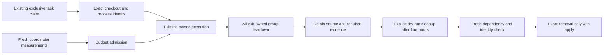

# Claim-bound resource controls

This is the #463 implementation contract for the retained dispatcher adapter.
The selected standalone skills remain the workflow authority. These changes are
uninstalled; behavioral decisions, disposable-runtime proof, independently reviewed
installation and actual #443 shipment must be reported separately.



## Acquisition and admission

The dispatcher keeps checkout creation intent and exact worker PID/start/group in the original claim.
Interrupted launch and checkout creation remain owned until reconciled under the existing dispatcher lock.
Original histories and durable terminal receipts remain the recovery authority.
The capacity check lives with its only caller in `scripts/delivery/local-dispatcher.py`.

The installed coordinator configuration may supply `execution_budget` and a
private `resource_observation_path` outside the writable checkout tree. Neither is
selected through candidate environment variables. Admission requires a host
observation at most 60 seconds old, normal memory pressure, no swap growth, zero
other heavy jobs, the retained disk floor plus scratch reserve, numeric peak
memory/CPU budget and host reserve. Begin with one heavy job, including other
owners; this implementation does not grant measured concurrency expansion.
Without a budget the recorded admission is **light-only**, not permission for a
native build. The coordinator must route heavy commands through measured
admission; a recorded planning restriction alone does not enforce that routing.

For Docker, the observation must contain actual VM memory/swap/CPU allocation,
aggregate reserved container budgets and inspected effective container memory,
memory-plus-swap and CPU limits. Unlimited/default or mismatched limits refuse.
The aggregate must fit the VM, and the VM must leave the host reserve. Failed
inventory remains unavailable. The trusted coordinator supplies real observations;
synthetic dictionaries are local behavioral evidence only.

## Exit, restart and retention

The original launcher stays alive to settle its own group on success, failure,
SIGTERM/SIGINT cancellation and timeout. Fresh PID start/group checks precede
signals; missing or changed ownership retains the claim. Repeated SIGTERM is
ignored during bounded teardown, and the original handler is restored afterward.
An unconfirmed surviving group retains `ownership-uncertain`. Cancellation cannot
produce terminal acceptance. Teardown precedes claim release and review/UI waits.

SIGKILL, interruption during spawn/receipt write, detached descendants and Docker
compute require coordinator reconciliation under the existing lock. The existing
guards retain ambiguous groups; this patch does not prove all crash/all-exit
enforcement installed. The coordinator must observe actual surviving identities
and stopped children before releasing ownership, and preserve interrupted intent
and original review accounting.

Resource deletion is an explicit on-demand operation through `scripts/delivery/cleanup.py`.
Its [record format and safeguards](local-dispatcher.md#admission-and-manual-cleanup) require known exclusive ownership, ended dependencies and actual use/release strictly more than four hours ago.
Dry-run is the default, and uncertain, dirty, unmerged, shared or active resources are retained.
The dispatcher no longer archives or deletes resources on an idle tick.

## Prepared profile custody

`external-approval.py` still rejects shared UID when `candidate_boundary` is absent.
The optional prepared profile contract requires an independently controlled config
pinning private receipt bytes, source/base/issue/claim, launcher/profile paths and
digests, and the original private `claim_state_path`. The receipt records matching
digests, the exact worker PID/start and observed denials for operator files,
approval credentials, claim writes, other branch writes, workspace secrets,
command networking and operator execution. A boolean in an unpinned candidate
file cannot establish approval.

The adapter checks the original active running claim, real PID start/group and a
different operator process group. It rechecks custody before publication writes,
and binds review consumption to the configured candidate issue/source/base.
Profile changes, incomplete denials, stale/reused process identity or a released
claim refuse. App provenance, exact-source acceptance, frozen product composition,
issuer-bound merge checks and independent protected environment review are retained.

The independent installation owner must validate the exact controls and real
command boundary before enabling this option. These fixtures cannot establish OS
isolation, live GitHub issuer/protection configuration or an independent verdict.
This worker has no installation, credential, protected publication or release
authority. No account switch or new #443 product review is part of this contract.

## Verification and next owner

Focused unprivileged checks:

```sh
python3 -B scripts/delivery/cleanup.test.py
python3 -B scripts/review/external-approval.test.py ProfileCustodyTests
python3 -B scripts/delivery/local-dispatcher.test.py
```

The dispatcher suite retains input isolation and complete queue-read checks.
Legacy claim, receipt and simulator bookkeeping fixtures are retired; cleanup safety is covered by the cleanup CLI regression suite above.

Run applicable canonical cheap checks against the frozen commit before any
independent review. No additional reviewer allocation is authorized by the worker
brief. Preserve all original failed runs and cumulative history. Only the trusted
coordinator can reconcile a new allocation from current direct human policy.
Review changed controls before installation, then observe real success/failure,
cancel/timeout and interrupted-coordinator cleanup, active/shared retention and
measured disk/RAM reclamation. Keep resource/security holds until those facts exist.

The separate package/heartbeat owner retains automation prompt updates and live
readback; preserve the human's ACTIVE state, schedule, target and publisher policy.
This branch neither modifies that package nor calls another scheduler or sender.
After supported cutover, the existing exclusive owner resumes frozen #443's
acceptance/review applicability/PR/main Verify/Deploy and product proof. No local
fixture, preparation commit or green deployment alone completes #463.
