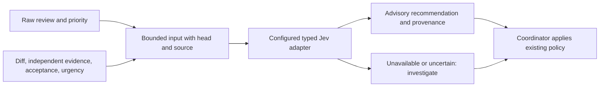

# On-demand review finding advice (#372)

The advisory CLI classifies one independent finding from bounded supplied evidence.
It never writes a review verdict, disposition sidecar, priority, required check, issue, queue card, or merge status.
The coordinator applies [the existing source-bound disposition policy](review-dispositions.md) and retains release authority.

Run `python3 scripts/review/advisory-finding.py path/to/finding.json` from this checkout.
The file contains one JSON object with `raw` (`verdict`, `priority`, `severity`, full 40-character `head`, `source`, and verbatim `finding`), bounded `context`, `evidence`, `urgency_rubric`, `acceptance_criteria` as `[{"id":"A1","text":"...","source":"https://..."}]`, and optional `owner` and `followup` for a real defect that might be deferred.
List only acceptance criteria mandatory for the current release; follow-up repair acceptance belongs in the linked follow-up issue.
The optional `--config` accepts a private JSON file with `provider`, `model`, `endpoint`, `key_file`, and `usd_per_million_input_tokens` for the configured adapter.
The default reuses the verified #388 Jev credential reader and private credential file.
The JSON response includes the preserved raw verdict, priority, reviewed head and source, input hash, provider and model, recommendation, reason, confidence, a concrete criterion object for `fix_now`, owner and follow-up for `defer_with_owner`, latency, usage, provider-billed cost where available, a separate list-price estimate, and explicit fallback.
The committed [real provider receipt](review-finding-provider-receipt.json) shows a Jev `jev-1.13.0` call on a PR #389 finding without credentials.
An unavailable provider returns `status: unavailable` and `recommendation: investigate`; the deterministic fallback is the existing review policy.
Low disposition confidence, a low-confidence fix-now criterion, a P0/P1 deferral, or a missing deferral owner also yields investigation.

The frozen shadow evaluator and its fixtures for deleted installers have been removed.
