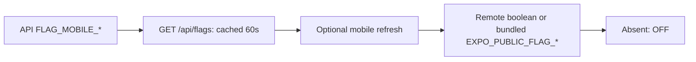

# Feature flags and rollbacks

**TL;DR:** Ship risky behavior OFF, disable its flag first, then restore a known-good deployment if needed.

## Flags

API callers use `isFlagEnabled('NEW_SEARCH')` from `apps/api/lib/flags.ts`, reading `FLAG_NEW_SEARCH` in Vercel's selected environment.
Only the literal string `true` enables a flag; absent or malformed values are OFF.
Deploy after changing Vercel env values so the API receives them.
Flags control rollout, never authorization, subscriptions or native compatibility.

Mobile callers import `isFlagEnabled` and optional `refreshFlags` from `apps/mobile/lib/flags.ts`:

```ts
await refreshFlags(); // Optional remote read before evaluating, e.g. on screen entry/foreground.
const enabled = isFlagEnabled('NEW_SEARCH', process.env.EXPO_PUBLIC_FLAG_NEW_SEARCH);
```

Keep literal dot access to `EXPO_PUBLIC_FLAG_*` at the call site so Expo inlines the bundled default.
Without a remote read, the bundled value applies, defaulting OFF.
For a remote override, explicitly set `FLAG_MOBILE_NEW_SEARCH=true` or `false` on the API and deploy it.
Public `GET /api/flags` returns `{"NEW_SEARCH":true}`; only `FLAG_MOBILE_*` names are exposed, never private API flags or secrets.
Both the response and mobile memory cache live for 60 seconds, so allow up to two minutes after the API deployment for a refreshed client to observe a change.
Remote booleans, including OFF, override bundled values; missing keys, expired caches, invalid payloads or failed reads fall back to the bundled value.
Reads time out after three seconds and failures retry after 60 seconds; restarting the app clears its memory cache.
Await refresh and update the consuming screen's state when reevaluating; no timer or automatic startup request is installed.



## API rollback

Use a Vercel-linked clone and retain the known-good production deployment URL before release.
Preview reads the target and prints it without promoting anything:

```bash
bash scripts/deploy/rollback.sh api https://KNOWN_GOOD_URL --dry-run
bash scripts/deploy/rollback.sh api https://KNOWN_GOOD_URL
```

Without a URL, selection uses the previous READY production deployment.
Automatic selection is one-shot: a second rollback could restore the bad deployment, so use an explicit known-good URL thereafter.
Check `/api/health`, run `bash scripts/verify/api-e2e.sh --base=https://fitsy.org --prod-safe`, and verify the affected authenticated path.
Record the deployment SHA, target and failure in the incident issue.

## Mobile rollback

The helper republishes a previous production EAS update group with `eas update:republish --platform ios`.
Automatic selection verifies iOS bundle identity against the existing binary runtime, skipping duplicate bundles.
Use an explicit known-good compatible group for subsequent recoveries:

```bash
bash scripts/deploy/rollback.sh mobile --dry-run
bash scripts/deploy/rollback.sh mobile KNOWN_GOOD_GROUP --dry-run
bash scripts/deploy/rollback.sh mobile KNOWN_GOOD_GROUP
```

Preview performs read-only discovery, without opening a rollback hold, acquiring a release lease or publishing; its target can change before execution.
Real rollback retains the existing durable hold and exclusive release lease behavior.
Verify the production group's identity and the affected flow on a compatible installed binary, following the [iOS release runbook](ios-release-runbook.md).
Keep the hold open until the repaired source passes normal checks, independent review and production publication approval.
An OTA cannot supply native changes; use the approved binary release path when required.

## Git and database recovery

From a repair branch based on current main, use `git revert -m 1 <merge-sha>` for a merge commit, then PR -> normal CI and AI review -> merge -> deploy.
Inspect the resulting diff and verify the original failure is resolved before release.
Migrations are forward-only: reverting application code never undoes a deployed migration.
Recover a schema change with a new reviewed migration; retain production DB target checks, migration safety checks and compatibility with the restored application.
