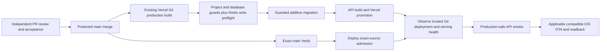

**TL;DR:** Existing Vercel Git deployment serves main; Deploy verifies exact-source health and publishes applicable guarded iOS OTA.

The existing Vercel project `fitsy-api` (`prj_z1QTfOgbj4tlm91U2Hf8JXr5k4v4`, team `team_VVc52BrZfx5IT2B1mDI5AuPT`) is linked to `dgmolla/fitsy` production branch `main`.
Repository `vercel.json` enables that existing Git producer.
The separate `fitsy` project has no Git link in the retained setup readback; this change does not establish another producer.
The coordinator must verify current project, Git link, production branch, bindings and serving alias before the real pilot.

The existing `scripts/dev/vercel-build.sh` is the actual Vercel build entrypoint.
It runs `scripts/deploy/migrate-prod.sh` before the production API build.
That caller requires the exact production project, GitHub repository, main branch and source metadata.
It validates both existing Production `POSTGRES_URL_NON_POOLING` and `POSTGRES_PRISMA_URL` against the known Supabase production host/tenant and database.
Migration connections must use the direct/session port, not the transaction pooler.
`POSTGRES_URL_NON_POOLING` uses the deploy administrator; `POSTGRES_PRISMA_URL` accepts the separate `fitsy_app` credential or the existing explicit `postgres` binding pending provisioning, and must match `SUPABASE_URL`.
The pipeline-role migration additionally requires Dawit's explicit approval recorded as its exact SHA-256 in `FITSY_PIPELINE_ROLES_APPROVED_SHA256`.
Without matching approval, `pipeline-roles-approval.mjs --deploy` excludes that migration and SQL mentioning its controlled roles (`fitsy_app`, `pipeline_writer`, `fitsy_audit_readonly`) from a temporary Prisma input directory while deploying unrelated migrations.
This conservatively holds role-dependent queue migrations, including future files and role names in comments, without marking held SQL applied or editing original migrations.
With matching approval, it includes the role SQL and checks the staged bytes before running Prisma.
The build logs an activation skip for a validated legacy binding; configured `fitsy_app` activation failures still withhold promotion, and pipeline credentials are provisioned separately for pipeline workers.
Names alone do not prove a database target.
Credentials stay in their existing Vercel bindings; do not copy them into GitHub, files or build arguments.
After those guards, `scripts/deploy/rate-limit-preflight.ts` exercises the runtime Redis `EVAL` before any migration.
It first checks required names from `scripts/deploy/env-manifest.json`, which also drives CI source-read validation.
Production and preview require `UPSTASH_REDIS_REST_URL` and a writable `UPSTASH_REDIS_REST_TOKEN` in their respective Vercel environments, with separate stores for production and nonproduction.
The preflight uses the same service, URL validation, response validation and one-second deadline as runtime quotas.
Its separate `deployment-readiness` namespace and unique identities leave user quotas untouched; probe keys expire in one second.
Missing or partial configuration, read-only credentials, unavailable transport, invalid replies or a denied probe withhold migrations and the build without a local fallback.
Provider errors, tokens and URLs never enter preflight diagnostics.
The existing release regression suite executes the real build scripts with synthetic signed identity and external transports, checks Prisma's exact migration input and cleanup, and runs the runtime binding guard at the build boundary.
Run `python3 -B scripts/deploy/routine-release.test.py` to verify approved, held, changed-SQL, legacy preview and fail-closed deployment paths without contacting production.
Run `node --test scripts/deploy/pipeline-roles-approval.test.mjs` for an installed-Prisma regression against disposable SQLite dependency migrations, including delayed approval, future role references, unchanged ledger entries and migration failures.
Already-applied role SQL needs no repeated approval; Prisma's [production deployment contract](https://docs.prisma.io/docs/orm/v6/prisma-migrate/workflows/development-and-production#production-and-testing-environments) permits an applied migration to be absent from the deploy input.
Wrong identity, missing binding or failed migration also withholds the build; failed API build cannot succeed.
Preview/development builds refuse either production binding and preview migrations retain the development route.
Preview and guarded development builds run the same manifest and Redis preflight after the DEV database guard and before migrations.
Ordinary `next dev` requests retain local enforcement when both Redis bindings are absent.
The existing dev mirror watches the preflight and database guard inputs so changes reach the stable dev deployment.
Environment checks select the guarded caller; they do not authorize candidate access to production credentials.
Migrations must remain additive under existing structural SQL checks and independent migration review so the prior API remains compatible during a build.

`Deploy` follows successful main-push `Verify` through `workflow_run`.
Its admission validates the workflow identity, successful main-push event, exact release commit, current main and protected merged PR source through GitHub.
GitHub requires `Verify` and `AI review` on the current PR head before merge.
Main Verify is required for completed delivery.
It is not a gate on the timing of the existing Git producer's build.

The smoke job observes GitHub's actual Vercel bot deployment/status for the exact main SHA and Production environment.
It checks the trusted bot identity and immutable deployment URL, then requires that deployment and `https://fitsy.org/api/health` to report the exact source and connected database.
It waits boundedly for Git deployment/domain readiness, fails on a failed newest deployment, runs the existing production-safe API smoke, then rechecks public serving identity.
On a terminal Vercel failure, the observer records the exact source, GitHub deployment ID, provider state and the trusted project's build-log link.
It makes one read-only public health request with a five-second timeout to report the currently serving source; unavailable or malformed health remains unknown and cannot mask the original deployment failure.
Provider descriptions, arbitrary log URLs and raw health errors are excluded from this diagnostic.
The failure incident links the exact Deploy run and source plus the existing separately authorized migration recovery procedure, without emitting a success receipt or retrying the deployment.
The health endpoint already consumes Vercel's system `VERCEL_GIT_COMMIT_SHA`.
Normal Git deployment and smoke observation need no custom Vercel token, CLI install, stage/promote process, new routine environment, App dispatch or routine human approval.
Failure recovery is a separate path: [production monitoring](monitoring-alerting.md) describes its existing-owner Vercel credential, explicit verified previous target, and unchanged rollback helper.
Keep the existing repository Expo/smoke credential route.
Sensitive maintenance retains `production-release`; native/Apple release decisions retain `production-native`.
This revision does not migrate unrelated secret custody.

OTA retains its existing lease, rollback hold, verified native baseline, production environment, iOS-only publication and group/bundle readback.
Under the lease it compares actual production iOS update `gitCommitHash` inputs with the release checkout.
API-only survivors reconcile pending eligible mobile work; already-applied inputs return N/A without duplicate publication.
Unknown production update source fails closed.
Existing native compatibility and Apple/product approvals still apply.

Before the pilot, retain the actual known-good serving deployment URL and applicable iOS group/native baseline.
Use `bash scripts/deploy/rollback.sh api https://KNOWN_GOOD_URL` for an authorized API rollback.
Do not infer the known-good target from second-newest deployment ordering.
After a failed or uncertain release, read the actual project/deployment/alias and health before resuming.
If Prisma reports `P3009`, the failed migration ledger still blocks deployment even when the failed file is held from the temporary input.
The role filter never resolves failures, deletes ledger rows, marks unexecuted SQL applied, or retries with unfiltered migrations.
For incident [#629](https://github.com/dgmolla/fitsy/issues/629), Vercel deployment `H3t9dcTY75kXmgPvmtpizY6oQZ2J` at `b28c630` reported a retained failure of `20261028130000_hex_jobs` from the preceding `63a36df` build.
The correction prevents new attempts without approved roles; it does not repair that existing production ledger.
The existing production maintenance owner must inspect the failed row and checksum, transaction rollback and actual table/ACL state before separately authorizing any Prisma recovery.
Run the complete read-only [migration failure audit](../../../scripts/deploy/migration-failure-audit.sql) through that owner's existing SQL connection or Supabase SQL editor and retain its JSON with the incident.
It reports every unresolved attempt, the hex-jobs history, remaining tables/ACLs and controlled-role presence in one bounded read-only snapshot without disclosing raw driver logs.
Compare the failed checksum with `shasum -a 256 prisma/migrations/20261028130000_hex_jobs/migration.sql`; a matching checksum or zero applied steps alone does not prove rollback.
Compare the recorded failure with the original build evidence, confirm both hex tables are absent, and diagnose any other unresolved attempt or partial effect.
Missing ledger logs remain unknown; role absence alone does not establish the original error.
Only after a confirmed complete rollback may that owner prepare a separately reviewed Prisma `migrate resolve --rolled-back 20261028130000_hex_jobs` operation under the existing `production-release` protection, retaining failed history and withholding role approval.
The manual `Production migration recovery` workflow now supplies only that incident-specific operation; it is separate from the routine Git build and fixture cleanup.
It defaults to `audit`, runs on protected `main` behind the existing `production-release` environment, and uses its existing `PROD_DATABASE_URL` binding.
No new secret or Vercel environment variable is required.
The dedicated recovery identity is signed by GitHub and binds the exact workflow, main source, manual event, GitHub-hosted runner and protected environment to a recovery-only audience.
It does not expand the ordinary database-writer allowlist or permit another workflow to perform recovery.
The target must be the exact production `postgres` database with an administrator session/direct connection; DEV, loopback, transaction pooling, nonpublic schemas and role approval are refused.
Only after separately reviewing the original failure and rollback may the maintenance owner select `resolve` and approve that protected run.
The command re-audits the database and accepts only attempt `c4b89b99-d4a5-49d9-9664-4699383e5f81`, its original timestamp and checksum, NULL ledger logs, zero completed steps, no other unresolved attempt and absent hex tables.
This narrow NULL-log exception is tied to the previously verified original PostgreSQL error, not an inference from missing roles or a general permission to resolve unknown failures.
Prisma performs `migrate resolve --rolled-back`; the command checks that only the rollback marker changed and that object and role state remained unchanged.
Repeated recovery, partial effects, changed migration bytes/history, unknown failure evidence and failed Prisma execution stop without an automatic retry, role grant or redeployment.
The owner must coordinate exclusive maintenance, retain the audit/recovery run and resume the ordinary guarded Git deployment separately.
This checkout still has no generic production recovery command; do not repurpose fixture cleanup or bypass the Git-build identity guard.
Partial effects or a different failure require diagnosis and a separately reviewed repair, not a speculative resolve or another identical build.
After authorized recovery, resume the guarded Git build and exact-source smoke against `fitsy.org`; neither local regression tests nor a healthy older serving source establish recovery.
The guarded caller now points failures to this inspection path without resolving or retrying them.
The disposable Prisma regression explicitly resolves its failed fixture through Prisma, then proves ordinary filtered deployment resumes, preserves the failed attempt and leaves role-dependent SQL held.
Run `npm test -w @fitsy/scripts -- --runInBand --runTestsByPath deploy/recover-hex-jobs.test.ts` for signed identity, target, state and actual workflow-shell refusal coverage.
Its post-recovery comparison tests accept independently parsed snapshots and reject changes beyond the rollback marker while preserving the original evidence.
The owned database verifier also runs `apps/api/tests/db/hexJobsRecovery.db.test.ts`, which recreates the observed ledger in a disposable PostgreSQL database, proves P3009 and partial-state refusal, and rehearses real Prisma recovery followed by filtered deployment.
If smoke reports `invalid-session=503` while database health and missing-session checks pass, inspect shared-store configuration and runtime `[rate-limit] Shared store unavailable` logs.
Missing-session 401s return before Redis, and `/api/health` probes only the database; neither establishes authentication readiness.
Restore both store variables in the existing `fitsy-api` Vercel environment with a writable token and verify `EVAL` access.
Use the supported Vercel environment controls without printing credential values, and keep production and nonproduction stores separate.
Then run the normal guarded Git build and exact-source production smoke; an environment edit does not update an already built deployment.
Do not accept 503 in smoke, skip quotas, or substitute a process-local limiter to make the release green.
The offline `build` and Redis fixture checks prove compilation and policy behavior, respectively; only the Vercel preflight exercises that deployment's actual store binding.
The coordinator owns provider readbacks, protected integration and release operations.
Local fixtures, source review and merged CI remain separate from actual release adoption.
Issue 471 itself can be the control-only pilot after exact-source review and CI, with actual migration/build, serving-source smoke, applicable OTA/N/A and rollback evidence.
