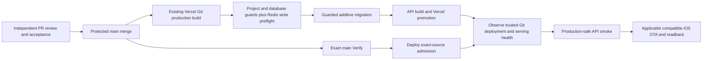

**TL;DR:** Existing Vercel Git deployment serves main; Deploy verifies exact-source health and publishes applicable guarded iOS OTA.

The existing Vercel project `fitsy-api` (`prj_z1QTfOgbj4tlm91U2Hf8JXr5k4v4`, team `team_VVc52BrZfx5IT2B1mDI5AuPT`) is linked to `dgmolla/fitsy` production branch `main`.
Repository `vercel.json` enables that existing Git producer.
The separate `fitsy` project has no Git link in the retained setup readback; this change does not establish another producer.
The coordinator must verify current project, Git link, production branch, bindings and serving alias before the real pilot.

The existing `scripts/dev/vercel-build.sh` is the actual Vercel build entrypoint.
It runs `scripts/deploy/migrate-prod.sh` before the production API build.
That caller requires the exact production project, GitHub repository, main branch and source metadata.
It validates both existing Production `POSTGRES_URL_NON_POOLING` and `POSTGRES_PRISMA_URL` against the known Supabase production host/tenant and database.
Migration connections must use the direct/session port, not the transaction pooler.
Names alone do not prove a database target.
Credentials stay in their existing Vercel bindings; do not copy them into GitHub, files or build arguments.
After those guards, `scripts/deploy/rate-limit-preflight.ts` exercises the runtime Redis `EVAL` before any migration.
Production and preview require `UPSTASH_REDIS_REST_URL` and a writable `UPSTASH_REDIS_REST_TOKEN` in their respective Vercel environments, with separate stores for production and nonproduction.
The preflight uses the same service, URL validation, response validation and one-second deadline as runtime quotas.
Its separate `deployment-readiness` namespace and unique identities leave user quotas untouched; probe keys expire in one second.
Missing or partial configuration, read-only credentials, unavailable transport, invalid replies or a denied probe withhold migrations and the build without a local fallback.
Provider errors, tokens and URLs never enter preflight diagnostics.
Wrong identity, missing binding or failed migration also withholds the build; failed API build cannot succeed.
Preview/development builds refuse either production binding and preview migrations retain the development route.
Preview runs the same Redis preflight after the DEV database guard and before migrations; undeployed development remains usable without Redis.
The existing dev mirror watches the preflight and database guard inputs so changes reach the stable dev deployment.
Environment checks select the guarded caller; they do not authorize candidate access to production credentials.
Migrations must remain additive under existing structural SQL checks and independent migration review so the prior API remains compatible during a build.

`Deploy` follows successful main-push `Verify` through `workflow_run`.
Its admission validates the workflow identity, successful main-push event, exact release commit, current main and protected merged PR source through GitHub.
GitHub requires `Verify` and `AI review` on the current PR head before merge.
Main Verify is required for completed delivery.
It is not a gate on the timing of the existing Git producer's build.

The smoke job observes GitHub's actual Vercel bot deployment/status for the exact main SHA and Production environment.
It checks the trusted bot identity and immutable deployment URL, then requires that deployment and `https://fitsy.org/api/health` to report the exact source and connected database.
It waits boundedly for Git deployment/domain readiness, fails on a failed newest deployment, runs the existing production-safe API smoke, then rechecks public serving identity.
The health endpoint already consumes Vercel's system `VERCEL_GIT_COMMIT_SHA`.
No custom Vercel token, CLI install, stage/promote process, new routine environment, App dispatch or routine human approval is required.
Keep the existing repository Expo/smoke credential route.
Sensitive maintenance retains `production-release`; native/Apple release decisions retain `production-native`.
This revision does not migrate unrelated secret custody.

OTA retains its existing lease, rollback hold, verified native baseline, production environment, iOS-only publication and group/bundle readback.
Under the lease it compares actual production iOS update `gitCommitHash` inputs with the release checkout.
API-only survivors reconcile pending eligible mobile work; already-applied inputs return N/A without duplicate publication.
Unknown production update source fails closed.
Existing native compatibility and Apple/product approvals still apply.

Before the pilot, retain the actual known-good serving deployment URL and applicable iOS group/native baseline.
Use `bash scripts/deploy/rollback.sh api https://KNOWN_GOOD_URL` for an authorized API rollback.
Do not infer the known-good target from second-newest deployment ordering.
After a failed or uncertain release, read the actual project/deployment/alias and health before resuming.
If smoke reports `invalid-session=503` while database health and missing-session checks pass, inspect shared-store configuration and runtime `[rate-limit] Shared store unavailable` logs.
Missing-session 401s return before Redis, and `/api/health` probes only the database; neither establishes authentication readiness.
Restore both store variables in the existing `fitsy-api` Vercel environment with a writable token and verify `EVAL` access.
Use the supported Vercel environment controls without printing credential values, and keep production and nonproduction stores separate.
Then run the normal guarded Git build and exact-source production smoke; an environment edit does not update an already built deployment.
Do not accept 503 in smoke, skip quotas, or substitute a process-local limiter to make the release green.
The offline `build` and Redis fixture checks prove compilation and policy behavior, respectively; only the Vercel preflight exercises that deployment's actual store binding.
The coordinator owns provider readbacks, protected integration and release operations.
Local fixtures, source review and merged CI remain separate from actual release adoption.
Issue 471 itself can be the control-only pilot after exact-source review and CI, with actual migration/build, serving-source smoke, applicable OTA/N/A and rollback evidence.
