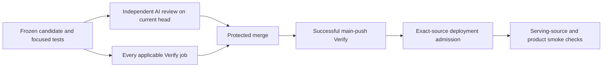

# Shipping control cutover

GitHub requires `Verify` and `AI review` on the current PR head before protected merge.
The selected standalone skills define delivery sequence and evidence planning.
The [shipping contract](shipping.md) retains product acceptance, security/data protections and release requirements.

## Merge and local validation

Independent review must cover the current source and required domains under `REVIEW.md`.
Candidate-written statuses, stale reviews and incomplete execution cannot replace the required results.
The final Verify job requires every applicable classified job to succeed and permits only legitimate skips.
Keep predecessor review triggers disabled so only the current AI review publisher owns that status.

The pre-push hook runs size/domain checks followed by cheap static checks and focused tests through `scripts/verify/run.mjs`.
Independent review uses the retained simple review runner before publication.
Local check results and fixtures prove their own execution; they do not establish GitHub merge or release acceptance.
Keep source frozen during local verification and rerun affected checks when source or focused selection changes.
Retain original raw evidence and accounting needed by unfinished outcomes.

## Release boundary

Use the existing [routine production contract](routine-production.md) and deployment entrypoints.
Release admission validates a successful main-push Verify run and the exact protected release source through GitHub.
Candidate test jobs must not receive release credentials.
Production database target checks, migration safety, OTA native compatibility, production environment selection and rollback coordination remain required.
Keep applicable UI, Apple, legal, submission and protected release approvals.
A successful deployment does not establish successful main Verify or product acceptance.

Report local validation, current-head review/CI, protected merge, main Verify, deployment and actual affected product proof separately.
Settings and credential changes are separate operations under their existing authorization.
