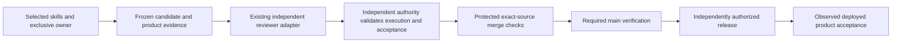

# Shipping control cutover

The selected standalone skills define delivery sequence and evidence planning.
This contract defines the independent authority boundary required before retiring local shipping session, socket and admission enforcement.
It does not authorize a candidate to approve or install its own controls.

## Authority boundary

Candidate files, environment variables, private copies of a control, raw JSON supplied by the implementer and fixture results cannot establish independent approval.
An installed control must bind genuine provider execution to source, comparison base, authoritative issue acceptance, required review domains and the current review policy.
Retain original raw artifacts, failed findings, interrupted execution, allocations and cumulative accounting unchanged.
Use the existing reviewer adapter and ledger rather than adding a review service, verdict cache or workflow engine.

The coordinator must identify the actual reviewer/check issuer, installation owner, merge authority and release authority before implementation depends on their interfaces.
Record identities and nonsecret installation receipts in the issue handoff.
Reviewer credentials and approval custody must be inaccessible to candidate execution and its environment.
Administrator-managed files owned by the same account as unrestricted candidate execution do not alone establish that separation.
A new path or a private file mode is not an independent execution boundary.

Protected merge must require the independent approval issuer and applicable required checks for the exact candidate source.
A context name with no issuer binding is insufficient.
Binding only to the GitHub Actions App is also insufficient when a candidate can edit a workflow that emits the same check.
Use an independently controlled existing issuer or native review authority whose credential custody and source binding can be demonstrated.
Do not substitute a simulated issuer or an implementer-authored passing status.

Release controls must validate the authorized release source and successful required main checks before consequential release credentials are made available.
Candidate test jobs must not receive review approval or release credentials.
Keep the existing UI, Apple, legal, submission and native compatibility approvals, and retain rollback evidence.
A successful deployment does not establish main verification or product acceptance.

## Verification and controlled installation

Reproduce malformed-history recovery and caller-selected comparison failures through the supported entrypoints before repair.
Retain the evidence-authority, Node startup and hook-redirection rejection cases.
Required negative cases include forged provider evidence, mismatched source or acceptance, incomplete review, failed required checks and unauthorized release.
A positive case must use an actual independent provider result and observed installed protection; fixture success proves only local behavior.

Local acceptance comparison must derive from authenticated frozen head and base rather than caller FITSY_DIFF_BASE or FITSY_DIFF_HEAD values.
Keep the explicit hosted comparison path for legitimate CI event ranges.
A later diagnosed recovery allocation must follow incomplete history, bind the new source and independently approved installed operator, and retain every failed second.
An old allocation cannot authorize another incomplete retry.
Reconcile bootstrap execution and original accounting through the supported independently approved control before acceptance or release.

Freeze and commit changed controls, run applicable cheap checks and focused regressions, and obtain independent review before installation.
The existing coordinator separately verifies actual provider execution, artifact digests and the exact committed controls.
An implementation owner cannot emit that coordinator approval.
Do not launch a review whose result cannot reach the supported acceptance and protected integration path.

Capture existing protection configuration, installed runtime identities, active claims and commands before cutover.
Install the independently approved replacement once through its supported installation interface.
Read back actual issuer bindings and release protections, exercise the negative controls against the installed boundary, and prove a valid candidate is accepted.
Only then disable superseded local session, socket and admission entrypoints and automatic triggers.
Preserve product commands, exclusive ownership and raw history.
A rollback must retain current approval and security protections; an incompatible legacy path is not a valid fallback.

## Frozen nutrition pilot

Retain the original nutrition source, comparison, genuine independent verdict, UI approval and all original timing ledgers.
Determine evidence applicability from source, acceptance, domains, test recipe, environment and review policy.
A change in orchestration alone does not justify another product review.
Revalidate the genuine result through the replacement rather than copying it into a new implementer-authored pass.

Release control readiness ownership before the coordinator admits the pilot through the existing exclusive claim helper.
The pilot must complete applicable tests, existing-review validation, PR checks, authorized merge, successful main Verify and Deploy, and affected product verification.
Report local validation, independent review, installation, merge, deployment and product proof separately.
The migration is complete only after invalid candidates are rejected by the replacement and the nutrition pilot actually ships through it.
