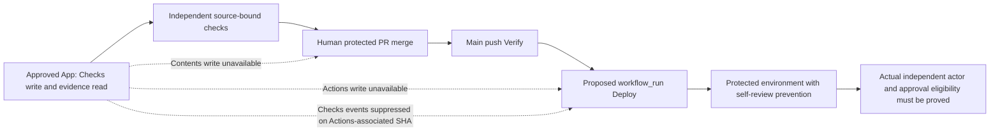

# Single-human installation viability

**TL;DR:** The approved Checks-only App has no established release-initiation path satisfying the existing protected-release contracts.

This is a read-only diagnosis and custody preparation packet, not a new control approval or an installed configuration.
Retain the independently reviewed `ca7d259e5b0c7996defafc93bac382e0d474b2d6` controls against base `257f8c2f696d4f0b7cf04a5620dcc76906b6f785`.
Do not fill the distinct reviewer template with the sole human and install it: that reproduces the already diagnosed release refusal.
The accepted migration outcome does not inherently require a second human GitHub account.
The current reviewed implementation does require a reviewer distinct from its merge actor, and changing that implementation requires a supported replacement plus independent review before installation.

## Permission and actor diagnosis

The human registered App `5285837`, installation `170592990`, on Fitsy with Checks write and read-only evidence permissions.
The private key is reportedly in Notes on the shared Mac; it has not been read, exported, copied or used here.
Its custody is unverified.
The App ID and installation ID are not a GitHub bot user ID; no actual App initiating actor ID has been observed.
The existing human GitHub account is `dgmolla`, user ID `18452532`.

| Proposed operation | GitHub contract | Result under the approved grant |
| --- | --- | --- |
| Publish independent checks | Checks write | Permission is approved; isolated issuance and actual App binding still require installation proof. |
| Merge protected PR as App | Contents write | Unavailable; adding an Integration ruleset actor does not grant Contents write. |
| Trigger workflow dispatch as App | Actions write | Unavailable. |
| Trigger repository dispatch as App | Contents write | Unavailable. |
| Trigger release from an App check on verified release source | Checks event recursion exclusions | Not a reliable source-bound trigger after Actions Verify has associated that source with Actions. |
| Rerequest an Actions check using this App | Check must belong to the authenticated App | GitHub documents a 403 for another App's check; the Actions issuer is `15368`. |
| Approve a deployment initiated by the sole human | Environment self-review prevention | Rejected even when that human is a configured required reviewer. |

Primary contracts: [PR merge permissions](https://docs.github.com/en/rest/pulls/pulls#merge-a-pull-request), [workflow dispatch permissions](https://docs.github.com/en/rest/actions/workflows#create-a-workflow-dispatch-event), [repository dispatch permissions](https://docs.github.com/en/rest/repos/repos#create-a-repository-dispatch-event), [Checks workflow exclusions](https://docs.github.com/en/actions/reference/workflows-and-actions/events-that-trigger-workflows#check_run), [check rerequest restrictions](https://docs.github.com/en/rest/checks/runs#rerequest-a-check-run), and [environment reviewer and administrator protections](https://docs.github.com/en/actions/reference/workflows-and-actions/deployments-and-environments).
The `check_suite` workflow event supports completed activity and has the same Actions-source exclusion; rerequesting a suite is not a documented independent Actions release trigger.
An unrelated commit used only to evade the source exclusion is not evidence of a supported frozen-candidate release path.

The read-only live audit observed human-initiated main Verify `37934151473` and Deploy `37934151530`, both at `257f8c2f696d4f0b7cf04a5620dcc76906b6f785` with both actor fields equal to `dgmolla`.
The repository reported zero `workflow_run` runs at audit time.
There is therefore no actual `workflow_run` actor observation establishing that the proposed downstream Deploy would have an independent initiator.
Do not infer an App actor from the workflow trigger name, a check label or a fixture.
[GitHub's actor context](https://docs.github.com/en/actions/reference/workflows-and-actions/contexts#github-context) distinguishes the original actor from the rerun initiator; an actual protected-run readback remains necessary.

Live main protection still requires only `product-flow/local` with an unbound issuer and enforces administrators.
The live ruleset inventory is empty.
The live environment inventory contains no `production-release` environment; observed production environments have no reviewer rules and allow administrator bypass.
These are observations of the pre-cutover configuration, not replacement enforcement.
No GitHub production setting or environment approval was changed during diagnosis.

No supported single-human installation path has been established within the current permission grant and source-bound release contracts.
Do not spend independent reviewer execution on a speculative adapter change or remove the reviewed distinct-actor rejection to make fixtures pass.
No additional App permissions, security grants, new GitHub user, release command or OS account creation is authorized by this diagnosis.
The existing coordinator must resolve the actual initiation mechanism within those boundaries or obtain a genuinely new explicit decision before proposing a different grant.
Keep the unresolved decision recorded once rather than repeating the prior second-user or App metadata request.

## Exact proposed Mac custody separation

Use the existing human/operator Mac login for Notes, its private login keychain, GitHub administration and environment approval, and separately create a standard candidate Mac account only when the human authorizes that final setup operation.
The proposed candidate account name is `fitsy-candidate`; its actual UID remains unresolved until human-created and verified.
The existing operator account's actual UID must be read and pinned during installation, not inferred from its account name.
No additional GitHub account is part of this custody proposal.

The human performs authentication credential entry, confirmation and submission, including account creation and any credential relocation.
The candidate execution must move entirely to the standard candidate account before isolated authority can count.
It must have no administrator group membership, sudo/root permission, operator password or ability to control an authenticated operator desktop session.
Its automation permissions must not permit operating the operator's Notes, browser, Terminal, keychain or authenticated GitHub/release UI.
Separate directories, shell variables or tokens under the present shared UID do not meet this boundary.

Keep the private key and any installation-token renewal in the human/operator account only.
Candidate access must exclude the operator's Notes database and iCloud session, login keychain, browser profiles and sessions, `gh` administrator credentials, Vercel production credentials, Expo production credentials and environment approval tokens.
The operator must inventory existing shared routes, securely relocate required credentials, and revoke remaining candidate-accessible copies or sessions without exposing values to this task.
Candidate CI and development receive only explicitly scoped ephemeral/dev credentials.
The human controls login switching and removes any unattended route from candidate execution to an authenticated operator session.

Install only independently approved immutable adapter bytes at `/opt/fitsy-approval/external-approval.py` and the fixed configuration at `/private/etc/fitsy/delivery-authority.json`.
Use canonical operator-controlled private paths under `/private/var/` or the operator's verified home; retain the ca7 ancestry and symlink restrictions.
Pin the actual distinct UIDs, transport path/digest, reviewed control SHA/digest, App ID, verified installation scope, original evidence digests and additive accounting.
Do not populate unresolved release identities with App or installation IDs.
All authority files and ancestors must be root/operator owned and inaccessible to candidate mutation; credentials remain private mode `0600`.
An operator-owned file inside a candidate-controlled ancestor does not satisfy that requirement.

Before installation acceptance, observe candidate read/write denial for operator authority and credential stores, denial of sudo and operator-session control, and actual issuer/actor identities from supported one-shot commands.
Validate isolation without reading secret values.
Keep any human confirmation or login authentication outside automated credential entry.
Missing OS custody is a final installation boundary, not a reason to stop read-only diagnosis and packet preparation.

## Validation and continuity

Retain the prior 115 focused cases and nine cheap checks at ca7 as historical local evidence, and retain its genuine control review and coordinator execution verification unchanged.
The existing external-boundary regression suite covers forged evidence, source/acceptance drift, failed checks, protected environment refusal, initiating-human reviewer rejection, and exact frozen443 control composition.
Its positive fixtures establish validator behavior, not App actor identity, protected GitHub approval eligibility or production shipment.
Any future supported single-human change must add meaningful App-versus-human cases and exercise actual protected negative and valid probes before cutover.

Preserve original #463 cumulative `3142.015647499007` seconds and stop `3177`, later actual cumulative `3687.416401539929` seconds and additive stop `3791`, every raw attempt and source-bound allocation.
This diagnosis adds zero reviewer execution and grants no new allowance.
Frozen #443 remains at `fe24cebe2bbfbdaad995561d1f2b14384e3e7a2e`, base `257f8c2f696d4f0b7cf04a5620dcc76906b6f785`, with genuine `252.81189254205674` second review and unchanged approved UI.
It receives no extra product review and no concurrent implementation.

Keep legacy controls active until reviewed replacements, independently reconciled accounting, actual negative/valid probes and the controlled cutover establish equivalent protection.
Retain rollback evidence and the existing commands.
Preparation remains distinct from independent approval, installed controls, merged code, deployment and production verification.
Completion still requires actual #443 shipment with successful release-SHA main Verify and Deploy plus product acceptance.

Raw read-only observations and this continuation's receipts belong under `.evidence/issue-463/single-human-setup-20261012/` and the issue handoff.
The acknowledgment is `/Users/dawitmolla/.fitsy-dispatcher/authorizations/issue-463-single-human-worker-ack-20261012.json`.
Retain the existing incident `issue-463-independent-custody`, the dispatch hold and Queued waiting state when inactive ownership is reconciled by the original disabled-config lifecycle helper.
Do not create a second sender, schedule, queue, cache or verdict.
