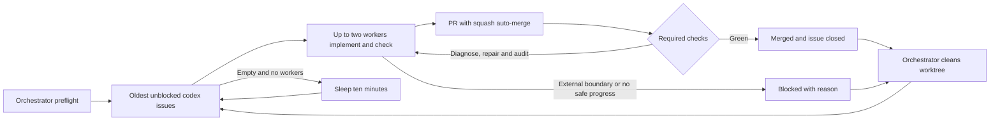

# Shipping flow

Open GitHub issues labeled `codex` are the queue; issues and PRs hold ownership, attempts, proof, and next actions.
Follow the [Orchestrator](../../../AGENTS.md#orchestrator) rules using `gh` directly, with one orchestrator and at most two per-issue workers.
The orchestrator only preflights, picks issues, starts workers, watches, and cleans up; it never edits code or merges.
Each worker owns one issue until its PR merges or the issue is marked blocked, including existing PRs that need completion.
Every task has a small, pass/fail "Done when"; every PR records Done-when, command/output proof, and what was skipped.
There is no queue script, daemon, new tooling, or skill.

Preflight GitHub authentication, fetch, dependency installation, Docker, and disk once at start and after infrastructure failure.
If any fails, comment on the pinned/tracking issue or print `PREFLIGHT FAILED: <reason>` and stop dispatching.
Query failures are errors, never an empty queue.
Exclude `blocked` issues and unresolved `BLOCKED:` fallback comments; missing Done when also blocks an issue.
Do not create labels: Dawit supplies a missing `codex` label; a missing `blocked` label requires an issue comment starting with `BLOCKED:` and noting its absence.

Use `~/fitsy-wt/issue-N` and `codex/issue-N` from current `origin/main`, or resume the existing PR branch after checking ownership.
Start `codex exec -C ~/fitsy-wt/issue-N -s danger-full-access -` in the background with the full issue and Worker/Hard rules on stdin, log to `~/fitsy-wt/logs/issue-N.log`, and record its PID on the issue.
Watch workers and PRs about every five minutes; update BEHIND branches, resolve conflicts, and fix failed checks/reviews through the worker until GitHub auto-merges.
At start, before each wait and before handoff/exit, freshly read both issue and PR comments, including edits, using observed `updated_at` cursors with inclusive ID/update/body-hash deduplication.
Failed queries are errors, not empty feedback; acknowledge material owner directions on the issue and deliver them to the existing worker within current authority.
At the first pending hosted Mac job, run the existing local `node scripts/verify/simulator-actions.mjs --preflight` and record absent capacity or unavailable inventory with its owner action instead of silently waiting.
This diagnostic adds no required context or registration authority and does not stop independent authorized work.
Infrastructure failures get one retry.
By default, continue necessary code/review repairs while diagnosis and changed evidence show progress, numbering batches additively and preserving all prior failures and allocations.
Pair repair unblocks with a proportionate causal audit, distinguish confirmed causes from hypotheses and unknowns, and apply low-stakes prevention in the affected existing callers, tests and guidance.
Do not repeat identical failures or weaken checks; block with evidence and a concrete resume action when diagnosis cannot establish safe progress or a real external dependency or consequential decision remains unresolved.
Account/legal grants and product/release decisions, including production design selection, retain their separate boundaries.
A crashed worker gets one diagnosed restart with its history preserved; a second crash blocks the issue with a sanitized log tail.
If the same failure happens twice anywhere, add one line with lasting prevention to [shipping lessons](shipping-lessons.md) in the affected PR.

The Mac has 16 GB RAM: at most two workers, and one Simulator/Maestro user at a time.
Workers atomically acquire `~/fitsy-wt/simulator.lock` with issue number and PID and remove only their own lock on exit; stale-lock recovery requires a stopped owner and no live simulator consumers.
Respect an active simulator CI job as a consumer too; do not overlap it with local simulator work.
See `docs/ci-simulator.md` if present for runner setup.
This documentation change does not install or reconfigure a runner.

Only workers enable squash auto-merge; never merge manually, bypass checks, use `--no-verify`, or change repository settings or required checks.
Follow all [Hard rules](../../../AGENTS.md#hard-rules-both-roles), including no production data writes, secrets in logs, App Store submission, RevenueCat production use, rate-limiter fail-open, or `git gc`.
Dawit pre-approved native builds (EAS build + TestFlight upload) on November 2, 2026 when rollout requires one, including OTA fingerprint mismatch; this supersedes older requests for native-build approval.
Run at most one native build/upload at a time, record it on the issue/PR, then do the OTA; never submit to App Store review.
Serialize that work with `~/fitsy-wt/native-build.lock` under the same ownership rules as the simulator lock.
After a merged worker exits, remove its worktree and local branch; after a blocked worker exits, preserve unfinished work on its branch before removing the worktree.
Delete files only under `~/fitsy-wt`; retain logs and blocked-branch work needed for recovery.
When no eligible issues and no workers remain, sleep ten minutes and rescan; exit only when told to stop or when preflight fails.

## Deprecated: old local loop

`scripts/delivery/loop/driver.py` and LaunchAgent `org.fitsy.loop-driver` are deprecated.
The LaunchAgent was confirmed unloaded on November 2, 2026; keep it unloaded.
Old loop files remain intact for reference; do not delete them or restart the old loop.
