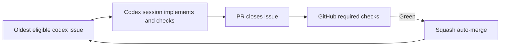

# Shipping flow

Codex does the work; open GitHub issues labeled `codex` are the queue, and issues plus PRs hold task state.
A Codex session follows the [Orchestrator](../../../AGENTS.md#orchestrator) instructions using `gh` directly: take the oldest eligible issue, skip issues with open PRs, implement on `codex/issue-N`, and open a PR with `Closes #N`.
Every task has a small, pass/fail "Done when"; every PR records Done-when, command/output proof, and what was skipped.
There is no queue script, manager process, or daemon.
Dawit must create the `codex` label if it is missing; agents do not create labels or change repository settings.

GitHub required checks are the only merge gate; enable squash auto-merge with `gh pr merge <PR_NUMBER> --auto --squash` and let GitHub merge when green.
Never bypass checks, use admin merge, or change required-check configuration.
Follow AGENTS.md's safety boundaries, including stopping for Dawit's OK before a new native build or fingerprint change.
Keep such a PR unmerged with auto-merge disabled until approval is recorded.

The loop v2 simulator setup uses Dawit's Mac as a self-hosted runner for the iOS Simulator check, one job at a time because the Mac has 16 GB RAM.
See `docs/ci-simulator.md` if present for runner setup.
This documentation change does not install or reconfigure a runner; existing repository guidance still describes a local simulator poller, so self-hosted runner wiring remains to be confirmed separately.

If the same failure happens twice, make one lasting fix and record the cause, correction, and proof in [shipping lessons](shipping-lessons.md).
Keep any blocked task's next action in its GitHub issue or PR; app work takes priority over process work.

## Deprecated: old local loop

`scripts/delivery/loop/driver.py` and LaunchAgent `org.fitsy.loop-driver` are deprecated.
The LaunchAgent was confirmed unloaded on November 2, 2026; keep it unloaded.
Old loop files remain intact for reference; do not delete them or restart the old loop.
