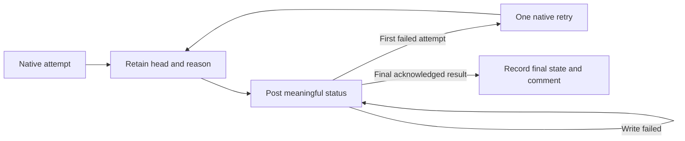

# Shipping lessons

- 2026-11-04: A declined account's renewed onboarding preview left stale history behind its paid offer; gate payment Back on current preview access and replay the restored-account checkout through cancellation, then run the saved native swipe and Back assertions (#718).

- After `npm ci`, require `npm ls --depth=0 --workspaces` and the actual renderer caller: a stale nested renderer can violate the manifest and React peer versions even while installation and focused tests pass; repair the generated lockfile with npm and recheck the native fingerprint before reusing a release binary (#711).

- 2026-11-03: Background Codex workers exited before logging when their launch tool sessions ended; keep the launch session open or detach with `subprocess.Popen(..., start_new_session=True)` and redirected stdin/stdout/stderr, then verify the live PID and nonempty log before claiming startup (#720 confirmed the detached path).
- 2026-10-31: Empty queues and empty planner responses stopped the loop; retain the owner lock, rescan task files on interruptible idle waits, and test task arrival after an idle poll.
- 2026-10-31: Paywall assertions duplicated synthetic plan names and trial lengths and disagreed across the autumn clock change; derive both the Debug offering and Maestro expectations from the Test Store fixture and test calendar boundaries.
- 2026-10-31: Simulator infrastructure failures reached code-repair workers; preserve the failed command diagnosis through billing and active-fixture setup, classify infrastructure and assertions separately, retain both attempts, consume the retry count in the driver, and resume an exhausted local infrastructure budget with `--no-environment-retry` so classification cannot silently grant another replay.
- 2026-10-31: TestFlight uploads left Apple processing, Internal distribution and native baseline evidence as manual follow-ups; bind the post-submit transaction to the exact build, verify IPA identities and group membership, and open a protected baseline PR.
- 2026-10-31: A tracked lessons file directly under docs/ failed the structural pre-push gate; keep shipping lessons under docs/engineering/devops/, update all references, and run the canonical structural check before publication.
- 2026-10-31: The Mac poller's direct Maestro calls omitted a wrapper-only fixture variable and broke both paywall flows; load the shared catalog in the saved flows and regression-test their actual script sequence without injected variables.
- Infra-blocked tasks stayed parked after the simulator harness fix merged (Oct 31) -> loop now auto-resumes them when the blocking fix lands.
- Loop fixes merged but never ran: the driver runs from a non-git copy. Prevention: driver self-installs merged loop changes and the LaunchAgent restarts it.
- Driver exited when its queue emptied (Oct 31, twice) -> driver now idles and re-scans, and a LaunchAgent restarts it on crash.
- Loop PRs stalled once their task ended (Oct 31, several times) -> driver now sweeps all open loop PRs: updates BEHIND branches, merges CLEAN ones, queues one rebase for conflicts.
- 2026-10-31: A follow-up task without `existing`/`pr` headers tried to recreate an open PR's branch from main and was stopped by a stale worktree; prevent recurrence with a branch-exists guard and clean stale-worktree cleanup before reuse and after merged, blocked or errored tasks.
- 2026-11-01: Cleanup counted ignored evidence as dirty work; ignore `!!` entries, archive `.evidence/` outside the worktree before removal, and retry retained cleanup failures in the existing sweep.

## Simulator errors after #691, 2026-10-31

**TL;DR:** A retry status hid real assertion failures, and the synthetic reminder fixture depended on anonymous account state.

Trace the actual status writer before diagnosing a red required check.
The protected `sim-scope.yml` workflow publishes `Sim scope`; the external Mac `sim-review/poller.mjs` publishes `Simulator`.
Its old first-failure path posted `error` with only `Attempt 1 failed; retrying next poll`, discarding the assertion's reason until the second attempt.
Its status writer also accepted an empty description, and comment publication happened before the final status write.
An interrupted or failed comment request could therefore leave the earlier error visible.

The retained local runs distinguish assertion failures from setup errors:

| PR and head prefix | First retry after #691, Pacific time | Observed cause | Later local outcome |
| --- | --- | --- | --- |
| #689 `5f90042e6b32` | 15:54 | Mixed-trial visual expected optional reminder copy; the anonymous paywall showed unavailable account state | `failure` at 16:49 |
| #685 `142495465959` | 16:07 | Same mixed-trial assertion | `failure` at 17:02 |
| #684 `ee0b23ba3700` | 16:19 | Floating navigation could not find `saved-content` | `failure` at 17:13 |

The table records Mac log and Maestro artifact observations.
A subsequent authenticated browser inspection confirmed final failures with matching descriptions on [#684](https://github.com/dgmolla/fitsy/pull/684), [#685](https://github.com/dgmolla/fitsy/pull/685) and [#689](https://github.com/dgmolla/fitsy/pull/689).
The reported earlier literal empty description could not be recovered from that latest-result display; it must not be confused with a status that was never posted.
The local status reproduction executes the deployed status blocks against an in-memory GitHub recorder and proves the first-failure misclassification and empty-description acceptance.
The saved screenshot and command report show the real mixed-trial failure before the repair.
The rendered payment-screen regression reproduces the same anonymous notification-state mismatch.

The affected runs reached Maestro, so their failures were not the 45-minute Maestro process timeout, 40-minute native build timeout or a missing status-publishing workflow.
Backend identity receipts bind #684 and #689 to stable dev at #691 and #685 to its exact-head Ready preview.
The earlier #685 `b1ce6297b8e0` error was different: the installed expired fixture still rejected preview backends.
#691 added a preview-capable module and installer, but the host import remained on its older implementation.
A merged helper is not installed behavior.

The lasting prevention is implemented in [the maintained status lifecycle](../../../scripts/sim/poller-status.mjs) and [its host installer](../../../scripts/sim/install-poller-status.mjs):

- Persist the head, attempt, classification and redacted reason before posting.
- Publish assertion failures as `failure` and runner problems as `error`, with a nonempty description capped at 140 characters.
- Queue one automatic retry with its original reason; preserve both attempts and never convert an incomplete run into success.
- Require and log GitHub's acknowledgment of the exact status fields.
- Resume a failed publication without running the simulator again, and post the final status before the optional comment.

The visual-fixture repair supplies synthetic opt-in and enabled states only when the development synthetic offering is active.
It retains the original visible assertions, live Test Store prices and purchase prohibition.
The production-mode regression checks a sandbox entitlement and confirms visual parameters cannot override real checkout notification permission.
This changes no RevenueCat offering, entitlement policy, TestFlight store key, App Review account or production data.

After merge, the existing host owner must install both `install-expired-fixture.mjs` and `install-poller-status.mjs` from clean, fresh main under the shared simulator lock.
Use a fresh poller process, retain the installation receipts, and refresh #684, #685 and #689 onto the repair before checking their new heads.
Rebase #690 onto main before its replay as requested.
Require ordinary Verify, independent review and fresh Simulator results; a diagnostic test, old-head status or edited state file is not acceptance.
Preserve #684's independent navigation failure if it still reproduces.
Stop and report if recovery requires account, secret or service-setting changes.

- 2026-11-01: Every isolated pre-push aborted with "pre-push died of signal 6" because the native sandbox denied reads of the root directory `/`, which dyld needs at launch on macOS 26. Prevention: the profile grants a literal `/` (listing only); `SandboxProfileTest` launches bash under the real generated profile on macOS.
- 2026-11-01: After the loop's LaunchAgent was regenerated from the repo template, the driver lost `FITSY_XCTEST_SIM_UDID`, so every app task stopped with "Host runner requires an explicitly owned simulator UDID". Stopgap: `launchctl setenv` for the canonical simulator (A9981463…, the one sim-review owns). Prevention: task 00122 makes the installed LaunchAgent carry the owned simulator settings.
- 2026-11-01: Loop installs must come from the canonical `wt3` checkout: `install.py` pins that checkout's `node_modules` as the only sandbox-readable dependency roots, and recreated task worktrees now link them (`worktrees.link_dependencies`); otherwise isolated pre-push fails with "verification dependencies are missing". Merged loop fixes only run after `install.py --apply` (check `source-receipt.json`).
- 2026-11-01: The loop stalled again and again on missing host setup (simulator UDID, Maestro/Java, E2E fixtures, `node_modules`, sandbox `/dev/null` writes, fingerprint baselines), each found only after a task failed, and `launchctl setenv` stopgaps vanished on reboot. Prevention: all loop settings live in one untracked file, `~/.config/fitsy-loop/loop.env` (named by `FITSY_LOOP_SETTINGS` in the LaunchAgent template), and `preflight.py` checks every prerequisite before any task runs; the driver runs nothing and logs one `PREFLIGHT FAILED` line until it is fixed.
- 2026-11-01: macOS Java ignores TMPDIR; sandboxed Maestro needs -Djava.io.tmpdir pointed at the sandbox scratch dir or jansi fails with UnsatisfiedLinkError.
- 2026-11-01: The host-replay sandbox must also read the Xcode license plist, ~/.gitconfig (ci.mjs strips GIT_* overrides) and the tracked .env.example, or replay dies before Maestro runs.
- 2026-11-01: sandbox-exec #"..." regexes are raw: never json.dumps them, and avoid re.escape (its \- is invalid POSIX).
- 2026-11-01: never grant the sandbox ~/.gitconfig (http.extraHeader can hold tokens); give candidates a scratch GIT_CONFIG_GLOBAL with allowlisted keys.

## Conservative PR test routing, 2026-11-02

**TL;DR:** Narrow PR tests with Jest's dependency graph, and run everything when the dependency boundary is uncertain.

Tests (L2) on PR #704 took 21m20s in [the baseline run](https://github.com/dgmolla/fitsy/actions/runs/41577431040/job/125725060653).
Selecting a workspace still ran every suite in that workspace, including unrelated delivery-loop fixtures.
The canonical `test.sh` entrypoint now asks `related-tests.mjs` to discover transitive Jest consumers of every changed eligible mobile or scripts input.
An empty mapping for even one file, failed discovery, deleted input, unknown comparison, shared configuration, non-Jest source or sensitive runtime path expands to all test groups.
API changes also retain the complete suite and existing global coverage thresholds.
Main pushes always run every group, including documentation-only pushes.
The existing fresh engine reports must still prove executed passing tests; an empty selection or failed test cannot become a pass.

Use `node scripts/verify/focused-tests.mjs --set <repository-relative test paths>` for local regressions.
That existing helper resolves absolute paths before calling a workspace's Jest command; passing repository-relative paths directly to `npm test --workspace=... -- --runTestsByPath` incorrectly repeats the workspace directory.
The regression fixtures execute the real test entrypoint and installed Jest dependency discovery, including a transitive consumer that actually fails when its source changes.

The routing-control PR itself must use the full fallback because it changes the verification harness.
Record the next eligible small PR's hosted L2 duration on issue #712 after this control change is integrated; fixture timings alone do not establish hosted performance.

- 2026-11-03: Updating the monitoring branch with simulator CI introduced undeclared environment reads and failed both the normal hook and hosted Static check; reconcile incoming names and exact file/expression declarations in the environment manifest, then validate the updated tree through the unchanged source validator and ordinary push hook.
- 2026-11-03: On #706 and #709, obsolete Verify runs with always-running jobs held the new head's concurrency slot; revalidate exact obsolete/current heads and ownership, try ordinary `gh run cancel`, then only after a five-minute checkpoint use the documented force-cancel endpoint if cancellation was ineffective, preserving cancellation as cancellation and never touching the current required run or another owner's run/settings.
- 2026-11-03: A millisecond-precision retry deadline minus a microsecond clock exceeded its exact test bound by 16 microseconds; compare both at the column's timestamp precision while retaining the original backoff bounds and early-claim rejection.
- 2026-11-03: Fresh native worktrees in #443, #717, #746 and #748 changed frozen inputs during iOS/Pods preparation; run the supported prepareNative pre-pass with the exact task environment before every first fresh-checkout builder, including hoped-for cache/reuse, then prove stable native source and resolved graph before the unchanged guarded builder while preserving checks and every original attempt.
- 2026-11-03: #443's successful native runs and parser regressions rejected an unmet conditional startup branch and an absent optional iOS prompt; share receipt-status validation between the runner and final gate, accept explicit conditional SKIPPED and optional SKIPPED/WARNED commands, and retain rejection of failed/unknown states and incomplete required assertions.
- 2026-11-03: #443's assisted native flow and regression exposed a missing Maestro API login binding despite successful app login; share explicit fixture credential forwarding across native entrypoints and retain the real unauthenticated 401, invalid-token 401 and login 200 assertions; #755 later exposed the inverse gap, so local and hosted billing callers now independently verify genuine provider history and run the maintained native sign-in helper instead of treating an adapter's API login as device readiness.
- 2026-11-03: A partial TypeScript repair on #718 left nullable sample-data diagnostics for the next run; read the complete diagnostic list before retrying, and keep the sample invariant and Expo Router test wrappers explicit at their consumers.
- 2026-11-03: Maestro API-flow arguments contain DEV fixture credentials; omit those arguments entirely for UI-only billing setup/journeys, use process names and targeted PID/cwd/listener checks without emitting command arguments or variable/configuration records, and retire exposed fixtures through their existing DEV owner while preserving account UUID and real history.
- 2026-11-03: The mobile connector lacked its device agent on #443, #717 and #718; use the installed Simulator accessibility/CUA and Maestro MCP fallback under the existing owned lock, preserve the connector diagnostic separately, and retain canonical saved-flow proof.
- 2026-11-04: Debug warnings after cold launch can cover the neighborhood chooser; reuse conditional LogBox dismissal before the footer action, retain the required sheet and coverage assertions, and give each replay scenario a distinct account ID for the owner-scoped preview cache.
- 2026-11-04: Native cancellation replays must handle the observed Apple Close prompt before Sign In Failed, bind HTTP and SDK session fixtures to the same account, and retain enabled sign-in and hidden-plan assertions.
- 2026-11-04: A completed Maestro footer tap can leave the resumed goal screen unchanged; bound recovery by the required next-screen outcome and condition repeated taps on the original screen so late navigation cannot advance a second page.
- 2026-11-04: Repeated native-fixture profile PATCH failures on #718 came from guessed field names and activity values; use the current profile wire contract, including macro gram fields and activity enums, and require an owned-account PATCH200 before store preparation.
- 2026-11-04: Release preparation and its following builder both rejected a Debug fixture password on #718; keep disposable login credentials out of Release public configuration and stop dependent native commands immediately when preparation fails.
- 2026-11-05: Repeated npm 11 override-metadata errors on #718 marked lock-matching versions invalid; retain the failed graph, recover through ordinary npm ci, and require both npm ls and guarded native-artifact revalidation before resuming the caller.
- 2026-11-05: A created ASC sandbox tester still failed StoreKit authentication twice on #718; verify private field input and the actual store response, bound the retry, and require genuine purchase history before admitting the Apple-history journey.

- 2026-11-05: Repeated Production Monitor failures rejected Deploy's dynamic run-name; bind observation to the workflow file, include release tags and active retries, and test persisted alert/recovery behavior through the actual monitor caller before activation (#605).
- 2026-11-05: #735's obscured Profile action and #748's moving small-screen neighborhood target completed native taps without the intended result; settle animations, scroll the target into the usable viewport, require the action enabled, and assert its visible outcome before continuing.
- 2026-11-05: #735 omitted dataApiFlow.test.ts and #753 omitted the scripts consumer of changed native YAML from focused selection; include dynamic caller contracts explicitly, require scripts/sim/ci.test.ts without a name filter for changed native YAML, and prove the real focused entrypoint rejects an omitted or failing consumer while retaining 401/401/login200 and user-visible journey assertions.
  Include the unfiltered spawned CLI plan consumer too: #755's retry-policy field passed producer tests while scripts/verify/simulator-scope.test.ts still expected the old exact schema.
  Replay maintained startup selectors against the real rendered caller with each supported feature-flag state, since #753's later review found list-only targets in map-mode startup despite passing list-start journeys.
  Match native selectors to the accessible control name and separately assert the visible child text, since #755's Macros chip correctly exposed Edit macros while its native caller searched only for Macros.
  Replay the expired sample-card selector against the real rendered accessibility label too, since its nutrition provenance and calories extended the label while the saved Maestro consumer still required the shorter text.
- 2026-11-05: #745 review and caller replay exposed false recovery from a successfully superseded health step; require a distinct release-ready marker and preserve a retained incident in the actual monitor CLI regression.

- 2026-11-05: CI and local release-helper tests silently skipped the survivor after a new workflow readiness guard; bind every workflow input, reject unevaluated `needs` expressions, preserve no-publication assertions for superseded output, and include `scripts/deploy/native-compatibility.test.ts` in focused release-workflow validation (#745).
- 2026-11-05: Both automatic and manual #745 monitor runs rejected Axiom's numeric nanosecond aggregates; normalize timestamps within their real query windows and replay that wire representation through the API, cron and monitor CLI callers before shipping.

- 2026-11-05: #748 and #753's inline Maestro regex expressions remained unevaluated; read controls with copyTextFrom, use literal index/substring parsing, replay all changed embedded expressions together and retain visible restaurant-name/row plus pin/counter proof, not counter-only substitutes.

- 2026-11-06: #753's readiness-only camera repair and first-pin assertions left other pins beneath controls; inspect the installed native camera writers before choosing a fix, apply overlay insets once through fitToCoordinates, use legalLabelInsets for attribution only, and inspect every source-bound native pin against measured controls/tray bounds before accepting the journey; for failed taps, inspect the pre-tap capture too, since #753's Debug warning toast covered Saved and disappeared after consuming its tap, requiring the existing conditional banner close rather than a navigation or fixture change.
  #755's real MapKit drag delivered touch start/end and region completion but no onPanDrag/onTouchMove; reproduce the installed event sequence, distinguish touch displacement from a tap, and prove the explicit area action and bounded request through the real Search caller before accepting a mocked callback test.
  If touch endpoints arrive without native camera completion, retain that unverified boundary and ensure a later intentional fit supersedes the incomplete gesture instead of leaving a permanent camera latch.
- 2026-11-07: #748's vertical remount and #755's failed-Shuffle retry retained selection while resetting the visible card; audit both scroll axes across loading/error/detent unmounts with selection established by pin taps and user drags, reset prior drag ownership only when a new native list mounts, restore the selected offset on layout/content-size events, and assert the actual scroll command plus restaurant name/pin/counter through the real retry caller.
  Exercise the actual mapDebug-only screenshot link with remote flags off and require Shuffle in both visible map/list controls; a separate shuffleDebug opt-in concealed the missing control in earlier native coverage.
  After an owner retires layouts, remove their selector and native capture subjourneys together, guard missing/retired deep-link parameters at the real screen entrypoint, and preserve retired results as history rather than passes; #755's old capture flow explicitly selected B despite its chosen-C default.
- 2026-11-07: #755 reproduced kAXErrorInvalidUIElement during a redundant post-renewal reset and again in billing ci-signin without the settled-launch observation; retain the already verified signed-in renewal, observe the bounded launch transition before the first Welcome hierarchy read in both maintained helpers, and prove the failed setup plus real native swipe outcomes without inflating assertion timeouts or treating desktop touch endpoints as completed gestures.
- 2026-11-07: #755's readable full-photo Welcome capture returned empty text from successful automatic OCR; retain that exact native image in the existing media regression, use bounded sparse-text recognition only after empty output, and distinguish command failure from unreadable pixels while retaining expiry rejection and the original total deadline.
- 2026-11-07: #704 introduced Simulator CI with zero registered runners, and #755 found 82 non-marketing Mac jobs with no assigned runner; run the existing local simulator-actions capacity preflight at the first pending checkpoint, distinguish denied inventory from absent capacity, and record the explicit registration owner boundary instead of waiting silently or adding a token-dependent merge gate.
- 2026-11-07: #755 twice nested the media host-isolation test inside its own idle native OS lease; release owned native consumers and the outer lease before media, reject a busy or unavailable canonical lock in the actual media preflight, and reacquire only before subsequent native work without changing test deadlines or foreign resources.
- 2026-11-08: #755's full-run attachment growth exhausted its projected disk floor while registration and Apple-history grants were pending; check the measured full-run projection before native admission, preserve the complete selection with explicit source-bound owner exceptions, and retire only independently reviewed, sealed exact-byte duplicates under the specific cleanup grant, never infer future deletion or test-waiver authority.
  Group hashes before staging a proposal, preserve only selected duplicate groups, and budget worst-case staging bytes before writes; copying untouched singletons created an unnecessary 16.44 GB mirror, so the existing preparation caller now excludes them, reuses verified representatives and measures free space even when APFS clone is available.
  Cross-language cleanup consumers must preserve the snapshot writer's timestamp conversion, exclude read-induced access-time changes from stable identity checks, and test real Node metadata plus an old-access-time file; synthetic stat assumptions masked unchanged-file rejection until independent review.
  Exercise hosted approval admission with empty CLI authentication and no token; read public authority through bounded HTTPS while preserving exact grant/source checks instead of inheriting local operator credentials.
  Retire reconstructible build caches before archiving completed native evidence, and compare retained member bytes and original metadata while normalizing only proved equivalent tar transport headers.
