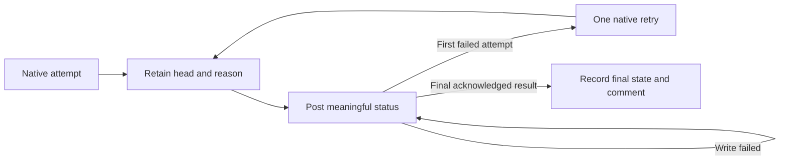

# Shipping lessons

- Loop fixes merged but never ran: the driver runs from a non-git copy. Prevention: driver self-installs merged loop changes and the LaunchAgent restarts it.
- Driver exited when its queue emptied (Oct 31, twice) -> driver now idles and re-scans, and a LaunchAgent restarts it on crash.
- Loop PRs stalled once their task ended (Oct 31, several times) -> driver now sweeps all open loop PRs: updates BEHIND branches, merges CLEAN ones, queues one rebase for conflicts.
- 2026-10-31: A follow-up task without `existing`/`pr` headers tried to recreate an open PR's branch from main and was stopped by a stale worktree; prevent recurrence with a branch-exists guard and clean stale-worktree cleanup before reuse and after merged, blocked or errored tasks.
- 2026-11-01: Cleanup counted ignored evidence as dirty work; ignore `!!` entries, archive `.evidence/` outside the worktree before removal, and retry retained cleanup failures in the existing sweep.

## Simulator errors after #691, 2026-10-31

**TL;DR:** A retry status hid real assertion failures, and the synthetic reminder fixture depended on anonymous account state.

Trace the actual status writer before diagnosing a red required check.
The protected `sim-scope.yml` workflow publishes `Sim scope`; the external Mac `sim-review/poller.mjs` publishes `Simulator`.
Its old first-failure path posted `error` with only `Attempt 1 failed; retrying next poll`, discarding the assertion's reason until the second attempt.
Its status writer also accepted an empty description, and comment publication happened before the final status write.
An interrupted or failed comment request could therefore leave the earlier error visible.

The retained local runs distinguish assertion failures from setup errors:

| PR and head prefix | First retry after #691, Pacific time | Observed cause | Later local outcome |
| --- | --- | --- | --- |
| #689 `5f90042e6b32` | 15:54 | Mixed-trial visual expected optional reminder copy; the anonymous paywall showed unavailable account state | `failure` at 16:49 |
| #685 `142495465959` | 16:07 | Same mixed-trial assertion | `failure` at 17:02 |
| #684 `ee0b23ba3700` | 16:19 | Floating navigation could not find `saved-content` | `failure` at 17:13 |

The table records Mac log and Maestro artifact observations.
A subsequent authenticated browser inspection confirmed final failures with matching descriptions on [#684](https://github.com/dgmolla/fitsy/pull/684), [#685](https://github.com/dgmolla/fitsy/pull/685) and [#689](https://github.com/dgmolla/fitsy/pull/689).
The reported earlier literal empty description could not be recovered from that latest-result display; it must not be confused with a status that was never posted.
The local status reproduction executes the deployed status blocks against an in-memory GitHub recorder and proves the first-failure misclassification and empty-description acceptance.
The saved screenshot and command report show the real mixed-trial failure before the repair.
The rendered payment-screen regression reproduces the same anonymous notification-state mismatch.

The affected runs reached Maestro, so their failures were not the 45-minute Maestro process timeout, 40-minute native build timeout or a missing status-publishing workflow.
Backend identity receipts bind #684 and #689 to stable dev at #691 and #685 to its exact-head Ready preview.
The earlier #685 `b1ce6297b8e0` error was different: the installed expired fixture still rejected preview backends.
#691 added a preview-capable module and installer, but the host import remained on its older implementation.
A merged helper is not installed behavior.

The lasting prevention is implemented in [the maintained status lifecycle](../../../scripts/sim/poller-status.mjs) and [its host installer](../../../scripts/sim/install-poller-status.mjs):

- Persist the head, attempt, classification and redacted reason before posting.
- Publish assertion failures as `failure` and runner problems as `error`, with a nonempty description capped at 140 characters.
- Queue one automatic retry with its original reason; preserve both attempts and never convert an incomplete run into success.
- Require and log GitHub's acknowledgment of the exact status fields.
- Resume a failed publication without running the simulator again, and post the final status before the optional comment.

The visual-fixture repair supplies synthetic opt-in and enabled states only when the development synthetic offering is active.
It retains the original visible assertions, live Test Store prices and purchase prohibition.
The production-mode regression checks a sandbox entitlement and confirms visual parameters cannot override real checkout notification permission.
This changes no RevenueCat offering, entitlement policy, TestFlight store key, App Review account or production data.

After merge, the existing host owner must install both `install-expired-fixture.mjs` and `install-poller-status.mjs` from clean, fresh main under the shared simulator lock.
Use a fresh poller process, retain the installation receipts, and refresh #684, #685 and #689 onto the repair before checking their new heads.
Rebase #690 onto main before its replay as requested.
Require ordinary Verify, independent review and fresh Simulator results; a diagnostic test, old-head status or edited state file is not acceptance.
Preserve #684's independent navigation failure if it still reproduces.
Stop and report if recovery requires account, secret or service-setting changes.

- 2026-11-01: Every isolated pre-push aborted with "pre-push died of signal 6" because the native sandbox denied reads of the root directory `/`, which dyld needs at launch on macOS 26. Prevention: the profile grants a literal `/` (listing only); `SandboxProfileTest` launches bash under the real generated profile on macOS.
- 2026-11-01: After the loop's LaunchAgent was regenerated from the repo template, the driver lost `FITSY_XCTEST_SIM_UDID`, so every app task stopped with "Host runner requires an explicitly owned simulator UDID". Stopgap: `launchctl setenv` for the canonical simulator (A9981463…, the one sim-review owns). Prevention: task 00122 makes the installed LaunchAgent carry the owned simulator settings.
- 2026-11-01: Loop installs must come from the canonical `wt3` checkout: `install.py` pins that checkout's `node_modules` as the only sandbox-readable dependency roots, and recreated task worktrees now link them (`worktrees.link_dependencies`); otherwise isolated pre-push fails with "verification dependencies are missing". Merged loop fixes only run after `install.py --apply` (check `source-receipt.json`).
