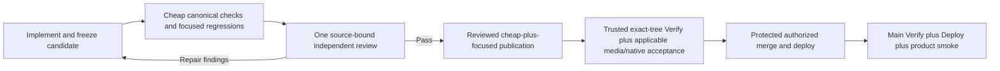

# Shipping a Fitsy change

The human-selected standalone Pstack `orchestrate-delivery`, `ship-branch` and `verify-fitsy` skills control coordination, evidence planning and shipping sequence.
Load the exact committed package paths supplied in the coordinator assignment.
Latest direct human instructions and issue-bound authorizations take precedence.
This document supplies supported command contracts, product acceptance, security/data protections and release requirements.
GitHub requires `Verify` and `AI review` on the current PR head before merge.
Local shipping helpers run candidate checks directly through the canonical verifier.
It does not impose another workflow, lifetime review count, automatic retry or budget increase.
The executable checks remain in `scripts/verify/registry.yml`, `scripts/verify/risk-tiers.yml`, and `scripts/review/`.
Historical recipes in `autonomous-shipping.md` and generic global skills do not select a competing pipeline.



## One branch owner and one review process

Inspect active worktrees and compare changes against each branch's merge base before integrating overlapping work.
Do not change another agent's checkout or force-push its branch.
Keep dependency chains explicit and rebase the dependent branch after its prerequisite lands.
Define one accepted user outcome per PR, with acceptance evidence, non-goals, and one execution owner.
An API and mobile change may ship in one PR when their contract evolves together; split only independently useful and safe outcomes.
Distinguish actual blockers from preferred order, and verify a backward-compatible interface with a small end-to-end contract check before shipping an API-first sequence.
The domain and 600-line checks report scope for review; neither imposes an automatic split or replaces affected product and security gates.
Use a fresh checkout for integration/deployment when the primary checkout is occupied.
Do not use a feature-branch mobile publication as a substitute for integrating the intended release commit.

Freeze the accepted outcome and non-goals when validation starts.
Optional hardening and preferred abstractions remain owned follow-ups unless a reachable failure invalidates required acceptance.
A substantive new human requirement changes scope explicitly; acknowledge it and refreeze the candidate before continuing.
Finish implementation and commit the frozen candidate before review.
Select meaningful focused reproduction and regression tests for the changed behavior.
Run applicable structural, lint, type and safety checks plus that focused selection before independent review.
The hook runs cheap checks and focused tests directly; GitHub owns merge requirements and heavy validation.
Independent review uses the [simple-review runner](../../../scripts/review/simple-review.md) and retained routing and severity rules.
The installed review caller publishes the existing `AI review` status for the exact candidate.
Reviewer execution remains separate, with attempts controlled by the installed local AI reviewer.

```sh
node scripts/verify/focused-tests.mjs --set scripts/verify/impact-plan.test.ts
npm run verify -- --stage=cheap
node --test scripts/review/simple-review.test.mjs
# Obtain an independent review through simple review before publishing.
# Publish through the ordinary hook after applicable validation.
git push -u origin HEAD
```

Replace the focused test with the accepted issue's meaningful regressions and run applicable final acceptance commands before merge.
Focused selection supports Jest, Node `.test.mjs` and Python `.test.py` through the canonical runner.
Stop on failed cheap checks or matching review before push; applicable final acceptance remains mandatory before protected merge.
A focused selection is not full acceptance; correctness review still judges scenario relevance.
The review behavior suite proves runner behavior; it does not supply a candidate's independent verdict.

Local verification and publication do not require an issue binding, a shipping session, a review daemon or `~/.fitsy-review`.
The pre-push hook runs size/domain checks followed by cheap static checks and focused tests.
It does not execute full suites, builds or reviewers.
A hook pass does not replace independent review, applicable product acceptance or required GitHub checks.

Keep review and acceptance evidence tied to the tested source.
After source changes, rerun affected checks and obtain matching review before merge.
Every selected verification check executes afresh, and full affected test groups include focused test files.
Empty selections, missing scripts and zero passing test cases fail verification.
Every verifier invocation retains complete stdout/stderr logs with paths in its JSON results; use the [diagnostic recovery contract](../../../scripts/verify/README.md#diagnostic-logs) after local or CI failures.
UI signoff and development walkthroughs precede final UI acceptance.
The final-candidate simulator runner and publisher retain source, app, backend and evidence validation without a local session wrapper.
Apple account, legal and submission approvals, product-flow status, PR checks, main Verify, Deploy and actual release acceptance remain required.

The pre-push hook runs size/domain checks followed by cheap static checks and focused tests.
GitHub's current-head `Verify` and `AI review` results provide merge authority.
The final Verify job still requires every applicable classified job to succeed and only permits legitimate skips.
Deployment validates successful main Verify and the exact protected release source through the existing [routine production entrypoints](routine-production.md).
The incident-specific manual migration recovery described there retains `production-release` approval and does not run from routine Deploy or the Git build.
A hook pass does not replace the applicable product-flow verification or independent review.
The registry determines which checks apply and whether a check is blocking or shadow.
Removing obsolete structural exceptions belongs to the changed product domain only when every removed entry names a file in the same diff.
Allowlist additions, unrelated removals, deletion of the allowlist and unreadable history retain infrastructure ownership.

Changes under `scripts/sim/`, the product-flow verification controls or the loop's host recovery controls run the blocking local `media-integration` lane in `npm run verify`.
Install `ffprobe` and `ffmpeg` locally before that run.
The media preflight also requires working `ps` process ownership inspection; a sandbox denial fails before native fixture children start.
The lane runs real decoder, XCTest attachment and host credential-isolation cases, then records `.evidence/verify/media-integration.json` with the candidate SHA and source/test hash.
Hosted L2 runs deterministic tests without media tools.
After committing, rerun `node scripts/verify/run.mjs --only=media-integration --runs=local` so the receipt names the PR head.
The `product-flow/local` publisher checks that receipt before setting its exact-head status, including when mobile product evidence is not applicable.

**Local product-flow gate.** Local iPhone E2E is blocking for mobile-facing changes.
CI runs static checks, unit tests and builds on Linux, without simulator execution or simulator secrets.
Hosted L2 uses the same owned PostGIS launcher, target assertions, migrations and data-only seed as local database verification.
Run `npm run verify:sim-plan` to inspect `none`, `smoke`, `flow` or `full` scope and its reason.
The planner uses the retained reviewer ownership router and simulator path tiers, mapping changed mobile screens and API contracts to the existing Maestro flows.
Navigation, auth, billing, native configuration, release and unmapped mobile-facing paths require all flows; changes without mobile consumers require no simulator.
The artifact explains each omitted flow; local execution and final acceptance consume the same selection, and explicit lists can only expand mandatory coverage.
Inspect `npm run verify:product-plan` for the selected final journeys and applicable MCP categories.
Verification-only package script edits do not require a simulator; native dependencies, build profiles and release changes retain full coverage.
Every mobile or web UI edit triggers local coverage: proven screen-local copy/style edits use launch-and-render smoke, navigation/state/forms use affected E2E flows, and shared UI or app shells use the full suite.
Render smoke reuses maintained flow setup through a mapped render assertion, then saves a screenshot; uncertain changes retain E2E coverage.
The `needs-sim` label forces flows and its addition or removal reruns classification.
CI prints the scope and reason and uploads the full plan as `selection.json` in the `sim-scope` artifact.
The classifier and baseline scripts run with read-only credentials and no persisted checkout token.
The separate `sim-scope.yml` workflow publishes a successful `Sim scope` status on the current PR head from protected code, after validating the source run and artifact.
Its description is `scope=<scope> flows=<count>` to stay within GitHub's 140-character limit; the local poller reads exact flow names and checkpoints from the linked Verify run's artifact.
That status records selection, not a native test result.
The final Verify job retains its existing applicability and failure semantics.
Simulator runs locally on the maintainer Mac via the sim-review poller, which posts the Simulator status; merges wait for it when scope is not none.
The poller uses the saved YAML flows in `apps/mobile/e2e/flows/` through Maestro, with Maestro MCP available for interactive diagnosis.
The pre-push hook stays a cheap static and focused-test gate.

Load the dev environment on the Mac and activate a compatible existing binary or use a supported build with measured capacity through the native procedure below.
The shared binary cache is optional, and compatibility still requires matching native inputs, configuration and the served candidate source.
The ordinary `product-flow.mjs build` entrypoint selects local receipts, then verified [shared native artifacts](native-binary-reuse.md#shared-native-cache), before compiling; `FITSY_NATIVE_CACHE_DIR=off` retains the uncached path.
The local scripted gate requires an explicitly owned, booted simulator and validates its native receipt, installed artifact, source and dev backend before driving it.
It uses `FITSY_SIM_OWNER` for the existing exclusive device lease and releases its own Maestro processes and Metro after execution.
Retire only the task's idle simulator through the resource lifecycle after the native phase; preserve active or shared devices and required evidence.
When sandbox access prevents that lease or the media ownership preflight, retain the failure and resume through the existing authorized host owner without substituting an unleased run.
It reads configuration only from the local process environment; it never fetches repository variables or secrets.
Use the matching `FITSY_DIFF_BASE` and `FITSY_DIFF_HEAD` when reproducing CI's selection and render checkpoints.

```sh
npm run verify:sim-plan
node --env-file=apps/mobile/.env.development.local scripts/sim/ci.mjs --scope=changed --udid=<UDID>
node --env-file=apps/mobile/.env.development.local scripts/sim/ci.mjs --scope=flow --flows=signin-options,paywall-access --udid=<UDID>
node --env-file=apps/mobile/.env.development.local scripts/sim/ci.mjs --scope=changed --udid=<UDID> --record-video
node --env-file=apps/mobile/.env.development.local scripts/sim/ci.mjs --scope=full --udid=<UDID>
```

Optional `--record-video` (or `FITSY_SIM_RECORD_VIDEO=1`) adds short Slack previews alongside screenshots without changing the simulator result.
See [optional Slack previews](../../../scripts/sim/native-runner-controls.md#optional-slack-previews) for capture limits, non-fatal failure handling and the external poller's supported wrapper invocation.
Complete explicitly requested product-acceptance videos keep their separate validation contract.

All selected flows require their documented starting states, including billing fixtures.
Configure `FITSY_E2E_FIXTURES` with the untracked local adapters and public environment files described in [the native README](../../../apps/mobile/e2e/README.md#local-journey-fixtures).
Each account-dependent flow declares its fixture and allowed stores in its YAML tags.
The runner prepares that fixture before the journey, reacquires the device lease, validates the installed native/build/store identity, and starts owned Metro with that fixture's configuration.
It stops owned Metro and restores the caller environment after each journey, so earlier sign-out flows cannot supply a later billing flow's starting state.
Missing preparation, incompatible stores and failed fixture assertions fail the selection without omitting flows.
Apple history-transfer acceptance still requires a compatible Apple store build; Test Store evidence cannot establish it.
Applicable product acceptance and its exact-head publisher require fresh `.evidence/product-flow/report.json` when impact selection applies; ordinary publication does not claim that proof.
Missing tools, skipped/failed assertions, missing coverage and stale evidence fail; unrelated changes get explicit `not_applicable`.
The existing local `product-flow/local` gate retains its independent source-bound acceptance checks.

Use an owned worktree, `npm run dev:env`, and an explicit simulator UDID.
Keep public configuration in the ignored mobile environment file.
The builder generates an embedded Release app, disables downloaded OTA updates, and records source/native/JS/configuration identities.
A keyless build proves navigation only and cannot cover billing.
Never publish credentials or personal data in evidence.

For RevenueCat Test Store, add `--test-store` to `build` and configure the public `EXPO_PUBLIC_REVENUECAT_TEST_KEY`.
This builds Debug without the dev launcher and uses an owned Metro server on port 8099.
Expo development bundles require a server connection; an embedded Debug bundle cannot initialize.
Each run starts its own server, refuses a busy port, and records its process, source, configuration and served-bundle hashes.
Keep that server running through walkthrough, publication and merge; the gate rechecks its identity and bundle.
Use `node scripts/sim/product-flow.mjs stop-metro` after shipping.
It only stops the recorded process; the usual development server is untouched.
Test Store evidence does not establish Apple sandbox billing behavior.
Synthetic plan names and trial periods come from `apps/mobile/lib/testStoreFixtures.json` in both Debug offering setup and the canonical Maestro entrypoints.
The runners retain every attempt, classify failures as environment or code, and retry diagnosed environment failures once against unchanged inputs after owned-process cleanup.
Assertions, unknown failures and lost ownership cannot earn a pass through retry; failed recovery keeps the gate closed.
Native uploads follow the [TestFlight post-submit transaction](ios-ota-baseline.md#complete-a-testflight-upload), and recurring incidents belong in [shipping lessons](shipping-lessons.md).

Both configurations use local simulator signing with Xcode's application entitlement so SecureStore can read and persist sessions.
Use a disposable simulator: iOS app reinstalls preserve keychain sessions.
For a fresh-account run, explicitly set `FITSY_SIM_RESET_KEYCHAIN` to that simulator's UDID.
This clears its entire keychain before the selected journeys and records the reset.
Never set it for a simulator containing accounts you need to keep.

```sh
npm run verify:product-plan
export FITSY_SIM_OWNER=my-task MAESTRO_BIN="$HOME/.maestro/bin/maestro"
node --env-file=apps/mobile/.env.development.local scripts/sim/product-flow.mjs build <UDID>
# Run final acceptance against the current candidate:
node --env-file=apps/mobile/.env.development.local scripts/sim/product-flow.mjs run <UDID> --mode=final-candidate
# Capture affected primary and recovery paths through Maestro MCP, then:
node --env-file=apps/mobile/.env.development.local scripts/sim/product-flow.mjs finish .evidence/walkthrough.json
```

The final runner automatically includes every affected journey, including cold-start and sign-in only when selected.
Explicit names add diagnostic journeys; they cannot replace mandatory flows.
Final acceptance executes the complete selected YAML even when local development used render smoke.
Maintain flow tags for every category in `--plan`, with at least two non-optional outcome assertions per changed journey.
Every selected flow and its mandatory source assertions must be present in the receipt; another tagged journey cannot substitute for an omitted flow.
Primary/recovery MCP observations, media/UI approval, source and binary identity, backend and store compatibility remain required where applicable.
Report speed improvements only from comparable repeated runs; a smaller plan or one simulator trial alone is not a speed measurement.
Promote discovered regressions into deterministic scenarios.
Final candidate runs retain required assertions, raw Maestro commands, screenshots, XCTest capture receipts, timing and changed-journey walkthroughs without recording video by default.
When a reviewer explicitly requests video, add `--record-video` to the final candidate run; the runner retains complete untrimmed video and the validator checks each recording before publication.
Development runs remain separate from final publication even when recorded.

The walkthrough JSON is an array with one entry per category: `category`, `expected`, `observed`, `branches: ["primary", "recovery"]`, `result: "pass"`, and `trace` relative to `.evidence/product-flow/`.
Traces are JSONL: one `{at, command: {name}, result: {content}}` object per line, recording actual Maestro MCP actions and screen observations.
Retain direct `tap_on`, `input_text`, `back` or `launch_app` interactions and `inspect_view_hierarchy` observations; a syntax check or scripted flow invocation alone does not establish an interactive walkthrough.
Identify run-owned synthetic fixtures with `FITSY_FIXTURE`; reviewers judge scenario relevance and visual quality.

### Keep mobile walkthroughs focused and recoverable

Before interacting, list the expected primary and recovery checkpoints, required assertions, and a task-appropriate action, retry and elapsed-time budget in the task evidence.
Use the accessibility screen or relevant subtree where supported to find visible controls and confirm semantic state.
Save complete successful Maestro MCP responses in the source-bound walkthrough trace, while bringing only the relevant controls and state change into working context.
Keep any failed response, including `isError: true`, in separate private diagnostic evidence because the product-flow validator rejects failed events in the walkthrough trace.
Record the failed attempt in the diagnostic action history and include a successful retry in the validated trace only after it actually changes or observes the required state.
If a target is offscreen, scroll to it deliberately, refresh the accessibility state, and verify reachability before tapping.
If accessibility data is missing or misleading, record that limitation and use a screenshot or another supported observation instead of inventing a selector.
Take screenshots at required outcomes and when checking layout, clipping, redundant controls or visual state that the accessibility tree cannot establish.
Inspect those images against the affected screen's acceptance criteria; semantic success alone does not establish visual quality.

Count attempts without a relevant state change across taps, selector variations, waits and restarts.
After two such attempts, save the current tree, screenshot and diagnostic action history, then diagnose the failed checkpoint before another action.
For a stale element, refresh the tree and reacquire the control.
For an overlay, inspect it, dismiss only a known safe overlay, and confirm the expected screen.
For delayed accessibility updates, use a bounded state-based wait and compare the screen image before treating the delay as an app failure.
At the planned budget boundary, record the failed step and cause through the normal recovery path; never turn a skipped assertion into a pass or replace it with a sleep.

Keep complete action responses and the selected raw log window in private task evidence, then read only a scoped excerpt during diagnosis.
For example, capture a short device window with `xcrun simctl spawn <UDID> log show --last 30s --style compact > .evidence/product-flow/device-log.txt`, then use `rg -n '<relevant-pattern>' .evidence/product-flow/device-log.txt` for the relevant lines.
Use `scripts/sim/sim logs --seconds 30 --grep '<relevant-pattern>'` when a quick bounded excerpt is sufficient.
Do not include credentials or personal data in published evidence.
Record actual tool calls, elapsed time, no-progress attempts, retries and evidence size if comparing flows; external speed claims are not Fitsy measurements.

```sh
node scripts/sim/publish-product-flow.mjs <PR_NUMBER>
```

The publisher requires a clean checkout matching the PR head and current main.
Use the PR's Ready Vercel preview for candidate backend changes and keep `dev.fitsy.org` pinned to `dev`.
The publisher rechecks source, app/configuration and backend identity, validates evidence no more than 24 hours old, and attaches verified commands, screenshots and traces to a **private draft** GitHub release.
Keep drafts unpublished.
Non-product PRs publish N/A without a simulator; `--include-baseline` optionally attaches a baseline validation run.

Main requires `product-flow/local` on the exact head.
Republish before merge; code/test changes require fresh evidence.
GitHub does not automatically expire an old success after 24 hours.
This trusts repository writers like the existing local reviews; it is not an attestation against an administrator.
Preserve existing required checks when configuring protection.
The local scope run cannot substitute for this separate source-bound acceptance gate.

For a backend change before its first push, deploy a clean committed checkout with `vercel deploy --target=preview`, then set `EXPO_PUBLIC_API_URL` to that Ready `fitsy-api` preview for build, run, finish, check and publication.
Keep `dev.fitsy.org` pinned to the `dev` branch.
Use the same origin for every fixture and pass it explicitly to Maestro; owned Metro disables dotenv overrides.
See [native helper checks](../../../apps/mobile/e2e/README.md#native-helper-checks) for the supported origin and external host-runner setup.
The gate accepts Vercel's CLI `meta.gitCommitSha` identity as well as a Git deployment's `gitSource.sha`, rejects dirty CLI uploads, and still compares candidate backend contents and pins the deployment across the test and publication.

## Independent review

Use one independent read-only review of the exact candidate through `scripts/review/simple-review.mjs`.
The required review gate remains `AI review`, alongside the final `Verify` job.
Do not change branch protection as part of local review tooling cleanup.
The implementer cannot supply its own independent verdict.

The retained `scripts/route-reviewers.sh` maps changed paths to roles.
The runner always includes correctness and maps API/mobile to danger-zone, CTO to workflow-security, product-manager to spec-conformance, and design/GTM to docs-sanity.
`REVIEW.md` retains the severity definitions, evidence requirements and complete-domain JSON contract.
Missing domains, contradictory verdicts, malformed output, timeouts and provider failures never establish approval.
Only CONFIRMED P0/P1 findings block the review result.
P2/P3 and plausible findings remain visible with the raw verdict; custom disposition files and test-receipt fingerprints are retired.
Required product tests and essential acceptance criteria still block independently of finding priority.

The runner supports Codex only, defaults to `gpt-6-sol` with high reasoning effort, and accepts an explicit `FITSY_REVIEW_MODEL`.
The provider executes in a temporary home with a read-only sandbox, without GitHub credentials or inherited agent-session configuration.
The installed subscription caller uses the same routing and output validation with its local transport.
See [simple review](../../../scripts/review/simple-review.md) for inputs, exit codes and the behavior suite.

Use immutable trusted-base review controls against the exact checked-out PR head and merge-base diff.
The runner checks live commits, labels and PR state before publication and creates or updates one marked bot comment.
A stale or incomplete review cannot publish a passing result.
Review caches, approval fingerprints, compatibility lens statuses and repository poller scripts no longer supply review results.
Keep all findings visible and repair material defects and mandatory acceptance failures together.
After repair, review changed behavior and affected consequences against current source.
Before protected merge, require current trusted Verify and every applicable real-media/native flow.
Apple, legal, submission and release approvals remain applicable.

## PR, integration, and deployment

Open the PR with scope, intent, actual verification results, relevant evidence paths, and remaining limits.
State the coherent outcome, acceptance evidence, non-goals, owner, and blocking dependencies.
Use `--body-file` for multiline CLI PR bodies.
Include `Spec:` or the incident reference where applicable.
Check the current PR head and its required `Verify` and `AI review` results before merging; an earlier commit's green result is insufficient.
Follow existing task authorization for push, merge, migration, and deployment.
If the user has already authorized the complete shipping sequence, continue through it without repeatedly requesting the same authorization.
Do not treat a request to discuss or prepare a proposal as authority to publish it.

Use the existing release tooling and documentation:

- API/landing: inspect the appropriate Vercel deployment for the merged commit; these are separate projects.
- Mobile JS: `scripts/deploy/ota.sh` and the iOS release runbook own the production OTA procedure.
  Production exports must use the production environment and valid RevenueCat/Supabase configuration.
  The [Expo fingerprint and channel contract](ios-ota-baseline.md) requires a verified matching native baseline and runtime.
  JS, styles and bundle-only assets can use OTA; native modules, permissions, plugins, icon/splash, Expo SDK and widget/Swift changes require a verified binary build.
  Before App Store launch, automatic OTA moves to `testflight`; App Store production OTA requires Dawit's manual main Deploy dispatch and protected release approval.
- Database: use the documented migration and rollback process; a successful Vercel deployment does not prove a migration ran.
- Rollback: `scripts/deploy/rollback.sh` plus the relevant deployment runbook; record the previous deployment/update and data rollback evidence before publishing risky changes.
- Documentation-only work has no mobile/API deployment requirement.

Once merged, inspect BOTH the main **Verify** workflow and the applicable **Deploy** workflow at the resulting commit.
The September workflow-lint incident showed that PR-only checks and a green deployment can coexist with a failing main Verify.
Do not report production completion while that distinction remains unchecked.
Recheck the applicable authenticated user path, not only a public health endpoint.

## Evidence for completion

Record the branch/PR, reviewed head, merge commit, deployment/update identity, check results, and rollback target.
Identify failures that were fixed separately from checks that remain skipped, shadow, or untested.
A screenshot or video should show the changed interaction; a successful build is not equivalent evidence.

For subscription/onboarding changes, explicitly name the states tested: new user, active subscriber, lapsed subscriber, restore, delete/recreate, and delayed synchronization where affected.
Record whether evidence comes from RevenueCat Test Store, Apple sandbox/StoreKit, or production behavior and configuration.
Do not claim complete real-store validation from a simulator/Test Store purchase.

For data work, identify the source/reference facts, preserved identities, before/after rows, writer path exercised, and rollback proof.
Distinguish synthetic fixtures and estimates from independently verified reference data.

Finish with a concise state report:

- What changed and where it is available.
- Which of local verification, PR checks, main Verify, deployment, and product smoke have passed, with evidence.
- Any remaining blocker or untested path, and the next owner/action.

A background process existing is not proof that it will wake its owner.
When waiting, retain durable task state and use the harness's supported completion notification mechanism.
If the runner cannot continue automatically, report that limitation rather than promise an unverified future follow-up.

The pre-push hook clears `NODE_OPTIONS`, `NODE_PATH` and shell startup selectors before verification.
The verifier executable also clears Node startup selectors and uses fixed interpreter search locations.
For npm verification aliases, clear Node startup options before invoking npm.
