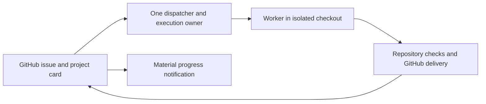

# Task management and worker ownership

> **Status:** living · **Last verified:** 2026-09-26

## Authority

The [Fitsy Delivery GitHub Project](https://github.com/users/dgmolla/projects/1) is the authoritative queue for Fitsy deliverables.
GitHub issues hold outcomes, acceptance criteria, dependencies, ownership, and follow-ups.
The project records the current stage and explicit blocker fields, while pull requests and Actions provide source-bound delivery evidence.
Do not start a second writable backlog.
Existing authorized work continues under its existing owner during migration.

| System | Responsibility |
| --- | --- |
| GitHub Issues and Fitsy Delivery Project | Deliverable, priority, dependencies, acceptance, execution owner, current stage, and blockers. |
| FM or an explicitly delegated coordinator | Claim work, supervise workers, reconcile evidence, and update the same issue. |
| Repository and GitHub | Canonical checks, source-bound review, PR/merge identity, deployment and verification receipts. |
| Slack | Notifications linked to the issue and evidence; never a separate task queue. |

## One issue, one execution owner

Search for an existing issue before creating one.
Each independently testable deliverable records its outcome, acceptance criteria, priority, dependencies, owning role, execution owner, and applicable release surface.
State the expected user outcome, acceptance evidence, non-goals, one execution owner, and actual blocking dependencies in the issue and PR.
Separate preferred scheduling order from a dependency that truly prevents independent acceptance.
Keep coupled API, mobile, and shared-code changes together when their contract is still evolving or neither layer delivers a useful accepted outcome alone.
Split a larger change only when each slice is independently useful, testable, and safe to ship; line count, file count, and layer boundaries are review signals rather than split rules.
If a compatible API addition ships before its UI, define the stable interface and verify a small end-to-end contract before starting the dependent slice.
For example, a new trial step and its changing API response belong to one outcome when neither is useful alone.
An additive, backward-compatible API capability may ship before its screen when the API has its own acceptance evidence and the screen depends on that stable contract.
Repair a missing prerequisite in its owning open PR; after that PR ships, use a bounded follow-up with an explicit dependency.
Do not create a new issue for each review comment or minor adjustment within the accepted outcome.
Keep required end-to-end checks and risk review across every affected surface.
Use the real GitHub issue number in branch and PR references.
Link related PRs, Actions runs, deployment receipts, and source-bound follow-up issues rather than copying raw logs or credentials into the project.
Apply existing PR scope and review rules from [shipping.md](shipping.md); this contract adds no approval or review gate.

One dispatcher assigns the execution owner before starting a worker.
The selected coordinator retains execution custody until explicit transfer or completion; legacy entry points must not dispatch a competing implementation.
Parallel subtasks have explicit file/behavior boundaries and report to that owner.
Freeze the accepted outcome during validation and keep optional improvements in owned follow-ups.
When human steering changes active scope, the coordinator delivers it at the existing owner's next safe boundary and records that owner's acknowledgment before claiming the change was applied.
Editing a board field, issue body or handoff alone does not prove that a running worker received the instruction.
Do not interrupt an active command or create a second owner to deliver steering.
Before transfer, persist current source, evidence, running operations, blockers and next action, confirm the prior owner stopped or released ownership, then record the successor.
An issue assignment alone is not an atomic process lock; use the existing supported claim controls for runtime exclusion.
Ordinary `local-dispatcher.py tick` admission refuses new work with `selected-brief-required` unless the selected coordinator supplies its in-process brief renderer.
Disabled-config ticks still reconcile existing claims.
Claims, resource protections, lifecycle reconciliation and verified terminal receipts remain executable contracts.
If ownership cannot be established, reconcile it before launching another worker.

For Codex-led work, one coordinator claims the issue and assigns one Sol implementation owner by default.
Add agents only for bounded independent tasks with explicit file ownership; another lane's blocker does not hold unrelated work.
Freeze and commit the candidate, select meaningful focused regressions, run `npm run verify -- --stage=cheap`, then complete one independent canonical review before full suites and affected E2E acceptance.
Repair findings and revalidate cheap checks and review before full acceptance; revalidate matching canonical review evidence through live shipping admission and preserve historical review records needed by unfinished tasks.
Use the review domains, UI signoff, release approvals and shipping gates in [shipping.md](shipping.md).
Send a separate Slack alert headed `🚨 *BLOCKED*` only when live evidence establishes a concrete action that requires the human.
Keep agent-owned review, required-gate, execution and dependency recovery on the issue and handoff without human mentions.
Mention the recipient directly and state the issue, reason, and next action in at most three short lines; do not mention the recipient in routine digests.
Use a stable incident deduplication key and confirmed Slack API receipt, never repeat an unchanged alert, and send one `✅` resolution when that incident clears.
A Slack delivery receipt confirms API acceptance, not a phone push or that the user saw the alert.

## Stages and evidence

Use the project's existing `Queued`, `In flight`, and `Done` statuses instead of creating duplicates.

| Project status | Required meaning |
| --- | --- |
| Queued | Accepted work awaiting priority or dependencies. |
| In flight | A named execution owner is implementing, validating, reviewing, integrating, or verifying the release. |
| Done | Applicable main checks, release verification and acceptance passed, with linked receipts. |

Record ready, review, merge, and deployment milestones in the issue with the source-bound receipts, not as new project statuses.
Record blocked reason, blocker owner, next action, and next check separately from the current project status.
Documentation-only work records deployment as not applicable.
For mobile, distinguish OTA publication, native binary distribution, and observed device uptake; one does not establish the others.
P2/P3 follow-ups retain the source-bound disposition and named acceptance from the review contract; creating an issue alone does not satisfy that contract.

## Progress and elapsed time

Use GitHub checks, PR state and deployment results for delivery status.
Repository verification and push hooks do not collect or publish phase events.
The repository no longer installs recurring dispatch, review or status-report jobs.
The optional Slack bridge remains available for authorized notifications.

Record actual UTC timestamps for request, ready, work start, PR opened, required gates ready, merged, deployed, and acceptance verified.
Preserve unknown historical values rather than substituting commit times or reconstructing imaginary work starts.
The execution owner sets the project's `Started at` to the observed ISO UTC time when work starts.
At material progress or a blocker, update `Progress`, `Next action`, `Last progress at`, and the existing Blocker/Dependencies fields on that project item.
Set `Verified at` only after acceptance and applicable main Verify, Deploy, and release receipts are linked; a merge or issue close is not verified delivery.
Report request-to-verified-delivery separately from PR-open-to-merge, queue time, active execution, and blocked time.
Do not sum overlapping reviewer/test durations and label the result wall time.
Use request-to-verified delivery elapsed time and repeated review/repair/acceptance cycles to assess velocity; activity, log output and check counts alone do not prove delivery.
Update the issue at material transitions, failures, ownership changes, and completion.
Honor the task's communication authorization before sending external notifications.
If GitHub is unavailable, record the gap in the active handoff and report it through the current user conversation.

## Worker lifecycle

A persistent FM supervisor may outlive many tasks; task workers must have a current purpose.
Use a fresh worker context for a new unrelated issue, preserving reusable evidence and repository state outside the conversation.
Resume the same issue only from its current compact handoff and verified source/evidence identities.
A paused worker records the hold reason, next owner/action, and explicit wake condition; pause its periodic progress reporting.
Reconcile workers on completion and on the supervisor's normal heartbeat.
After recording completion, use FM's canonical teardown for the completed worker when no child work, owned running operation, pending delivery, or unrecorded evidence remains.
Keep a completed worker only for a documented recovery need with an owner and expiry/recheck condition.
Do not keep it idle indefinitely as a substitute for durable task state.
Do not kill workers solely because of elapsed age outside an explicitly configured, issue-bound execution budget, and do not restart them to evade the AI review attempt limit or erase failed attempts.
The local dispatcher enforces a 90-minute active claim budget, records a timeout, reconciles its owned process group, and parks the issue without resetting source-bound evidence or review history.
Worker retirement and worktree deletion are separate operations: preserve unmerged changes, source-bound evidence, review history, and release/rollback receipts.
Release simulator, Metro, database and other resource claims only through their ownership-aware procedures.

## Cutover and recovery

Inventory existing FM and local rollout items, then map each deliverable to an existing or newly created GitHub issue.
Preserve completed PR/deployment links and unresolved findings; do not import old completed generations as new work.
Store returned issue identifiers before attempting another create; reconcile uncertain writes before retrying.
Record verified dependencies and the single dispatcher, then mark the previous backlog as a reference to the Fitsy Delivery project.
Confirm issue reads, a real task update, owner reconciliation and the configured notification path before declaring the integration operational.
During an outage, preserve a bounded pending-update log keyed by issue and event identity under the current dispatcher.
Continue already-owned authorized work when safe; do not dispatch duplicate work or claim unsynchronized statuses were delivered.
Replay and reconcile the pending updates after recovery, retaining their original observed timestamps.

### Review follow-up

Every PR body includes exactly one `Delivery-Issue: #N` line within its first 4,000 characters, naming the authoritative outcome issue.

At each review round closeout, record confirmed findings, impact priority, and either the detector plus prevention change or an owned follow-up under the review disposition contract.
If no new hardening is warranted, state that explicitly instead of manufacturing a change.
Link merged fixes and successful checks or deployment results on the issue; queued fixes do not count as shipped improvements.
