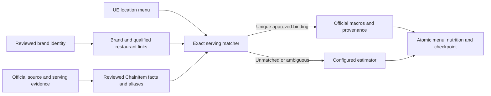

# Canonical Chain Macros

**TL;DR:** Verified brands share reviewed serving facts; UE alone determines each location's menu membership.

The canonical catalog separates restaurant identity, location menu membership and published nutrition.
The schema lives in `prisma/schema.prisma`; the maintained implementation is `chainCatalog.ts` and `chainServing.ts` in `apps/api/services/`.
This document supersedes the June detection proposal as an operational architecture reference.
Historical detection experiments and source comparisons remain in Git history and `../archive/`.

## Execution boundary

Local ingestion, catalog apply, identity onboarding and rollback examples target DEV or disposable loopback databases only.
Use an explicit `PIPELINE_DATABASE_URL` with the dedicated `pipeline_writer` role.
Production migrations run through the existing [guarded Vercel Git main deploy](../devops/routine-production.md).
Production ingestion requires the [approved cloud worker and signed workload identity](../devops/production-deployment.md#invocation).
The current v2 worker is DEV-only and refuses production targets even with production-write flags.
No historical detection result, source extraction or documentation example authorizes production data changes.

## Phase 0: Independent brand identity

`Brand` represents a reviewed restaurant identity rather than a macro provider's coverage.
The runtime matcher accepts unique, verified names and reviewed aliases, including supported location suffixes.
Conflicting brand links, duplicate claims and ambiguous near names abstain.
Identity onboarding is separate from activating reviewed nutrition bindings.
See [reviewed identity batches](chain-identity-batches.md) for the supported proposal, plan, apply and rollback contract.

A verified brand handoff in `persistHex` sets the location's brand and chain flag atomically with its menu.
Ordinary refresh preserves existing flags; a provider source alone cannot establish a new chain identity.
The retired source-derived chain-flag backfill is no longer an operational command.

## Phase 1: Published serving facts

### Step A: Discover and review the official source

Discovery and extraction happen outside API requests and the hex menu worker.
Keep the official URL, content hash, page or table locator, serving size, selected options and all four macros.
Provider aggregations and model estimates cannot become official truth through renaming or a successful arithmetic check.
Review extracted facts against the original source before approving a catalog row.
The [catalog batch workflow](chain-catalog-batches.md) owns source review, exact plans, canaries and recovery journals.

`ChainItem` keys include the brand and canonical serving identity.
Individual dishes, family portions, sizes, sides and combo components remain distinct.
Regional and store-specific facts require their reviewed geographic scope.
A catalog row supplies nutrition only after both its fact hash and exact menu binding pass the maintained approval checks.

Menu identity includes provider-qualified product IDs and serving context.
Reviewed aliases retain name, section, description and applicable source calorie evidence.
Ranges and customization choices require an explicit reviewed default; missing evidence remains unresolved.
See [reviewed matching](reviewed-chain-matcher.md), [regional scopes](chain-regional-scopes.md) and [store scope](chain-store-scope.md).

## Phase 3: Location menu and nutrition resolution

Every restaurant imports its menu from UE `getStoreV1`, regardless of catalog coverage.
The canonical catalog never invents which products a location sells.
An explicitly empty UE menu skips that location and preserves its existing menu.
Unexpected transport errors or schema drift abort the hex without a completion checkpoint.

The shared matcher supplies official macros only for unique, reviewed serving bindings.
Unmatched chain and independent items use the configured estimator: Haiku in the legacy UE-first command, Jev in v2.
The v2 hex worker queues missing official-source discovery for the separate PDF worker rather than performing PDF search inline.
See the [DEV proof](pipeline-v2-dev-poc.md), [shared queue](pipeline-v2-queue.md) and [PDF queue](pipeline-v2-queue.md#background-chain-nutrition).

Existing historical estimates retain their stored labels, values and compatibility priority in `macroProvenance.ts`.
No provider retirement migration deletes, relabels or re-estimates those rows.
A new estimate cannot replace a valid higher-priority winner merely because it is newer.
The [serving handoff](chain-serving-handoff.md) defines stale official bindings, preservation rules and nutrition-only updates.

`persistHex` commits menus, nutrition, verified brand identity and the checkpoint in one transaction.
Conflicting identity, missing nutrition or lost queue ownership rolls back the hex.
Source identity, retirement and saved-reference behavior follow the [persistence and cutover contract](../backend/idempotent-preload-spec.md).

## Validation

Captured UE responses and independent official-source transcriptions exercise the real matcher and writer in a disposable loopback database.
Tests cover reviewed and unmatched servings, ambiguous identities, merchant precedence, preserved historical estimates, idempotence and atomic rollback.
CLI regressions prove menu-provider requests, estimator accounting, spend-cap recovery and production-target refusal.
These proofs establish the tested serving and persistence behavior; they do not establish measured-food accuracy or nationwide catalog coverage.
