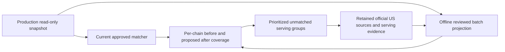

# Los Angeles chain rollout proposals

**TL;DR:** Issue #498 prepares read-only coverage projections; live rollout and source approvals remain pending.

The October 24 scope permits proposals only and forbids writes to production or live data.
No production batch, migration, refresh, deployment, merge or submission was performed in this implementation.
The September reports are generated historical records and remain unchanged.



## Coverage evidence and target

| Evidence | Matched | Unmatched | Share | Meaning |
|---|---:|---:|---:|---|
| September 14 production audit | 42,951 | 94,086 | 31.34% | Historical approved exact matches across 62 identities and 1,440 restaurants |
| October 24 production census | Unmeasured | Unmeasured | Unmeasured | No production credentials or live DB connectivity in this execution environment |
| Proposed production after | Pending snapshot and source review | Pending | Pending | Must be computed against the same current LA cohort |

The historical counts come from the [immutable reconciliation](chain-catalog-reconciliation-2026-09-13.md).
They are not today's baseline.
An 80% share is a proposed planning target to assess after the current census, not a claimed result.
On the historical denominator it would require 109,630 total matches, or 66,679 additional matches.
The denominator can change after the source-ID refresh, so that arithmetic must not substitute for the current report.

Use the existing explicit production read-only URL guard; do not use the legacy landing, refresh or apply commands for this task.
The census sets `SET TRANSACTION READ ONLY` inside a repeatable-read transaction before reading brands, catalog facts, restaurants and active menu rows.
It writes private local files with exclusive creation and has no apply mode.
The LA rectangle is latitude 33.7 to 34.35 and longitude -118.75 to -117.65, matching the source collision audit.
This is the rollout area, not an administrative city boundary.

```bash
# PROD_DATABASE_URL must be supplied through the existing authorized environment.
npm run audit:chain-coverage -- live /tmp/la-chain-snapshot.json /tmp/la-chain-before.json

# Compile a reviewed product/binding proposal using the existing compiler.
node --import tsx scripts/preload-chain-product-batch.ts /path/to/reviewed-input.json /tmp/chain-proposal.json

# Reuse the identical snapshot, without any database connection or mutation.
npm run audit:chain-coverage -- snapshot /tmp/la-chain-snapshot.json /tmp/la-chain-proposed.json --proposal=/tmp/chain-proposal.json --target=0.8
```

Each chain reports restaurant count, approved facts, matched, unmatched, ambiguous and identity-held rows before and after the proposal.
All active stored chain locations, including locations with unverified identities or no approved facts, remain in the denominator.
Retired dishes are excluded.
The census detects whether production has the source-ID and retirement columns and can read the pre-cutover schema without applying a migration.
The `sourceIdentity` fields state which columns were available; missing source IDs cannot satisfy an ID-specific binding.
Current winning official estimates and consistent official nutrition are reported separately from eligible catalog matches.
Merchant overrides do not count as served official nutrition.
The projected after column describes eligibility under proposed catalog changes; it does not claim those facts have been installed or served.
Snapshot and proposal hashes bind each comparison to its actual inputs.
Empty cohorts, malformed snapshots, stale expected baselines and proposals that lose existing matches fail.

Work down `unmatchedGroups` in descending row count, retaining exact name, section, description and provider-qualified source ID.
Rows with distinct source IDs stay distinct even when their titles agree.
Context groups aggregate their affected rows for prioritization while retaining every source-ID variant separately.
Source-ID-specific bindings require the exact observed context as well as the ID.
Do not infer serving sizes from estimated calories, prices, ingredient lists or a chain-wide default.
Use [catalog batches](chain-catalog-batches.md) and [serving evidence](chain-serving-handoff.md) to prepare the reviewed inputs.
Actual production application remains outside this issue's present authorization.

## KFC and manual sources

KFC remains blocked for nutrition approval.
The [official US full nutrition guide](https://www.kfc.com/full-nutrition-guide) and [nutrition entrypoint](https://www.kfc.com/nutrition) exposed only a JavaScript shell to the text reader on October 24.
This establishes an extraction limitation, not absence of official nutrition.
No retained US table with a source hash, full labeled macro columns and exact LA menu serving bindings was available here.
The identity correction already described in the September rollout does not approve KFC nutrition.
Resume source review when the official US rendered table or a linked US PDF and matching current menu capture are available.
Keep configurable buckets, combos, sizes and side selections unmatched until the serving is defensible.
Do not substitute a foreign-market KFC PDF or third-party nutrition table.

| Chain or discovery entry | Manual-source disposition | Required next evidence |
|---|---|---|
| KFC | Blocked: official nutrition is JavaScript rendered; no retained reviewed US table | Rendered US full nutrition table or official linked PDF, source hash, exact serving and current menu context |
| 7-Eleven | Historical discovery points to `7-eleven.ca` | US product label or official US nutrition table before LA bindings |
| Burger King | Historical discovery points to `burgerking.ca` | Official US guide and serving review; existing approved US facts remain separate |
| Jamba Juice, sweetgreen, Philz Coffee | Historical discovery contains third-party nutrition domains | Brand-owned US source; do not approve the discovery result wholesale |
| Any chain yielding fewer than five valid static rows | Unresolved static extraction, potentially SPA or genuinely small table | Retained official rendered table or PDF and explicit serving review; a small table is not proof of a SPA |

These historical discovery defects were found in `scripts/phase1-discover-sample.json`; the table does not claim a fresh source audit of those chains.
The original discovery artifact remains unchanged.
For an extraction run, `scripts/phase1-run.ts` now includes source-less chains and emits `_manual-sources.json` beside `_coverage.json`, naming every deferred or errored chain, its URL, reason and recovery action.
Old checkpoints are invalidated so an obsolete source result cannot hide a new deferral.
The static/PDF extractor produces candidates only; a successful extraction is not approval.
SPA browser automation remains deferred in favor of this explicit manual-source path.

## Integrated matching and allulose

Source identity preservation already landed in [PR #515](https://github.com/dgmolla/fitsy/pull/515).
This change adds provider-qualified, case-sensitive source-ID bindings to reviewed nutrition aliases and carries them through inventory, existing-menu planning, both existing-menu writers, provenance and new-import matching.
Aliases without IDs keep their existing approval hashes and matching behavior.
Conflicting generic and ID-specific approvals abstain; disjoint ID-specific servings can coexist.
The capture-based regression uses synthetic nutrition to prove separation of individual and family products, not to approve Panini facts.

Allulose remains part of published total carbohydrate.
Only explicitly sourced allulose grams receive the 0.4 kcal/g energy factor described in [FDA guidance](https://www.fda.gov/regulatory-information/search-fda-guidance-documents/guidance-industry-declaration-allulose-and-calories-allulose-nutrition-and-supplement-facts-labels).
Extraction retains those grams in the local candidate artifact.
Reviewed batches carry `allulose: { grams, locator }` in the source-bound approval JSON; both fields are included in its digest.
Negative, non-finite or greater-than-total-carbohydrate allulose is rejected.
Absent evidence keeps the ordinary 4/4/9 check and its existing tolerance.
Published calories and total carbs are preserved; this does not introduce net-carb calculations or broader tolerance.
Official macro provenance carries the reviewed allulose evidence into ingestion's mismatch telemetry, preventing a valid allulose serving from being falsely flagged there.
Malformed evidence and ordinary estimator outputs retain the existing mismatch check.
No database column or migration is needed for the additional review metadata.

## Recovery and remaining acceptance

The task owner assessed the verify-fitsy skill, existing production read-only guard, local dependency cache, Prisma generator and canonical verification entrypoints.
Offline dependency installation failed because the package cache lacks `react-test-renderer`; a task-owned dependency overlay recovered local Jest and TypeScript execution without editing shared installations.
Prisma initially attempted a forbidden shared-cache timestamp update; explicit task-owned engine paths recovered client generation.
Matching locked mobile dependency versions in the local cache recovered the initially failing mobile type check.
The maintained audit CLI and this runbook provide a repeatable recovery path for the missing census, while the extraction runner carries manual-source recovery into its actual output.

Final local API execution passed 1,142 tests in 96 suites; 75 database-dependent cases were skipped.
The coverage command still fails its 80% function gate at 79.65% without the database suites; an unchanged-HEAD run independently reproduced that existing gate failure at 78.94%.
Statements, branches and lines pass their configured coverage thresholds.
The supported owned-database verifier was attempted and stopped because sandbox policy denies access to the Docker socket; no database fixture was created and no database pass is claimed.
The actual CLI regressions reproduce the fixed allulose rejection, source-less-chain omission and ingestion mismatch, alongside source-ID and proposal safety checks.

The remaining outcome is owned by issue #498: capture the current read-only production snapshot, review official sources and the largest unmatched serving groups, then regenerate per-chain projections and choose a realistic coverage target.
No new production nutrition facts or real serving approvals were invented to satisfy the target.
Live coverage improvement and merged-code acceptance remain unproven until a separately authorized rollout and merge occur.
There are no changed mobile screens or journeys, so no Maestro flow change is needed.
