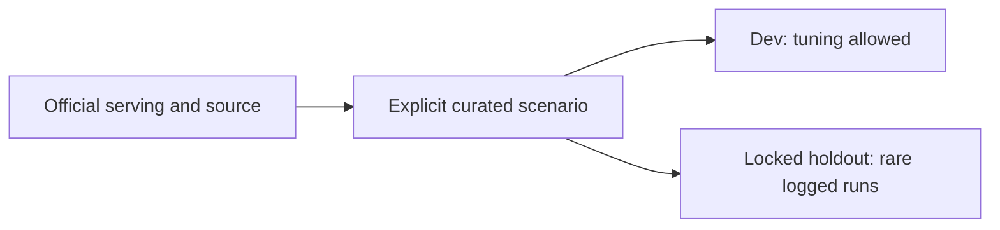

**TL;DR:** These 224 matching and 178 macro scenarios freeze verified servings and explicit hard-case expectations.

# Eval suite v1 curated cases

This is a human review list; generating it does not execute any model or score holdout.
Tune with dev only; do not copy holdout cases into prompts, rules, or examples.
Matching scenarios marked synthetic deliberately alter chain, modifiers, or candidate availability; their nutrition reference stays the cited published row.
Physical PDF page numbers are one-based; Wahoo's printed page is one less.
Manufacturer sources use the named product-label page.

Measured seeds retain a second citation to the captured UE card; NO MATCH is relative to the listed candidates.
Measured candidates include their section, portion and optional source tags so identical names remain distinguishable.

## Matching

| ID / split | Chain / category | Input and serving | Expected | Why | Source |
| --- | --- | --- | --- | --- | --- |
| curated:match:001 / dev | WaBa Grill / non_chain_lookalike | All Broccoli; Family A La Carte; 1 published family a la carte serving: All Broccoli; synthetic-challenge; candidates: All Broccoli / Broccoli & Carrots / Plantspired Steak / 6 oz Black Beans | NO MATCH | An independent restaurant copying a chain dish name has no official chain match. | [page 1](https://cp1.inkrefuge.com/admin/asset/uploads/296/on_page_element/pdf/jan2025-nutrition-chart-final.pdf) |
| curated:match:002 / dev | WaBa Grill / near_miss_name | Dole 100% Apple Juice - 15.2oz Bottle; Beverages; 1 bottle (15.2 US fl oz); synthetic-challenge; candidates: 6 oz Brown Rice / 6 oz White Rice / Large Side 1/2 & 1/2 Brown Rice Black Beans / 6 oz Black Beans | NO MATCH | Shared dish words across different chains cannot transfer an official match. | [page manufacturer product label](https://www.pepsicopartners.com/pepsico/en/USD/OTHER-BRANDS/DOLE%C2%AE/APPLE/Dole-Apple-100%25-Juice/p/1-3Q1DN-7) |
| curated:match:003 / dev | WaBa Grill / size_variant | Miso Soup; Sides; 1 standard soup serving; synthetic-challenge; candidates: Loaded Miso Soup (w/ WM Chicken) / Plantspired Steak / Loaded Miso Soup (w/ Chicken) / Loaded Miso Soup (w/ Tofu) | NO MATCH | The correct serving is absent; nearby size/protein variants must return NO MATCH. | [page 1](https://cp1.inkrefuge.com/admin/asset/uploads/296/on_page_element/pdf/jan2025-nutrition-chart-final.pdf) |
| curated:match:004 / dev | WaBa Grill / size_variant | Half-Ocado; Sides; 1 published sides serving: Half-Ocado; synthetic-challenge; candidates: WaBa (Chicken & Steak) / Plantspired Steak / Rib-Eye Steak / Sweet & Spicy Chicken | NO MATCH | Only other published portions are offered; reject a forced nearest-name match. | [page 1](https://cp1.inkrefuge.com/admin/asset/uploads/296/on_page_element/pdf/jan2025-nutrition-chart-final.pdf) |
| curated:match:005 / holdout | WaBa Grill / combo_build_your_own | Build Your Own Combo; Bowls; ; synthetic-challenge; candidates: Organic Tofu / Organic Tofu / WaBa (WM Chicken & Steak) / BBQ Chicken Sliders | NO MATCH | Unselected proteins and base do not identify any one published component or meal. | [page 1](https://cp1.inkrefuge.com/admin/asset/uploads/296/on_page_element/pdf/jan2025-nutrition-chart-final.pdf) |
| curated:match:006 / dev | WaBa Grill / section_dependent | Boom Boom Sauce (1 fluid oz); Sauce Dressing; 1 published sauce dressing serving: Boom Boom Sauce (1 fluid oz); published-row; candidates: Spicy WaBa Sauce (1 fluid oz) / Sweet Chili Sauce (1 fluid oz) / Large Side 1/2 & 1/2 Brown Rice Black Beans / Boom Boom Sauce (1 fluid oz) | MATCH: Boom Boom Sauce (1 fluid oz) | Select the exact published chain, recipe, section and serving among near misses. | [page 1](https://cp1.inkrefuge.com/admin/asset/uploads/296/on_page_element/pdf/jan2025-nutrition-chart-final.pdf) |
| curated:match:007 / dev | WaBa Grill / size_variant | Organic Tofu; Mini Bowls; 1 published mini bowls serving: Organic Tofu; published-row; candidates: Organic Tofu / 6 oz Black Beans / Organic Tofu / Organic Tofu Veggies | MATCH: Organic Tofu | Select the exact published chain, recipe, section and serving among near misses. | [page 1](https://cp1.inkrefuge.com/admin/asset/uploads/296/on_page_element/pdf/jan2025-nutrition-chart-final.pdf) |
| curated:match:008 / dev | WaBa Grill / zero_macro | Pure Leaf Brewed Iced Tea Unsweet - 16.9oz Bottle; Beverages; 1 bottle (16.9 US fl oz); published-row; candidates: 6 oz Black Beans / Pure Leaf Brewed Iced Tea Unsweet - 16.9oz Bottle / Pure Leaf Brewed Iced Tea Raspberry - 16.9oz Bottle / Dole 100% Apple Juice - 15.2oz Bottle | MATCH: Pure Leaf Brewed Iced Tea Unsweet - 16.9oz Bottle | Select the exact published chain, recipe, section and serving among near misses. | [page manufacturer product label](https://www.pepsicopartners.com/pepsico/en/USD/BEVERAGES/Coffees-Teas/Pure-Leaf-Unsweetened/p/1-MQ0RW-2) |
| curated:match:009 / dev | WaBa Grill / catering_family | Broccoli & Carrots; Family A La Carte; 1 published family a la carte serving: Broccoli & Carrots; published-row; candidates: Broccoli & Carrots / Sweet & Spicy Chicken / WaBa (Chicken & Steak) / Large Side 1/2 & 1/2 Brown Rice Black Beans | MATCH: Broccoli & Carrots | Select the exact published chain, recipe, section and serving among near misses. | [page 1](https://cp1.inkrefuge.com/admin/asset/uploads/296/on_page_element/pdf/jan2025-nutrition-chart-final.pdf) |
| curated:match:010 / holdout | WaBa Grill / drink_oz | Gatorade Cool Blue - 20oz Bottle; Beverages; 1 bottle (20 US fl oz / 591 mL); published-row; candidates: Organic Tofu / WaBa (WM Chicken & Steak) / BBQ Chicken Sliders / Gatorade Cool Blue - 20oz Bottle | MATCH: Gatorade Cool Blue - 20oz Bottle | Select the exact published chain, recipe, section and serving among near misses. | [page manufacturer product label](https://www.pepsicopartners.com/pepsico/en/USD/BEVERAGES/Sports-Drinks/Gatorade-Cool-Blue/p/1-HYK-50627) |
| curated:match:011 / holdout | WaBa Grill / non_chain_lookalike | Garlic Serrano Sauce (1 fluid oz); Sauce Dressing; 1 published sauce dressing serving: Garlic Serrano Sauce (1 fluid oz); synthetic-challenge; candidates: WM Chicken (4.5 oz) / Kids, Build Your Own Pizza (1 slice) with Marinara Sauce / Garlic Serrano Sauce (1 fluid oz) / Sweet & Spicy Chicken (4.5 oz) | NO MATCH | An independent restaurant copying a chain dish name has no official chain match. | [page 1](https://cp1.inkrefuge.com/admin/asset/uploads/296/on_page_element/pdf/jan2025-nutrition-chart-final.pdf) |
| curated:match:012 / dev | WaBa Grill / near_miss_name | Plantspired Steak; Bowls; 1 published bowls serving: Plantspired Steak; synthetic-challenge; candidates: 6 oz Black Beans / Grilled Ribeye Steak / Grilled Ribeye Steak / Grilled Ribeye Steak | NO MATCH | Shared dish words across different chains cannot transfer an official match. | [page 1](https://cp1.inkrefuge.com/admin/asset/uploads/296/on_page_element/pdf/jan2025-nutrition-chart-final.pdf) |
| curated:match:013 / dev | WaBa Grill / size_variant | Ranch Dressing (1.5 fluid oz); Sauce Dressing; 1 published sauce dressing serving: Ranch Dressing (1.5 fluid oz); synthetic-challenge; candidates: Spicy Sesame Dressing (1 fluid oz) / WaBa Sesame Dressing (1 fluid oz) / Boom Boom Sauce (1 fluid oz) / Spicy WaBa Sauce (1 fluid oz) | NO MATCH | The correct serving is absent; nearby size/protein variants must return NO MATCH. | [page 1](https://cp1.inkrefuge.com/admin/asset/uploads/296/on_page_element/pdf/jan2025-nutrition-chart-final.pdf) |
| curated:match:014 / dev | WaBa Grill / modifier | Organic Tofu Veggies, no rice; Mini Bowls; 1 published mini bowls serving: Organic Tofu Veggies; synthetic-challenge; candidates: Organic Tofu / Organic Tofu / Mixed Veggies / Organic Tofu Veggies | NO MATCH | Explicit no-rice changes this rice-containing published recipe; no modified row is supplied. | [page 1](https://cp1.inkrefuge.com/admin/asset/uploads/296/on_page_element/pdf/jan2025-nutrition-chart-final.pdf) |
| curated:match:015 / dev | WaBa Grill / combo_build_your_own | Build Your Own Combo; Sauce Dressing; ; synthetic-challenge; candidates: Spicy WaBa Sauce (1 fluid oz) / Soy Sauce Packet / WaBa Hot Sauce Packet / WaBa Sauce Packet | NO MATCH | Unselected proteins and base do not identify any one published component or meal. | [page 1](https://cp1.inkrefuge.com/admin/asset/uploads/296/on_page_element/pdf/jan2025-nutrition-chart-final.pdf) |
| curated:match:016 / dev | WaBa Grill / catering_family | Brown Rice (2 Servings); Family A La Carte; 1 published family a la carte serving: Brown Rice (2 Servings); published-row; candidates: Large Side 1/2 & 1/2 Brown Rice Black Beans / Brown Rice (2 Servings) / White Rice (2 Servings) / Brown Rice (10 oz) | MATCH: Brown Rice (2 Servings) | Select the exact published chain, recipe, section and serving among near misses. | [page 1](https://cp1.inkrefuge.com/admin/asset/uploads/296/on_page_element/pdf/jan2025-nutrition-chart-final.pdf) |
| curated:match:017 / dev | WaBa Grill / drink_oz | Gatorade Fruit Punch - 20oz Bottle; Beverages; 1 bottle (20 US fl oz / 591 mL); published-row; candidates: Gatorade Fruit Punch - 20oz Bottle / Pepsi - 20oz Bottle / Dole 100% Apple Juice - 15.2oz Bottle / Gatorade Lime Cucumber | MATCH: Gatorade Fruit Punch - 20oz Bottle | Select the exact published chain, recipe, section and serving among near misses. | [page manufacturer product label](https://www.pepsicopartners.com/pepsico/en/USD/BEVERAGES/Sports-Drinks/Gatorade-Fruit-Punch/p/1-4WG82-4) |
| curated:match:018 / dev | WaBa Grill / low_calorie | Sweet Chili Sauce (1 fluid oz); Sauce Dressing; 1 published sauce dressing serving: Sweet Chili Sauce (1 fluid oz); published-row; candidates: Boom Boom Sauce (1 fluid oz) / Spicy WaBa Sauce (1 fluid oz) / Large Side 1/2 & 1/2 Brown Rice Black Beans / Sweet Chili Sauce (1 fluid oz) | MATCH: Sweet Chili Sauce (1 fluid oz) | Select the exact published chain, recipe, section and serving among near misses. | [page 1](https://cp1.inkrefuge.com/admin/asset/uploads/296/on_page_element/pdf/jan2025-nutrition-chart-final.pdf) |
| curated:match:019 / dev | WaBa Grill / near_miss_name | Steak Bowl; Rice Bowls; ; captured-uber-eats; candidates: Rib-Eye Steak / Grilled Ribeye Steak / Rib-Eye Steak / Rib-Eye Steak | MATCH: Rib-Eye Steak | Select the exact published chain, recipe, section and serving among near misses. | [page 1](https://cp1.inkrefuge.com/admin/asset/uploads/296/on_page_element/pdf/jan2025-nutrition-chart-final.pdf) |
| curated:match:020 / dev | WaBa Grill / section_dependent | Spicy Sesame Dressing (1 fluid oz); Sauce Dressing; 1 published sauce dressing serving: Spicy Sesame Dressing (1 fluid oz); published-row; candidates: Large Side 1/2 & 1/2 Brown Rice Black Beans / Spicy Sesame Dressing (1 fluid oz) / WaBa Sesame Dressing (1 fluid oz) / Spicy WaBa Sauce (1 fluid oz) | MATCH: Spicy Sesame Dressing (1 fluid oz) | Select the exact published chain, recipe, section and serving among near misses. | [page 1](https://cp1.inkrefuge.com/admin/asset/uploads/296/on_page_element/pdf/jan2025-nutrition-chart-final.pdf) |
| curated:match:021 / dev | WaBa Grill / non_chain_lookalike | Plantspired Steak; Mini Bowls; 1 published mini bowls serving: Plantspired Steak; synthetic-challenge; candidates: Plantspired Steak / Plantspired Steak / Plantspired Steak / Grilled Ribeye Steak | NO MATCH | An independent restaurant copying a chain dish name has no official chain match. | [page 1](https://cp1.inkrefuge.com/admin/asset/uploads/296/on_page_element/pdf/jan2025-nutrition-chart-final.pdf) |
| curated:match:022 / dev | WaBa Grill / near_miss_name | Chicken; Family A La Carte; 1 published family a la carte serving: Chicken; synthetic-challenge; candidates: Fajita Veggie Bowl - Charbroiled Chicken Brown Rice White Beans / Fajita Veggie Bowl - Charbroiled Chicken White Rice Black Beans / Grilled Habanero Chicken / Fajita Veggie Bowl - Charbroiled Chicken Brown Rice Black Beans | NO MATCH | Shared dish words across different chains cannot transfer an official match. | [page 1](https://cp1.inkrefuge.com/admin/asset/uploads/296/on_page_element/pdf/jan2025-nutrition-chart-final.pdf) |
| curated:match:023 / dev | WaBa Grill / size_variant | Pepsi - 20oz Bottle; Beverages; 1 bottle (20 US fl oz); synthetic-challenge; candidates: Pure Leaf Brewed Iced Tea Raspberry - 16.9oz Bottle / Pure Leaf Brewed Iced Tea Unsweet - 16.9oz Bottle / Gatorade Fruit Punch - 20oz Bottle / Dole 100% Apple Juice - 15.2oz Bottle | NO MATCH | The correct serving is absent; nearby size/protein variants must return NO MATCH. | [page manufacturer product label](https://www.pepsicopartners.com/pepsico/en/USD/BEVERAGES/Soft-Drinks/Pepsi/p/1-HYK-8425) |
| curated:match:024 / dev | WaBa Grill / size_variant | WaBa Sauce Packet; Sauce Dressing; 1 published sauce dressing serving: WaBa Sauce Packet; synthetic-challenge; candidates: WaBa (WM Chicken & Steak) / WaBa Hot Sauce Packet / Spicy WaBa Sauce (1 fluid oz) / WaBa (Chicken & Steak) | NO MATCH | Only other published portions are offered; reject a forced nearest-name match. | [page 1](https://cp1.inkrefuge.com/admin/asset/uploads/296/on_page_element/pdf/jan2025-nutrition-chart-final.pdf) |
| curated:match:025 / dev | WaBa Grill / combo_build_your_own | Build Your Own Combo; Bowls; ; synthetic-challenge; candidates: Sweet & Spicy Chicken / Sweet & Spicy Chicken / Sweet & Spicy Chicken Veggies / Large Side 1/2 & 1/2 Brown Rice Black Beans | NO MATCH | Unselected proteins and base do not identify any one published component or meal. | [page 1](https://cp1.inkrefuge.com/admin/asset/uploads/296/on_page_element/pdf/jan2025-nutrition-chart-final.pdf) |
| curated:match:026 / dev | WaBa Grill / section_dependent | Spicy WaBa Sauce (1 fluid oz); Sauce Dressing; 1 published sauce dressing serving: Spicy WaBa Sauce (1 fluid oz); published-row; candidates: Boom Boom Sauce (1 fluid oz) / Spicy Sesame Dressing (1 fluid oz) / Large Side 1/2 & 1/2 Brown Rice Black Beans / Spicy WaBa Sauce (1 fluid oz) | MATCH: Spicy WaBa Sauce (1 fluid oz) | Select the exact published chain, recipe, section and serving among near misses. | [page 1](https://cp1.inkrefuge.com/admin/asset/uploads/296/on_page_element/pdf/jan2025-nutrition-chart-final.pdf) |
| curated:match:027 / dev | WaBa Grill / size_variant | Sweet & Spicy; Mini Bowls; 1 published mini bowls serving: Sweet & Spicy; published-row; candidates: Sweet & Spicy Chicken / Large Side 1/2 & 1/2 Brown Rice Black Beans / Sweet & Spicy / Sweet & Spicy Chicken | MATCH: Sweet & Spicy | Select the exact published chain, recipe, section and serving among near misses. | [page 1](https://cp1.inkrefuge.com/admin/asset/uploads/296/on_page_element/pdf/jan2025-nutrition-chart-final.pdf) |
| curated:match:028 / dev | WaBa Grill / catering_family | Mixed Veggies; Family A La Carte; 1 published family a la carte serving: Mixed Veggies; published-row; candidates: Mixed Veggies / Mixed Veggies / Organic Tofu Veggies / Sweet & Spicy Chicken Veggies | MATCH: Mixed Veggies | Select the exact published chain, recipe, section and serving among near misses. | [page 1](https://cp1.inkrefuge.com/admin/asset/uploads/296/on_page_element/pdf/jan2025-nutrition-chart-final.pdf) |
| curated:match:029 / dev | WaBa Grill / drink_oz | Poppi Raspberry Rose - 12oz Can; Beverages; 1 can (12 US fl oz); published-row; candidates: Poppi Raspberry Rose - 12oz Can / Pure Leaf Brewed Iced Tea Raspberry - 16.9oz Bottle / Plantspired Steak / 6 oz Black Beans | MATCH: Poppi Raspberry Rose - 12oz Can | Select the exact published chain, recipe, section and serving among near misses. | [page manufacturer product label](https://www.drinkpoppi.com/products/raspberry-rose) |
| curated:match:030 / dev | WaBa Grill / low_calorie | Salad; Sides; 1 published sides serving: Salad; published-row; candidates: Plantspired Steak / Rib-Eye Steak / 6 oz Black Beans / Salad | MATCH: Salad | Select the exact published chain, recipe, section and serving among near misses. | [page 1](https://cp1.inkrefuge.com/admin/asset/uploads/296/on_page_element/pdf/jan2025-nutrition-chart-final.pdf) |
| curated:match:031 / dev | WaBa Grill / non_chain_lookalike | WaBa (Chicken & Steak); Bowls; 1 published bowls serving: WaBa (Chicken & Steak); synthetic-challenge; candidates: WaBa (Chicken & Steak) / Large Side 1/2 & 1/2 Brown Rice Black Beans / WaBa (Chicken & Steak) / WaBa (WM Chicken & Steak) | NO MATCH | An independent restaurant copying a chain dish name has no official chain match. | [page 1](https://cp1.inkrefuge.com/admin/asset/uploads/296/on_page_element/pdf/jan2025-nutrition-chart-final.pdf) |
| curated:match:032 / dev | WaBa Grill / near_miss_name | WaBa Sesame Dressing (1 fluid oz); Sauce Dressing; 1 published sauce dressing serving: WaBa Sesame Dressing (1 fluid oz); synthetic-challenge; candidates: Side 1/2 & 1/2 Brown Rice Black Beans / Large Side 1/2 & 1/2 Brown Rice Black Beans / Large Side 1/2 & 1/2 Brown Rice White Beans / Large Side 1/2 & 1/2 White Rice White Beans | NO MATCH | Shared dish words across different chains cannot transfer an official match. | [page 1](https://cp1.inkrefuge.com/admin/asset/uploads/296/on_page_element/pdf/jan2025-nutrition-chart-final.pdf) |
| curated:match:033 / dev | WaBa Grill / size_variant | Sweet & Spicy Chicken Veggies; Mini Bowls; 1 published mini bowls serving: Sweet & Spicy Chicken Veggies; synthetic-challenge; candidates: Sweet & Spicy Chicken / Sweet & Spicy Chicken / Sweet & Spicy Chicken / Sweet & Spicy | NO MATCH | The correct serving is absent; nearby size/protein variants must return NO MATCH. | [page 1](https://cp1.inkrefuge.com/admin/asset/uploads/296/on_page_element/pdf/jan2025-nutrition-chart-final.pdf) |
| curated:match:034 / holdout | WaBa Grill / size_variant | Organic Tofu; Family A La Carte; 1 published family a la carte serving: Organic Tofu; synthetic-challenge; candidates: WaBa (WM Chicken & Steak) / Wild Caught Salmon / WM Chicken / Organic Tofu | NO MATCH | Only other published portions are offered; reject a forced nearest-name match. | [page 1](https://cp1.inkrefuge.com/admin/asset/uploads/296/on_page_element/pdf/jan2025-nutrition-chart-final.pdf) |
| curated:match:035 / dev | WaBa Grill / combo_build_your_own | Build Your Own Combo; Beverages; ; synthetic-challenge; candidates: Rib-Eye Steak / Junior's Strawberry Swirl Cheesecake / Poppi Strawberry Lemon - 12oz Can / Plantspired Steak | NO MATCH | Unselected proteins and base do not identify any one published component or meal. | [page manufacturer product label](https://www.drinkpoppi.com/products/strawberry-lemon) |
| curated:match:036 / holdout | WaBa Grill / low_calorie | Veggies; Sides; ; captured-uber-eats; candidates: BBQ Chicken Sliders / Steamed Veggies / Chicken Veggies / Organic Tofu | MATCH: Steamed Veggies | Select the exact published chain, recipe, section and serving among near misses. | [page 1](https://cp1.inkrefuge.com/admin/asset/uploads/296/on_page_element/pdf/jan2025-nutrition-chart-final.pdf) |
| curated:match:037 / holdout | WaBa Grill / near_miss_name | WaBa (WM Chicken & Steak); Bowls; 1 published bowls serving: WaBa (WM Chicken & Steak); published-row; candidates: WaBa (WM Chicken & Steak) / WaBa (WM Chicken & Steak) / WaBa (Chicken & Steak) / BBQ Chicken Sliders | MATCH: WaBa (WM Chicken & Steak) | Select the exact published chain, recipe, section and serving among near misses. | [page 1](https://cp1.inkrefuge.com/admin/asset/uploads/296/on_page_element/pdf/jan2025-nutrition-chart-final.pdf) |
| curated:match:038 / dev | WaBa Grill / section_dependent | Brown Rice (10 oz); Sides; 1 published sides serving: Brown Rice (10 oz); published-row; candidates: White Rice (10 oz) / Brown Rice (2 Servings) / 6 oz Brown Rice / Brown Rice (10 oz) | MATCH: Brown Rice (10 oz) | Select the exact published chain, recipe, section and serving among near misses. | [page 1](https://cp1.inkrefuge.com/admin/asset/uploads/296/on_page_element/pdf/jan2025-nutrition-chart-final.pdf) |
| curated:match:039 / holdout | WaBa Grill / size_variant | WM Chicken; Mini Bowls; 1 published mini bowls serving: WM Chicken; published-row; candidates: WM Chicken / BBQ Chicken Sliders / WM Chicken / WaBa (WM Chicken & Steak) | MATCH: WM Chicken | Select the exact published chain, recipe, section and serving among near misses. | [page 1](https://cp1.inkrefuge.com/admin/asset/uploads/296/on_page_element/pdf/jan2025-nutrition-chart-final.pdf) |
| curated:match:040 / dev | WaBa Grill / catering_family | Rib-Eye Steak; Family A La Carte; 1 published family a la carte serving: Rib-Eye Steak; published-row; candidates: Grilled Ribeye Steak / Rib-Eye Steak / Rib-Eye Steak / Rib-Eye Steak | MATCH: Rib-Eye Steak | Select the exact published chain, recipe, section and serving among near misses. | [page 1](https://cp1.inkrefuge.com/admin/asset/uploads/296/on_page_element/pdf/jan2025-nutrition-chart-final.pdf) |
| curated:match:041 / dev | WaBa Grill / non_chain_lookalike | Pure Leaf Brewed Iced Tea Raspberry - 16.9oz Bottle; Beverages; 1 bottle (16.9 US fl oz); synthetic-challenge; candidates: Pure Leaf Brewed Iced Tea Raspberry - 16.9oz Bottle / Pure Leaf Brewed Iced Tea Unsweet - 16.9oz Bottle / Dole 100% Apple Juice - 15.2oz Bottle / 6 oz Black Beans | NO MATCH | An independent restaurant copying a chain dish name has no official chain match. | [page manufacturer product label](https://www.pepsicopartners.com/pepsico/en/USD/BEVERAGES/Coffees-Teas/Pure-Leaf-Raspberry/p/1-YW28R-1) |
| curated:match:042 / holdout | WaBa Grill / near_miss_name | Wild Caught Salmon; Bowls; 1 published bowls serving: Wild Caught Salmon; synthetic-challenge; candidates: BBQ Chicken Sliders / Beef Sliders with Cheese / Bonanza Platter / Grilled Teriyaki Salmon | NO MATCH | Shared dish words across different chains cannot transfer an official match. | [page 1](https://cp1.inkrefuge.com/admin/asset/uploads/296/on_page_element/pdf/jan2025-nutrition-chart-final.pdf) |
| curated:match:043 / dev | WaBa Grill / size_variant | Chicken (4.5 oz); Sides; 1 published sides serving: Chicken (4.5 oz); synthetic-challenge; candidates: Chicken / Chicken / Sweet & Spicy Chicken / WaBa (Chicken & Steak) | NO MATCH | The correct serving is absent; nearby size/protein variants must return NO MATCH. | [page 1](https://cp1.inkrefuge.com/admin/asset/uploads/296/on_page_element/pdf/jan2025-nutrition-chart-final.pdf) |
| curated:match:044 / dev | WaBa Grill / modifier | WM Chicken Veggies, no rice; Mini Bowls; 1 published mini bowls serving: WM Chicken Veggies; synthetic-challenge; candidates: Fajita Veggie Bowl - Charbroiled Chicken Brown Rice Black Beans / WM Chicken Veggies / WM Chicken / Sweet & Spicy Chicken Veggies | NO MATCH | Explicit no-rice changes this rice-containing published recipe; no modified row is supplied. | [page 1](https://cp1.inkrefuge.com/admin/asset/uploads/296/on_page_element/pdf/jan2025-nutrition-chart-final.pdf) |
| curated:match:045 / dev | WaBa Grill / combo_build_your_own | Build Your Own Combo; Family A La Carte; ; synthetic-challenge; candidates: Sweet & Spicy Chicken / Sweet & Spicy Chicken / Sweet & Spicy Chicken Veggies / Large Side 1/2 & 1/2 Brown Rice Black Beans | NO MATCH | Unselected proteins and base do not identify any one published component or meal. | [page 1](https://cp1.inkrefuge.com/admin/asset/uploads/296/on_page_element/pdf/jan2025-nutrition-chart-final.pdf) |
| curated:match:046 / holdout | WaBa Grill / near_miss_name | White Meat Chicken Bowl; Chicken; ; captured-uber-eats; candidates: WaBa (WM Chicken & Steak) / WaBa (WM Chicken & Steak) / BBQ Chicken Sliders / WM Chicken | MATCH: WM Chicken | Select the exact published chain, recipe, section and serving among near misses. | [page 1](https://cp1.inkrefuge.com/admin/asset/uploads/296/on_page_element/pdf/jan2025-nutrition-chart-final.pdf) |
| curated:match:047 / dev | WaBa Grill / section_dependent | Loaded Miso Soup (w/ Chicken); Sides; 1 published sides serving: Loaded Miso Soup (w/ Chicken); published-row; candidates: Miso Soup / Fajita Veggie Bowl - Charbroiled Chicken Brown Rice Black Beans / Loaded Miso Soup (w/ Chicken) / Loaded Miso Soup (w/ Tofu) | MATCH: Loaded Miso Soup (w/ Chicken) | Select the exact published chain, recipe, section and serving among near misses. | [page 1](https://cp1.inkrefuge.com/admin/asset/uploads/296/on_page_element/pdf/jan2025-nutrition-chart-final.pdf) |
| curated:match:048 / dev | WaBa Grill / size_variant | Chicken; Mini Bowls; 1 published mini bowls serving: Chicken; published-row; candidates: Fajita Veggie Bowl - Charbroiled Chicken Brown Rice Black Beans / Chicken / Sweet & Spicy Chicken / WaBa (Chicken & Steak) | MATCH: Chicken | Select the exact published chain, recipe, section and serving among near misses. | [page 1](https://cp1.inkrefuge.com/admin/asset/uploads/296/on_page_element/pdf/jan2025-nutrition-chart-final.pdf) |
| curated:match:049 / holdout | WaBa Grill / catering_family | WaBa (Chicken & Steak); Family A La Carte; 1 published family a la carte serving: WaBa (Chicken & Steak); published-row; candidates: WaBa (Chicken & Steak) / WaBa (WM Chicken & Steak) / WaBa (WM Chicken & Steak) / BBQ Chicken Sliders | MATCH: WaBa (Chicken & Steak) | Select the exact published chain, recipe, section and serving among near misses. | [page 1](https://cp1.inkrefuge.com/admin/asset/uploads/296/on_page_element/pdf/jan2025-nutrition-chart-final.pdf) |
| curated:match:050 / dev | WaBa Grill / near_miss_name | Chicken Bowl; Chicken; ; captured-uber-eats; candidates: Sweet & Spicy Chicken / WaBa (Chicken & Steak) / Fajita Veggie Bowl - Charbroiled Chicken Brown Rice Black Beans / Chicken | MATCH: Chicken | Select the exact published chain, recipe, section and serving among near misses. | [page 1](https://cp1.inkrefuge.com/admin/asset/uploads/296/on_page_element/pdf/jan2025-nutrition-chart-final.pdf) |
| curated:match:051 / dev | WaBa Grill / non_chain_lookalike | Loaded Miso Soup (w/ Tofu); Sides; 1 published sides serving: Loaded Miso Soup (w/ Tofu); synthetic-challenge; candidates: Loaded Miso Soup (w/ WM Chicken) / Gyudon Beef (w/o veg) / Loaded Miso Soup (w/ Tofu) / Loaded Miso Soup (w/ Chicken) | NO MATCH | An independent restaurant copying a chain dish name has no official chain match. | [page 1](https://cp1.inkrefuge.com/admin/asset/uploads/296/on_page_element/pdf/jan2025-nutrition-chart-final.pdf) |
| curated:match:052 / holdout | WaBa Grill / near_miss_name | Chicken Veggies; Mini Bowls; 1 published mini bowls serving: Chicken Veggies; synthetic-challenge; candidates: BBQ Chicken Salad Platter, 4-6 (6 servings) / BBQ Chicken Sliders / Buffalo Chicken Wings, Share Size / Buffalo Chicken Wings, Snack Size | NO MATCH | Shared dish words across different chains cannot transfer an official match. | [page 1](https://cp1.inkrefuge.com/admin/asset/uploads/296/on_page_element/pdf/jan2025-nutrition-chart-final.pdf) |
| curated:match:053 / holdout | WaBa Grill / size_variant | WaBa (WM Chicken & Steak); Family A La Carte; 1 published family a la carte serving: WaBa (WM Chicken & Steak); synthetic-challenge; candidates: WaBa (WM Chicken & Steak) / WaBa (Chicken & Steak) / WaBa (Chicken & Steak) / WM Chicken | NO MATCH | The correct serving is absent; nearby size/protein variants must return NO MATCH. | [page 1](https://cp1.inkrefuge.com/admin/asset/uploads/296/on_page_element/pdf/jan2025-nutrition-chart-final.pdf) |
| curated:match:054 / holdout | WaBa Grill / modifier | Chicken, add avocado; Plates; 1 standard chicken plate; synthetic-challenge; candidates: WaBa (WM Chicken & Steak) / WM Chicken / BBQ Chicken Sliders / Chicken | NO MATCH | Adding avocado changes this published recipe/component; no modified row or derived nutrition is supplied. | [page 1](https://cp1.inkrefuge.com/admin/asset/uploads/296/on_page_element/pdf/jan2025-nutrition-chart-final.pdf) |
| curated:match:055 / dev | WaBa Grill / combo_build_your_own | Build Your Own Combo; Sides; ; synthetic-challenge; candidates: Signature House (served w/ WM Chicken) / Fajita Veggie Bowl - Charbroiled Chicken Brown Rice Black Beans / Loaded Miso Soup (w/ WM Chicken) / Loaded Miso Soup (w/ Tofu) | NO MATCH | Unselected proteins and base do not identify any one published component or meal. | [page 1](https://cp1.inkrefuge.com/admin/asset/uploads/296/on_page_element/pdf/jan2025-nutrition-chart-final.pdf) |
| curated:match:056 / dev | WaBa Grill / size_variant | Tofu (6 oz); Sides; 1 published sides serving: Tofu (6 oz); published-row; candidates: 6 oz Black Beans / Tofu (6 oz) / Organic Tofu / Organic Tofu Veggies | MATCH: Tofu (6 oz) | Select the exact published chain, recipe, section and serving among near misses. | [page 1](https://cp1.inkrefuge.com/admin/asset/uploads/296/on_page_element/pdf/jan2025-nutrition-chart-final.pdf) |
| curated:match:057 / dev | Yoshinoya / combo_build_your_own | Brown Rice; Combo XL Bowls / Select One Base; 312 g; Combo XL Bowls / Select One Base; Brown Rice; published mass 312 g; published-row; candidates: Brown Rice / White Rice / White Rice / Brown Rice (2 Servings) | MATCH: Brown Rice | Select the exact published chain, recipe, section and serving among near misses. | [page 1](https://www.dropbox.com/scl/fi/945n2jb4x08wp7fztvn81/Nutrition-Facts-December-2025.pdf?rlkey=rgdz9iheqlhro9f81wotwrjws&dl=1) |
| curated:match:058 / dev | Yoshinoya / drink_oz | Gatorade Lime Cucumber; Sips; 1 bottle (20 US fl oz / 591 mL); published-row; candidates: Edamame Salted / Shrimp Tempura (2 pc + 1 sauce) / Gatorade Fruit Punch - 20oz Bottle / Gatorade Lime Cucumber | MATCH: Gatorade Lime Cucumber | Select the exact published chain, recipe, section and serving among near misses. | [page manufacturer product label](https://www.pepsicopartners.com/pepsico/en/USD/BEVERAGES/Sports-Drinks/Gatorade-Lime-Cucumber/p/1-DQN49-12) |
| curated:match:059 / dev | Yoshinoya / high_calorie | Large Teriyaki Grilled Salmon; Large Bowls; ; captured-uber-eats; candidates: Grilled Teriyaki Salmon / Salmon (4 oz) / Grilled Teriyaki Salmon / Grilled Teriyaki Salmon | MATCH: Grilled Teriyaki Salmon | Select the exact published chain, recipe, section and serving among near misses. | [page 1](https://www.dropbox.com/scl/fi/945n2jb4x08wp7fztvn81/Nutrition-Facts-December-2025.pdf?rlkey=rgdz9iheqlhro9f81wotwrjws&dl=1) |
| curated:match:060 / dev | Yoshinoya / low_calorie | Ginger; Condiments; ; captured-uber-eats; candidates: WaBa Hot Sauce Packet / Ginger Packet / Soy Sauce Packet / Sriracha Sauce Packet | MATCH: Ginger Packet | Select the exact published chain, recipe, section and serving among near misses. | [page 2](https://www.dropbox.com/scl/fi/945n2jb4x08wp7fztvn81/Nutrition-Facts-December-2025.pdf?rlkey=rgdz9iheqlhro9f81wotwrjws&dl=1) |
| curated:match:061 / dev | Yoshinoya / non_chain_lookalike | Gyudon Beef; Sides; 198 g side (no rice); published mass 198 g; synthetic-challenge; candidates: Gyudon Beef / Gyudon Beef with Yellow Onion & Beef Broth / Gyudon Beef / Plantspired Steak | NO MATCH | An independent restaurant copying a chain dish name has no official chain match. | [page 1](https://www.dropbox.com/scl/fi/945n2jb4x08wp7fztvn81/Nutrition-Facts-December-2025.pdf?rlkey=rgdz9iheqlhro9f81wotwrjws&dl=1) |
| curated:match:062 / dev | Yoshinoya / near_miss_name | Edamame Salted; Appetizers; 150 g; Appetizers; Edamame Salted; published mass 150 g; synthetic-challenge; candidates: Rib-Eye Steak / Sweet & Spicy Chicken / WaBa (Chicken & Steak) / Plantspired Steak | NO MATCH | Shared dish words across different chains cannot transfer an official match. | [page 1](https://www.dropbox.com/scl/fi/945n2jb4x08wp7fztvn81/Nutrition-Facts-December-2025.pdf?rlkey=rgdz9iheqlhro9f81wotwrjws&dl=1) |
| curated:match:063 / dev | Yoshinoya / size_variant | Shrimp Tempura (2 pc + 1 sauce); Appetizers; 98 g; Appetizers; Shrimp Tempura (2 pc + 1 sauce); published mass 98 g; synthetic-challenge; candidates: Gyoza Sauce (2 packs) / Tempura Sauce / Shrimp Tempura (8 pc + 2 sauce) / Springs Rolls (2 pc) | NO MATCH | The correct serving is absent; nearby size/protein variants must return NO MATCH. | [page 1](https://www.dropbox.com/scl/fi/945n2jb4x08wp7fztvn81/Nutrition-Facts-December-2025.pdf?rlkey=rgdz9iheqlhro9f81wotwrjws&dl=1) |
| curated:match:064 / dev | Yoshinoya / modifier | Grilled Habanero Chicken, no rice; Large Bowls on White Rice w/ Mixed Veggies; 793 g; Large Bowls on White Rice w/ Mixed Veggies; Grilled Habanero Chicken; published mass 793 g; synthetic-challenge; candidates: Sweet & Spicy Chicken / Grilled Habanero Chicken / Grilled Habanero Chicken / Grilled Habanero Chicken | NO MATCH | Explicit no-rice changes this rice-containing published recipe; no modified row is supplied. | [page 1](https://www.dropbox.com/scl/fi/945n2jb4x08wp7fztvn81/Nutrition-Facts-December-2025.pdf?rlkey=rgdz9iheqlhro9f81wotwrjws&dl=1) |
| curated:match:065 / dev | Yoshinoya / combo_build_your_own | Build Your Own Combo; Combo XL Bowls / Select One Base; ; synthetic-challenge; candidates: Japanese Udon Noodles / Edamame Salted / Shrimp Tempura (2 pc + 1 sauce) / Plantspired Steak | NO MATCH | Unselected proteins and base do not identify any one published component or meal. | [page 1](https://www.dropbox.com/scl/fi/945n2jb4x08wp7fztvn81/Nutrition-Facts-December-2025.pdf?rlkey=rgdz9iheqlhro9f81wotwrjws&dl=1) |
| curated:match:066 / dev | Yoshinoya / high_calorie | TFC Large (Blended Sauce); Large Bowls on White Rice w/ Mixed Veggies; 978 g; Large Bowls on White Rice w/ Mixed Veggies; TFC Large (Blended Sauce); published mass 978 g; published-row; candidates: TFC (Blended Sauce) (Side, Addon, Same portion as REG) / TFC Regular (Blended Sauce) / Boom Boom Sauce (1 fluid oz) / TFC Large (Blended Sauce) | MATCH: TFC Large (Blended Sauce) | Select the exact published chain, recipe, section and serving among near misses. | [page 1](https://www.dropbox.com/scl/fi/945n2jb4x08wp7fztvn81/Nutrition-Facts-December-2025.pdf?rlkey=rgdz9iheqlhro9f81wotwrjws&dl=1) |
| curated:match:067 / holdout | Yoshinoya / low_calorie | Japanese Red Pepper; Condiments; ; captured-uber-eats; candidates: TFC (Blended Sauce) ($3 for 3pc Promo) / BBQ Chicken Sliders / Shichimi Seasoning / Sweet and Spicy Edamame | MATCH: Shichimi Seasoning | Select the exact published chain, recipe, section and serving among near misses. | [page 2](https://www.dropbox.com/scl/fi/945n2jb4x08wp7fztvn81/Nutrition-Facts-December-2025.pdf?rlkey=rgdz9iheqlhro9f81wotwrjws&dl=1) |
| curated:match:068 / holdout | Yoshinoya / modifier | Habanero Grilled Chicken; Ala Carte; ; captured-uber-eats; candidates: BBQ Chicken Sliders / Habanero Chicken / Grilled Teriyaki Chicken / Habanero Sauce | MATCH: Habanero Chicken | Select the exact published chain, recipe, section and serving among near misses. | [page 1](https://www.dropbox.com/scl/fi/945n2jb4x08wp7fztvn81/Nutrition-Facts-December-2025.pdf?rlkey=rgdz9iheqlhro9f81wotwrjws&dl=1) |
| curated:match:069 / dev | Yoshinoya / near_miss_name | Spring Rolls (4 pc); Appetizers; 316 g; Appetizers; Spring Rolls (4 pc); published mass 316 g; published-row; candidates: Spring Rolls (4 pc) / Springs Rolls (2 pc) / Shrimp Tempura (2 pc + 1 sauce) / Salmon (4 oz) | MATCH: Spring Rolls (4 pc) | Select the exact published chain, recipe, section and serving among near misses. | [page 1](https://www.dropbox.com/scl/fi/945n2jb4x08wp7fztvn81/Nutrition-Facts-December-2025.pdf?rlkey=rgdz9iheqlhro9f81wotwrjws&dl=1) |
| curated:match:070 / dev | Yoshinoya / section_dependent | Shrimp Tempura (8 pc + 2 sauce); Appetizers; 291 g; Appetizers; Shrimp Tempura (8 pc + 2 sauce); published mass 291 g; published-row; candidates: Shrimp Tempura (2 pc + 1 sauce) / Springs Rolls (2 pc) / Large Side 1/2 & 1/2 Brown Rice Black Beans / Shrimp Tempura (8 pc + 2 sauce) | MATCH: Shrimp Tempura (8 pc + 2 sauce) | Select the exact published chain, recipe, section and serving among near misses. | [page 1](https://www.dropbox.com/scl/fi/945n2jb4x08wp7fztvn81/Nutrition-Facts-December-2025.pdf?rlkey=rgdz9iheqlhro9f81wotwrjws&dl=1) |
| curated:match:071 / holdout | Yoshinoya / non_chain_lookalike | Grilled Ribeye Steak; Large Bowls on White Rice w/ Mixed Veggies; 807 g; Large Bowls on White Rice w/ Mixed Veggies; Grilled Ribeye Steak; published mass 807 g; synthetic-challenge; candidates: Grilled Teriyaki Salmon / WaBa (WM Chicken & Steak) / Grilled Ribeye Steak / Hanabi Ribeye Steak | NO MATCH | An independent restaurant copying a chain dish name has no official chain match. | [page 1](https://www.dropbox.com/scl/fi/945n2jb4x08wp7fztvn81/Nutrition-Facts-December-2025.pdf?rlkey=rgdz9iheqlhro9f81wotwrjws&dl=1) |
| curated:match:072 / dev | Yoshinoya / near_miss_name | White Rice; Combo XL Bowls / Select One Base; 312 g; Combo XL Bowls / Select One Base; White Rice; published mass 312 g; synthetic-challenge; candidates: Power Chopper Vegetarian White Rice White Beans / Large Side 1/2 & 1/2 White Rice White Beans / Side 1/2 & 1/2 White Rice White Beans / Fajita Veggie Bowl - Carnitas White Rice White Beans | NO MATCH | Shared dish words across different chains cannot transfer an official match. | [page 1](https://www.dropbox.com/scl/fi/945n2jb4x08wp7fztvn81/Nutrition-Facts-December-2025.pdf?rlkey=rgdz9iheqlhro9f81wotwrjws&dl=1) |
| curated:match:073 / dev | Yoshinoya / size_variant | Soy Sauce Packet; Packets; 9 g; Packets; Soy Sauce Packet; published mass 9 g; synthetic-challenge; candidates: Sriracha Sauce Packet / Shrimp Tempura (2 pc + 1 sauce) / Shrimp Tempura (8 pc + 2 sauce) / TFC (Blended Sauce) (Side, Addon, Same portion as REG) | NO MATCH | The correct serving is absent; nearby size/protein variants must return NO MATCH. | [page 2](https://www.dropbox.com/scl/fi/945n2jb4x08wp7fztvn81/Nutrition-Facts-December-2025.pdf?rlkey=rgdz9iheqlhro9f81wotwrjws&dl=1) |
| curated:match:074 / dev | Yoshinoya / size_variant | Springs Rolls (2 pc); Appetizers; 158 g; Appetizers; Springs Rolls (2 pc); published mass 158 g; synthetic-challenge; candidates: Shrimp Tempura (8 pc + 2 sauce) / Spring Rolls (4 pc) / Gyoza Sauce (2 packs) / Shrimp Tempura (2 pc + 1 sauce) | NO MATCH | Only other published portions are offered; reject a forced nearest-name match. | [page 1](https://www.dropbox.com/scl/fi/945n2jb4x08wp7fztvn81/Nutrition-Facts-December-2025.pdf?rlkey=rgdz9iheqlhro9f81wotwrjws&dl=1) |
| curated:match:075 / holdout | Yoshinoya / combo_build_your_own | Build Your Own Combo; Appetizers; ; synthetic-challenge; candidates: Habanero Sauce / Pub Pretzel, Snack Size, with Cheese Sauce / TFC (Blended Sauce) ($3 for 3pc Promo) / TFC (Blended Sauce) | NO MATCH | Unselected proteins and base do not identify any one published component or meal. | [page 1](https://www.dropbox.com/scl/fi/945n2jb4x08wp7fztvn81/Nutrition-Facts-December-2025.pdf?rlkey=rgdz9iheqlhro9f81wotwrjws&dl=1) |
| curated:match:076 / dev | Yoshinoya / size_variant | Large Teriyaki Grilled Chicken; Large Bowls; ; captured-uber-eats; candidates: Sweet & Spicy Chicken / Grilled Teriyaki Chicken / Grilled Teriyaki Chicken / Grilled Teriyaki Chicken | MATCH: Grilled Teriyaki Chicken | Select the exact published chain, recipe, section and serving among near misses. | [page 1](https://www.dropbox.com/scl/fi/945n2jb4x08wp7fztvn81/Nutrition-Facts-December-2025.pdf?rlkey=rgdz9iheqlhro9f81wotwrjws&dl=1) |
| curated:match:077 / holdout | Yoshinoya / combo_build_your_own | Coleslaw; Combo XL Bowls / Select One Vegetable; 113 g; Combo XL Bowls / Select One Vegetable; Coleslaw; published mass 113 g; published-row; candidates: Coleslaw / Sweet and Spicy Edamame / TFC (Blended Sauce) ($3 for 3pc Promo) / BBQ Chicken Sliders | MATCH: Coleslaw | Select the exact published chain, recipe, section and serving among near misses. | [page 1](https://www.dropbox.com/scl/fi/945n2jb4x08wp7fztvn81/Nutrition-Facts-December-2025.pdf?rlkey=rgdz9iheqlhro9f81wotwrjws&dl=1) |
| curated:match:078 / dev | Yoshinoya / low_calorie | Sriracha Sauce; Condiments; ; captured-uber-eats; candidates: Soy Sauce Packet / Shrimp Tempura (2 pc + 1 sauce) / WaBa Hot Sauce Packet / Sriracha Sauce Packet | MATCH: Sriracha Sauce Packet | Select the exact published chain, recipe, section and serving among near misses. | [page 2](https://www.dropbox.com/scl/fi/945n2jb4x08wp7fztvn81/Nutrition-Facts-December-2025.pdf?rlkey=rgdz9iheqlhro9f81wotwrjws&dl=1) |
| curated:match:079 / holdout | Yoshinoya / near_miss_name | Sweet and Spicy Edamame; Appetizers; 150 g; Appetizers; Sweet and Spicy Edamame; published mass 150 g; published-row; candidates: TFC (Blended Sauce) ($3 for 3pc Promo) / Sweet & Spicy Chicken / Sweet and Spicy Edamame / Sweet & Spicy Sauce | MATCH: Sweet and Spicy Edamame | Select the exact published chain, recipe, section and serving among near misses. | [page 1](https://www.dropbox.com/scl/fi/945n2jb4x08wp7fztvn81/Nutrition-Facts-December-2025.pdf?rlkey=rgdz9iheqlhro9f81wotwrjws&dl=1) |
| curated:match:080 / dev | Yoshinoya / section_dependent | TFC (Blended Sauce) (Side, Addon, Same portion as REG); Appetizers; 280 g; Appetizers; TFC (Blended Sauce) (Side, Addon, Same portion as REG); published mass 280 g; published-row; candidates: Boom Boom Sauce (1 fluid oz) / TFC (Blended Sauce) (Side, Addon, Same portion as REG) / TFC Large (Blended Sauce) / TFC Regular (Blended Sauce) | MATCH: TFC (Blended Sauce) (Side, Addon, Same portion as REG) | Select the exact published chain, recipe, section and serving among near misses. | [page 1](https://www.dropbox.com/scl/fi/945n2jb4x08wp7fztvn81/Nutrition-Facts-December-2025.pdf?rlkey=rgdz9iheqlhro9f81wotwrjws&dl=1) |
| curated:match:081 / dev | Yoshinoya / non_chain_lookalike | Gyudon Beef (w/o veg); Large Bowls on White Rice w/ Mixed Veggies; 595 g; Large Bowls on White Rice w/ Mixed Veggies; Gyudon Beef (w/o veg); published mass 595 g; synthetic-challenge; candidates: Gyudon Beef (w/o veg) / Gyudon Beef (w/o veg) / Gyudon Beef with Yellow Onion & Beef Broth / Signature House (served w/ WM Chicken) | NO MATCH | An independent restaurant copying a chain dish name has no official chain match. | [page 1](https://www.dropbox.com/scl/fi/945n2jb4x08wp7fztvn81/Nutrition-Facts-December-2025.pdf?rlkey=rgdz9iheqlhro9f81wotwrjws&dl=1) |
| curated:match:082 / dev | Yoshinoya / near_miss_name | Mixed Veggies; Combo XL Bowls / Select One Vegetable; 113 g; Combo XL Bowls / Select One Vegetable; Mixed Veggies; published mass 113 g; synthetic-challenge; candidates: Organic Tofu Veggies / Sweet & Spicy Chicken Veggies / WM Chicken Veggies / Mixed Veggies | NO MATCH | Shared dish words across different chains cannot transfer an official match. | [page 1](https://www.dropbox.com/scl/fi/945n2jb4x08wp7fztvn81/Nutrition-Facts-December-2025.pdf?rlkey=rgdz9iheqlhro9f81wotwrjws&dl=1) |
| curated:match:083 / holdout | Yoshinoya / size_variant | Beef Broth; Side Sauces; 113 g; Side Sauces; Beef Broth; published mass 113 g; synthetic-challenge; candidates: Clam Chowder / Coleslaw / Sweet and Spicy Edamame / TFC (Blended Sauce) ($3 for 3pc Promo) | NO MATCH | The correct serving is absent; nearby size/protein variants must return NO MATCH. | [page 2](https://www.dropbox.com/scl/fi/945n2jb4x08wp7fztvn81/Nutrition-Facts-December-2025.pdf?rlkey=rgdz9iheqlhro9f81wotwrjws&dl=1) |
| curated:match:084 / holdout | Yoshinoya / size_variant | Clam Chowder; Appetizers; 227 g soup serving; published mass 227 g; synthetic-challenge; candidates: Grilled Teriyaki Salmon / Sweet and Spicy Edamame / TFC (Blended Sauce) ($3 for 3pc Promo) / Coleslaw | NO MATCH | Only other published portions are offered; reject a forced nearest-name match. | [page 1](https://www.dropbox.com/scl/fi/945n2jb4x08wp7fztvn81/Nutrition-Facts-December-2025.pdf?rlkey=rgdz9iheqlhro9f81wotwrjws&dl=1) |
| curated:match:085 / dev | Yoshinoya / combo_build_your_own | Build Your Own Combo; Packets; ; synthetic-challenge; candidates: Gyoza Sauce (2 packs) / Shrimp Tempura (2 pc + 1 sauce) / Shrimp Tempura (8 pc + 2 sauce) / Large Side 1/2 & 1/2 Brown Rice Black Beans | NO MATCH | Unselected proteins and base do not identify any one published component or meal. | [page 2](https://www.dropbox.com/scl/fi/945n2jb4x08wp7fztvn81/Nutrition-Facts-December-2025.pdf?rlkey=rgdz9iheqlhro9f81wotwrjws&dl=1) |
| curated:match:086 / dev | Yoshinoya / combo_build_your_own | Grilled Habanero Chicken; Combo XL Bowls / Select Two Large Proteins; 250 g; Combo XL Bowls / Select Two Large Proteins; Grilled Habanero Chicken; published mass 250 g; published-row; candidates: Grilled Habanero Chicken / Grilled Habanero Chicken / Sweet & Spicy Chicken / Grilled Habanero Chicken | MATCH: Grilled Habanero Chicken | Select the exact published chain, recipe, section and serving among near misses. | [page 1](https://www.dropbox.com/scl/fi/945n2jb4x08wp7fztvn81/Nutrition-Facts-December-2025.pdf?rlkey=rgdz9iheqlhro9f81wotwrjws&dl=1) |
| curated:match:087 / dev | Yoshinoya / low_calorie | Tempura Sauce; Side Sauces; 50 g; Side Sauces; Tempura Sauce; published mass 50 g; published-row; candidates: Shrimp Tempura (8 pc + 2 sauce) / Boom Boom Sauce (1 fluid oz) / Tempura Sauce / Shrimp Tempura (2 pc + 1 sauce) | MATCH: Tempura Sauce | Select the exact published chain, recipe, section and serving among near misses. | [page 2](https://www.dropbox.com/scl/fi/945n2jb4x08wp7fztvn81/Nutrition-Facts-December-2025.pdf?rlkey=rgdz9iheqlhro9f81wotwrjws&dl=1) |
| curated:match:088 / dev | Yoshinoya / near_miss_name | Chocolate Chip Cookie (1); Desserts; 37 g; Desserts; Chocolate Chip Cookie (1); published mass 37 g; published-row; candidates: Large Side 1/2 & 1/2 Brown Rice Black Beans / Chocolate Chip Cookie (1) / Shrimp Tempura (2 pc + 1 sauce) / Edamame Salted | MATCH: Chocolate Chip Cookie (1) | Select the exact published chain, recipe, section and serving among near misses. | [page 2](https://www.dropbox.com/scl/fi/945n2jb4x08wp7fztvn81/Nutrition-Facts-December-2025.pdf?rlkey=rgdz9iheqlhro9f81wotwrjws&dl=1) |
| curated:match:089 / dev | Yoshinoya / section_dependent | TFC Regular (Blended Sauce); Regular Bowls on White Rice w/ Mixed Veggies; 620 g; Regular Bowls on White Rice w/ Mixed Veggies; TFC Regular (Blended Sauce); published mass 620 g; published-row; candidates: TFC Regular (Blended Sauce) / TFC (Blended Sauce) (Side, Addon, Same portion as REG) / TFC Large (Blended Sauce) / Boom Boom Sauce (1 fluid oz) | MATCH: TFC Regular (Blended Sauce) | Select the exact published chain, recipe, section and serving among near misses. | [page 1](https://www.dropbox.com/scl/fi/945n2jb4x08wp7fztvn81/Nutrition-Facts-December-2025.pdf?rlkey=rgdz9iheqlhro9f81wotwrjws&dl=1) |
| curated:match:090 / dev | Yoshinoya / combo_build_your_own | Grilled Ribeye Steak; Combo XL Bowls / Select Two Large Proteins; 264 g; Combo XL Bowls / Select Two Large Proteins; Grilled Ribeye Steak; published mass 264 g; published-row; candidates: Grilled Ribeye Steak / Grilled Ribeye Steak / Plantspired Steak / Grilled Ribeye Steak | MATCH: Grilled Ribeye Steak | Select the exact published chain, recipe, section and serving among near misses. | [page 1](https://www.dropbox.com/scl/fi/945n2jb4x08wp7fztvn81/Nutrition-Facts-December-2025.pdf?rlkey=rgdz9iheqlhro9f81wotwrjws&dl=1) |
| curated:match:091 / dev | Yoshinoya / non_chain_lookalike | Veggies; Sides; 113 g; Sides; Veggies; published mass 113 g; synthetic-challenge; candidates: Mixed Veggies / Mixed Veggies / Veggies / Mixed Veggies | NO MATCH | An independent restaurant copying a chain dish name has no official chain match. | [page 1](https://www.dropbox.com/scl/fi/945n2jb4x08wp7fztvn81/Nutrition-Facts-December-2025.pdf?rlkey=rgdz9iheqlhro9f81wotwrjws&dl=1) |
| curated:match:092 / holdout | Yoshinoya / near_miss_name | Junior's Double Chocolate (Devil's Food Cheesecake); Desserts; 113 g; Desserts; Junior's Double Chocolate (Devil's Food Cheesecake); published mass 113 g; synthetic-challenge; candidates: Buffalo Chicken Wings, Share Size / BBQ Chicken Sliders / Beef Sliders with Cheese / Bonanza Platter | NO MATCH | Shared dish words across different chains cannot transfer an official match. | [page 1](https://www.dropbox.com/scl/fi/945n2jb4x08wp7fztvn81/Nutrition-Facts-December-2025.pdf?rlkey=rgdz9iheqlhro9f81wotwrjws&dl=1) |
| curated:match:093 / holdout | Yoshinoya / size_variant | Habanero Sauce; Side Sauces; 53 g; Side Sauces; Habanero Sauce; published mass 53 g; synthetic-challenge; candidates: TFC (Blended Sauce) ($3 for 3pc Promo) / TFC (Blended Sauce) / Habanero Chicken / Grilled Habanero Chicken | NO MATCH | The correct serving is absent; nearby size/protein variants must return NO MATCH. | [page 2](https://www.dropbox.com/scl/fi/945n2jb4x08wp7fztvn81/Nutrition-Facts-December-2025.pdf?rlkey=rgdz9iheqlhro9f81wotwrjws&dl=1) |
| curated:match:094 / dev | Yoshinoya / modifier | Grilled Teriyaki Chicken, add avocado; Combo XL Bowls / Select Two Large Proteins; 250 g; Combo XL Bowls / Select Two Large Proteins; Grilled Teriyaki Chicken; published mass 250 g; synthetic-challenge; candidates: Grilled Teriyaki Chicken / Grilled Teriyaki Chicken / Sweet & Spicy Chicken / Grilled Teriyaki Chicken | NO MATCH | Adding avocado changes this published recipe/component; no modified row or derived nutrition is supplied. | [page 1](https://www.dropbox.com/scl/fi/945n2jb4x08wp7fztvn81/Nutrition-Facts-December-2025.pdf?rlkey=rgdz9iheqlhro9f81wotwrjws&dl=1) |
| curated:match:095 / dev | Yoshinoya / combo_build_your_own | Build Your Own Combo; Desserts; ; synthetic-challenge; candidates: Edamame Salted / Plantspired Steak / Junior's Original Cheesecake / Junior's Strawberry Swirl Cheesecake | NO MATCH | Unselected proteins and base do not identify any one published component or meal. | [page 1](https://www.dropbox.com/scl/fi/945n2jb4x08wp7fztvn81/Nutrition-Facts-December-2025.pdf?rlkey=rgdz9iheqlhro9f81wotwrjws&dl=1) |
| curated:match:096 / dev | Yoshinoya / section_dependent | Hanabi Mayo; Sauces; ; captured-uber-eats; candidates: Plantspired Steak / Hanabi Mayo / Hanabi Hot Grilled Chicken / Hanabi Hot Gyudon Beef | MATCH: Hanabi Mayo | Select the exact published chain, recipe, section and serving among near misses. | [page 2](https://www.dropbox.com/scl/fi/945n2jb4x08wp7fztvn81/Nutrition-Facts-December-2025.pdf?rlkey=rgdz9iheqlhro9f81wotwrjws&dl=1) |
| curated:match:097 / holdout | Yoshinoya / combo_build_your_own | Grilled Teriyaki Salmon; Combo XL Bowls / Select Two Large Proteins; 332 g; Combo XL Bowls / Select Two Large Proteins; Grilled Teriyaki Salmon; published mass 332 g; published-row; candidates: Grilled Teriyaki Salmon / Grilled Teriyaki Chicken / Grilled Ribeye Steak / Wild Caught Salmon | MATCH: Grilled Teriyaki Salmon | Select the exact published chain, recipe, section and serving among near misses. | [page 1](https://www.dropbox.com/scl/fi/945n2jb4x08wp7fztvn81/Nutrition-Facts-December-2025.pdf?rlkey=rgdz9iheqlhro9f81wotwrjws&dl=1) |
| curated:match:098 / dev | Yoshinoya / near_miss_name | Strawberry Cheesecake; Sweets; ; captured-uber-eats; candidates: Junior's Original Cheesecake / Edamame Salted / Poppi Strawberry Lemon - 12oz Can / Junior's Strawberry Swirl Cheesecake | MATCH: Junior's Strawberry Swirl Cheesecake | Select the exact published chain, recipe, section and serving among near misses. | [page 1](https://www.dropbox.com/scl/fi/945n2jb4x08wp7fztvn81/Nutrition-Facts-December-2025.pdf?rlkey=rgdz9iheqlhro9f81wotwrjws&dl=1) |
| curated:match:099 / holdout | Yoshinoya / section_dependent | Sweet & Spicy Sauce; Sauces; ; captured-uber-eats; candidates: TFC (Blended Sauce) ($3 for 3pc Promo) / Sweet & Spicy Chicken / Sweet & Spicy Sauce / Sweet and Spicy Edamame | MATCH: Sweet & Spicy Sauce | Select the exact published chain, recipe, section and serving among near misses. | [page 2](https://www.dropbox.com/scl/fi/945n2jb4x08wp7fztvn81/Nutrition-Facts-December-2025.pdf?rlkey=rgdz9iheqlhro9f81wotwrjws&dl=1) |
| curated:match:100 / dev | Yoshinoya / combo_build_your_own | Gyudon Beef; Combo XL Bowls / Select Two Large Proteins; 283 g; Combo XL Bowls / Select Two Large Proteins; Gyudon Beef; published mass 283 g; published-row; candidates: Plantspired Steak / Gyudon Beef / Gyudon Beef with Yellow Onion & Beef Broth / Hanabi Hot Gyudon Beef | MATCH: Gyudon Beef | Select the exact published chain, recipe, section and serving among near misses. | [page 1](https://www.dropbox.com/scl/fi/945n2jb4x08wp7fztvn81/Nutrition-Facts-December-2025.pdf?rlkey=rgdz9iheqlhro9f81wotwrjws&dl=1) |
| curated:match:101 / dev | Yoshinoya / non_chain_lookalike | Grilled Habanero Chicken; Regular Bowls on White Rice w/ Mixed Veggies; 510 g; Regular Bowls on White Rice w/ Mixed Veggies; Grilled Habanero Chicken; published mass 510 g; synthetic-challenge; candidates: Grilled Habanero Chicken / Grilled Habanero Chicken / Grilled Habanero Chicken / Sweet & Spicy Chicken | NO MATCH | An independent restaurant copying a chain dish name has no official chain match. | [page 1](https://www.dropbox.com/scl/fi/945n2jb4x08wp7fztvn81/Nutrition-Facts-December-2025.pdf?rlkey=rgdz9iheqlhro9f81wotwrjws&dl=1) |
| curated:match:102 / dev | Yoshinoya / near_miss_name | Teriyaki Sauce; Side Sauces; 63 g; Side Sauces; Teriyaki Sauce; published mass 63 g; synthetic-challenge; candidates: Spicy WaBa Sauce (1 fluid oz) / Sweet Chili Sauce (1 fluid oz) / WaBa Hot Sauce Packet / Boom Boom Sauce (1 fluid oz) | NO MATCH | Shared dish words across different chains cannot transfer an official match. | [page 2](https://www.dropbox.com/scl/fi/945n2jb4x08wp7fztvn81/Nutrition-Facts-December-2025.pdf?rlkey=rgdz9iheqlhro9f81wotwrjws&dl=1) |
| curated:match:103 / dev | Yoshinoya / size_variant | Gyudon Beef with Yellow Onion & Beef Broth; Combo XL Bowls / Select Two Large Proteins; 283 g; Combo XL Bowls / Select Two Large Proteins; Gyudon Beef with Yellow Onion & Beef Broth; published mass 283 g; synthetic-challenge; candidates: Gyudon Beef / Gyudon Beef (w/o veg) / Gyudon Beef / Hanabi Hot Gyudon Beef | NO MATCH | The correct serving is absent; nearby size/protein variants must return NO MATCH. | [page 1](https://www.dropbox.com/scl/fi/945n2jb4x08wp7fztvn81/Nutrition-Facts-December-2025.pdf?rlkey=rgdz9iheqlhro9f81wotwrjws&dl=1) |
| curated:match:104 / dev | Yoshinoya / modifier | Grilled Ribeye Steak, no rice; Regular Bowls on White Rice w/ Mixed Veggies; 520 g; Regular Bowls on White Rice w/ Mixed Veggies; Grilled Ribeye Steak; published mass 520 g; synthetic-challenge; candidates: Plantspired Steak / Grilled Ribeye Steak / Grilled Ribeye Steak / Grilled Ribeye Steak | NO MATCH | Explicit no-rice changes this rice-containing published recipe; no modified row is supplied. | [page 1](https://www.dropbox.com/scl/fi/945n2jb4x08wp7fztvn81/Nutrition-Facts-December-2025.pdf?rlkey=rgdz9iheqlhro9f81wotwrjws&dl=1) |
| curated:match:105 / dev | Yoshinoya / combo_build_your_own | Build Your Own Combo; Sides; ; synthetic-challenge; candidates: Teriyaki Chicken / Grilled Teriyaki Chicken / Grilled Teriyaki Chicken / Sweet & Spicy Chicken | NO MATCH | Unselected proteins and base do not identify any one published component or meal. | [page 1](https://www.dropbox.com/scl/fi/945n2jb4x08wp7fztvn81/Nutrition-Facts-December-2025.pdf?rlkey=rgdz9iheqlhro9f81wotwrjws&dl=1) |
| curated:match:106 / dev | Yoshinoya / combo_build_your_own | Hanabi Hot Grilled Chicken; Combo XL Bowls / Select Two Large Proteins; 250 g; Combo XL Bowls / Select Two Large Proteins; Hanabi Hot Grilled Chicken; published mass 250 g; published-row; candidates: Grilled Habanero Chicken / Grilled Teriyaki Chicken / Sweet & Spicy Chicken / Hanabi Hot Grilled Chicken | MATCH: Hanabi Hot Grilled Chicken | Select the exact published chain, recipe, section and serving among near misses. | [page 1](https://www.dropbox.com/scl/fi/945n2jb4x08wp7fztvn81/Nutrition-Facts-December-2025.pdf?rlkey=rgdz9iheqlhro9f81wotwrjws&dl=1) |
| curated:match:107 / holdout | Yoshinoya / near_miss_name | Teriyaki Grilled Chicken; Regular Bowls; ; captured-uber-eats; candidates: Grilled Habanero Chicken / BBQ Chicken Sliders / Grilled Teriyaki Chicken / Grilled Teriyaki Salmon | MATCH: Grilled Teriyaki Chicken | Select the exact published chain, recipe, section and serving among near misses. | [page 1](https://www.dropbox.com/scl/fi/945n2jb4x08wp7fztvn81/Nutrition-Facts-December-2025.pdf?rlkey=rgdz9iheqlhro9f81wotwrjws&dl=1) |
| curated:match:108 / dev | Yoshinoya / section_dependent | Teriyaki Grilled Ribeye; Ala Carte; ; captured-uber-eats; candidates: Plantspired Steak / Teriyaki Ribeye / Grilled Ribeye Steak / Grilled Teriyaki Chicken | MATCH: Teriyaki Ribeye | Select the exact published chain, recipe, section and serving among near misses. | [page 1](https://www.dropbox.com/scl/fi/945n2jb4x08wp7fztvn81/Nutrition-Facts-December-2025.pdf?rlkey=rgdz9iheqlhro9f81wotwrjws&dl=1) |
| curated:match:109 / dev | Yoshinoya / combo_build_your_own | Hanabi Hot Gyudon Beef; Combo XL Bowls / Select Two Large Proteins; 354 g; Combo XL Bowls / Select Two Large Proteins; Hanabi Hot Gyudon Beef; published mass 354 g; published-row; candidates: Hanabi Hot Gyudon Beef / Gyudon Beef with Yellow Onion & Beef Broth / Gyudon Beef / WaBa Hot Sauce Packet | MATCH: Hanabi Hot Gyudon Beef | Select the exact published chain, recipe, section and serving among near misses. | [page 1](https://www.dropbox.com/scl/fi/945n2jb4x08wp7fztvn81/Nutrition-Facts-December-2025.pdf?rlkey=rgdz9iheqlhro9f81wotwrjws&dl=1) |
| curated:match:110 / dev | Yoshinoya / near_miss_name | Teriyaki Grilled Salmon; Regular Bowls; ; captured-uber-eats; candidates: Grilled Teriyaki Salmon / Grilled Teriyaki Salmon / Salmon (4 oz) / Grilled Teriyaki Salmon | MATCH: Grilled Teriyaki Salmon | Select the exact published chain, recipe, section and serving among near misses. | [page 1](https://www.dropbox.com/scl/fi/945n2jb4x08wp7fztvn81/Nutrition-Facts-December-2025.pdf?rlkey=rgdz9iheqlhro9f81wotwrjws&dl=1) |
| curated:match:111 / dev | Yoshinoya / non_chain_lookalike | Teriyaki Salmon; Sides; 166 g; Sides; Teriyaki Salmon; published mass 166 g; synthetic-challenge; candidates: Grilled Teriyaki Salmon / Salmon (4 oz) / Teriyaki Salmon / Grilled Teriyaki Salmon | NO MATCH | An independent restaurant copying a chain dish name has no official chain match. | [page 1](https://www.dropbox.com/scl/fi/945n2jb4x08wp7fztvn81/Nutrition-Facts-December-2025.pdf?rlkey=rgdz9iheqlhro9f81wotwrjws&dl=1) |
| curated:match:112 / holdout | Yoshinoya / near_miss_name | Hanabi Ribeye Steak; Combo XL Bowls / Select Two Large Proteins; 241 g; Combo XL Bowls / Select Two Large Proteins; Hanabi Ribeye Steak; published mass 241 g; synthetic-challenge; candidates: WaBa (Chicken & Steak) / WaBa (WM Chicken & Steak) / WaBa (Chicken & Steak) / WaBa (WM Chicken & Steak) | NO MATCH | Shared dish words across different chains cannot transfer an official match. | [page 1](https://www.dropbox.com/scl/fi/945n2jb4x08wp7fztvn81/Nutrition-Facts-December-2025.pdf?rlkey=rgdz9iheqlhro9f81wotwrjws&dl=1) |
| curated:match:113 / dev | Wahoo's Fish Taco / size_variant | Side of Cauliflower Rice 7oz; Sides; 7oz; synthetic-challenge; candidates: Large Side 1/2 & 1/2 Brown Rice Black Beans / Large Side 1/2 & 1/2 Brown Rice White Beans / Large Side 1/2 & 1/2 White Rice White Beans / Side 1/2 & 1/2 Brown Rice Black Beans | NO MATCH | The correct serving is absent; nearby size/protein variants must return NO MATCH. | [page 63](https://www.wahoos.com/wp-content/uploads/2026/06/Wahoos-Nutritional-info-6-26.pdf) |
| curated:match:114 / holdout | Wahoo's Fish Taco / modifier | Fajita Veggie Bowl - Carne Asada White Rice White Beans, no rice; Wahoo's Fresno; 1 published menu portion; Fajita Veggie Bowl - Carne Asada White Rice White Beans; synthetic-challenge; candidates: Fajita Veggie Bowl - Carnitas Brown Rice Black Beans / Large Side 1/2 & 1/2 White Rice Black Beans / Regular Veggie Bowl / Fajita Veggie Bowl - Carne Asada White Rice White Beans | NO MATCH | Explicit no-rice changes this rice-containing published recipe; no modified row is supplied. | [page 70](https://www.wahoos.com/wp-content/uploads/2026/06/Wahoos-Nutritional-info-6-26.pdf) |
| curated:match:115 / dev | Wahoo's Fish Taco / combo_build_your_own | Build Your Own Combo; Sides; ; synthetic-challenge; candidates: Large Side 1/2 & 1/2 Brown Rice White Beans / Brown Rice (2 Servings) / Side 1/2 & 1/2 Brown Rice Black Beans / Large Side 1/2 & 1/2 Brown Rice Black Beans | NO MATCH | Unselected proteins and base do not identify any one published component or meal. | [page 62](https://www.wahoos.com/wp-content/uploads/2026/06/Wahoos-Nutritional-info-6-26.pdf) |
| curated:match:116 / dev | Wahoo's Fish Taco / size_variant | 6 oz Black Beans; Sides; 6 oz; published-row; candidates: Tofu (6 oz) / 6 oz Black Beans / 6 oz Brown Rice / 6 oz White Rice | MATCH: 6 oz Black Beans | Select the exact published chain, recipe, section and serving among near misses. | [page 62](https://www.wahoos.com/wp-content/uploads/2026/06/Wahoos-Nutritional-info-6-26.pdf) |
| curated:match:117 / dev | Wahoo's Fish Taco / low_calorie | Side Pico De Gallo Salsa 3 oz.; Sides; 3 oz; published-row; candidates: Side Pico De Gallo Salsa 3 oz. / Side Pico De Gallo Salsa 12 oz. / Side Guac 3 oz. / TFC (Blended Sauce) (Side, Addon, Same portion as REG) | MATCH: Side Pico De Gallo Salsa 3 oz. | Select the exact published chain, recipe, section and serving among near misses. | [page 63](https://www.wahoos.com/wp-content/uploads/2026/06/Wahoos-Nutritional-info-6-26.pdf) |
| curated:match:118 / holdout | Wahoo's Fish Taco / regional_variant | Fajita Veggie Bowl - Carnitas Brown Rice Black Beans; Wahoo's Fresno; 1 published menu portion; Fajita Veggie Bowl - Carnitas Brown Rice Black Beans; published-row; candidates: Fajita Veggie Bowl - Carne Asada White Rice White Beans / Large Side 1/2 & 1/2 White Rice Black Beans / Regular Veggie Bowl / Fajita Veggie Bowl - Carnitas Brown Rice Black Beans | MATCH: Fajita Veggie Bowl - Carnitas Brown Rice Black Beans | Select the exact published chain, recipe, section and serving among near misses. | [page 70](https://www.wahoos.com/wp-content/uploads/2026/06/Wahoos-Nutritional-info-6-26.pdf) |
| curated:match:119 / holdout | Wahoo's Fish Taco / section_dependent | Side 1/2 & 1/2 Brown Rice White Beans; Sides; 1 published menu portion; Side 1/2 & 1/2 Brown Rice White Beans; published-row; candidates: Fajita Veggie Bowl - Carne Asada White Rice White Beans / Kids, Build Your Own Pizza (1 slice) with BBQ Chicken / Side 1/2 & 1/2 Brown Rice White Beans / Large Side 1/2 & 1/2 White Rice Black Beans | MATCH: Side 1/2 & 1/2 Brown Rice White Beans | Select the exact published chain, recipe, section and serving among near misses. | [page 62](https://www.wahoos.com/wp-content/uploads/2026/06/Wahoos-Nutritional-info-6-26.pdf) |
| curated:match:120 / dev | Wahoo's Fish Taco / size_variant | 6 oz Brown Rice; Sides; 6 oz; published-row; candidates: Brown Rice (10 oz) / 6 oz Brown Rice / 6 oz White Rice / 6 oz Black Beans | MATCH: 6 oz Brown Rice | Select the exact published chain, recipe, section and serving among near misses. | [page 62](https://www.wahoos.com/wp-content/uploads/2026/06/Wahoos-Nutritional-info-6-26.pdf) |
| curated:match:121 / dev | Wahoo's Fish Taco / non_chain_lookalike | Fajita Veggie Bowl - Carnitas Brown Rice White Beans; Wahoo's Fresno; 1 published menu portion; Fajita Veggie Bowl - Carnitas Brown Rice White Beans; synthetic-challenge; candidates: Fajita Veggie Bowl - Carnitas Brown Rice White Beans / Fajita Veggie Bowl - Carnitas White Rice White Beans / Fajita Veggie Bowl - Carnitas White Rice Black Beans / Brown Rice (2 Servings) | NO MATCH | An independent restaurant copying a chain dish name has no official chain match. | [page 70](https://www.wahoos.com/wp-content/uploads/2026/06/Wahoos-Nutritional-info-6-26.pdf) |
| curated:match:122 / dev | Wahoo's Fish Taco / near_miss_name | Side 1/2 & 1/2 White Rice Black Beans; Sides; 1 published menu portion; Side 1/2 & 1/2 White Rice Black Beans; synthetic-challenge; candidates: Brown Rice (2 Servings) / White Rice (10 oz) / Shrimp Tempura (2 pc + 1 sauce) / White Rice (2 Servings) | NO MATCH | Shared dish words across different chains cannot transfer an official match. | [page 62](https://www.wahoos.com/wp-content/uploads/2026/06/Wahoos-Nutritional-info-6-26.pdf) |
| curated:match:123 / holdout | Wahoo's Fish Taco / size_variant | 6 oz White Beans; Sides; 6 oz; synthetic-challenge; candidates: Side 1/2 & 1/2 Brown Rice White Beans / Fajita Veggie Bowl - Carnitas Brown Rice Black Beans / Fajita Veggie Bowl - Carne Asada White Rice White Beans / Large Side 1/2 & 1/2 White Rice Black Beans | NO MATCH | The correct serving is absent; nearby size/protein variants must return NO MATCH. | [page 62](https://www.wahoos.com/wp-content/uploads/2026/06/Wahoos-Nutritional-info-6-26.pdf) |
| curated:match:124 / dev | Wahoo's Fish Taco / modifier | Fajita Veggie Bowl - Carnitas White Rice Black Beans, no rice; Wahoo's Fresno; 1 published menu portion; Fajita Veggie Bowl - Carnitas White Rice Black Beans; synthetic-challenge; candidates: White Rice (2 Servings) / Fajita Veggie Bowl - Carnitas White Rice Black Beans / Fajita Veggie Bowl - Carnitas White Rice White Beans / Fajita Veggie Bowl - Carnitas Brown Rice White Beans | NO MATCH | Explicit no-rice changes this rice-containing published recipe; no modified row is supplied. | [page 70](https://www.wahoos.com/wp-content/uploads/2026/06/Wahoos-Nutritional-info-6-26.pdf) |
| curated:match:125 / dev | Wahoo's Fish Taco / combo_build_your_own | Build Your Own Combo; Sides; ; synthetic-challenge; candidates: Side 1/2 & 1/2 White Rice White Beans / Large Side 1/2 & 1/2 White Rice White Beans / Large Side 1/2 & 1/2 Brown Rice White Beans / White Rice (2 Servings) | NO MATCH | Unselected proteins and base do not identify any one published component or meal. | [page 62](https://www.wahoos.com/wp-content/uploads/2026/06/Wahoos-Nutritional-info-6-26.pdf) |
| curated:match:126 / dev | Wahoo's Fish Taco / size_variant | 6 oz White Rice; Sides; 6 oz; published-row; candidates: 6 oz Brown Rice / Large Side 1/2 & 1/2 White Rice White Beans / White Rice (10 oz) / 6 oz White Rice | MATCH: 6 oz White Rice | Select the exact published chain, recipe, section and serving among near misses. | [page 62](https://www.wahoos.com/wp-content/uploads/2026/06/Wahoos-Nutritional-info-6-26.pdf) |
| curated:match:127 / dev | Wahoo's Fish Taco / regional_variant | Fajita Veggie Bowl - Carnitas White Rice White Beans; Wahoo's Fresno; 1 published menu portion; Fajita Veggie Bowl - Carnitas White Rice White Beans; published-row; candidates: Fajita Veggie Bowl - Carnitas White Rice Black Beans / White Rice (2 Servings) / Fajita Veggie Bowl - Carnitas White Rice White Beans / Fajita Veggie Bowl - Carnitas Brown Rice White Beans | MATCH: Fajita Veggie Bowl - Carnitas White Rice White Beans | Select the exact published chain, recipe, section and serving among near misses. | [page 70](https://www.wahoos.com/wp-content/uploads/2026/06/Wahoos-Nutritional-info-6-26.pdf) |
| curated:match:128 / dev | Wahoo's Fish Taco / size_variant | Large Side 1/2 & 1/2 Brown Rice Black Beans; Sides; 1 published menu portion; Large Side 1/2 & 1/2 Brown Rice Black Beans; published-row; candidates: Brown Rice (2 Servings) / Large Side 1/2 & 1/2 Brown Rice Black Beans / Large Side 1/2 & 1/2 Brown Rice White Beans / Side 1/2 & 1/2 Brown Rice Black Beans | MATCH: Large Side 1/2 & 1/2 Brown Rice Black Beans | Select the exact published chain, recipe, section and serving among near misses. | [page 62](https://www.wahoos.com/wp-content/uploads/2026/06/Wahoos-Nutritional-info-6-26.pdf) |
| curated:match:129 / dev | Wahoo's Fish Taco / regional_variant | Fajita Veggie Bowl - Charbroiled Chicken Brown Rice Black Beans; Wahoo's Fresno; 1 published menu portion; Fajita Veggie Bowl - Charbroiled Chicken Brown Rice Black Beans; published-row; candidates: Fajita Veggie Bowl - Charbroiled Chicken Brown Rice Black Beans / Fajita Veggie Bowl - Charbroiled Chicken Brown Rice White Beans / Fajita Veggie Bowl - Charbroiled Chicken White Rice Black Beans / Brown Rice (2 Servings) | MATCH: Fajita Veggie Bowl - Charbroiled Chicken Brown Rice Black Beans | Select the exact published chain, recipe, section and serving among near misses. | [page 70](https://www.wahoos.com/wp-content/uploads/2026/06/Wahoos-Nutritional-info-6-26.pdf) |
| curated:match:130 / dev | Wahoo's Fish Taco / size_variant | Large Side 1/2 & 1/2 Brown Rice White Beans; Sides; 1 published menu portion; Large Side 1/2 & 1/2 Brown Rice White Beans; published-row; candidates: Large Side 1/2 & 1/2 White Rice White Beans / Large Side 1/2 & 1/2 Brown Rice Black Beans / Brown Rice (2 Servings) / Large Side 1/2 & 1/2 Brown Rice White Beans | MATCH: Large Side 1/2 & 1/2 Brown Rice White Beans | Select the exact published chain, recipe, section and serving among near misses. | [page 62](https://www.wahoos.com/wp-content/uploads/2026/06/Wahoos-Nutritional-info-6-26.pdf) |
| curated:match:131 / dev | Wahoo's Fish Taco / non_chain_lookalike | Fajita Veggie Bowl - Charbroiled Chicken Brown Rice White Beans; Wahoo's Fresno; 1 published menu portion; Fajita Veggie Bowl - Charbroiled Chicken Brown Rice White Beans; synthetic-challenge; candidates: Fajita Veggie Bowl - Charbroiled Chicken White Rice Black Beans / Brown Rice (2 Servings) / Fajita Veggie Bowl - Charbroiled Chicken Brown Rice White Beans / Fajita Veggie Bowl - Charbroiled Chicken Brown Rice Black Beans | NO MATCH | An independent restaurant copying a chain dish name has no official chain match. | [page 70](https://www.wahoos.com/wp-content/uploads/2026/06/Wahoos-Nutritional-info-6-26.pdf) |
| curated:match:132 / holdout | Wahoo's Fish Taco / near_miss_name | Large Side 1/2 & 1/2 White Rice Black Beans; Sides; 1 published menu portion; Large Side 1/2 & 1/2 White Rice Black Beans; synthetic-challenge; candidates: Kids, Build Your Own Pizza (1 slice) with Marinara Sauce / Kids, Build Your Own Pizza (1 slice) with Black Olives / Kids, Build Your Own Pizza (1 slice) with BBQ Chicken / Kids, Build Your Own Pizza (1 slice) with Italian Sausage | NO MATCH | Shared dish words across different chains cannot transfer an official match. | [page 62](https://www.wahoos.com/wp-content/uploads/2026/06/Wahoos-Nutritional-info-6-26.pdf) |
| curated:match:133 / dev | Wahoo's Fish Taco / size_variant | Fajita Veggie Bowl - Charbroiled Chicken White Rice Black Beans; Wahoo's Fresno; 1 published menu portion; Fajita Veggie Bowl - Charbroiled Chicken White Rice Black Beans; synthetic-challenge; candidates: Fajita Veggie Bowl - Charbroiled Chicken Brown Rice Black Beans / Fajita Veggie Bowl - Charbroiled Chicken Brown Rice White Beans / Fajita Veggie Bowl - Carnitas White Rice Black Beans / Fajita Veggie Bowl - Carnitas White Rice White Beans | NO MATCH | The correct serving is absent; nearby size/protein variants must return NO MATCH. | [page 70](https://www.wahoos.com/wp-content/uploads/2026/06/Wahoos-Nutritional-info-6-26.pdf) |
| curated:match:134 / dev | Wahoo's Fish Taco / modifier | Large Side 1/2 & 1/2 White Rice White Beans, no rice; Sides; 1 published menu portion; Large Side 1/2 & 1/2 White Rice White Beans; synthetic-challenge; candidates: Large Side 1/2 & 1/2 Brown Rice White Beans / Side 1/2 & 1/2 White Rice White Beans / White Rice (2 Servings) / Large Side 1/2 & 1/2 White Rice White Beans | NO MATCH | Explicit no-rice changes this rice-containing published recipe; no modified row is supplied. | [page 62](https://www.wahoos.com/wp-content/uploads/2026/06/Wahoos-Nutritional-info-6-26.pdf) |
| curated:match:135 / holdout | Claim Jumper / combo_build_your_own | Build Your Own Combo; APPETIZERS; ; synthetic-challenge; candidates: BBQ Chicken Salad Platter, 8-10 (10 servings) / Organic Tofu / Bonanza Platter / BBQ Chicken Salad Platter, 4-6 (6 servings) | NO MATCH | Unselected proteins and base do not identify any one published component or meal. | [page 1](https://www.claimjumper.com/files/nutrition-guide-pdf.pdf) |
| curated:match:136 / holdout | Claim Jumper / combo_build_your_own | Kids, Build Your Own Pizza (1 slice) with BBQ Chicken; KID’S MENU; 1 slice; published-row; candidates: Large Side 1/2 & 1/2 White Rice Black Beans / Kids, Build Your Own Pizza (1 slice) with BBQ Chicken / Kids, Build Your Own Pizza (1 slice) with Black Olives / Kids, Build Your Own Pizza (1 slice) with Italian Sausage | MATCH: Kids, Build Your Own Pizza (1 slice) with BBQ Chicken | Select the exact published chain, recipe, section and serving among near misses. | [page 8](https://www.claimjumper.com/files/nutrition-guide-pdf.pdf) |
| curated:match:137 / holdout | Claim Jumper / high_calorie | Buffalo Chicken Wings, Share Size; APPETIZERS; Share Size; published-row; candidates: Buffalo Chicken Wings, Share Size / Buffalo Chicken Wings, Snack Size / Calamari, Share Size / WaBa (WM Chicken & Steak) | MATCH: Buffalo Chicken Wings, Share Size | Select the exact published chain, recipe, section and serving among near misses. | [page 1](https://www.claimjumper.com/files/nutrition-guide-pdf.pdf) |
| curated:match:138 / holdout | Claim Jumper / low_calorie | Red Bull, Sugar Free; NON-ALCOHOLIC BEVERAGES; 1 published menu portion; Red Bull, Sugar Free; published-row; candidates: BBQ Chicken Sliders / Beef Sliders with Cheese / Organic Tofu / Red Bull, Sugar Free | MATCH: Red Bull, Sugar Free | Select the exact published chain, recipe, section and serving among near misses. | [page 8](https://www.claimjumper.com/files/nutrition-guide-pdf.pdf) |
| curated:match:139 / holdout | Claim Jumper / modifier | Sliced Avocado (2 ounces) (add); LUNCH; 1 published menu portion; Sliced Avocado (2 ounces) (add); published-row; candidates: Beef Sliders with Cheese / Large Side 1/2 & 1/2 White Rice Black Beans / Sliced Avocado (2 ounces) (add) / BBQ Chicken Sliders | MATCH: Sliced Avocado (2 ounces) (add) | Select the exact published chain, recipe, section and serving among near misses. | [page 7](https://www.claimjumper.com/files/nutrition-guide-pdf.pdf) |
| curated:match:140 / holdout | Claim Jumper / near_miss_name | BBQ Chicken Sliders; APPETIZERS; 1 published menu portion; BBQ Chicken Sliders; published-row; candidates: WaBa (WM Chicken & Steak) / BBQ Chicken Sliders / BBQ Chicken Salad Platter, 4-6 (6 servings) / BBQ Chicken Salad Platter, 8-10 (10 servings) | MATCH: BBQ Chicken Sliders | Select the exact published chain, recipe, section and serving among near misses. | [page 1](https://www.claimjumper.com/files/nutrition-guide-pdf.pdf) |
| curated:match:141 / holdout | Claim Jumper / non_chain_lookalike | Buffalo Chicken Wings, Snack Size; APPETIZERS; Snack Size; synthetic-challenge; candidates: Buffalo Chicken Wings, Snack Size / Buffalo Chicken Wings, Share Size / Calamari, Snack Size / WaBa (WM Chicken & Steak) | NO MATCH | An independent restaurant copying a chain dish name has no official chain match. | [page 1](https://www.claimjumper.com/files/nutrition-guide-pdf.pdf) |
| curated:match:142 / holdout | Claim Jumper / near_miss_name | Chives; LUNCH; 1 published menu portion; Chives; synthetic-challenge; candidates: WaBa (WM Chicken & Steak) / Wild Caught Salmon / WM Chicken / Organic Tofu | NO MATCH | Shared dish words across different chains cannot transfer an official match. | [page 7](https://www.claimjumper.com/files/nutrition-guide-pdf.pdf) |
| curated:match:143 / holdout | Claim Jumper / size_variant | BBQ Chicken Salad Platter, 4-6 (6 servings); GARDEN SALAD PLATTERS; 6 servings; synthetic-challenge; candidates: Chinese Salad Platter, 4-6 (6 servings) / BBQ Chicken Salad Platter, 8-10 (10 servings) / Caesar Salad Platter, 4-6 (6 servings) with Broiled Chicken / Caesar Salad Platter, 4-6 (6 servings) | NO MATCH | The correct serving is absent; nearby size/protein variants must return NO MATCH. | [page 14](https://www.claimjumper.com/files/nutrition-guide-pdf.pdf) |
| curated:match:144 / holdout | Claim Jumper / modifier | Kids, Build Your Own Pizza (1 slice) with Black Olives, add avocado; KID’S MENU; 1 slice; synthetic-challenge; candidates: Large Side 1/2 & 1/2 White Rice Black Beans / Kids, Build Your Own Pizza (1 slice) with Black Olives / Kids, Build Your Own Pizza (1 slice) with BBQ Chicken / Kids, Build Your Own Pizza (1 slice) with Italian Sausage | NO MATCH | Adding avocado changes this published recipe/component; no modified row or derived nutrition is supplied. | [page 8](https://www.claimjumper.com/files/nutrition-guide-pdf.pdf) |
| curated:match:145 / holdout | Claim Jumper / combo_build_your_own | Build Your Own Combo; APPETIZERS; ; synthetic-challenge; candidates: Pub Pretzels, Share Size, with Cheese Sauce / Pub Pretzel, Snack Size, with Cheese Sauce / Pub Pretzels, Share Size / Garlic Serrano Sauce (1 fluid oz) | NO MATCH | Unselected proteins and base do not identify any one published component or meal. | [page 1](https://www.claimjumper.com/files/nutrition-guide-pdf.pdf) |
| curated:match:146 / holdout | Claim Jumper / near_miss_name | Beef Sliders with Cheese; APPETIZERS; 1 published menu portion; Beef Sliders with Cheese; published-row; candidates: Pub Pretzel, Snack Size, with Cheese Sauce / Pub Pretzels, Share Size, with Cheese Sauce / Beef Broth / Beef Sliders with Cheese | MATCH: Beef Sliders with Cheese | Select the exact published chain, recipe, section and serving among near misses. | [page 1](https://www.claimjumper.com/files/nutrition-guide-pdf.pdf) |
| curated:match:147 / holdout | Claim Jumper / size_variant | Calamari, Share Size; APPETIZERS; Share Size; published-row; candidates: Calamari, Snack Size / Organic Tofu / Calamari, Share Size / Buffalo Chicken Wings, Share Size | MATCH: Calamari, Share Size | Select the exact published chain, recipe, section and serving among near misses. | [page 1](https://www.claimjumper.com/files/nutrition-guide-pdf.pdf) |
| curated:match:148 / holdout | Claim Jumper / zero_macro | Coffee; NON-ALCOHOLIC BEVERAGES; 1 published menu portion; Coffee; published-row; candidates: Organic Tofu / Coffee / BBQ Chicken Sliders / Beef Sliders with Cheese | MATCH: Coffee | Select the exact published chain, recipe, section and serving among near misses. | [page 8](https://www.claimjumper.com/files/nutrition-guide-pdf.pdf) |
| curated:match:149 / holdout | Claim Jumper / catering_family | BBQ Chicken Salad Platter, 8-10 (10 servings); GARDEN SALAD PLATTERS; 10 servings; published-row; candidates: BBQ Chicken Salad Platter, 8-10 (10 servings) / Caesar Salad Platter, 8-10 (10 servings) with Broiled Chicken / Caesar Salad Platter, 8-10 (10 servings) / WaBa (WM Chicken & Steak) | MATCH: BBQ Chicken Salad Platter, 8-10 (10 servings) | Select the exact published chain, recipe, section and serving among near misses. | [page 14](https://www.claimjumper.com/files/nutrition-guide-pdf.pdf) |
| curated:match:150 / holdout | Claim Jumper / combo_build_your_own | Kids, Build Your Own Pizza (1 slice) with Italian Sausage; KID’S MENU; 1 slice; published-row; candidates: Kids, Build Your Own Pizza (1 slice) with BBQ Chicken / Kids, Build Your Own Pizza (1 slice) with Black Olives / Large Side 1/2 & 1/2 White Rice Black Beans / Kids, Build Your Own Pizza (1 slice) with Italian Sausage | MATCH: Kids, Build Your Own Pizza (1 slice) with Italian Sausage | Select the exact published chain, recipe, section and serving among near misses. | [page 8](https://www.claimjumper.com/files/nutrition-guide-pdf.pdf) |
| curated:match:151 / holdout | Claim Jumper / non_chain_lookalike | Coke; NON-ALCOHOLIC BEVERAGES; 1 published menu portion; Coke; synthetic-challenge; candidates: Kids Coke / Organic Tofu / Coke / Diet Coke | NO MATCH | An independent restaurant copying a chain dish name has no official chain match. | [page 8](https://www.claimjumper.com/files/nutrition-guide-pdf.pdf) |
| curated:match:152 / holdout | Claim Jumper / near_miss_name | Calamari, Snack Size; APPETIZERS; Snack Size; synthetic-challenge; candidates: WM Chicken / Organic Tofu / WaBa (WM Chicken & Steak) / Wild Caught Salmon | NO MATCH | Shared dish words across different chains cannot transfer an official match. | [page 1](https://www.claimjumper.com/files/nutrition-guide-pdf.pdf) |
| curated:match:153 / holdout | Claim Jumper / size_variant | Diet Coke; NON-ALCOHOLIC BEVERAGES; 1 published menu portion; Diet Coke; synthetic-challenge; candidates: Coke / Kids Coke / BBQ Chicken Sliders / Beef Sliders with Cheese | NO MATCH | The correct serving is absent; nearby size/protein variants must return NO MATCH. | [page 8](https://www.claimjumper.com/files/nutrition-guide-pdf.pdf) |
| curated:match:154 / holdout | Claim Jumper / modifier | Caesar Salad Platter, 4-6 (6 servings), add avocado; GARDEN SALAD PLATTERS; 6 servings; synthetic-challenge; candidates: Caesar Salad Platter, 4-6 (6 servings) with Broiled Chicken / BBQ Chicken Salad Platter, 4-6 (6 servings) / Shrimp (4 pc) / Caesar Salad Platter, 4-6 (6 servings) | NO MATCH | Adding avocado changes this published recipe/component; no modified row or derived nutrition is supplied. | [page 14](https://www.claimjumper.com/files/nutrition-guide-pdf.pdf) |
| curated:match:155 / holdout | Claim Jumper / combo_build_your_own | Build Your Own Combo; KID’S MENU; ; synthetic-challenge; candidates: Kids, Build Your Own Pizza (1 slice) with Italian Sausage / Garlic Serrano Sauce (1 fluid oz) / Kids, Build Your Own Pizza (1 slice) with Marinara Sauce / Kids, Build Your Own Pizza (1 slice) with Black Olives | NO MATCH | Unselected proteins and base do not identify any one published component or meal. | [page 8](https://www.claimjumper.com/files/nutrition-guide-pdf.pdf) |
| curated:match:156 / holdout | Claim Jumper / near_miss_name | Kids Coke; NON-ALCOHOLIC BEVERAGES; 1 published menu portion; Kids Coke; published-row; candidates: Organic Tofu / Kids Coke / Kids Diet Coke / Kids, Build Your Own Pizza (1 slice) with Black Olives | MATCH: Kids Coke | Select the exact published chain, recipe, section and serving among near misses. | [page 8](https://www.claimjumper.com/files/nutrition-guide-pdf.pdf) |
| curated:match:157 / holdout | Claim Jumper / size_variant | Pub Pretzel, Snack Size; APPETIZERS; Snack Size; published-row; candidates: Pub Pretzel, Snack Size / Pub Pretzel, Snack Size, with Cheese Sauce / Buffalo Chicken Wings, Snack Size / Organic Tofu | MATCH: Pub Pretzel, Snack Size | Select the exact published chain, recipe, section and serving among near misses. | [page 1](https://www.claimjumper.com/files/nutrition-guide-pdf.pdf) |
| curated:match:158 / holdout | Claim Jumper / zero_macro | Diet Sprite; NON-ALCOHOLIC BEVERAGES; 1 published menu portion; Diet Sprite; published-row; candidates: BBQ Chicken Sliders / Beef Sliders with Cheese / Organic Tofu / Diet Sprite | MATCH: Diet Sprite | Select the exact published chain, recipe, section and serving among near misses. | [page 8](https://www.claimjumper.com/files/nutrition-guide-pdf.pdf) |
| curated:match:159 / holdout | Claim Jumper / catering_family | Caesar Salad Platter, 4-6 (6 servings) with Broiled Chicken; GARDEN SALAD PLATTERS; 6 servings; published-row; candidates: Caesar Salad Platter, 4-6 (6 servings) / WaBa (WM Chicken & Steak) / Caesar Salad Platter, 4-6 (6 servings) with Broiled Chicken / BBQ Chicken Salad Platter, 4-6 (6 servings) | MATCH: Caesar Salad Platter, 4-6 (6 servings) with Broiled Chicken | Select the exact published chain, recipe, section and serving among near misses. | [page 14](https://www.claimjumper.com/files/nutrition-guide-pdf.pdf) |
| curated:match:160 / holdout | Claim Jumper / combo_build_your_own | Kids, Build Your Own Pizza (1 slice) with Mozzarella Cheese; KID’S MENU; 1 slice; published-row; candidates: Large Side 1/2 & 1/2 White Rice Black Beans / Kids, Build Your Own Pizza (1 slice) with Mozzarella Cheese / Kids, Build Your Own Pizza (1 slice) with BBQ Chicken / Kids, Build Your Own Pizza (1 slice) with Black Olives | MATCH: Kids, Build Your Own Pizza (1 slice) with Mozzarella Cheese | Select the exact published chain, recipe, section and serving among near misses. | [page 8](https://www.claimjumper.com/files/nutrition-guide-pdf.pdf) |
| curated:measured:ue:wahoos:0322902d-a20b-5c3c-92dd-c6746a506e6b / dev | Wahoo's Fish Taco / combo_build_your_own | "Entree #2"; "Entrees"; ; captured-uber-eats; candidates: Combo #1 1988 Taco Veggie Black Beans Brown Rice & Black Beans Brown Rice [Plates; 1 published plates serving: Combo #1 1988 Taco Veggie Black Beans Brown Rice & Black Beans Brown Rice; dish; wahoo-s-fish-taco:plates/combo-1-1988-taco-veggie-black-beans-brown-rice-black-beans-brown-rice] / Ensenada Fish Taco [Tacos; 1 published tacos serving: Ensenada Fish Taco; dish; wahoo-s-fish-taco:tacos/ensenada-fish-taco] | NO MATCH | Unselected configuration or a complete bundle cannot identify any supplied fixed configuration or individual component. | [page 26](https://www.wahoos.com/wp-content/uploads/2026/06/Wahoos-Nutritional-info-6-26.pdf); [UE card line 233](https://www.ubereats.com/store/wahoos-fish-taco-7891-warner-ave/cLgixq3TScanU2u-nCBoxg) |
| curated:measured:ue:wahoos:73f3c72e-ef70-5a89-bd8a-8a4662f5530d / dev | Wahoo's Fish Taco / naming_punctuation | "Ensenada Fish Taco"; "Tacos & Enchiladas"; ; captured-uber-eats; candidates: Ensenada Fish Taco [Tacos; 1 published tacos serving: Ensenada Fish Taco; dish; wahoo-s-fish-taco:tacos/ensenada-fish-taco] | MATCH: Ensenada Fish Taco [Tacos; 1 published tacos serving: Ensenada Fish Taco; dish; wahoo-s-fish-taco:tacos/ensenada-fish-taco] | Reviewed captured recipe and menu context identify the standard published serving; preserve all explicit portion and dietary distinctions. | [page 16](https://www.wahoos.com/wp-content/uploads/2026/06/Wahoos-Nutritional-info-6-26.pdf); [UE card line 1103](https://www.ubereats.com/store/wahoos-fish-taco-7891-warner-ave/cLgixq3TScanU2u-nCBoxg) |
| curated:measured:ue:wahoos:1531479f-5772-5e46-a6ce-3e0115fe6f7d / dev | Wahoo's Fish Taco / naming_punctuation | "Chicken Tortilla Soup"; "Salads/Soup"; ; captured-uber-eats; candidates: Chicken Tortilla Soup [Soup; 1 published soup serving: Chicken Tortilla Soup; dish; wahoo-s-fish-taco:soup/chicken-tortilla-soup] | MATCH: Chicken Tortilla Soup [Soup; 1 published soup serving: Chicken Tortilla Soup; dish; wahoo-s-fish-taco:soup/chicken-tortilla-soup] | Reviewed captured recipe and menu context identify the standard published serving; preserve all explicit portion and dietary distinctions. | [page 4](https://www.wahoos.com/wp-content/uploads/2026/06/Wahoos-Nutritional-info-6-26.pdf); [UE card line 397](https://www.ubereats.com/store/wahoos-fish-taco-7891-warner-ave/cLgixq3TScanU2u-nCBoxg) |
| curated:measured:ue:wahoos:02b9c11b-6b63-4b9a-a911-b1daddd2f436 / holdout | Wahoo's Fish Taco / combo_build_your_own | Banzai Burrito; "Burritos"; ; captured-uber-eats; candidates: Banzai Burrito Crispy Fish Brown Rice Black Beans [Burritos; 1 published burritos serving: Banzai Burrito Crispy Fish Brown Rice Black Beans; dish; wahoo-s-fish-taco:burritos/banzai-burrito-crispy-fish-brown-rice-black-beans] / Banzai Burrito Crispy Fish White Rice White Beans [Burritos; 1 published burritos serving: Banzai Burrito Crispy Fish White Rice White Beans; dish; wahoo-s-fish-taco:burritos/banzai-burrito-crispy-fish-white-rice-white-beans] | NO MATCH | Unselected configuration or a complete bundle cannot identify any supplied fixed configuration or individual component. | [page 38](https://www.wahoos.com/wp-content/uploads/2026/06/Wahoos-Nutritional-info-6-26.pdf); [UE card line 469](https://www.ubereats.com/store/wahoos-fish-taco-7891-warner-ave/cLgixq3TScanU2u-nCBoxg) |
| curated:measured:ue:wahoos:c3a68888-3e81-5494-aa1b-9a7454b6b2b7 / dev | Wahoo's Fish Taco / naming_punctuation | "Churro Chips"; "Desserts"; ; captured-uber-eats; candidates: Churro Chips [Dessert; 1 published dessert serving: Churro Chips; dish; wahoo-s-fish-taco:dessert/churro-chips] | MATCH: Churro Chips [Dessert; 1 published dessert serving: Churro Chips; dish; wahoo-s-fish-taco:dessert/churro-chips] | Reviewed captured recipe and menu context identify the standard published serving; preserve all explicit portion and dietary distinctions. | [page 68](https://www.wahoos.com/wp-content/uploads/2026/06/Wahoos-Nutritional-info-6-26.pdf); [UE card line 521](https://www.ubereats.com/store/wahoos-fish-taco-7891-warner-ave/cLgixq3TScanU2u-nCBoxg) |
| curated:measured:ue:wahoos:9503d2e7-2f6d-5e2b-8274-f1477531515b / holdout | Wahoo's Fish Taco / snapshot_ue_only | Pepsi Bottle; "Drinks"; ; captured-uber-eats; candidates: Protein Bowl Blackened Chicken & Shrimp [Bowls; 1 published bowls serving: Protein Bowl Blackened Chicken & Shrimp; dish; wahoo-s-fish-taco:bowls/protein-bowl-blackened-chicken-shrimp] / Protein Bowl Carne Asada only [Bowls; 1 published bowls serving: Protein Bowl Carne Asada only; dish; wahoo-s-fish-taco:bowls/protein-bowl-carne-asada-only] / Banzai Burrito Crispy Fish Brown Rice Black Beans [Burritos; 1 published burritos serving: Banzai Burrito Crispy Fish Brown Rice Black Beans; dish; wahoo-s-fish-taco:burritos/banzai-burrito-crispy-fish-brown-rice-black-beans] | NO MATCH | No supplied verified candidate identifies this captured item. This is a candidate-relative negative, not a claim of absence from the complete source. | [page 54](https://www.wahoos.com/wp-content/uploads/2026/06/Wahoos-Nutritional-info-6-26.pdf); [UE card line 583](https://www.ubereats.com/store/wahoos-fish-taco-7891-warner-ave/cLgixq3TScanU2u-nCBoxg) |
| curated:measured:ue:wahoos:ceee00f7-8d43-52a5-a7a2-c1e251ba57bc / dev | Wahoo's Fish Taco / snapshot_ue_only | Poppi Doc Pop; "Drinks"; ; captured-uber-eats; candidates: Banzai Bowl Brown Rice Black Beans Chicken [Bowls; 1 published bowls serving: Banzai Bowl Brown Rice Black Beans Chicken; dish; wahoo-s-fish-taco:bowls/banzai-bowl-brown-rice-black-beans-chicken] / Maui Steak Bowl Brown Rice Black Beans [Bowls; 1 published bowls serving: Maui Steak Bowl Brown Rice Black Beans; dish; wahoo-s-fish-taco:bowls/maui-steak-bowl-brown-rice-black-beans] / Banzai Bowl Brown Rice Black Beans Carne Asada [Bowls; 1 published bowls serving: Banzai Bowl Brown Rice Black Beans Carne Asada; dish; wahoo-s-fish-taco:bowls/banzai-bowl-brown-rice-black-beans-carne-asada] | NO MATCH | No supplied verified candidate identifies this captured item. This is a candidate-relative negative, not a claim of absence from the complete source. | [page 49](https://www.wahoos.com/wp-content/uploads/2026/06/Wahoos-Nutritional-info-6-26.pdf); [UE card line 623](https://www.ubereats.com/store/wahoos-fish-taco-7891-warner-ave/cLgixq3TScanU2u-nCBoxg) |
| curated:measured:ue:wahoos:1f1b817f-f7a0-5ac4-96ad-4bdcd9b9b9c7 / dev | Wahoo's Fish Taco / snapshot_ue_only | Poppi Strawberry Lemon; "Drinks"; ; captured-uber-eats; candidates: Banzai Bowl Brown Rice Black Beans Chicken [Bowls; 1 published bowls serving: Banzai Bowl Brown Rice Black Beans Chicken; dish; wahoo-s-fish-taco:bowls/banzai-bowl-brown-rice-black-beans-chicken] / Maui Steak Bowl Brown Rice Black Beans [Bowls; 1 published bowls serving: Maui Steak Bowl Brown Rice Black Beans; dish; wahoo-s-fish-taco:bowls/maui-steak-bowl-brown-rice-black-beans] / Banzai Bowl Brown Rice Black Beans Carne Asada [Bowls; 1 published bowls serving: Banzai Bowl Brown Rice Black Beans Carne Asada; dish; wahoo-s-fish-taco:bowls/banzai-bowl-brown-rice-black-beans-carne-asada] | NO MATCH | No supplied verified candidate identifies this captured item. This is a candidate-relative negative, not a claim of absence from the complete source. | [page 49](https://www.wahoos.com/wp-content/uploads/2026/06/Wahoos-Nutritional-info-6-26.pdf); [UE card line 653](https://www.ubereats.com/store/wahoos-fish-taco-7891-warner-ave/cLgixq3TScanU2u-nCBoxg) |
| curated:measured:ue:wahoos:0e121b7d-2afd-5418-9297-7522d51192a0 / dev | Wahoo's Fish Taco / combo_build_your_own | Kids Plate; "Just for kids"; ; captured-uber-eats; candidates: Ensenada Fish Taco [Tacos; 1 published tacos serving: Ensenada Fish Taco; dish; wahoo-s-fish-taco:tacos/ensenada-fish-taco] / Combo #1 1988 Taco Veggie Black Beans Brown Rice & Black Beans Brown Rice [Plates; 1 published plates serving: Combo #1 1988 Taco Veggie Black Beans Brown Rice & Black Beans Brown Rice; dish; wahoo-s-fish-taco:plates/combo-1-1988-taco-veggie-black-beans-brown-rice-black-beans-brown-rice] | NO MATCH | Unselected configuration or a complete bundle cannot identify any supplied fixed configuration or individual component. | [page 26](https://www.wahoos.com/wp-content/uploads/2026/06/Wahoos-Nutritional-info-6-26.pdf); [UE card line 693](https://www.ubereats.com/store/wahoos-fish-taco-7891-warner-ave/cLgixq3TScanU2u-nCBoxg) |
| curated:measured:ue:wahoos:19464933-3d96-591e-84de-18f6e883912b / holdout | Wahoo's Fish Taco / ue_positive | Tacos de Papa; "Shared Plates"; ; captured-uber-eats; candidates: Tacos de Papa [Shared Plates; 1 published shared plates serving: Tacos de Papa; dish; wahoo-s-fish-taco:shared-plates/tacos-de-papa] | MATCH: Tacos de Papa [Shared Plates; 1 published shared plates serving: Tacos de Papa; dish; wahoo-s-fish-taco:shared-plates/tacos-de-papa] | Reviewed captured recipe and menu context identify the standard published serving; preserve all explicit portion and dietary distinctions. | [page 3](https://www.wahoos.com/wp-content/uploads/2026/06/Wahoos-Nutritional-info-6-26.pdf); [UE card line 809](https://www.ubereats.com/store/wahoos-fish-taco-7891-warner-ave/cLgixq3TScanU2u-nCBoxg) |
| curated:measured:ue:wahoos:5fe91423-fdcc-5fc2-a784-cc2aabf01cc4 / holdout | Wahoo's Fish Taco / snapshot_missing | Side of Queso Fresco; "Online Sides"; ; captured-uber-eats; candidates: Protein Bowl Blackened Chicken & Shrimp [Bowls; 1 published bowls serving: Protein Bowl Blackened Chicken & Shrimp; dish; wahoo-s-fish-taco:bowls/protein-bowl-blackened-chicken-shrimp] / Protein Bowl Carne Asada only [Bowls; 1 published bowls serving: Protein Bowl Carne Asada only; dish; wahoo-s-fish-taco:bowls/protein-bowl-carne-asada-only] / Banzai Burrito Crispy Fish Brown Rice Black Beans [Burritos; 1 published burritos serving: Banzai Burrito Crispy Fish Brown Rice Black Beans; dish; wahoo-s-fish-taco:burritos/banzai-burrito-crispy-fish-brown-rice-black-beans] | NO MATCH | No supplied verified candidate identifies this captured item. This is a candidate-relative negative, not a claim of absence from the complete source. | [page 54](https://www.wahoos.com/wp-content/uploads/2026/06/Wahoos-Nutritional-info-6-26.pdf); [UE card line 1013](https://www.ubereats.com/store/wahoos-fish-taco-7891-warner-ave/cLgixq3TScanU2u-nCBoxg) |
| curated:measured:ue:wahoos:a31247c7-18ba-5570-97b7-c2638a096c0c / holdout | Wahoo's Fish Taco / snapshot_missing | 4oz Side Seafood; "Online Sides"; ; captured-uber-eats; candidates: Protein Bowl Carne Asada only [Bowls; 1 published bowls serving: Protein Bowl Carne Asada only; dish; wahoo-s-fish-taco:bowls/protein-bowl-carne-asada-only] / Banzai Burrito Crispy Fish Brown Rice Black Beans [Burritos; 1 published burritos serving: Banzai Burrito Crispy Fish Brown Rice Black Beans; dish; wahoo-s-fish-taco:burritos/banzai-burrito-crispy-fish-brown-rice-black-beans] / Protein Bowl Blackened Chicken & Shrimp [Bowls; 1 published bowls serving: Protein Bowl Blackened Chicken & Shrimp; dish; wahoo-s-fish-taco:bowls/protein-bowl-blackened-chicken-shrimp] | NO MATCH | No supplied verified candidate identifies this captured item. This is a candidate-relative negative, not a claim of absence from the complete source. | [page 54](https://www.wahoos.com/wp-content/uploads/2026/06/Wahoos-Nutritional-info-6-26.pdf); [UE card line 1023](https://www.ubereats.com/store/wahoos-fish-taco-7891-warner-ave/cLgixq3TScanU2u-nCBoxg) |
| curated:measured:ue:wahoos:0e3a17e0-e63a-5dcb-b6de-75fae00f4b57 / holdout | Wahoo's Fish Taco / snapshot_missing | 3oz side of Meat; "Online Sides"; ; captured-uber-eats; candidates: Banzai Burrito Crispy Fish Brown Rice Black Beans [Burritos; 1 published burritos serving: Banzai Burrito Crispy Fish Brown Rice Black Beans; dish; wahoo-s-fish-taco:burritos/banzai-burrito-crispy-fish-brown-rice-black-beans] / Protein Bowl Blackened Chicken & Shrimp [Bowls; 1 published bowls serving: Protein Bowl Blackened Chicken & Shrimp; dish; wahoo-s-fish-taco:bowls/protein-bowl-blackened-chicken-shrimp] / Protein Bowl Carne Asada only [Bowls; 1 published bowls serving: Protein Bowl Carne Asada only; dish; wahoo-s-fish-taco:bowls/protein-bowl-carne-asada-only] | NO MATCH | No supplied verified candidate identifies this captured item. This is a candidate-relative negative, not a claim of absence from the complete source. | [page 54](https://www.wahoos.com/wp-content/uploads/2026/06/Wahoos-Nutritional-info-6-26.pdf); [UE card line 1033](https://www.ubereats.com/store/wahoos-fish-taco-7891-warner-ave/cLgixq3TScanU2u-nCBoxg) |
| curated:measured:ue:claim-jumper:5781f9ad-027e-59a6-a956-c243148ea57a / holdout | Claim Jumper / combo_build_your_own | Bag of Bones; Bag of Bones; ; captured-uber-eats; candidates: Buffalo Chicken Wings, Share Size [APPETIZERS; Share Size; size-variant; claim-jumper:appetizers/buffalo-chicken-wings-share-size] / French Fries [SINGLE AND SHARE SIDES CONT.; 1 published single and share sides cont. serving: French Fries; component; claim-jumper:single-and-share-sides-cont/french-fries] / BBQ Baby Back Ribs, Full Rack [LAND & SEA ENTRÉES; 1 published land & sea entrées serving: BBQ Baby Back Ribs, Full Rack; size-variant; claim-jumper:land-sea-entrees/bbq-baby-back-ribs-full-rack] | NO MATCH | The captured multi-person ribs, wings, fries and coleslaw bundle cannot match an individual ribs, wings or fries row. | [page 5](https://www.claimjumper.com/files/nutrition-guide-pdf.pdf); [UE card line 79](https://www.ubereats.com/store/claim-jumper-7971-beach-blvd/kpRW8pFJRv2TwhUbmduaXA) |
| curated:measured:ue:claim-jumper:815f61eb-bb96-5a2e-8bb4-aac6c0cbae01 / holdout | Claim Jumper / ue_positive | Bonanza Platter; Starters; ; captured-uber-eats; candidates: Bonanza Platter [APPETIZERS; 1 published menu portion; Bonanza Platter; dish; claim-jumper:appetizers/bonanza-platter] | MATCH: Bonanza Platter [APPETIZERS; 1 published menu portion; Bonanza Platter; dish; claim-jumper:appetizers/bonanza-platter] | Reviewed captured recipe and menu context identify the standard published serving; preserve all explicit portion and dietary distinctions. | [page 1](https://www.claimjumper.com/files/nutrition-guide-pdf.pdf); [UE card line 113](https://www.ubereats.com/store/claim-jumper-7971-beach-blvd/kpRW8pFJRv2TwhUbmduaXA) |
| curated:measured:ue:claim-jumper:ae567849-4ba9-5d99-80c2-5c0db523ac2c / holdout | Claim Jumper / snapshot_missing | Lobster Tails With Drawn Butter - Single; Signature Steakhouse Menu; ; captured-uber-eats; candidates: BBQ Chicken Sliders [APPETIZERS; 1 published menu portion; BBQ Chicken Sliders; dish; claim-jumper:appetizers/bbq-chicken-sliders] / Beef Sliders with Cheese [APPETIZERS; 1 published menu portion; Beef Sliders with Cheese; ; claim-jumper:appetizers/beef-sliders-with-cheese] / Bonanza Platter [APPETIZERS; 1 published menu portion; Bonanza Platter; dish; claim-jumper:appetizers/bonanza-platter] | NO MATCH | No supplied verified candidate identifies this captured item. This is a candidate-relative negative, not a claim of absence from the complete source. | [page 1](https://www.claimjumper.com/files/nutrition-guide-pdf.pdf); [UE card line 592](https://www.ubereats.com/store/claim-jumper-7971-beach-blvd/kpRW8pFJRv2TwhUbmduaXA) |
| curated:measured:ue:claim-jumper:2ef07759-fac3-5014-9f64-55584840ee7e / holdout | Claim Jumper / snapshot_missing | Pan-Seared Sea Bass; Signature Steakhouse Menu; ; captured-uber-eats; candidates: Beef Sliders with Cheese [APPETIZERS; 1 published menu portion; Beef Sliders with Cheese; ; claim-jumper:appetizers/beef-sliders-with-cheese] / Bonanza Platter [APPETIZERS; 1 published menu portion; Bonanza Platter; dish; claim-jumper:appetizers/bonanza-platter] / BBQ Chicken Sliders [APPETIZERS; 1 published menu portion; BBQ Chicken Sliders; dish; claim-jumper:appetizers/bbq-chicken-sliders] | NO MATCH | No supplied verified candidate identifies this captured item. This is a candidate-relative negative, not a claim of absence from the complete source. | [page 1](https://www.claimjumper.com/files/nutrition-guide-pdf.pdf); [UE card line 602](https://www.ubereats.com/store/claim-jumper-7971-beach-blvd/kpRW8pFJRv2TwhUbmduaXA) |
| curated:measured:ue:claim-jumper:09cb0f96-c9dd-5958-86ce-f17063557c07 / holdout | Claim Jumper / snapshot_missing | Artichoke Hearts; Signature Shareable Sides; ; captured-uber-eats; candidates: Beef Sliders with Cheese [APPETIZERS; 1 published menu portion; Beef Sliders with Cheese; ; claim-jumper:appetizers/beef-sliders-with-cheese] / Bonanza Platter [APPETIZERS; 1 published menu portion; Bonanza Platter; dish; claim-jumper:appetizers/bonanza-platter] / BBQ Chicken Sliders [APPETIZERS; 1 published menu portion; BBQ Chicken Sliders; dish; claim-jumper:appetizers/bbq-chicken-sliders] | NO MATCH | No supplied verified candidate identifies this captured item. This is a candidate-relative negative, not a claim of absence from the complete source. | [page 1](https://www.claimjumper.com/files/nutrition-guide-pdf.pdf); [UE card line 712](https://www.ubereats.com/store/claim-jumper-7971-beach-blvd/kpRW8pFJRv2TwhUbmduaXA) |
| curated:measured:ue:old-spaghetti-factory:c7337f74-842a-51a2-8f7c-d2e5b2425fc2 / dev | The Old Spaghetti Factory / ue_positive | Mizithra Cheese & Browned Butter; Pasta Classics; ; captured-uber-eats; candidates: Mizithra Cheese and Brown Butter [Pasta Classic Entrees; 383g; dish; the-old-spaghetti-factory:pasta-classic-entrees/mizithra-cheese-and-brown-butter] / Mizithra Cheese & Browned Butter [Lunch - Pasta Classic Entrees; 269g; size-variant; the-old-spaghetti-factory:lunch-pasta-classic-entrees/mizithra-cheese-browned-butter] | MATCH: Mizithra Cheese and Brown Butter [Pasta Classic Entrees; 383g; dish; the-old-spaghetti-factory:pasta-classic-entrees/mizithra-cheese-and-brown-butter] | The captured standard pasta is the adult published Mizithra serving, not the lunch row that happens to have the identical spelling. | [page HTML card: Pasta Classic Entrees / Mizithra Cheese and Brown Butter](https://www.osf.com/about/nutrition/); [UE card line 451](https://www.ubereats.com/store/the-old-spaghetti-factory-fullerton/KRsyHvxrSeifVS1iwydHSQ) |
| curated:measured:ue:old-spaghetti-factory:d4b7ab04-c6c7-5912-a930-e84822c72c3b / holdout | The Old Spaghetti Factory / ue_positive | Sicilian Garlic Cheese Bread; Appetizers; ; captured-uber-eats; candidates: Sicilian Garlic Cheese Bread [Appetizers; 454g; dish; the-old-spaghetti-factory:appetizers/sicilian-garlic-cheese-bread] | MATCH: Sicilian Garlic Cheese Bread [Appetizers; 454g; dish; the-old-spaghetti-factory:appetizers/sicilian-garlic-cheese-bread] | Reviewed captured recipe and menu context identify the standard published serving; preserve all explicit portion and dietary distinctions. | [page HTML card: Appetizers / Sicilian Garlic Cheese Bread](https://www.osf.com/about/nutrition/); [UE card line 249](https://www.ubereats.com/store/the-old-spaghetti-factory-fullerton/KRsyHvxrSeifVS1iwydHSQ) |
| curated:measured:ue:old-spaghetti-factory:8a69c73e-a636-5677-b4ad-a7e49be7a495 / dev | The Old Spaghetti Factory / multiple_pdf_rows | Fettuccine Alfredo; Guss and Sally's Favorites; ; captured-uber-eats; candidates: Fettuccine Alfredo [Kids and Senior - Entrees; 236g; size-variant; the-old-spaghetti-factory:kids-and-senior-entrees/fettuccine-alfredo] / Fettuccine Alfredo [Guss & Sally's Favorites; 378g; dish; the-old-spaghetti-factory:guss-sally-s-favorites/fettuccine-alfredo] | MATCH: Fettuccine Alfredo [Guss & Sally's Favorites; 378g; dish; the-old-spaghetti-factory:guss-sally-s-favorites/fettuccine-alfredo] | Reviewed captured recipe and menu context identify the standard published serving; preserve all explicit portion and dietary distinctions. | [page HTML card: Guss & Sally's Favorites / Fettuccine Alfredo](https://www.osf.com/about/nutrition/); [UE card line 381](https://www.ubereats.com/store/the-old-spaghetti-factory-fullerton/KRsyHvxrSeifVS1iwydHSQ) |
| curated:measured:ue:old-spaghetti-factory:91bcb785-63c4-5d5f-af15-d9016012a3cc / dev | The Old Spaghetti Factory / naming_punctuation | Our Famous Baked Lasagna; Guss and Sally's Favorites; ; captured-uber-eats; candidates: Baked Lasagna [Guss & Sally's Favorites; 500g; dish; the-old-spaghetti-factory:guss-sally-s-favorites/baked-lasagna] | MATCH: Baked Lasagna [Guss & Sally's Favorites; 500g; dish; the-old-spaghetti-factory:guss-sally-s-favorites/baked-lasagna] | Reviewed captured recipe and menu context identify the standard published serving; preserve all explicit portion and dietary distinctions. | [page HTML card: Guss & Sally's Favorites / Baked Lasagna](https://www.osf.com/about/nutrition/); [UE card line 321](https://www.ubereats.com/store/the-old-spaghetti-factory-fullerton/KRsyHvxrSeifVS1iwydHSQ) |
| curated:measured:ue:old-spaghetti-factory:4d318502-9af5-5881-b1f3-c6f0a9231b06 / holdout | The Old Spaghetti Factory / multiple_pdf_rows | Rich Meat Sauce; Pasta Classics; ; captured-uber-eats; candidates: Rich Meat Sauce [Lunch - Pasta Classic Entrees; 312g; size-variant; the-old-spaghetti-factory:lunch-pasta-classic-entrees/rich-meat-sauce] / Rich Meat Sauce [Kids and Senior - Entrees; 227g; size-variant; the-old-spaghetti-factory:kids-and-senior-entrees/rich-meat-sauce] / Rich Meat Sauce [Pasta Classic Entrees; 425g; dish; the-old-spaghetti-factory:pasta-classic-entrees/rich-meat-sauce] | MATCH: Rich Meat Sauce [Pasta Classic Entrees; 425g; dish; the-old-spaghetti-factory:pasta-classic-entrees/rich-meat-sauce] | Reviewed captured recipe and menu context identify the standard published serving; preserve all explicit portion and dietary distinctions. | [page HTML card: Pasta Classic Entrees / Rich Meat Sauce](https://www.osf.com/about/nutrition/); [UE card line 461](https://www.ubereats.com/store/the-old-spaghetti-factory-fullerton/KRsyHvxrSeifVS1iwydHSQ) |
| curated:measured:ue:old-spaghetti-factory:f38a904a-98e4-52c8-8cd6-a771531a9357 / dev | The Old Spaghetti Factory / size_variant | Adult Mac & Cheese; Pasta Classics; ; captured-uber-eats; candidates: Kid's Macaroni and Cheese [Kids and Senior - Entrees; 227g; size-variant; the-old-spaghetti-factory:kids-and-senior-entrees/kid-s-macaroni-and-cheese] | NO MATCH | The captured count, adult serving or catering configuration explicitly differs from the supplied published portion. | [page HTML card: Kids and Senior - Entrees / Kid's Macaroni and Cheese](https://www.osf.com/about/nutrition/); [UE card line 471](https://www.ubereats.com/store/the-old-spaghetti-factory-fullerton/KRsyHvxrSeifVS1iwydHSQ) |
| curated:measured:ue:old-spaghetti-factory:eba151ed-f3a1-5ca3-a255-1b32d57c0dfd / dev | The Old Spaghetti Factory / multiple_pdf_rows | Marinara Sauce; Pasta Classics; ; captured-uber-eats; candidates: Marinara Sauce [Lunch - Pasta Classic Entrees; 312g; size-variant; the-old-spaghetti-factory:lunch-pasta-classic-entrees/marinara-sauce] / Marinara Sauce [Kids and Senior - Entrees; 227g; size-variant; the-old-spaghetti-factory:kids-and-senior-entrees/marinara-sauce] / Marinara Sauce [Gluten Sensitive; 397g; dish, gluten-sensitive; the-old-spaghetti-factory:gluten-sensitive/marinara-sauce] / Marinara Sauce [Pasta Classic Entrees; 425g; dish; the-old-spaghetti-factory:pasta-classic-entrees/marinara-sauce] | MATCH: Marinara Sauce [Pasta Classic Entrees; 425g; dish; the-old-spaghetti-factory:pasta-classic-entrees/marinara-sauce] | Reviewed captured recipe and menu context identify the standard published serving; preserve all explicit portion and dietary distinctions. | [page HTML card: Pasta Classic Entrees / Marinara Sauce](https://www.osf.com/about/nutrition/); [UE card line 481](https://www.ubereats.com/store/the-old-spaghetti-factory-fullerton/KRsyHvxrSeifVS1iwydHSQ) |
| curated:measured:ue:old-spaghetti-factory:385ab987-03ea-5414-8bec-2d0a8390c2f1 / holdout | The Old Spaghetti Factory / multiple_pdf_rows | Spicy Spaghetti Vesuvius; Pasta Classics; ; captured-uber-eats; candidates: Spicy Spaghetti Vesuvius [Lunch - Pasta Classic Entrees; 316g; size-variant; the-old-spaghetti-factory:lunch-pasta-classic-entrees/spicy-spaghetti-vesuvius] / Spicy Spaghetti Vesuvius [Pasta Classic Entrees; 486g; dish; the-old-spaghetti-factory:pasta-classic-entrees/spicy-spaghetti-vesuvius] | MATCH: Spicy Spaghetti Vesuvius [Pasta Classic Entrees; 486g; dish; the-old-spaghetti-factory:pasta-classic-entrees/spicy-spaghetti-vesuvius] | Reviewed captured recipe and menu context identify the standard published serving; preserve all explicit portion and dietary distinctions. | [page HTML card: Pasta Classic Entrees / Spicy Spaghetti Vesuvius](https://www.osf.com/about/nutrition/); [UE card line 521](https://www.ubereats.com/store/the-old-spaghetti-factory-fullerton/KRsyHvxrSeifVS1iwydHSQ) |
| curated:measured:ue:old-spaghetti-factory:4915bd88-4880-5989-98f4-f4bcbfe3e835 / holdout | The Old Spaghetti Factory / snapshot_missing | Great Little Plate for 1 - Meatballs; NEW Featured Item; ; captured-uber-eats; candidates: Bread Only [Bread & Garlic Spread; 170g; component; the-old-spaghetti-factory:bread-garlic-spread/bread-only] / Garlic Spread Only [Bread & Garlic Spread; 28g; component; the-old-spaghetti-factory:bread-garlic-spread/garlic-spread-only] / Sicilian Garlic Cheese Bread [Appetizers; 454g; dish; the-old-spaghetti-factory:appetizers/sicilian-garlic-cheese-bread] | NO MATCH | No supplied verified candidate identifies this captured item. This is a candidate-relative negative, not a claim of absence from the complete source. | [page HTML card: Appetizers / Sicilian Garlic Cheese Bread](https://www.osf.com/about/nutrition/); [UE card line 237](https://www.ubereats.com/store/the-old-spaghetti-factory-fullerton/KRsyHvxrSeifVS1iwydHSQ) |
| curated:measured:ue:old-spaghetti-factory:a2b8fa3c-5500-51b5-a87a-f942a1d11280 / dev | The Old Spaghetti Factory / naming_punctuation | Spinach and Meat Tortellini; Guss and Sally's Favorites; ; captured-uber-eats; candidates: Spinach & Meat Tortellini [Guss & Sally's Favorites; 343g; dish; the-old-spaghetti-factory:guss-sally-s-favorites/spinach-meat-tortellini] | MATCH: Spinach & Meat Tortellini [Guss & Sally's Favorites; 343g; dish; the-old-spaghetti-factory:guss-sally-s-favorites/spinach-meat-tortellini] | Reviewed captured recipe and menu context identify the standard published serving; preserve all explicit portion and dietary distinctions. | [page HTML card: Guss & Sally's Favorites / Spinach & Meat Tortellini](https://www.osf.com/about/nutrition/); [UE card line 391](https://www.ubereats.com/store/the-old-spaghetti-factory-fullerton/KRsyHvxrSeifVS1iwydHSQ) |
| curated:measured:ue:old-spaghetti-factory:48d428b9-25d2-5c7e-b8e1-91b4fa626d78 / dev | The Old Spaghetti Factory / ue_positive | Chicken Marsala; Guss and Sally's Favorites; ; captured-uber-eats; candidates: Chicken Marsala [Guss & Sally's Favorites; 483g; dish; the-old-spaghetti-factory:guss-sally-s-favorites/chicken-marsala] | MATCH: Chicken Marsala [Guss & Sally's Favorites; 483g; dish; the-old-spaghetti-factory:guss-sally-s-favorites/chicken-marsala] | Reviewed captured recipe and menu context identify the standard published serving; preserve all explicit portion and dietary distinctions. | [page HTML card: Guss & Sally's Favorites / Chicken Marsala](https://www.osf.com/about/nutrition/); [UE card line 431](https://www.ubereats.com/store/the-old-spaghetti-factory-fullerton/KRsyHvxrSeifVS1iwydHSQ) |
| curated:measured:ue:old-spaghetti-factory:9d66c8be-9288-5d74-bba8-13c55a5a4b0b / dev | The Old Spaghetti Factory / multiple_pdf_rows | White Clam Sauce; Pasta Classics; ; captured-uber-eats; candidates: White Clam Sauce [Lunch - Pasta Classic Entrees; 312g; size-variant; the-old-spaghetti-factory:lunch-pasta-classic-entrees/white-clam-sauce] / White Clam Sauce [Kids and Senior - Entrees; 227g; size-variant; the-old-spaghetti-factory:kids-and-senior-entrees/white-clam-sauce] / White Clam Sauce [Pasta Classic Entrees; 425g; dish; the-old-spaghetti-factory:pasta-classic-entrees/white-clam-sauce] | MATCH: White Clam Sauce [Pasta Classic Entrees; 425g; dish; the-old-spaghetti-factory:pasta-classic-entrees/white-clam-sauce] | Reviewed captured recipe and menu context identify the standard published serving; preserve all explicit portion and dietary distinctions. | [page HTML card: Pasta Classic Entrees / White Clam Sauce](https://www.osf.com/about/nutrition/); [UE card line 491](https://www.ubereats.com/store/the-old-spaghetti-factory-fullerton/KRsyHvxrSeifVS1iwydHSQ) |
| curated:measured:ue:old-spaghetti-factory:fdf458f8-8364-562e-99f5-326466f08310 / dev | The Old Spaghetti Factory / multiple_pdf_rows | Pot Pourri; Pasta Classics; ; captured-uber-eats; candidates: Pot Pourri [Pasta Classic Entrees; 461g; dish; the-old-spaghetti-factory:pasta-classic-entrees/pot-pourri] / Pot Pourri [Lunch - Pasta Classic Entrees; 333g; size-variant; the-old-spaghetti-factory:lunch-pasta-classic-entrees/pot-pourri] | MATCH: Pot Pourri [Pasta Classic Entrees; 461g; dish; the-old-spaghetti-factory:pasta-classic-entrees/pot-pourri] | Reviewed captured recipe and menu context identify the standard published serving; preserve all explicit portion and dietary distinctions. | [page HTML card: Pasta Classic Entrees / Pot Pourri](https://www.osf.com/about/nutrition/); [UE card line 501](https://www.ubereats.com/store/the-old-spaghetti-factory-fullerton/KRsyHvxrSeifVS1iwydHSQ) |
| curated:measured:ue:old-spaghetti-factory:e2978a76-76d0-5bca-b17b-d2898d9826f5 / holdout | The Old Spaghetti Factory / multiple_pdf_rows | Mushroom Sauce; Pasta Classics; ; captured-uber-eats; candidates: Mushroom Sauce [Pasta Classic Entrees; 510g; dish; the-old-spaghetti-factory:pasta-classic-entrees/mushroom-sauce] / Mushroom Sauce [Lunch - Pasta Classic Entrees; 397g; size-variant; the-old-spaghetti-factory:lunch-pasta-classic-entrees/mushroom-sauce] / Mushroom Sauce [Kids and Senior - Entrees; 284g; size-variant; the-old-spaghetti-factory:kids-and-senior-entrees/mushroom-sauce] | MATCH: Mushroom Sauce [Pasta Classic Entrees; 510g; dish; the-old-spaghetti-factory:pasta-classic-entrees/mushroom-sauce] | Reviewed captured recipe and menu context identify the standard published serving; preserve all explicit portion and dietary distinctions. | [page HTML card: Pasta Classic Entrees / Mushroom Sauce](https://www.osf.com/about/nutrition/); [UE card line 511](https://www.ubereats.com/store/the-old-spaghetti-factory-fullerton/KRsyHvxrSeifVS1iwydHSQ) |
| curated:measured:ue:old-spaghetti-factory:9d3b6246-34f7-542e-8cd8-c2c915e2b3d0 / holdout | The Old Spaghetti Factory / size_variant | Two Meatballs; Sides; ; captured-uber-eats; candidates: Side of Sicilian Meatballs (1 each) [Sides; 96g; component; the-old-spaghetti-factory:sides/side-of-sicilian-meatballs-1-each] | NO MATCH | Two captured meatballs cannot match the explicitly one-each published side; no multiplying nutrition to invent a new row. | [page HTML card: Sides / Side of Sicilian Meatballs (1 each)](https://www.osf.com/about/nutrition/); [UE card line 551](https://www.ubereats.com/store/the-old-spaghetti-factory-fullerton/KRsyHvxrSeifVS1iwydHSQ) |
| curated:measured:ue:old-spaghetti-factory:1e589431-6c9a-5384-9e41-77756921f74b / dev | The Old Spaghetti Factory / combo_build_your_own | Side Sauce; Sides; ; captured-uber-eats; candidates: Side of Meat Sauce [Sides; 170g; component; the-old-spaghetti-factory:sides/side-of-meat-sauce] / Side of Alfredo Sauce [Sides; 170g; component; the-old-spaghetti-factory:sides/side-of-alfredo-sauce] | NO MATCH | Unselected configuration or a complete bundle cannot identify any supplied fixed configuration or individual component. | [page HTML card: Sides / Side of Alfredo Sauce](https://www.osf.com/about/nutrition/); [UE card line 561](https://www.ubereats.com/store/the-old-spaghetti-factory-fullerton/KRsyHvxrSeifVS1iwydHSQ) |
| curated:measured:ue:old-spaghetti-factory:30b78c94-8698-541c-a112-2dbc335523b5 / dev | The Old Spaghetti Factory / snapshot_missing | Pint of Spumoni Ice Cream; Sides; ; captured-uber-eats; candidates: Baked Lasagna [Guss & Sally's Favorites; 500g; dish; the-old-spaghetti-factory:guss-sally-s-favorites/baked-lasagna] / Olive Tapenade [Appetizers; 117g; dish; the-old-spaghetti-factory:appetizers/olive-tapenade] / Marinara Sauce [Gluten Sensitive; 397g; dish, gluten-sensitive; the-old-spaghetti-factory:gluten-sensitive/marinara-sauce] | NO MATCH | No supplied verified candidate identifies this captured item. This is a candidate-relative negative, not a claim of absence from the complete source. | [page HTML card: Appetizers / Olive Tapenade](https://www.osf.com/about/nutrition/); [UE card line 609](https://www.ubereats.com/store/the-old-spaghetti-factory-fullerton/KRsyHvxrSeifVS1iwydHSQ) |
| curated:measured:ue:old-spaghetti-factory:f90c44da-0203-5aa5-89cb-065ca1921688 / holdout | The Old Spaghetti Factory / size_variant | Three Meatballs; Sides; ; captured-uber-eats; candidates: Side of Sicilian Meatballs (1 each) [Sides; 96g; component; the-old-spaghetti-factory:sides/side-of-sicilian-meatballs-1-each] | NO MATCH | Three captured meatballs cannot match the explicitly one-each published side; no multiplying nutrition to invent a new row. | [page HTML card: Sides / Side of Sicilian Meatballs (1 each)](https://www.osf.com/about/nutrition/); [UE card line 649](https://www.ubereats.com/store/the-old-spaghetti-factory-fullerton/KRsyHvxrSeifVS1iwydHSQ) |
| curated:measured:ue:old-spaghetti-factory:914523f5-adc7-5fff-9ae2-a872b21343f0 / holdout | The Old Spaghetti Factory / naming_punctuation | Side of Minestrone Soup; Sides; ; captured-uber-eats; candidates: Minestrone [Soups; 255g; dish; the-old-spaghetti-factory:soups/minestrone] | MATCH: Minestrone [Soups; 255g; dish; the-old-spaghetti-factory:soups/minestrone] | Reviewed captured recipe and menu context identify the standard published serving; preserve all explicit portion and dietary distinctions. | [page HTML card: Soups / Minestrone](https://www.osf.com/about/nutrition/); [UE card line 689](https://www.ubereats.com/store/the-old-spaghetti-factory-fullerton/KRsyHvxrSeifVS1iwydHSQ) |
| curated:measured:ue:old-spaghetti-factory:ccddffb6-fada-56e1-b0a7-74b79418684a / dev | The Old Spaghetti Factory / combo_build_your_own | Side of Dressing; Sides; ; captured-uber-eats; candidates: Side of Creamy Pesto Dressing [Sides; 43g; component; the-old-spaghetti-factory:sides/side-of-creamy-pesto-dressing] / Side of Ranch Dressing [Sides; 43g; component; the-old-spaghetti-factory:sides/side-of-ranch-dressing] | NO MATCH | Unselected configuration or a complete bundle cannot identify any supplied fixed configuration or individual component. | [page HTML card: Sides / Side of Creamy Pesto Dressing](https://www.osf.com/about/nutrition/); [UE card line 699](https://www.ubereats.com/store/the-old-spaghetti-factory-fullerton/KRsyHvxrSeifVS1iwydHSQ) |
| curated:measured:ue:old-spaghetti-factory:93a1abf1-d0c2-557f-82c7-b1553720836a / dev | The Old Spaghetti Factory / combo_build_your_own | Pint of Dressing; Sides; ; captured-uber-eats; candidates: Side of Ranch Dressing [Sides; 43g; component; the-old-spaghetti-factory:sides/side-of-ranch-dressing] / Side of Creamy Pesto Dressing [Sides; 43g; component; the-old-spaghetti-factory:sides/side-of-creamy-pesto-dressing] | NO MATCH | Unselected configuration or a complete bundle cannot identify any supplied fixed configuration or individual component. | [page HTML card: Sides / Side of Creamy Pesto Dressing](https://www.osf.com/about/nutrition/); [UE card line 709](https://www.ubereats.com/store/the-old-spaghetti-factory-fullerton/KRsyHvxrSeifVS1iwydHSQ) |
| curated:measured:ue:old-spaghetti-factory:89bb8278-104e-5a62-a61b-b45694b46232 / holdout | The Old Spaghetti Factory / gluten_sensitive | Rich Meat Sauce; Gluten Sensitive; ; captured-uber-eats; candidates: Rich Meat Sauce [Lunch - Pasta Classic Entrees; 312g; size-variant; the-old-spaghetti-factory:lunch-pasta-classic-entrees/rich-meat-sauce] / Rich Meat Sauce [Kids and Senior - Entrees; 227g; size-variant; the-old-spaghetti-factory:kids-and-senior-entrees/rich-meat-sauce] / Meat Sauce [Gluten Sensitive; 397g; dish, gluten-sensitive; the-old-spaghetti-factory:gluten-sensitive/meat-sauce] / Rich Meat Sauce [Pasta Classic Entrees; 425g; dish; the-old-spaghetti-factory:pasta-classic-entrees/rich-meat-sauce] | MATCH: Meat Sauce [Gluten Sensitive; 397g; dish, gluten-sensitive; the-old-spaghetti-factory:gluten-sensitive/meat-sauce] | The captured recipe explicitly uses gluten-sensitive fusilli; select the published Gluten Sensitive Meat Sauce serving rather than any identical Rich Meat Sauce title on regular, lunch or child pasta. | [page HTML card: Gluten Sensitive / Meat Sauce](https://www.osf.com/about/nutrition/); [UE card line 729](https://www.ubereats.com/store/the-old-spaghetti-factory-fullerton/KRsyHvxrSeifVS1iwydHSQ) |
| curated:measured:ue:old-spaghetti-factory:b7e6cc08-1bd1-55db-a3fc-49327f4ee453 / dev | The Old Spaghetti Factory / gluten_sensitive | Mizithra Cheese & Browned Butter; Gluten Sensitive; ; captured-uber-eats; candidates: Mizithra Cheese & Browned Butter [Lunch - Pasta Classic Entrees; 269g; size-variant; the-old-spaghetti-factory:lunch-pasta-classic-entrees/mizithra-cheese-browned-butter] | NO MATCH | The captured recipe explicitly uses gluten-sensitive fusilli; supplied regular-pasta or child rows cannot substitute. | [page HTML card: Lunch - Pasta Classic Entrees / Mizithra Cheese & Browned Butter](https://www.osf.com/about/nutrition/); [UE card line 739](https://www.ubereats.com/store/the-old-spaghetti-factory-fullerton/KRsyHvxrSeifVS1iwydHSQ) |
| curated:measured:ue:old-spaghetti-factory:332d323a-0ee9-530b-aec3-f4fb0bec2f07 / dev | The Old Spaghetti Factory / gluten_sensitive | Italian Sausage with Meat Sauce; Gluten Sensitive; ; captured-uber-eats; candidates: Italian Sausage with Meat Sauce [Guss & Sally's Favorites; 539g; dish; the-old-spaghetti-factory:guss-sally-s-favorites/italian-sausage-with-meat-sauce] | NO MATCH | The captured recipe explicitly uses gluten-sensitive fusilli; supplied regular-pasta or child rows cannot substitute. | [page HTML card: Guss & Sally's Favorites / Italian Sausage with Meat Sauce](https://www.osf.com/about/nutrition/); [UE card line 769](https://www.ubereats.com/store/the-old-spaghetti-factory-fullerton/KRsyHvxrSeifVS1iwydHSQ) |
| curated:measured:ue:old-spaghetti-factory:f60e8b9a-7559-55e5-a68a-4edd8eae340a / dev | The Old Spaghetti Factory / gluten_sensitive | Pot Pourri; Gluten Sensitive; ; captured-uber-eats; candidates: Pot Pourri [Pasta Classic Entrees; 461g; dish; the-old-spaghetti-factory:pasta-classic-entrees/pot-pourri] / Pot Pourri [Lunch - Pasta Classic Entrees; 333g; size-variant; the-old-spaghetti-factory:lunch-pasta-classic-entrees/pot-pourri] | NO MATCH | The captured recipe explicitly uses gluten-sensitive fusilli; supplied regular-pasta or child rows cannot substitute. | [page HTML card: Pasta Classic Entrees / Pot Pourri](https://www.osf.com/about/nutrition/); [UE card line 779](https://www.ubereats.com/store/the-old-spaghetti-factory-fullerton/KRsyHvxrSeifVS1iwydHSQ) |
| curated:measured:ue:old-spaghetti-factory:e2260085-1078-557b-8ac3-936fa2cadc1b / holdout | The Old Spaghetti Factory / gluten_sensitive | Mushroom Sauce; Gluten Sensitive; ; captured-uber-eats; candidates: Mushroom Sauce [Kids and Senior - Entrees; 284g; size-variant; the-old-spaghetti-factory:kids-and-senior-entrees/mushroom-sauce] / Mushroom Sauce [Pasta Classic Entrees; 510g; dish; the-old-spaghetti-factory:pasta-classic-entrees/mushroom-sauce] / Mushroom Sauce [Lunch - Pasta Classic Entrees; 397g; size-variant; the-old-spaghetti-factory:lunch-pasta-classic-entrees/mushroom-sauce] | NO MATCH | The captured recipe explicitly uses gluten-sensitive fusilli; supplied regular-pasta or child rows cannot substitute. | [page HTML card: Pasta Classic Entrees / Mushroom Sauce](https://www.osf.com/about/nutrition/); [UE card line 789](https://www.ubereats.com/store/the-old-spaghetti-factory-fullerton/KRsyHvxrSeifVS1iwydHSQ) |
| curated:measured:ue:old-spaghetti-factory:16bb9304-a3c5-50e8-926d-84ce32c10a40 / dev | The Old Spaghetti Factory / gluten_sensitive | White Clam Sauce; Gluten Sensitive; ; captured-uber-eats; candidates: White Clam Sauce [Pasta Classic Entrees; 425g; dish; the-old-spaghetti-factory:pasta-classic-entrees/white-clam-sauce] / White Clam Sauce [Lunch - Pasta Classic Entrees; 312g; size-variant; the-old-spaghetti-factory:lunch-pasta-classic-entrees/white-clam-sauce] / White Clam Sauce [Kids and Senior - Entrees; 227g; size-variant; the-old-spaghetti-factory:kids-and-senior-entrees/white-clam-sauce] | NO MATCH | The captured recipe explicitly uses gluten-sensitive fusilli; supplied regular-pasta or child rows cannot substitute. | [page HTML card: Pasta Classic Entrees / White Clam Sauce](https://www.osf.com/about/nutrition/); [UE card line 799](https://www.ubereats.com/store/the-old-spaghetti-factory-fullerton/KRsyHvxrSeifVS1iwydHSQ) |
| curated:measured:ue:old-spaghetti-factory:e27d4e47-85fa-57b3-a645-b4e5e34bd061 / dev | The Old Spaghetti Factory / gluten_sensitive | Marinara Sauce; Gluten Sensitive; ; captured-uber-eats; candidates: Marinara Sauce [Lunch - Pasta Classic Entrees; 312g; size-variant; the-old-spaghetti-factory:lunch-pasta-classic-entrees/marinara-sauce] / Marinara Sauce [Kids and Senior - Entrees; 227g; size-variant; the-old-spaghetti-factory:kids-and-senior-entrees/marinara-sauce] / Marinara Sauce [Gluten Sensitive; 397g; dish, gluten-sensitive; the-old-spaghetti-factory:gluten-sensitive/marinara-sauce] / Marinara Sauce [Pasta Classic Entrees; 425g; dish; the-old-spaghetti-factory:pasta-classic-entrees/marinara-sauce] | MATCH: Marinara Sauce [Gluten Sensitive; 397g; dish, gluten-sensitive; the-old-spaghetti-factory:gluten-sensitive/marinara-sauce] | The captured recipe explicitly uses gluten-sensitive fusilli; only the published Gluten Sensitive Marinara serving is compatible among four identical sauce titles. | [page HTML card: Gluten Sensitive / Marinara Sauce](https://www.osf.com/about/nutrition/); [UE card line 809](https://www.ubereats.com/store/the-old-spaghetti-factory-fullerton/KRsyHvxrSeifVS1iwydHSQ) |
| curated:measured:ue:old-spaghetti-factory:3dbb4d2d-d7a1-5d97-b36f-5f9775ece194 / dev | The Old Spaghetti Factory / snapshot_missing | Pint of Spumoni Ice Cream; Desserts; ; captured-uber-eats; candidates: Olive Tapenade [Appetizers; 117g; dish; the-old-spaghetti-factory:appetizers/olive-tapenade] / Marinara Sauce [Gluten Sensitive; 397g; dish, gluten-sensitive; the-old-spaghetti-factory:gluten-sensitive/marinara-sauce] / Baked Lasagna [Guss & Sally's Favorites; 500g; dish; the-old-spaghetti-factory:guss-sally-s-favorites/baked-lasagna] | NO MATCH | No supplied verified candidate identifies this captured item. This is a candidate-relative negative, not a claim of absence from the complete source. | [page HTML card: Appetizers / Olive Tapenade](https://www.osf.com/about/nutrition/); [UE card line 839](https://www.ubereats.com/store/the-old-spaghetti-factory-fullerton/KRsyHvxrSeifVS1iwydHSQ) |
| curated:measured:ue:old-spaghetti-factory:e67e64bf-f90d-5115-8b47-653e27b5324e / dev | The Old Spaghetti Factory / catering_family | Catering Spinach & Artichoke Dip; Catering; ; captured-uber-eats; candidates: Baked Lasagna [Guss & Sally's Favorites; 500g; dish; the-old-spaghetti-factory:guss-sally-s-favorites/baked-lasagna] / Olive Tapenade [Appetizers; 117g; dish; the-old-spaghetti-factory:appetizers/olive-tapenade] / Marinara Sauce [Gluten Sensitive; 397g; dish, gluten-sensitive; the-old-spaghetti-factory:gluten-sensitive/marinara-sauce] | NO MATCH | The captured catering order does not identify any supplied single-meal or child serving; identical titles do not establish portion compatibility. | [page HTML card: Appetizers / Olive Tapenade](https://www.osf.com/about/nutrition/); [UE card line 859](https://www.ubereats.com/store/the-old-spaghetti-factory-fullerton/KRsyHvxrSeifVS1iwydHSQ) |
| curated:measured:ue:old-spaghetti-factory:4566832e-800c-5b54-bac4-076001e9ac17 / dev | The Old Spaghetti Factory / catering_family | Olive Tapenade; Catering; ; captured-uber-eats; candidates: Olive Tapenade [Appetizers; 117g; dish; the-old-spaghetti-factory:appetizers/olive-tapenade] | NO MATCH | The captured catering order does not identify any supplied single-meal or child serving; identical titles do not establish portion compatibility. | [page HTML card: Appetizers / Olive Tapenade](https://www.osf.com/about/nutrition/); [UE card line 869](https://www.ubereats.com/store/the-old-spaghetti-factory-fullerton/KRsyHvxrSeifVS1iwydHSQ) |
| curated:measured:ue:old-spaghetti-factory:2078993f-05ec-5584-b984-1462d78eee2c / dev | The Old Spaghetti Factory / catering_family | Chicken Parmigiana; Catering; ; captured-uber-eats; candidates: Chicken Parmigiana [Guss & Sally's Favorites; 518g; dish; the-old-spaghetti-factory:guss-sally-s-favorites/chicken-parmigiana] | NO MATCH | The captured catering order does not identify any supplied single-meal or child serving; identical titles do not establish portion compatibility. | [page HTML card: Guss & Sally's Favorites / Chicken Parmigiana](https://www.osf.com/about/nutrition/); [UE card line 879](https://www.ubereats.com/store/the-old-spaghetti-factory-fullerton/KRsyHvxrSeifVS1iwydHSQ) |
| curated:measured:ue:old-spaghetti-factory:eef118ed-690f-5b08-bdf6-da73d5638941 / dev | The Old Spaghetti Factory / catering_family | Breast Of Chicken Fettuccine; Catering; ; captured-uber-eats; candidates: Breast of Chicken Fettuccine [Guss & Sally's Favorites; 533g; dish; the-old-spaghetti-factory:guss-sally-s-favorites/breast-of-chicken-fettuccine] | NO MATCH | The captured catering order does not identify any supplied single-meal or child serving; identical titles do not establish portion compatibility. | [page HTML card: Guss & Sally's Favorites / Breast of Chicken Fettuccine](https://www.osf.com/about/nutrition/); [UE card line 899](https://www.ubereats.com/store/the-old-spaghetti-factory-fullerton/KRsyHvxrSeifVS1iwydHSQ) |
| curated:measured:ue:old-spaghetti-factory:e708e479-d085-5dbb-9107-78ef31e7ace1 / dev | The Old Spaghetti Factory / catering_family | Chicken Marsala; Catering; ; captured-uber-eats; candidates: Chicken Marsala [Guss & Sally's Favorites; 483g; dish; the-old-spaghetti-factory:guss-sally-s-favorites/chicken-marsala] | NO MATCH | The captured catering order does not identify any supplied single-meal or child serving; identical titles do not establish portion compatibility. | [page HTML card: Guss & Sally's Favorites / Chicken Marsala](https://www.osf.com/about/nutrition/); [UE card line 919](https://www.ubereats.com/store/the-old-spaghetti-factory-fullerton/KRsyHvxrSeifVS1iwydHSQ) |
| curated:measured:ue:old-spaghetti-factory:f1a3a310-fd00-5a21-a3c7-29dc6b260eec / dev | The Old Spaghetti Factory / catering_family | Fettuccine Alfredo; Catering; ; captured-uber-eats; candidates: Fettuccine Alfredo [Guss & Sally's Favorites; 378g; dish; the-old-spaghetti-factory:guss-sally-s-favorites/fettuccine-alfredo] / Fettuccine Alfredo [Kids and Senior - Entrees; 236g; size-variant; the-old-spaghetti-factory:kids-and-senior-entrees/fettuccine-alfredo] | NO MATCH | The captured catering order does not identify any supplied single-meal or child serving; identical titles do not establish portion compatibility. | [page HTML card: Guss & Sally's Favorites / Fettuccine Alfredo](https://www.osf.com/about/nutrition/); [UE card line 929](https://www.ubereats.com/store/the-old-spaghetti-factory-fullerton/KRsyHvxrSeifVS1iwydHSQ) |
| curated:measured:ue:old-spaghetti-factory:f5c0fc1c-142e-5738-8121-67a1ab5ec0df / dev | The Old Spaghetti Factory / catering_family | Sicilian Meatballs; Catering; ; captured-uber-eats; candidates: Sicilian Meatballs [Guss & Sally's Favorites; 618g; dish; the-old-spaghetti-factory:guss-sally-s-favorites/sicilian-meatballs] | NO MATCH | The captured catering order does not identify any supplied single-meal or child serving; identical titles do not establish portion compatibility. | [page HTML card: Guss & Sally's Favorites / Sicilian Meatballs](https://www.osf.com/about/nutrition/); [UE card line 949](https://www.ubereats.com/store/the-old-spaghetti-factory-fullerton/KRsyHvxrSeifVS1iwydHSQ) |
| curated:measured:ue:old-spaghetti-factory:95a8ddf0-1e90-5b33-b9da-7ce9d1dcd824 / dev | The Old Spaghetti Factory / catering_family | Mizithra Cheese & Browned Butter; Catering; ; captured-uber-eats; candidates: Mizithra Cheese & Browned Butter [Lunch - Pasta Classic Entrees; 269g; size-variant; the-old-spaghetti-factory:lunch-pasta-classic-entrees/mizithra-cheese-browned-butter] | NO MATCH | The captured catering order does not identify any supplied single-meal or child serving; identical titles do not establish portion compatibility. | [page HTML card: Lunch - Pasta Classic Entrees / Mizithra Cheese & Browned Butter](https://www.osf.com/about/nutrition/); [UE card line 969](https://www.ubereats.com/store/the-old-spaghetti-factory-fullerton/KRsyHvxrSeifVS1iwydHSQ) |
| curated:measured:ue:old-spaghetti-factory:365e665d-2fb7-5ed4-bedb-a990a70a0302 / holdout | The Old Spaghetti Factory / catering_family | Rich Meat Sauce; Catering; ; captured-uber-eats; candidates: Rich Meat Sauce [Kids and Senior - Entrees; 227g; size-variant; the-old-spaghetti-factory:kids-and-senior-entrees/rich-meat-sauce] / Rich Meat Sauce [Pasta Classic Entrees; 425g; dish; the-old-spaghetti-factory:pasta-classic-entrees/rich-meat-sauce] / Rich Meat Sauce [Lunch - Pasta Classic Entrees; 312g; size-variant; the-old-spaghetti-factory:lunch-pasta-classic-entrees/rich-meat-sauce] | NO MATCH | The captured catering order does not identify any supplied single-meal or child serving; identical titles do not establish portion compatibility. | [page HTML card: Pasta Classic Entrees / Rich Meat Sauce](https://www.osf.com/about/nutrition/); [UE card line 979](https://www.ubereats.com/store/the-old-spaghetti-factory-fullerton/KRsyHvxrSeifVS1iwydHSQ) |
| curated:measured:ue:old-spaghetti-factory:3be62441-d492-5b2a-a1c2-3128ba3734f1 / holdout | The Old Spaghetti Factory / catering_family | Mushroom Sauce; Catering; ; captured-uber-eats; candidates: Mushroom Sauce [Pasta Classic Entrees; 510g; dish; the-old-spaghetti-factory:pasta-classic-entrees/mushroom-sauce] / Mushroom Sauce [Lunch - Pasta Classic Entrees; 397g; size-variant; the-old-spaghetti-factory:lunch-pasta-classic-entrees/mushroom-sauce] / Mushroom Sauce [Kids and Senior - Entrees; 284g; size-variant; the-old-spaghetti-factory:kids-and-senior-entrees/mushroom-sauce] | NO MATCH | The captured catering order does not identify any supplied single-meal or child serving; identical titles do not establish portion compatibility. | [page HTML card: Pasta Classic Entrees / Mushroom Sauce](https://www.osf.com/about/nutrition/); [UE card line 989](https://www.ubereats.com/store/the-old-spaghetti-factory-fullerton/KRsyHvxrSeifVS1iwydHSQ) |
| curated:measured:ue:old-spaghetti-factory:a9411fe5-a39a-59d8-9360-dcd04417fdb2 / dev | The Old Spaghetti Factory / catering_family | Marinara Sauce; Catering; ; captured-uber-eats; candidates: Marinara Sauce [Gluten Sensitive; 397g; dish, gluten-sensitive; the-old-spaghetti-factory:gluten-sensitive/marinara-sauce] / Marinara Sauce [Pasta Classic Entrees; 425g; dish; the-old-spaghetti-factory:pasta-classic-entrees/marinara-sauce] / Marinara Sauce [Lunch - Pasta Classic Entrees; 312g; size-variant; the-old-spaghetti-factory:lunch-pasta-classic-entrees/marinara-sauce] / Marinara Sauce [Kids and Senior - Entrees; 227g; size-variant; the-old-spaghetti-factory:kids-and-senior-entrees/marinara-sauce] | NO MATCH | The captured catering order does not identify any supplied single-meal or child serving; identical titles do not establish portion compatibility. | [page HTML card: Pasta Classic Entrees / Marinara Sauce](https://www.osf.com/about/nutrition/); [UE card line 999](https://www.ubereats.com/store/the-old-spaghetti-factory-fullerton/KRsyHvxrSeifVS1iwydHSQ) |
| curated:measured:ue:old-spaghetti-factory:24f23c67-7877-5bc5-830c-0316a8547e02 / dev | The Old Spaghetti Factory / catering_family | White Clam Sauce; Catering; ; captured-uber-eats; candidates: White Clam Sauce [Kids and Senior - Entrees; 227g; size-variant; the-old-spaghetti-factory:kids-and-senior-entrees/white-clam-sauce] / White Clam Sauce [Pasta Classic Entrees; 425g; dish; the-old-spaghetti-factory:pasta-classic-entrees/white-clam-sauce] / White Clam Sauce [Lunch - Pasta Classic Entrees; 312g; size-variant; the-old-spaghetti-factory:lunch-pasta-classic-entrees/white-clam-sauce] | NO MATCH | The captured catering order does not identify any supplied single-meal or child serving; identical titles do not establish portion compatibility. | [page HTML card: Pasta Classic Entrees / White Clam Sauce](https://www.osf.com/about/nutrition/); [UE card line 1009](https://www.ubereats.com/store/the-old-spaghetti-factory-fullerton/KRsyHvxrSeifVS1iwydHSQ) |
| curated:measured:ue:old-spaghetti-factory:021d7868-9a13-597f-b1d3-52384428e7b7 / dev | The Old Spaghetti Factory / catering_family | Caesar Salad; Catering; ; captured-uber-eats; candidates: Caesar Salad [Salads; 334g; dish; the-old-spaghetti-factory:salads/caesar-salad] | NO MATCH | The captured catering order does not identify any supplied single-meal or child serving; identical titles do not establish portion compatibility. | [page HTML card: Salads / Caesar Salad](https://www.osf.com/about/nutrition/); [UE card line 1029](https://www.ubereats.com/store/the-old-spaghetti-factory-fullerton/KRsyHvxrSeifVS1iwydHSQ) |
| curated:measured:ue:old-spaghetti-factory:2f39ecda-61f7-57e9-bf47-74425812934b / dev | The Old Spaghetti Factory / catering_family | 14 Piece Whole Chocolate Cake; Catering; ; captured-uber-eats; candidates: Olive Tapenade [Appetizers; 117g; dish; the-old-spaghetti-factory:appetizers/olive-tapenade] / Marinara Sauce [Gluten Sensitive; 397g; dish, gluten-sensitive; the-old-spaghetti-factory:gluten-sensitive/marinara-sauce] / Baked Lasagna [Guss & Sally's Favorites; 500g; dish; the-old-spaghetti-factory:guss-sally-s-favorites/baked-lasagna] | NO MATCH | The captured catering order does not identify any supplied single-meal or child serving; identical titles do not establish portion compatibility. | [page HTML card: Appetizers / Olive Tapenade](https://www.osf.com/about/nutrition/); [UE card line 1077](https://www.ubereats.com/store/the-old-spaghetti-factory-fullerton/KRsyHvxrSeifVS1iwydHSQ) |
| curated:measured:ue:old-spaghetti-factory:070ffc0a-9de4-5991-9176-8e8b11b414e5 / dev | The Old Spaghetti Factory / snapshot_ue_only | Sprite; Beverages; ; captured-uber-eats; candidates: Baked Lasagna [Guss & Sally's Favorites; 500g; dish; the-old-spaghetti-factory:guss-sally-s-favorites/baked-lasagna] / Olive Tapenade [Appetizers; 117g; dish; the-old-spaghetti-factory:appetizers/olive-tapenade] / Marinara Sauce [Gluten Sensitive; 397g; dish, gluten-sensitive; the-old-spaghetti-factory:gluten-sensitive/marinara-sauce] | NO MATCH | No supplied verified candidate identifies this captured item. This is a candidate-relative negative, not a claim of absence from the complete source. | [page HTML card: Appetizers / Olive Tapenade](https://www.osf.com/about/nutrition/); [UE card line 1165](https://www.ubereats.com/store/the-old-spaghetti-factory-fullerton/KRsyHvxrSeifVS1iwydHSQ) |
| curated:measured:ue:old-spaghetti-factory:7438804c-2182-599e-9a36-9b0feaf2c419 / dev | The Old Spaghetti Factory / snapshot_ue_only | Diet Coke; Beverages; ; captured-uber-eats; candidates: Baked Lasagna [Guss & Sally's Favorites; 500g; dish; the-old-spaghetti-factory:guss-sally-s-favorites/baked-lasagna] / Olive Tapenade [Appetizers; 117g; dish; the-old-spaghetti-factory:appetizers/olive-tapenade] / Marinara Sauce [Gluten Sensitive; 397g; dish, gluten-sensitive; the-old-spaghetti-factory:gluten-sensitive/marinara-sauce] | NO MATCH | No supplied verified candidate identifies this captured item. This is a candidate-relative negative, not a claim of absence from the complete source. | [page HTML card: Appetizers / Olive Tapenade](https://www.osf.com/about/nutrition/); [UE card line 1193](https://www.ubereats.com/store/the-old-spaghetti-factory-fullerton/KRsyHvxrSeifVS1iwydHSQ) |
| curated:measured:ue:old-spaghetti-factory:8f3cb49b-3740-501a-b139-a6168895822b / dev | The Old Spaghetti Factory / snapshot_ue_only | Coca-Cola Zero; Beverages; ; captured-uber-eats; candidates: Olive Tapenade [Appetizers; 117g; dish; the-old-spaghetti-factory:appetizers/olive-tapenade] / Marinara Sauce [Gluten Sensitive; 397g; dish, gluten-sensitive; the-old-spaghetti-factory:gluten-sensitive/marinara-sauce] / Baked Lasagna [Guss & Sally's Favorites; 500g; dish; the-old-spaghetti-factory:guss-sally-s-favorites/baked-lasagna] | NO MATCH | No supplied verified candidate identifies this captured item. This is a candidate-relative negative, not a claim of absence from the complete source. | [page HTML card: Appetizers / Olive Tapenade](https://www.osf.com/about/nutrition/); [UE card line 1233](https://www.ubereats.com/store/the-old-spaghetti-factory-fullerton/KRsyHvxrSeifVS1iwydHSQ) |

## Macro estimation

| ID / split | Chain / category | Input and serving | Expected | Why | Source |
| --- | --- | --- | --- | --- | --- |
| curated:macro:waba-grill:family-a-la-carte/all-broccoli / dev | WaBa Grill / catering_family | All Broccoli; Family A La Carte; 1 published family a la carte serving: All Broccoli | Cal/P/C/F: 120/10/24/1 | Family/catering totals apply to the entire published portion, not one diner. | [page 1](https://cp1.inkrefuge.com/admin/asset/uploads/296/on_page_element/pdf/jan2025-nutrition-chart-final.pdf) |
| curated:macro:waba-grill:packaged/dole/apple-100-percent/15-2-fl-oz / dev | WaBa Grill / drink_oz | Dole 100% Apple Juice - 15.2oz Bottle; Beverages; 1 bottle (15.2 US fl oz) | Cal/P/C/F: 210/1/51/0 | Use the entire labelled bottle/can in fluid ounces; never reinterpret it as grams. | [page manufacturer product label](https://www.pepsicopartners.com/pepsico/en/USD/OTHER-BRANDS/DOLE%C2%AE/APPLE/Dole-Apple-100%25-Juice/p/1-3Q1DN-7) |
| curated:macro:waba-grill:miso-soup / dev | WaBa Grill / low_calorie | Miso Soup; Sides; 1 standard soup serving | Cal/P/C/F: 30/2/3/0 | Keep small nonzero published values and decimals; rounding to a meal estimate is a large miss. | [page 1](https://cp1.inkrefuge.com/admin/asset/uploads/296/on_page_element/pdf/jan2025-nutrition-chart-final.pdf) |
| curated:macro:waba-grill:sides/half-ocado / dev | WaBa Grill / modifier | Half-Ocado; Sides; 1 published sides serving: Half-Ocado | Cal/P/C/F: 150/2/10/14 | The published side/add-on or no-rice protein has its own facts; do not substitute a full bowl. | [page 1](https://cp1.inkrefuge.com/admin/asset/uploads/296/on_page_element/pdf/jan2025-nutrition-chart-final.pdf) |
| curated:macro:waba-grill:bowls/organic-tofu / holdout | WaBa Grill / near_miss_name | Organic Tofu; Bowls; 1 published bowls serving: Organic Tofu | Cal/P/C/F: 590/23/90/11 | Similar protein and sauce names denote different published recipes. | [page 1](https://cp1.inkrefuge.com/admin/asset/uploads/296/on_page_element/pdf/jan2025-nutrition-chart-final.pdf) |
| curated:macro:waba-grill:sauce-dressing/boom-boom-sauce-1-fluid-oz / dev | WaBa Grill / section_dependent | Boom Boom Sauce (1 fluid oz); Sauce Dressing; 1 published sauce dressing serving: Boom Boom Sauce (1 fluid oz) | Cal/P/C/F: 150/0/2/16 | The section and serving distinguish a component from a complete meal. | [page 1](https://cp1.inkrefuge.com/admin/asset/uploads/296/on_page_element/pdf/jan2025-nutrition-chart-final.pdf) |
| curated:macro:waba-grill:mini-bowls/organic-tofu / dev | WaBa Grill / size_variant | Organic Tofu; Mini Bowls; 1 published mini bowls serving: Organic Tofu | Cal/P/C/F: 330/14/50/7 | A mini/large or sized side must keep its exact published portion. | [page 1](https://cp1.inkrefuge.com/admin/asset/uploads/296/on_page_element/pdf/jan2025-nutrition-chart-final.pdf) |
| curated:macro:waba-grill:packaged/pure-leaf/unsweetened/16-9-fl-oz / dev | WaBa Grill / zero_macro | Pure Leaf Brewed Iced Tea Unsweet - 16.9oz Bottle; Beverages; 1 bottle (16.9 US fl oz) | Cal/P/C/F: 0/0/0/0 | Published zero is exact; do not invent calories, protein, carbohydrate, or fat. | [page manufacturer product label](https://www.pepsicopartners.com/pepsico/en/USD/BEVERAGES/Coffees-Teas/Pure-Leaf-Unsweetened/p/1-MQ0RW-2) |
| curated:macro:waba-grill:family-a-la-carte/broccoli-carrots / dev | WaBa Grill / catering_family | Broccoli & Carrots; Family A La Carte; 1 published family a la carte serving: Broccoli & Carrots | Cal/P/C/F: 130/7/30/1 | Family/catering totals apply to the entire published portion, not one diner. | [page 1](https://cp1.inkrefuge.com/admin/asset/uploads/296/on_page_element/pdf/jan2025-nutrition-chart-final.pdf) |
| curated:macro:waba-grill:packaged/gatorade/cool-blue/20-fl-oz / holdout | WaBa Grill / drink_oz | Gatorade Cool Blue - 20oz Bottle; Beverages; 1 bottle (20 US fl oz / 591 mL) | Cal/P/C/F: 140/0/36/0 | Use the entire labelled bottle/can in fluid ounces; never reinterpret it as grams. | [page manufacturer product label](https://www.pepsicopartners.com/pepsico/en/USD/BEVERAGES/Sports-Drinks/Gatorade-Cool-Blue/p/1-HYK-50627) |
| curated:macro:waba-grill:sauce-dressing/garlic-serrano-sauce-1-fluid-oz / holdout | WaBa Grill / low_calorie | Garlic Serrano Sauce (1 fluid oz); Sauce Dressing; 1 published sauce dressing serving: Garlic Serrano Sauce (1 fluid oz) | Cal/P/C/F: 50/1/8/1 | Keep small nonzero published values and decimals; rounding to a meal estimate is a large miss. | [page 1](https://cp1.inkrefuge.com/admin/asset/uploads/296/on_page_element/pdf/jan2025-nutrition-chart-final.pdf) |
| curated:macro:waba-grill:bowls/plantspired-steak / dev | WaBa Grill / near_miss_name | Plantspired Steak; Bowls; 1 published bowls serving: Plantspired Steak | Cal/P/C/F: 660/22/110/15 | Similar protein and sauce names denote different published recipes. | [page 1](https://cp1.inkrefuge.com/admin/asset/uploads/296/on_page_element/pdf/jan2025-nutrition-chart-final.pdf) |
| curated:macro:waba-grill:sauce-dressing/ranch-dressing-1-5-fluid-oz / dev | WaBa Grill / section_dependent | Ranch Dressing (1.5 fluid oz); Sauce Dressing; 1 published sauce dressing serving: Ranch Dressing (1.5 fluid oz) | Cal/P/C/F: 150/1/1/16 | The section and serving distinguish a component from a complete meal. | [page 1](https://cp1.inkrefuge.com/admin/asset/uploads/296/on_page_element/pdf/jan2025-nutrition-chart-final.pdf) |
| curated:macro:waba-grill:mini-bowls/organic-tofu-veggies / dev | WaBa Grill / size_variant | Organic Tofu Veggies; Mini Bowls; 1 published mini bowls serving: Organic Tofu Veggies | Cal/P/C/F: 300/14/40/7 | A mini/large or sized side must keep its exact published portion. | [page 1](https://cp1.inkrefuge.com/admin/asset/uploads/296/on_page_element/pdf/jan2025-nutrition-chart-final.pdf) |
| curated:macro:waba-grill:sauce-dressing/waba-hot-sauce-packet / dev | WaBa Grill / zero_macro | WaBa Hot Sauce Packet; Sauce Dressing; 1 published sauce dressing serving: WaBa Hot Sauce Packet | Cal/P/C/F: 0/0/0/0 | Published zero is exact; do not invent calories, protein, carbohydrate, or fat. | [page 1](https://cp1.inkrefuge.com/admin/asset/uploads/296/on_page_element/pdf/jan2025-nutrition-chart-final.pdf) |
| curated:macro:waba-grill:family-a-la-carte/brown-rice-2-servings / dev | WaBa Grill / catering_family | Brown Rice (2 Servings); Family A La Carte; 1 published family a la carte serving: Brown Rice (2 Servings) | Cal/P/C/F: 640/14/140/4 | Family/catering totals apply to the entire published portion, not one diner. | [page 1](https://cp1.inkrefuge.com/admin/asset/uploads/296/on_page_element/pdf/jan2025-nutrition-chart-final.pdf) |
| curated:macro:waba-grill:packaged/gatorade/fruit-punch/20-fl-oz / dev | WaBa Grill / drink_oz | Gatorade Fruit Punch - 20oz Bottle; Beverages; 1 bottle (20 US fl oz / 591 mL) | Cal/P/C/F: 140/0/36/0 | Use the entire labelled bottle/can in fluid ounces; never reinterpret it as grams. | [page manufacturer product label](https://www.pepsicopartners.com/pepsico/en/USD/BEVERAGES/Sports-Drinks/Gatorade-Fruit-Punch/p/1-4WG82-4) |
| curated:macro:waba-grill:sauce-dressing/sweet-chili-sauce-1-fluid-oz / dev | WaBa Grill / low_calorie | Sweet Chili Sauce (1 fluid oz); Sauce Dressing; 1 published sauce dressing serving: Sweet Chili Sauce (1 fluid oz) | Cal/P/C/F: 50/0/13/0 | Keep small nonzero published values and decimals; rounding to a meal estimate is a large miss. | [page 1](https://cp1.inkrefuge.com/admin/asset/uploads/296/on_page_element/pdf/jan2025-nutrition-chart-final.pdf) |
| curated:macro:waba-grill:bowls/rib-eye-steak / dev | WaBa Grill / near_miss_name | Rib-Eye Steak; Bowls; 1 published bowls serving: Rib-Eye Steak | Cal/P/C/F: 720/29/110/18 | Similar protein and sauce names denote different published recipes. | [page 1](https://cp1.inkrefuge.com/admin/asset/uploads/296/on_page_element/pdf/jan2025-nutrition-chart-final.pdf) |
| curated:macro:waba-grill:sauce-dressing/spicy-sesame-dressing-1-fluid-oz / dev | WaBa Grill / section_dependent | Spicy Sesame Dressing (1 fluid oz); Sauce Dressing; 1 published sauce dressing serving: Spicy Sesame Dressing (1 fluid oz) | Cal/P/C/F: 70/1/8/4 | The section and serving distinguish a component from a complete meal. | [page 1](https://cp1.inkrefuge.com/admin/asset/uploads/296/on_page_element/pdf/jan2025-nutrition-chart-final.pdf) |
| curated:macro:waba-grill:mini-bowls/plantspired-steak / dev | WaBa Grill / size_variant | Plantspired Steak; Mini Bowls; 1 published mini bowls serving: Plantspired Steak | Cal/P/C/F: 320/10/50/7 | A mini/large or sized side must keep its exact published portion. | [page 1](https://cp1.inkrefuge.com/admin/asset/uploads/296/on_page_element/pdf/jan2025-nutrition-chart-final.pdf) |
| curated:macro:waba-grill:family-a-la-carte/chicken / dev | WaBa Grill / catering_family | Chicken; Family A La Carte; 1 published family a la carte serving: Chicken | Cal/P/C/F: 1050/140/30/45 | Family/catering totals apply to the entire published portion, not one diner. | [page 1](https://cp1.inkrefuge.com/admin/asset/uploads/296/on_page_element/pdf/jan2025-nutrition-chart-final.pdf) |
| curated:macro:waba-grill:packaged/pepsi/original/20-fl-oz / dev | WaBa Grill / drink_oz | Pepsi - 20oz Bottle; Beverages; 1 bottle (20 US fl oz) | Cal/P/C/F: 250/0/69/0 | Use the entire labelled bottle/can in fluid ounces; never reinterpret it as grams. | [page manufacturer product label](https://www.pepsicopartners.com/pepsico/en/USD/BEVERAGES/Soft-Drinks/Pepsi/p/1-HYK-8425) |
| curated:macro:waba-grill:sauce-dressing/waba-sauce-packet / dev | WaBa Grill / low_calorie | WaBa Sauce Packet; Sauce Dressing; 1 published sauce dressing serving: WaBa Sauce Packet | Cal/P/C/F: 30/0/10/0 | Keep small nonzero published values and decimals; rounding to a meal estimate is a large miss. | [page 1](https://cp1.inkrefuge.com/admin/asset/uploads/296/on_page_element/pdf/jan2025-nutrition-chart-final.pdf) |
| curated:macro:waba-grill:bowls/sweet-spicy-chicken / dev | WaBa Grill / near_miss_name | Sweet & Spicy Chicken; Bowls; 1 published bowls serving: Sweet & Spicy Chicken | Cal/P/C/F: 680/38/120/11 | Similar protein and sauce names denote different published recipes. | [page 1](https://cp1.inkrefuge.com/admin/asset/uploads/296/on_page_element/pdf/jan2025-nutrition-chart-final.pdf) |
| curated:macro:waba-grill:sauce-dressing/spicy-waba-sauce-1-fluid-oz / dev | WaBa Grill / section_dependent | Spicy WaBa Sauce (1 fluid oz); Sauce Dressing; 1 published sauce dressing serving: Spicy WaBa Sauce (1 fluid oz) | Cal/P/C/F: 60/0/12/0 | The section and serving distinguish a component from a complete meal. | [page 1](https://cp1.inkrefuge.com/admin/asset/uploads/296/on_page_element/pdf/jan2025-nutrition-chart-final.pdf) |
| curated:macro:waba-grill:mini-bowls/sweet-spicy / dev | WaBa Grill / size_variant | Sweet & Spicy; Mini Bowls; 1 published mini bowls serving: Sweet & Spicy | Cal/P/C/F: 320/21/50/6 | A mini/large or sized side must keep its exact published portion. | [page 1](https://cp1.inkrefuge.com/admin/asset/uploads/296/on_page_element/pdf/jan2025-nutrition-chart-final.pdf) |
| curated:macro:waba-grill:family-a-la-carte/mixed-veggies / dev | WaBa Grill / catering_family | Mixed Veggies; Family A La Carte; 1 published family a la carte serving: Mixed Veggies | Cal/P/C/F: 50/2/10/0 | Family/catering totals apply to the entire published portion, not one diner. | [page 1](https://cp1.inkrefuge.com/admin/asset/uploads/296/on_page_element/pdf/jan2025-nutrition-chart-final.pdf) |
| curated:macro:waba-grill:packaged/poppi/raspberry-rose/12-fl-oz / dev | WaBa Grill / drink_oz | Poppi Raspberry Rose - 12oz Can; Beverages; 1 can (12 US fl oz) | Cal/P/C/F: 30/0/9/0 | Use the entire labelled bottle/can in fluid ounces; never reinterpret it as grams. | [page manufacturer product label](https://www.drinkpoppi.com/products/raspberry-rose) |
| curated:macro:waba-grill:sides/salad / dev | WaBa Grill / low_calorie | Salad; Sides; 1 published sides serving: Salad | Cal/P/C/F: 30/2/10/0 | Keep small nonzero published values and decimals; rounding to a meal estimate is a large miss. | [page 1](https://cp1.inkrefuge.com/admin/asset/uploads/296/on_page_element/pdf/jan2025-nutrition-chart-final.pdf) |
| curated:macro:waba-grill:bowls/waba-chicken-steak / dev | WaBa Grill / near_miss_name | WaBa (Chicken & Steak); Bowls; 1 published bowls serving: WaBa (Chicken & Steak) | Cal/P/C/F: 710/37/100/16 | Similar protein and sauce names denote different published recipes. | [page 1](https://cp1.inkrefuge.com/admin/asset/uploads/296/on_page_element/pdf/jan2025-nutrition-chart-final.pdf) |
| curated:macro:waba-grill:sauce-dressing/waba-sesame-dressing-1-fluid-oz / dev | WaBa Grill / section_dependent | WaBa Sesame Dressing (1 fluid oz); Sauce Dressing; 1 published sauce dressing serving: WaBa Sesame Dressing (1 fluid oz) | Cal/P/C/F: 110/0/8/10 | The section and serving distinguish a component from a complete meal. | [page 1](https://cp1.inkrefuge.com/admin/asset/uploads/296/on_page_element/pdf/jan2025-nutrition-chart-final.pdf) |
| curated:macro:waba-grill:mini-bowls/sweet-spicy-chicken-veggies / dev | WaBa Grill / size_variant | Sweet & Spicy Chicken Veggies; Mini Bowls; 1 published mini bowls serving: Sweet & Spicy Chicken Veggies | Cal/P/C/F: 290/21/40/6 | A mini/large or sized side must keep its exact published portion. | [page 1](https://cp1.inkrefuge.com/admin/asset/uploads/296/on_page_element/pdf/jan2025-nutrition-chart-final.pdf) |
| curated:macro:waba-grill:family-a-la-carte/organic-tofu / holdout | WaBa Grill / catering_family | Organic Tofu; Family A La Carte; 1 published family a la carte serving: Organic Tofu | Cal/P/C/F: 720/59/10/37 | Family/catering totals apply to the entire published portion, not one diner. | [page 1](https://cp1.inkrefuge.com/admin/asset/uploads/296/on_page_element/pdf/jan2025-nutrition-chart-final.pdf) |
| curated:macro:waba-grill:packaged/poppi/strawberry-lemon/12-fl-oz / dev | WaBa Grill / drink_oz | Poppi Strawberry Lemon - 12oz Can; Beverages; 1 can (12 US fl oz) | Cal/P/C/F: 30/0/9/0 | Use the entire labelled bottle/can in fluid ounces; never reinterpret it as grams. | [page manufacturer product label](https://www.drinkpoppi.com/products/strawberry-lemon) |
| curated:macro:waba-grill:sides/steamed-veggies / holdout | WaBa Grill / low_calorie | Steamed Veggies; Sides; 1 published sides serving: Steamed Veggies | Cal/P/C/F: 50/3/10/0 | Keep small nonzero published values and decimals; rounding to a meal estimate is a large miss. | [page 1](https://cp1.inkrefuge.com/admin/asset/uploads/296/on_page_element/pdf/jan2025-nutrition-chart-final.pdf) |
| curated:macro:waba-grill:bowls/waba-wm-chicken-steak / holdout | WaBa Grill / near_miss_name | WaBa (WM Chicken & Steak); Bowls; 1 published bowls serving: WaBa (WM Chicken & Steak) | Cal/P/C/F: 710/42/100/13 | Similar protein and sauce names denote different published recipes. | [page 1](https://cp1.inkrefuge.com/admin/asset/uploads/296/on_page_element/pdf/jan2025-nutrition-chart-final.pdf) |
| curated:macro:waba-grill:sides/brown-rice-10-oz / dev | WaBa Grill / section_dependent | Brown Rice (10 oz); Sides; 1 published sides serving: Brown Rice (10 oz) | Cal/P/C/F: 320/7/70/2 | The section and serving distinguish a component from a complete meal. | [page 1](https://cp1.inkrefuge.com/admin/asset/uploads/296/on_page_element/pdf/jan2025-nutrition-chart-final.pdf) |
| curated:macro:waba-grill:mini-bowls/wm-chicken / holdout | WaBa Grill / size_variant | WM Chicken; Mini Bowls; 1 published mini bowls serving: WM Chicken | Cal/P/C/F: 320/21/50/2 | A mini/large or sized side must keep its exact published portion. | [page 1](https://cp1.inkrefuge.com/admin/asset/uploads/296/on_page_element/pdf/jan2025-nutrition-chart-final.pdf) |
| curated:macro:waba-grill:family-a-la-carte/rib-eye-steak / dev | WaBa Grill / catering_family | Rib-Eye Steak; Family A La Carte; 1 published family a la carte serving: Rib-Eye Steak | Cal/P/C/F: 1570/104/100/78 | Family/catering totals apply to the entire published portion, not one diner. | [page 1](https://cp1.inkrefuge.com/admin/asset/uploads/296/on_page_element/pdf/jan2025-nutrition-chart-final.pdf) |
| curated:macro:waba-grill:packaged/pure-leaf/raspberry/16-9-fl-oz / dev | WaBa Grill / drink_oz | Pure Leaf Brewed Iced Tea Raspberry - 16.9oz Bottle; Beverages; 1 bottle (16.9 US fl oz) | Cal/P/C/F: 160/0/42/0 | Use the entire labelled bottle/can in fluid ounces; never reinterpret it as grams. | [page manufacturer product label](https://www.pepsicopartners.com/pepsico/en/USD/BEVERAGES/Coffees-Teas/Pure-Leaf-Raspberry/p/1-YW28R-1) |
| curated:macro:waba-grill:bowls/wild-caught-salmon / holdout | WaBa Grill / near_miss_name | Wild Caught Salmon; Bowls; 1 published bowls serving: Wild Caught Salmon | Cal/P/C/F: 540/29/90/5 | Similar protein and sauce names denote different published recipes. | [page 1](https://cp1.inkrefuge.com/admin/asset/uploads/296/on_page_element/pdf/jan2025-nutrition-chart-final.pdf) |
| curated:macro:waba-grill:sides/chicken-4-5-oz / dev | WaBa Grill / section_dependent | Chicken (4.5 oz); Sides; 1 published sides serving: Chicken (4.5 oz) | Cal/P/C/F: 220/32/0/10 | The section and serving distinguish a component from a complete meal. | [page 1](https://cp1.inkrefuge.com/admin/asset/uploads/296/on_page_element/pdf/jan2025-nutrition-chart-final.pdf) |
| curated:macro:waba-grill:mini-bowls/wm-chicken-veggies / dev | WaBa Grill / size_variant | WM Chicken Veggies; Mini Bowls; 1 published mini bowls serving: WM Chicken Veggies | Cal/P/C/F: 290/21/40/2 | A mini/large or sized side must keep its exact published portion. | [page 1](https://cp1.inkrefuge.com/admin/asset/uploads/296/on_page_element/pdf/jan2025-nutrition-chart-final.pdf) |
| curated:macro:waba-grill:family-a-la-carte/sweet-spicy-chicken / dev | WaBa Grill / catering_family | Sweet & Spicy Chicken; Family A La Carte; 1 published family a la carte serving: Sweet & Spicy Chicken | Cal/P/C/F: 1100/140/70/45 | Family/catering totals apply to the entire published portion, not one diner. | [page 1](https://cp1.inkrefuge.com/admin/asset/uploads/296/on_page_element/pdf/jan2025-nutrition-chart-final.pdf) |
| curated:macro:waba-grill:bowls/wm-chicken / holdout | WaBa Grill / near_miss_name | WM Chicken; Bowls; 1 published bowls serving: WM Chicken | Cal/P/C/F: 630/46/100/5 | Similar protein and sauce names denote different published recipes. | [page 1](https://cp1.inkrefuge.com/admin/asset/uploads/296/on_page_element/pdf/jan2025-nutrition-chart-final.pdf) |
| curated:macro:waba-grill:sides/loaded-miso-soup-w-chicken / dev | WaBa Grill / section_dependent | Loaded Miso Soup (w/ Chicken); Sides; 1 published sides serving: Loaded Miso Soup (w/ Chicken) | Cal/P/C/F: 150/14/20/1 | The section and serving distinguish a component from a complete meal. | [page 1](https://cp1.inkrefuge.com/admin/asset/uploads/296/on_page_element/pdf/jan2025-nutrition-chart-final.pdf) |
| curated:macro:waba-grill:mini-chicken-bowl / dev | WaBa Grill / size_variant | Chicken; Mini Bowls; 1 published mini bowls serving: Chicken | Cal/P/C/F: 320/17/50/5 | A mini/large or sized side must keep its exact published portion. | [page 1](https://cp1.inkrefuge.com/admin/asset/uploads/296/on_page_element/pdf/jan2025-nutrition-chart-final.pdf) |
| curated:macro:waba-grill:family-a-la-carte/waba-chicken-steak / holdout | WaBa Grill / catering_family | WaBa (Chicken & Steak); Family A La Carte; 1 published family a la carte serving: WaBa (Chicken & Steak) | Cal/P/C/F: 1390/136/60/66 | Family/catering totals apply to the entire published portion, not one diner. | [page 1](https://cp1.inkrefuge.com/admin/asset/uploads/296/on_page_element/pdf/jan2025-nutrition-chart-final.pdf) |
| curated:macro:waba-grill:chicken-bowl / dev | WaBa Grill / near_miss_name | Chicken; Bowls; 1 published bowls serving: Chicken | Cal/P/C/F: 640/38/100/11 | Similar protein and sauce names denote different published recipes. | [page 1](https://cp1.inkrefuge.com/admin/asset/uploads/296/on_page_element/pdf/jan2025-nutrition-chart-final.pdf) |
| curated:macro:waba-grill:sides/loaded-miso-soup-w-tofu / dev | WaBa Grill / section_dependent | Loaded Miso Soup (w/ Tofu); Sides; 1 published sides serving: Loaded Miso Soup (w/ Tofu) | Cal/P/C/F: 160/11/20/4 | The section and serving distinguish a component from a complete meal. | [page 1](https://cp1.inkrefuge.com/admin/asset/uploads/296/on_page_element/pdf/jan2025-nutrition-chart-final.pdf) |
| curated:macro:waba-grill:mini-chicken-bowl-veggies / holdout | WaBa Grill / size_variant | Chicken Veggies; Mini Bowls; 1 published mini bowls serving: Chicken Veggies | Cal/P/C/F: 290/18/40/5 | A mini/large or sized side must keep its exact published portion. | [page 1](https://cp1.inkrefuge.com/admin/asset/uploads/296/on_page_element/pdf/jan2025-nutrition-chart-final.pdf) |
| curated:macro:waba-grill:family-a-la-carte/waba-wm-chicken-steak / holdout | WaBa Grill / catering_family | WaBa (WM Chicken & Steak); Family A La Carte; 1 published family a la carte serving: WaBa (WM Chicken & Steak) | Cal/P/C/F: 1360/157/60/51 | Family/catering totals apply to the entire published portion, not one diner. | [page 1](https://cp1.inkrefuge.com/admin/asset/uploads/296/on_page_element/pdf/jan2025-nutrition-chart-final.pdf) |
| curated:macro:waba-grill:chicken-plate / holdout | WaBa Grill / near_miss_name | Chicken; Plates; 1 standard chicken plate | Cal/P/C/F: 820/54/110/15 | Similar protein and sauce names denote different published recipes. | [page 1](https://cp1.inkrefuge.com/admin/asset/uploads/296/on_page_element/pdf/jan2025-nutrition-chart-final.pdf) |
| curated:macro:waba-grill:sides/loaded-miso-soup-w-wm-chicken / dev | WaBa Grill / section_dependent | Loaded Miso Soup (w/ WM Chicken); Sides; 1 published sides serving: Loaded Miso Soup (w/ WM Chicken) | Cal/P/C/F: 150/14/20/1 | The section and serving distinguish a component from a complete meal. | [page 1](https://cp1.inkrefuge.com/admin/asset/uploads/296/on_page_element/pdf/jan2025-nutrition-chart-final.pdf) |
| curated:macro:waba-grill:sides/tofu-6-oz / dev | WaBa Grill / size_variant | Tofu (6 oz); Sides; 1 published sides serving: Tofu (6 oz) | Cal/P/C/F: 200/16/0/10 | A mini/large or sized side must keep its exact published portion. | [page 1](https://cp1.inkrefuge.com/admin/asset/uploads/296/on_page_element/pdf/jan2025-nutrition-chart-final.pdf) |
| curated:macro:yoshinoya:combo-xl-bowls-select-one-base/brown-rice / dev | Yoshinoya / combo_build_your_own | Brown Rice; Combo XL Bowls / Select One Base; 312 g; Combo XL Bowls / Select One Base; Brown Rice; published mass 312 g | Cal/P/C/F: 350/7/73/2.5 | A named combo component is one published component, not an assembled meal. | [page 1](https://www.dropbox.com/scl/fi/945n2jb4x08wp7fztvn81/Nutrition-Facts-December-2025.pdf?rlkey=rgdz9iheqlhro9f81wotwrjws&dl=1) |
| curated:macro:yoshinoya:packaged/gatorade/lime-cucumber/20-fl-oz / dev | Yoshinoya / drink_oz | Gatorade Lime Cucumber; Sips; 1 bottle (20 US fl oz / 591 mL) | Cal/P/C/F: 140/0/36/0 | Use the entire labelled bottle/can in fluid ounces; never reinterpret it as grams. | [page manufacturer product label](https://www.pepsicopartners.com/pepsico/en/USD/BEVERAGES/Sports-Drinks/Gatorade-Lime-Cucumber/p/1-DQN49-12) |
| curated:macro:yoshinoya:large-bowls-on-white-rice-w-mixed-veggies/grilled-teriyaki-salmon / dev | Yoshinoya / high_calorie | Grilled Teriyaki Salmon; Large Bowls on White Rice w/ Mixed Veggies; 875 g; Large Bowls on White Rice w/ Mixed Veggies; Grilled Teriyaki Salmon; published mass 875 g | Cal/P/C/F: 1025/63/128/24 | Retain the full high-energy serving; no clipping or conversion to a smaller portion. | [page 1](https://www.dropbox.com/scl/fi/945n2jb4x08wp7fztvn81/Nutrition-Facts-December-2025.pdf?rlkey=rgdz9iheqlhro9f81wotwrjws&dl=1) |
| curated:macro:yoshinoya:packets/ginger-packet / dev | Yoshinoya / low_calorie | Ginger Packet; Packets; 9 g; Packets; Ginger Packet; published mass 9 g | Cal/P/C/F: 2/0.3/0.3/0 | Keep small nonzero published values and decimals; rounding to a meal estimate is a large miss. | [page 2](https://www.dropbox.com/scl/fi/945n2jb4x08wp7fztvn81/Nutrition-Facts-December-2025.pdf?rlkey=rgdz9iheqlhro9f81wotwrjws&dl=1) |
| curated:macro:yoshinoya:gyudon-beef-side / dev | Yoshinoya / modifier | Gyudon Beef; Sides; 198 g side (no rice); published mass 198 g | Cal/P/C/F: 310/21/8/21 | The published side/add-on or no-rice protein has its own facts; do not substitute a full bowl. | [page 1](https://www.dropbox.com/scl/fi/945n2jb4x08wp7fztvn81/Nutrition-Facts-December-2025.pdf?rlkey=rgdz9iheqlhro9f81wotwrjws&dl=1) |
| curated:macro:yoshinoya:appetizers/edamame-salted / dev | Yoshinoya / near_miss_name | Edamame Salted; Appetizers; 150 g; Appetizers; Edamame Salted; published mass 150 g | Cal/P/C/F: 170/19/12/9 | Similar protein and sauce names denote different published recipes. | [page 1](https://www.dropbox.com/scl/fi/945n2jb4x08wp7fztvn81/Nutrition-Facts-December-2025.pdf?rlkey=rgdz9iheqlhro9f81wotwrjws&dl=1) |
| curated:macro:yoshinoya:appetizers/shrimp-tempura-2-pc-1-sauce / dev | Yoshinoya / section_dependent | Shrimp Tempura (2 pc + 1 sauce); Appetizers; 98 g; Appetizers; Shrimp Tempura (2 pc + 1 sauce); published mass 98 g | Cal/P/C/F: 186/5/17/11 | The section and serving distinguish a component from a complete meal. | [page 1](https://www.dropbox.com/scl/fi/945n2jb4x08wp7fztvn81/Nutrition-Facts-December-2025.pdf?rlkey=rgdz9iheqlhro9f81wotwrjws&dl=1) |
| curated:macro:yoshinoya:large-bowls-on-white-rice-w-mixed-veggies/grilled-habanero-chicken / dev | Yoshinoya / size_variant | Grilled Habanero Chicken; Large Bowls on White Rice w/ Mixed Veggies; 793 g; Large Bowls on White Rice w/ Mixed Veggies; Grilled Habanero Chicken; published mass 793 g | Cal/P/C/F: 930/53/128/16 | A mini/large or sized side must keep its exact published portion. | [page 1](https://www.dropbox.com/scl/fi/945n2jb4x08wp7fztvn81/Nutrition-Facts-December-2025.pdf?rlkey=rgdz9iheqlhro9f81wotwrjws&dl=1) |
| curated:macro:yoshinoya:combo-xl-bowls-select-one-base/japanese-udon-noodles / dev | Yoshinoya / combo_build_your_own | Japanese Udon Noodles; Combo XL Bowls / Select One Base; 290 g; Combo XL Bowls / Select One Base; Japanese Udon Noodles; published mass 290 g | Cal/P/C/F: 520/15/104/4 | A named combo component is one published component, not an assembled meal. | [page 1](https://www.dropbox.com/scl/fi/945n2jb4x08wp7fztvn81/Nutrition-Facts-December-2025.pdf?rlkey=rgdz9iheqlhro9f81wotwrjws&dl=1) |
| curated:macro:yoshinoya:large-bowls-on-white-rice-w-mixed-veggies/tfc-large-blended-sauce / dev | Yoshinoya / high_calorie | TFC Large (Blended Sauce); Large Bowls on White Rice w/ Mixed Veggies; 978 g; Large Bowls on White Rice w/ Mixed Veggies; TFC Large (Blended Sauce); published mass 978 g | Cal/P/C/F: 1487/65/210/42 | Retain the full high-energy serving; no clipping or conversion to a smaller portion. | [page 1](https://www.dropbox.com/scl/fi/945n2jb4x08wp7fztvn81/Nutrition-Facts-December-2025.pdf?rlkey=rgdz9iheqlhro9f81wotwrjws&dl=1) |
| curated:macro:yoshinoya:packets/shichimi-seasoning / holdout | Yoshinoya / low_calorie | Shichimi Seasoning; Packets; 1 g; Packets; Shichimi Seasoning; published mass 1 g | Cal/P/C/F: 3/0/1/0 | Keep small nonzero published values and decimals; rounding to a meal estimate is a large miss. | [page 2](https://www.dropbox.com/scl/fi/945n2jb4x08wp7fztvn81/Nutrition-Facts-December-2025.pdf?rlkey=rgdz9iheqlhro9f81wotwrjws&dl=1) |
| curated:macro:yoshinoya:habanero-chicken-side / holdout | Yoshinoya / modifier | Habanero Chicken; Sides; 166 g side (no rice); published mass 166 g | Cal/P/C/F: 290/28/18/11 | The published side/add-on or no-rice protein has its own facts; do not substitute a full bowl. | [page 1](https://www.dropbox.com/scl/fi/945n2jb4x08wp7fztvn81/Nutrition-Facts-December-2025.pdf?rlkey=rgdz9iheqlhro9f81wotwrjws&dl=1) |
| curated:macro:yoshinoya:appetizers/spring-rolls-4-pc / dev | Yoshinoya / near_miss_name | Spring Rolls (4 pc); Appetizers; 316 g; Appetizers; Spring Rolls (4 pc); published mass 316 g | Cal/P/C/F: 560/8/55/24 | Similar protein and sauce names denote different published recipes. | [page 1](https://www.dropbox.com/scl/fi/945n2jb4x08wp7fztvn81/Nutrition-Facts-December-2025.pdf?rlkey=rgdz9iheqlhro9f81wotwrjws&dl=1) |
| curated:macro:yoshinoya:appetizers/shrimp-tempura-8-pc-2-sauce / dev | Yoshinoya / section_dependent | Shrimp Tempura (8 pc + 2 sauce); Appetizers; 291 g; Appetizers; Shrimp Tempura (8 pc + 2 sauce); published mass 291 g | Cal/P/C/F: 708/20/62/42 | The section and serving distinguish a component from a complete meal. | [page 1](https://www.dropbox.com/scl/fi/945n2jb4x08wp7fztvn81/Nutrition-Facts-December-2025.pdf?rlkey=rgdz9iheqlhro9f81wotwrjws&dl=1) |
| curated:macro:yoshinoya:large-bowls-on-white-rice-w-mixed-veggies/grilled-ribeye-steak / holdout | Yoshinoya / size_variant | Grilled Ribeye Steak; Large Bowls on White Rice w/ Mixed Veggies; 807 g; Large Bowls on White Rice w/ Mixed Veggies; Grilled Ribeye Steak; published mass 807 g | Cal/P/C/F: 925/40/127/25 | A mini/large or sized side must keep its exact published portion. | [page 1](https://www.dropbox.com/scl/fi/945n2jb4x08wp7fztvn81/Nutrition-Facts-December-2025.pdf?rlkey=rgdz9iheqlhro9f81wotwrjws&dl=1) |
| curated:macro:yoshinoya:combo-xl-bowls-select-one-base/white-rice / dev | Yoshinoya / combo_build_your_own | White Rice; Combo XL Bowls / Select One Base; 312 g; Combo XL Bowls / Select One Base; White Rice; published mass 312 g | Cal/P/C/F: 410/7/89/0 | A named combo component is one published component, not an assembled meal. | [page 1](https://www.dropbox.com/scl/fi/945n2jb4x08wp7fztvn81/Nutrition-Facts-December-2025.pdf?rlkey=rgdz9iheqlhro9f81wotwrjws&dl=1) |
| curated:macro:yoshinoya:packets/soy-sauce-packet / dev | Yoshinoya / low_calorie | Soy Sauce Packet; Packets; 9 g; Packets; Soy Sauce Packet; published mass 9 g | Cal/P/C/F: 4/0/1/0 | Keep small nonzero published values and decimals; rounding to a meal estimate is a large miss. | [page 2](https://www.dropbox.com/scl/fi/945n2jb4x08wp7fztvn81/Nutrition-Facts-December-2025.pdf?rlkey=rgdz9iheqlhro9f81wotwrjws&dl=1) |
| curated:macro:yoshinoya:appetizers/springs-rolls-2-pc / dev | Yoshinoya / near_miss_name | Springs Rolls (2 pc); Appetizers; 158 g; Appetizers; Springs Rolls (2 pc); published mass 158 g | Cal/P/C/F: 280/4/27/12 | Similar protein and sauce names denote different published recipes. | [page 1](https://www.dropbox.com/scl/fi/945n2jb4x08wp7fztvn81/Nutrition-Facts-December-2025.pdf?rlkey=rgdz9iheqlhro9f81wotwrjws&dl=1) |
| curated:macro:yoshinoya:appetizers/tfc-blended-sauce-3-for-3pc-promo / holdout | Yoshinoya / section_dependent | TFC (Blended Sauce) ($3 for 3pc Promo); Appetizers; 207 g; Appetizers; TFC (Blended Sauce) ($3 for 3pc Promo); published mass 207 g | Cal/P/C/F: 481/25/52/20 | The section and serving distinguish a component from a complete meal. | [page 1](https://www.dropbox.com/scl/fi/945n2jb4x08wp7fztvn81/Nutrition-Facts-December-2025.pdf?rlkey=rgdz9iheqlhro9f81wotwrjws&dl=1) |
| curated:macro:yoshinoya:large-bowls-on-white-rice-w-mixed-veggies/grilled-teriyaki-chicken / dev | Yoshinoya / size_variant | Grilled Teriyaki Chicken; Large Bowls on White Rice w/ Mixed Veggies; 793 g; Large Bowls on White Rice w/ Mixed Veggies; Grilled Teriyaki Chicken; published mass 793 g | Cal/P/C/F: 870/55/118/13 | A mini/large or sized side must keep its exact published portion. | [page 1](https://www.dropbox.com/scl/fi/945n2jb4x08wp7fztvn81/Nutrition-Facts-December-2025.pdf?rlkey=rgdz9iheqlhro9f81wotwrjws&dl=1) |
| curated:macro:yoshinoya:combo-xl-bowls-select-one-vegetable/coleslaw / holdout | Yoshinoya / combo_build_your_own | Coleslaw; Combo XL Bowls / Select One Vegetable; 113 g; Combo XL Bowls / Select One Vegetable; Coleslaw; published mass 113 g | Cal/P/C/F: 70/2/11/3 | A named combo component is one published component, not an assembled meal. | [page 1](https://www.dropbox.com/scl/fi/945n2jb4x08wp7fztvn81/Nutrition-Facts-December-2025.pdf?rlkey=rgdz9iheqlhro9f81wotwrjws&dl=1) |
| curated:macro:yoshinoya:packets/sriracha-sauce-packet / dev | Yoshinoya / low_calorie | Sriracha Sauce Packet; Packets; 7 g; Packets; Sriracha Sauce Packet; published mass 7 g | Cal/P/C/F: 5/0/1.5/0 | Keep small nonzero published values and decimals; rounding to a meal estimate is a large miss. | [page 2](https://www.dropbox.com/scl/fi/945n2jb4x08wp7fztvn81/Nutrition-Facts-December-2025.pdf?rlkey=rgdz9iheqlhro9f81wotwrjws&dl=1) |
| curated:macro:yoshinoya:appetizers/sweet-and-spicy-edamame / holdout | Yoshinoya / near_miss_name | Sweet and Spicy Edamame; Appetizers; 150 g; Appetizers; Sweet and Spicy Edamame; published mass 150 g | Cal/P/C/F: 210/15/34/3 | Similar protein and sauce names denote different published recipes. | [page 1](https://www.dropbox.com/scl/fi/945n2jb4x08wp7fztvn81/Nutrition-Facts-December-2025.pdf?rlkey=rgdz9iheqlhro9f81wotwrjws&dl=1) |
| curated:macro:yoshinoya:appetizers/tfc-blended-sauce-side-addon-same-portion-as-reg / dev | Yoshinoya / section_dependent | TFC (Blended Sauce) (Side, Addon, Same portion as REG); Appetizers; 280 g; Appetizers; TFC (Blended Sauce) (Side, Addon, Same portion as REG); published mass 280 g | Cal/P/C/F: 649/37/65/27 | The section and serving distinguish a component from a complete meal. | [page 1](https://www.dropbox.com/scl/fi/945n2jb4x08wp7fztvn81/Nutrition-Facts-December-2025.pdf?rlkey=rgdz9iheqlhro9f81wotwrjws&dl=1) |
| curated:macro:yoshinoya:large-bowls-on-white-rice-w-mixed-veggies/gyudon-beef-w-o-veg / dev | Yoshinoya / size_variant | Gyudon Beef (w/o veg); Large Bowls on White Rice w/ Mixed Veggies; 595 g; Large Bowls on White Rice w/ Mixed Veggies; Gyudon Beef (w/o veg); published mass 595 g | Cal/P/C/F: 919/49/106/31 | A mini/large or sized side must keep its exact published portion. | [page 1](https://www.dropbox.com/scl/fi/945n2jb4x08wp7fztvn81/Nutrition-Facts-December-2025.pdf?rlkey=rgdz9iheqlhro9f81wotwrjws&dl=1) |
| curated:macro:yoshinoya:combo-xl-bowls-select-one-vegetable/mixed-veggies / dev | Yoshinoya / combo_build_your_own | Mixed Veggies; Combo XL Bowls / Select One Vegetable; 113 g; Combo XL Bowls / Select One Vegetable; Mixed Veggies; published mass 113 g | Cal/P/C/F: 40/2/7/0 | A named combo component is one published component, not an assembled meal. | [page 1](https://www.dropbox.com/scl/fi/945n2jb4x08wp7fztvn81/Nutrition-Facts-December-2025.pdf?rlkey=rgdz9iheqlhro9f81wotwrjws&dl=1) |
| curated:macro:yoshinoya:side-sauces/beef-broth / holdout | Yoshinoya / low_calorie | Beef Broth; Side Sauces; 113 g; Side Sauces; Beef Broth; published mass 113 g | Cal/P/C/F: 40/3/7/0 | Keep small nonzero published values and decimals; rounding to a meal estimate is a large miss. | [page 2](https://www.dropbox.com/scl/fi/945n2jb4x08wp7fztvn81/Nutrition-Facts-December-2025.pdf?rlkey=rgdz9iheqlhro9f81wotwrjws&dl=1) |
| curated:macro:yoshinoya:blount-clam-chowder / holdout | Yoshinoya / near_miss_name | Clam Chowder; Appetizers; 227 g soup serving; published mass 227 g | Cal/P/C/F: 300/9/18/22 | Similar protein and sauce names denote different published recipes. | [page 1](https://www.dropbox.com/scl/fi/945n2jb4x08wp7fztvn81/Nutrition-Facts-December-2025.pdf?rlkey=rgdz9iheqlhro9f81wotwrjws&dl=1) |
| curated:macro:yoshinoya:packets/gyoza-sauce-2-packs / dev | Yoshinoya / section_dependent | Gyoza Sauce (2 packs); Packets; 56 g; Packets; Gyoza Sauce (2 packs); published mass 56 g | Cal/P/C/F: 52/2/10/0 | The section and serving distinguish a component from a complete meal. | [page 2](https://www.dropbox.com/scl/fi/945n2jb4x08wp7fztvn81/Nutrition-Facts-December-2025.pdf?rlkey=rgdz9iheqlhro9f81wotwrjws&dl=1) |
| curated:macro:yoshinoya:combo-xl-bowls-select-two-large-proteins/grilled-habanero-chicken / dev | Yoshinoya / combo_build_your_own | Grilled Habanero Chicken; Combo XL Bowls / Select Two Large Proteins; 250 g; Combo XL Bowls / Select Two Large Proteins; Grilled Habanero Chicken; published mass 250 g | Cal/P/C/F: 440/42/26/16 | A named combo component is one published component, not an assembled meal. | [page 1](https://www.dropbox.com/scl/fi/945n2jb4x08wp7fztvn81/Nutrition-Facts-December-2025.pdf?rlkey=rgdz9iheqlhro9f81wotwrjws&dl=1) |
| curated:macro:yoshinoya:side-sauces/tempura-sauce / dev | Yoshinoya / low_calorie | Tempura Sauce; Side Sauces; 50 g; Side Sauces; Tempura Sauce; published mass 50 g | Cal/P/C/F: 18/1/4/0 | Keep small nonzero published values and decimals; rounding to a meal estimate is a large miss. | [page 2](https://www.dropbox.com/scl/fi/945n2jb4x08wp7fztvn81/Nutrition-Facts-December-2025.pdf?rlkey=rgdz9iheqlhro9f81wotwrjws&dl=1) |
| curated:macro:yoshinoya:desserts/chocolate-chip-cookie-1 / dev | Yoshinoya / near_miss_name | Chocolate Chip Cookie (1); Desserts; 37 g; Desserts; Chocolate Chip Cookie (1); published mass 37 g | Cal/P/C/F: 170/2/26/7 | Similar protein and sauce names denote different published recipes. | [page 2](https://www.dropbox.com/scl/fi/945n2jb4x08wp7fztvn81/Nutrition-Facts-December-2025.pdf?rlkey=rgdz9iheqlhro9f81wotwrjws&dl=1) |
| curated:macro:yoshinoya:regular-bowls-on-white-rice-w-mixed-veggies/tfc-regular-blended-sauce / dev | Yoshinoya / section_dependent | TFC Regular (Blended Sauce); Regular Bowls on White Rice w/ Mixed Veggies; 620 g; Regular Bowls on White Rice w/ Mixed Veggies; TFC Regular (Blended Sauce); published mass 620 g | Cal/P/C/F: 974/44/137/27 | The section and serving distinguish a component from a complete meal. | [page 1](https://www.dropbox.com/scl/fi/945n2jb4x08wp7fztvn81/Nutrition-Facts-December-2025.pdf?rlkey=rgdz9iheqlhro9f81wotwrjws&dl=1) |
| curated:macro:yoshinoya:combo-xl-bowls-select-two-large-proteins/grilled-ribeye-steak / dev | Yoshinoya / combo_build_your_own | Grilled Ribeye Steak; Combo XL Bowls / Select Two Large Proteins; 264 g; Combo XL Bowls / Select Two Large Proteins; Grilled Ribeye Steak; published mass 264 g | Cal/P/C/F: 440/29/25/25 | A named combo component is one published component, not an assembled meal. | [page 1](https://www.dropbox.com/scl/fi/945n2jb4x08wp7fztvn81/Nutrition-Facts-December-2025.pdf?rlkey=rgdz9iheqlhro9f81wotwrjws&dl=1) |
| curated:macro:yoshinoya:sides/veggies / dev | Yoshinoya / low_calorie | Veggies; Sides; 113 g; Sides; Veggies; published mass 113 g | Cal/P/C/F: 35/2/7/0 | Keep small nonzero published values and decimals; rounding to a meal estimate is a large miss. | [page 1](https://www.dropbox.com/scl/fi/945n2jb4x08wp7fztvn81/Nutrition-Facts-December-2025.pdf?rlkey=rgdz9iheqlhro9f81wotwrjws&dl=1) |
| curated:macro:yoshinoya:desserts/junior-s-double-chocolate-devil-s-food-cheesecake / holdout | Yoshinoya / near_miss_name | Junior's Double Chocolate (Devil's Food Cheesecake); Desserts; 113 g; Desserts; Junior's Double Chocolate (Devil's Food Cheesecake); published mass 113 g | Cal/P/C/F: 430/6/47/25 | Similar protein and sauce names denote different published recipes. | [page 1](https://www.dropbox.com/scl/fi/945n2jb4x08wp7fztvn81/Nutrition-Facts-December-2025.pdf?rlkey=rgdz9iheqlhro9f81wotwrjws&dl=1) |
| curated:macro:yoshinoya:side-sauces/habanero-sauce / holdout | Yoshinoya / section_dependent | Habanero Sauce; Side Sauces; 53 g; Side Sauces; Habanero Sauce; published mass 53 g | Cal/P/C/F: 90/1/20/1 | The section and serving distinguish a component from a complete meal. | [page 2](https://www.dropbox.com/scl/fi/945n2jb4x08wp7fztvn81/Nutrition-Facts-December-2025.pdf?rlkey=rgdz9iheqlhro9f81wotwrjws&dl=1) |
| curated:macro:yoshinoya:combo-xl-bowls-select-two-large-proteins/grilled-teriyaki-chicken / dev | Yoshinoya / combo_build_your_own | Grilled Teriyaki Chicken; Combo XL Bowls / Select Two Large Proteins; 250 g; Combo XL Bowls / Select Two Large Proteins; Grilled Teriyaki Chicken; published mass 250 g | Cal/P/C/F: 380/44/16/13 | A named combo component is one published component, not an assembled meal. | [page 1](https://www.dropbox.com/scl/fi/945n2jb4x08wp7fztvn81/Nutrition-Facts-December-2025.pdf?rlkey=rgdz9iheqlhro9f81wotwrjws&dl=1) |
| curated:macro:yoshinoya:desserts/junior-s-original-cheesecake / dev | Yoshinoya / near_miss_name | Junior's Original Cheesecake; Desserts; 113 g; Desserts; Junior's Original Cheesecake; published mass 113 g | Cal/P/C/F: 380/6/23/28 | Similar protein and sauce names denote different published recipes. | [page 1](https://www.dropbox.com/scl/fi/945n2jb4x08wp7fztvn81/Nutrition-Facts-December-2025.pdf?rlkey=rgdz9iheqlhro9f81wotwrjws&dl=1) |
| curated:macro:yoshinoya:side-sauces/hanabi-mayo / dev | Yoshinoya / section_dependent | Hanabi Mayo; Side Sauces; 58.1 g; Side Sauces; Hanabi Mayo; published mass 58.1 g | Cal/P/C/F: 143.3/1/14.8/9.2 | The section and serving distinguish a component from a complete meal. | [page 2](https://www.dropbox.com/scl/fi/945n2jb4x08wp7fztvn81/Nutrition-Facts-December-2025.pdf?rlkey=rgdz9iheqlhro9f81wotwrjws&dl=1) |
| curated:macro:yoshinoya:combo-xl-bowls-select-two-large-proteins/grilled-teriyaki-salmon / holdout | Yoshinoya / combo_build_your_own | Grilled Teriyaki Salmon; Combo XL Bowls / Select Two Large Proteins; 332 g; Combo XL Bowls / Select Two Large Proteins; Grilled Teriyaki Salmon; published mass 332 g | Cal/P/C/F: 540/52/26/24 | A named combo component is one published component, not an assembled meal. | [page 1](https://www.dropbox.com/scl/fi/945n2jb4x08wp7fztvn81/Nutrition-Facts-December-2025.pdf?rlkey=rgdz9iheqlhro9f81wotwrjws&dl=1) |
| curated:macro:yoshinoya:desserts/junior-s-strawberry-swirl-cheesecake / dev | Yoshinoya / near_miss_name | Junior's Strawberry Swirl Cheesecake; Desserts; 113 g; Desserts; Junior's Strawberry Swirl Cheesecake; published mass 113 g | Cal/P/C/F: 350/5/28/24 | Similar protein and sauce names denote different published recipes. | [page 1](https://www.dropbox.com/scl/fi/945n2jb4x08wp7fztvn81/Nutrition-Facts-December-2025.pdf?rlkey=rgdz9iheqlhro9f81wotwrjws&dl=1) |
| curated:macro:yoshinoya:side-sauces/sweet-spicy-sauce / holdout | Yoshinoya / section_dependent | Sweet & Spicy Sauce; Side Sauces; 66.6 g; Side Sauces; Sweet & Spicy Sauce; published mass 66.6 g | Cal/P/C/F: 147.4/2/36.2/0 | The section and serving distinguish a component from a complete meal. | [page 2](https://www.dropbox.com/scl/fi/945n2jb4x08wp7fztvn81/Nutrition-Facts-December-2025.pdf?rlkey=rgdz9iheqlhro9f81wotwrjws&dl=1) |
| curated:macro:yoshinoya:combo-xl-bowls-select-two-large-proteins/gyudon-beef / dev | Yoshinoya / combo_build_your_own | Gyudon Beef; Combo XL Bowls / Select Two Large Proteins; 283 g; Combo XL Bowls / Select Two Large Proteins; Gyudon Beef; published mass 283 g | Cal/P/C/F: 509.4/42.45/16.98/31.13 | A named combo component is one published component, not an assembled meal. | [page 1](https://www.dropbox.com/scl/fi/945n2jb4x08wp7fztvn81/Nutrition-Facts-December-2025.pdf?rlkey=rgdz9iheqlhro9f81wotwrjws&dl=1) |
| curated:macro:yoshinoya:regular-bowls-on-white-rice-w-mixed-veggies/grilled-habanero-chicken / dev | Yoshinoya / near_miss_name | Grilled Habanero Chicken; Regular Bowls on White Rice w/ Mixed Veggies; 510 g; Regular Bowls on White Rice w/ Mixed Veggies; Grilled Habanero Chicken; published mass 510 g | Cal/P/C/F: 620/33/90/11 | Similar protein and sauce names denote different published recipes. | [page 1](https://www.dropbox.com/scl/fi/945n2jb4x08wp7fztvn81/Nutrition-Facts-December-2025.pdf?rlkey=rgdz9iheqlhro9f81wotwrjws&dl=1) |
| curated:macro:yoshinoya:side-sauces/teriyaki-sauce / dev | Yoshinoya / section_dependent | Teriyaki Sauce; Side Sauces; 63 g; Side Sauces; Teriyaki Sauce; published mass 63 g | Cal/P/C/F: 68.4/1.3/16.1/0 | The section and serving distinguish a component from a complete meal. | [page 2](https://www.dropbox.com/scl/fi/945n2jb4x08wp7fztvn81/Nutrition-Facts-December-2025.pdf?rlkey=rgdz9iheqlhro9f81wotwrjws&dl=1) |
| curated:macro:yoshinoya:combo-xl-bowls-select-two-large-proteins/gyudon-beef-with-yellow-onion-beef-broth / dev | Yoshinoya / combo_build_your_own | Gyudon Beef with Yellow Onion & Beef Broth; Combo XL Bowls / Select Two Large Proteins; 283 g; Combo XL Bowls / Select Two Large Proteins; Gyudon Beef with Yellow Onion & Beef Broth; published mass 283 g | Cal/P/C/F: 996.16/39.31/12.08/89.23 | A named combo component is one published component, not an assembled meal. | [page 1](https://www.dropbox.com/scl/fi/945n2jb4x08wp7fztvn81/Nutrition-Facts-December-2025.pdf?rlkey=rgdz9iheqlhro9f81wotwrjws&dl=1) |
| curated:macro:yoshinoya:regular-bowls-on-white-rice-w-mixed-veggies/grilled-ribeye-steak / dev | Yoshinoya / near_miss_name | Grilled Ribeye Steak; Regular Bowls on White Rice w/ Mixed Veggies; 520 g; Regular Bowls on White Rice w/ Mixed Veggies; Grilled Ribeye Steak; published mass 520 g | Cal/P/C/F: 620/26/89/17 | Similar protein and sauce names denote different published recipes. | [page 1](https://www.dropbox.com/scl/fi/945n2jb4x08wp7fztvn81/Nutrition-Facts-December-2025.pdf?rlkey=rgdz9iheqlhro9f81wotwrjws&dl=1) |
| curated:macro:yoshinoya:sides/teriyaki-chicken / dev | Yoshinoya / section_dependent | Teriyaki Chicken; Sides; 166 g; Sides; Teriyaki Chicken; published mass 166 g | Cal/P/C/F: 250/30/11/9 | The section and serving distinguish a component from a complete meal. | [page 1](https://www.dropbox.com/scl/fi/945n2jb4x08wp7fztvn81/Nutrition-Facts-December-2025.pdf?rlkey=rgdz9iheqlhro9f81wotwrjws&dl=1) |
| curated:macro:yoshinoya:combo-xl-bowls-select-two-large-proteins/hanabi-hot-grilled-chicken / dev | Yoshinoya / combo_build_your_own | Hanabi Hot Grilled Chicken; Combo XL Bowls / Select Two Large Proteins; 250 g; Combo XL Bowls / Select Two Large Proteins; Hanabi Hot Grilled Chicken; published mass 250 g | Cal/P/C/F: 413.27/44.33/19.64/16.17 | A named combo component is one published component, not an assembled meal. | [page 1](https://www.dropbox.com/scl/fi/945n2jb4x08wp7fztvn81/Nutrition-Facts-December-2025.pdf?rlkey=rgdz9iheqlhro9f81wotwrjws&dl=1) |
| curated:macro:yoshinoya:regular-bowls-on-white-rice-w-mixed-veggies/grilled-teriyaki-chicken / holdout | Yoshinoya / near_miss_name | Grilled Teriyaki Chicken; Regular Bowls on White Rice w/ Mixed Veggies; 510 g; Regular Bowls on White Rice w/ Mixed Veggies; Grilled Teriyaki Chicken; published mass 510 g | Cal/P/C/F: 580/37/83/9 | Similar protein and sauce names denote different published recipes. | [page 1](https://www.dropbox.com/scl/fi/945n2jb4x08wp7fztvn81/Nutrition-Facts-December-2025.pdf?rlkey=rgdz9iheqlhro9f81wotwrjws&dl=1) |
| curated:macro:yoshinoya:sides/teriyaki-ribeye / dev | Yoshinoya / section_dependent | Teriyaki Ribeye; Sides; 166 g; Sides; Teriyaki Ribeye; published mass 166 g | Cal/P/C/F: 287.5/19.1/15.5/17 | The section and serving distinguish a component from a complete meal. | [page 1](https://www.dropbox.com/scl/fi/945n2jb4x08wp7fztvn81/Nutrition-Facts-December-2025.pdf?rlkey=rgdz9iheqlhro9f81wotwrjws&dl=1) |
| curated:macro:yoshinoya:combo-xl-bowls-select-two-large-proteins/hanabi-hot-gyudon-beef / dev | Yoshinoya / combo_build_your_own | Hanabi Hot Gyudon Beef; Combo XL Bowls / Select Two Large Proteins; 354 g; Combo XL Bowls / Select Two Large Proteins; Hanabi Hot Gyudon Beef; published mass 354 g | Cal/P/C/F: 524.49/31.64/30.14/29.21 | A named combo component is one published component, not an assembled meal. | [page 1](https://www.dropbox.com/scl/fi/945n2jb4x08wp7fztvn81/Nutrition-Facts-December-2025.pdf?rlkey=rgdz9iheqlhro9f81wotwrjws&dl=1) |
| curated:macro:yoshinoya:regular-bowls-on-white-rice-w-mixed-veggies/grilled-teriyaki-salmon / dev | Yoshinoya / near_miss_name | Grilled Teriyaki Salmon; Regular Bowls on White Rice w/ Mixed Veggies; 510 g; Regular Bowls on White Rice w/ Mixed Veggies; Grilled Teriyaki Salmon; published mass 510 g | Cal/P/C/F: 600/33/85/12 | Similar protein and sauce names denote different published recipes. | [page 1](https://www.dropbox.com/scl/fi/945n2jb4x08wp7fztvn81/Nutrition-Facts-December-2025.pdf?rlkey=rgdz9iheqlhro9f81wotwrjws&dl=1) |
| curated:macro:yoshinoya:sides/teriyaki-salmon / dev | Yoshinoya / section_dependent | Teriyaki Salmon; Sides; 166 g; Sides; Teriyaki Salmon; published mass 166 g | Cal/P/C/F: 270/26/13/12 | The section and serving distinguish a component from a complete meal. | [page 1](https://www.dropbox.com/scl/fi/945n2jb4x08wp7fztvn81/Nutrition-Facts-December-2025.pdf?rlkey=rgdz9iheqlhro9f81wotwrjws&dl=1) |
| curated:macro:yoshinoya:combo-xl-bowls-select-two-large-proteins/hanabi-ribeye-steak / holdout | Yoshinoya / combo_build_your_own | Hanabi Ribeye Steak; Combo XL Bowls / Select Two Large Proteins; 241 g; Combo XL Bowls / Select Two Large Proteins; Hanabi Ribeye Steak; published mass 241 g | Cal/P/C/F: 434.49/28.64/22.14/25.21 | A named combo component is one published component, not an assembled meal. | [page 1](https://www.dropbox.com/scl/fi/945n2jb4x08wp7fztvn81/Nutrition-Facts-December-2025.pdf?rlkey=rgdz9iheqlhro9f81wotwrjws&dl=1) |
| curated:macro:wahoo-s-fish-taco:sides/side-of-cauliflower-rice-7oz / dev | Wahoo's Fish Taco / low_calorie | Side of Cauliflower Rice 7oz; Sides; 7oz | Cal/P/C/F: 48.01/4.54/9.85/0.03 | Keep small nonzero published values and decimals; rounding to a meal estimate is a large miss. | [page 63](https://www.wahoos.com/wp-content/uploads/2026/06/Wahoos-Nutritional-info-6-26.pdf) |
| curated:macro:wahoo-s-fish-taco:wahoo-s-fresno/fajita-veggie-bowl-carne-asada-white-rice-white-beans / holdout | Wahoo's Fish Taco / regional_variant | Fajita Veggie Bowl - Carne Asada White Rice White Beans; Wahoo's Fresno; 1 published menu portion; Fajita Veggie Bowl - Carne Asada White Rice White Beans | Cal/P/C/F: 802.73/34.47/90.76/34.24 | The named regional recipe and complete portion determine the published facts. | [page 70](https://www.wahoos.com/wp-content/uploads/2026/06/Wahoos-Nutritional-info-6-26.pdf) |
| curated:macro:wahoo-s-fish-taco:sides/side-1-2-1-2-brown-rice-black-beans / dev | Wahoo's Fish Taco / section_dependent | Side 1/2 & 1/2 Brown Rice Black Beans; Sides; 1 published menu portion; Side 1/2 & 1/2 Brown Rice Black Beans | Cal/P/C/F: 240.52/10.2/42.85/3.66 | The section and serving distinguish a component from a complete meal. | [page 62](https://www.wahoos.com/wp-content/uploads/2026/06/Wahoos-Nutritional-info-6-26.pdf) |
| curated:macro:wahoo-s-fish-taco:sides/6-oz-black-beans / dev | Wahoo's Fish Taco / size_variant | 6 oz Black Beans; Sides; 6 oz | Cal/P/C/F: 218.76/13.88/41.05/1.09 | A mini/large or sized side must keep its exact published portion. | [page 62](https://www.wahoos.com/wp-content/uploads/2026/06/Wahoos-Nutritional-info-6-26.pdf) |
| curated:macro:wahoo-s-fish-taco:sides/side-pico-de-gallo-salsa-3-oz / dev | Wahoo's Fish Taco / low_calorie | Side Pico De Gallo Salsa 3 oz.; Sides; 3 oz | Cal/P/C/F: 18.3/0.88/3.92/0.19 | Keep small nonzero published values and decimals; rounding to a meal estimate is a large miss. | [page 63](https://www.wahoos.com/wp-content/uploads/2026/06/Wahoos-Nutritional-info-6-26.pdf) |
| curated:macro:wahoo-s-fish-taco:wahoo-s-fresno/fajita-veggie-bowl-carnitas-brown-rice-black-beans / holdout | Wahoo's Fish Taco / regional_variant | Fajita Veggie Bowl - Carnitas Brown Rice Black Beans; Wahoo's Fresno; 1 published menu portion; Fajita Veggie Bowl - Carnitas Brown Rice Black Beans | Cal/P/C/F: 814.41/51.58/77.93/33.66 | The named regional recipe and complete portion determine the published facts. | [page 70](https://www.wahoos.com/wp-content/uploads/2026/06/Wahoos-Nutritional-info-6-26.pdf) |
| curated:macro:wahoo-s-fish-taco:sides/side-1-2-1-2-brown-rice-white-beans / holdout | Wahoo's Fish Taco / section_dependent | Side 1/2 & 1/2 Brown Rice White Beans; Sides; 1 published menu portion; Side 1/2 & 1/2 Brown Rice White Beans | Cal/P/C/F: 211.87/7.57/38.2/4.02 | The section and serving distinguish a component from a complete meal. | [page 62](https://www.wahoos.com/wp-content/uploads/2026/06/Wahoos-Nutritional-info-6-26.pdf) |
| curated:macro:wahoo-s-fish-taco:sides/6-oz-brown-rice / dev | Wahoo's Fish Taco / size_variant | 6 oz Brown Rice; Sides; 6 oz | Cal/P/C/F: 209.99/3.99/38.58/4.39 | A mini/large or sized side must keep its exact published portion. | [page 62](https://www.wahoos.com/wp-content/uploads/2026/06/Wahoos-Nutritional-info-6-26.pdf) |
| curated:macro:wahoo-s-fish-taco:wahoo-s-fresno/fajita-veggie-bowl-carnitas-brown-rice-white-beans / dev | Wahoo's Fish Taco / regional_variant | Fajita Veggie Bowl - Carnitas Brown Rice White Beans; Wahoo's Fresno; 1 published menu portion; Fajita Veggie Bowl - Carnitas Brown Rice White Beans | Cal/P/C/F: 776.2/48.08/71.73/34.15 | The named regional recipe and complete portion determine the published facts. | [page 70](https://www.wahoos.com/wp-content/uploads/2026/06/Wahoos-Nutritional-info-6-26.pdf) |
| curated:macro:wahoo-s-fish-taco:sides/side-1-2-1-2-white-rice-black-beans / dev | Wahoo's Fish Taco / section_dependent | Side 1/2 & 1/2 White Rice Black Beans; Sides; 1 published menu portion; Side 1/2 & 1/2 White Rice Black Beans | Cal/P/C/F: 316.54/11.26/56.71/4.93 | The section and serving distinguish a component from a complete meal. | [page 62](https://www.wahoos.com/wp-content/uploads/2026/06/Wahoos-Nutritional-info-6-26.pdf) |
| curated:macro:wahoo-s-fish-taco:sides/6-oz-white-beans / holdout | Wahoo's Fish Taco / size_variant | 6 oz White Beans; Sides; 6 oz | Cal/P/C/F: 139.72/7.73/27.15/1.16 | A mini/large or sized side must keep its exact published portion. | [page 62](https://www.wahoos.com/wp-content/uploads/2026/06/Wahoos-Nutritional-info-6-26.pdf) |
| curated:macro:wahoo-s-fish-taco:wahoo-s-fresno/fajita-veggie-bowl-carnitas-white-rice-black-beans / dev | Wahoo's Fish Taco / regional_variant | Fajita Veggie Bowl - Carnitas White Rice Black Beans; Wahoo's Fresno; 1 published menu portion; Fajita Veggie Bowl - Carnitas White Rice Black Beans | Cal/P/C/F: 932.65/53.23/99.5/35.64 | The named regional recipe and complete portion determine the published facts. | [page 70](https://www.wahoos.com/wp-content/uploads/2026/06/Wahoos-Nutritional-info-6-26.pdf) |
| curated:macro:wahoo-s-fish-taco:sides/side-1-2-1-2-white-rice-white-beans / dev | Wahoo's Fish Taco / section_dependent | Side 1/2 & 1/2 White Rice White Beans; Sides; 1 published menu portion; Side 1/2 & 1/2 White Rice White Beans | Cal/P/C/F: 287.88/8.63/52.06/5.3 | The section and serving distinguish a component from a complete meal. | [page 62](https://www.wahoos.com/wp-content/uploads/2026/06/Wahoos-Nutritional-info-6-26.pdf) |
| curated:macro:wahoo-s-fish-taco:sides/6-oz-white-rice / dev | Wahoo's Fish Taco / size_variant | 6 oz White Rice; Sides; 6 oz | Cal/P/C/F: 240.43/3.74/41.91/5.75 | A mini/large or sized side must keep its exact published portion. | [page 62](https://www.wahoos.com/wp-content/uploads/2026/06/Wahoos-Nutritional-info-6-26.pdf) |
| curated:macro:wahoo-s-fish-taco:wahoo-s-fresno/fajita-veggie-bowl-carnitas-white-rice-white-beans / dev | Wahoo's Fish Taco / regional_variant | Fajita Veggie Bowl - Carnitas White Rice White Beans; Wahoo's Fresno; 1 published menu portion; Fajita Veggie Bowl - Carnitas White Rice White Beans | Cal/P/C/F: 894.44/49.73/93.3/36.13 | The named regional recipe and complete portion determine the published facts. | [page 70](https://www.wahoos.com/wp-content/uploads/2026/06/Wahoos-Nutritional-info-6-26.pdf) |
| curated:macro:wahoo-s-fish-taco:sides/large-side-1-2-1-2-brown-rice-black-beans / dev | Wahoo's Fish Taco / size_variant | Large Side 1/2 & 1/2 Brown Rice Black Beans; Sides; 1 published menu portion; Large Side 1/2 & 1/2 Brown Rice Black Beans | Cal/P/C/F: 374.15/15.86/66.65/5.69 | A mini/large or sized side must keep its exact published portion. | [page 62](https://www.wahoos.com/wp-content/uploads/2026/06/Wahoos-Nutritional-info-6-26.pdf) |
| curated:macro:wahoo-s-fish-taco:wahoo-s-fresno/fajita-veggie-bowl-charbroiled-chicken-brown-rice-black-beans / dev | Wahoo's Fish Taco / regional_variant | Fajita Veggie Bowl - Charbroiled Chicken Brown Rice Black Beans; Wahoo's Fresno; 1 published menu portion; Fajita Veggie Bowl - Charbroiled Chicken Brown Rice Black Beans | Cal/P/C/F: 647.66/37.76/74.14/23.14 | The named regional recipe and complete portion determine the published facts. | [page 70](https://www.wahoos.com/wp-content/uploads/2026/06/Wahoos-Nutritional-info-6-26.pdf) |
| curated:macro:wahoo-s-fish-taco:sides/large-side-1-2-1-2-brown-rice-white-beans / dev | Wahoo's Fish Taco / size_variant | Large Side 1/2 & 1/2 Brown Rice White Beans; Sides; 1 published menu portion; Large Side 1/2 & 1/2 Brown Rice White Beans | Cal/P/C/F: 329.57/11.78/59.41/6.26 | A mini/large or sized side must keep its exact published portion. | [page 62](https://www.wahoos.com/wp-content/uploads/2026/06/Wahoos-Nutritional-info-6-26.pdf) |
| curated:macro:wahoo-s-fish-taco:wahoo-s-fresno/fajita-veggie-bowl-charbroiled-chicken-brown-rice-white-beans / dev | Wahoo's Fish Taco / regional_variant | Fajita Veggie Bowl - Charbroiled Chicken Brown Rice White Beans; Wahoo's Fresno; 1 published menu portion; Fajita Veggie Bowl - Charbroiled Chicken Brown Rice White Beans | Cal/P/C/F: 609.45/34.26/67.94/23.63 | The named regional recipe and complete portion determine the published facts. | [page 70](https://www.wahoos.com/wp-content/uploads/2026/06/Wahoos-Nutritional-info-6-26.pdf) |
| curated:macro:wahoo-s-fish-taco:sides/large-side-1-2-1-2-white-rice-black-beans / holdout | Wahoo's Fish Taco / size_variant | Large Side 1/2 & 1/2 White Rice Black Beans; Sides; 1 published menu portion; Large Side 1/2 & 1/2 White Rice Black Beans | Cal/P/C/F: 492.39/17.51/88.21/7.67 | A mini/large or sized side must keep its exact published portion. | [page 62](https://www.wahoos.com/wp-content/uploads/2026/06/Wahoos-Nutritional-info-6-26.pdf) |
| curated:macro:wahoo-s-fish-taco:wahoo-s-fresno/fajita-veggie-bowl-charbroiled-chicken-white-rice-black-beans / dev | Wahoo's Fish Taco / regional_variant | Fajita Veggie Bowl - Charbroiled Chicken White Rice Black Beans; Wahoo's Fresno; 1 published menu portion; Fajita Veggie Bowl - Charbroiled Chicken White Rice Black Beans | Cal/P/C/F: 765.9/39.41/95.71/25.12 | The named regional recipe and complete portion determine the published facts. | [page 70](https://www.wahoos.com/wp-content/uploads/2026/06/Wahoos-Nutritional-info-6-26.pdf) |
| curated:macro:wahoo-s-fish-taco:sides/large-side-1-2-1-2-white-rice-white-beans / dev | Wahoo's Fish Taco / size_variant | Large Side 1/2 & 1/2 White Rice White Beans; Sides; 1 published menu portion; Large Side 1/2 & 1/2 White Rice White Beans | Cal/P/C/F: 447.82/13.43/80.98/8.24 | A mini/large or sized side must keep its exact published portion. | [page 62](https://www.wahoos.com/wp-content/uploads/2026/06/Wahoos-Nutritional-info-6-26.pdf) |
| curated:macro:claim-jumper:appetizers/bonanza-platter / holdout | Claim Jumper / catering_family | Bonanza Platter; APPETIZERS; 1 published menu portion; Bonanza Platter | Cal/P/C/F: 2150/80/180/120 | Family/catering totals apply to the entire published portion, not one diner. | [page 1](https://www.claimjumper.com/files/nutrition-guide-pdf.pdf) |
| curated:macro:claim-jumper:kid-s-menu/kids-build-your-own-pizza-1-slice-with-bbq-chicken / holdout | Claim Jumper / combo_build_your_own | Kids, Build Your Own Pizza (1 slice) with BBQ Chicken; KID’S MENU; 1 slice | Cal/P/C/F: 90/0/20/0 | A named combo component is one published component, not an assembled meal. | [page 8](https://www.claimjumper.com/files/nutrition-guide-pdf.pdf) |
| curated:macro:claim-jumper:appetizers/buffalo-chicken-wings-share-size / holdout | Claim Jumper / high_calorie | Buffalo Chicken Wings, Share Size; APPETIZERS; Share Size | Cal/P/C/F: 1113/59/18/90 | Retain the full high-energy serving; no clipping or conversion to a smaller portion. | [page 1](https://www.claimjumper.com/files/nutrition-guide-pdf.pdf) |
| curated:macro:claim-jumper:non-alcoholic-beverages/red-bull-sugar-free / holdout | Claim Jumper / low_calorie | Red Bull, Sugar Free; NON-ALCOHOLIC BEVERAGES; 1 published menu portion; Red Bull, Sugar Free | Cal/P/C/F: 10/0/0/0 | Keep small nonzero published values and decimals; rounding to a meal estimate is a large miss. | [page 8](https://www.claimjumper.com/files/nutrition-guide-pdf.pdf) |
| curated:macro:claim-jumper:lunch/sliced-avocado-2-ounces-add / holdout | Claim Jumper / modifier | Sliced Avocado (2 ounces) (add); LUNCH; 1 published menu portion; Sliced Avocado (2 ounces) (add) | Cal/P/C/F: 100/0/0/10 | The published side/add-on or no-rice protein has its own facts; do not substitute a full bowl. | [page 7](https://www.claimjumper.com/files/nutrition-guide-pdf.pdf) |
| curated:macro:claim-jumper:appetizers/bbq-chicken-sliders / holdout | Claim Jumper / near_miss_name | BBQ Chicken Sliders; APPETIZERS; 1 published menu portion; BBQ Chicken Sliders | Cal/P/C/F: 663/37/95/14 | Similar protein and sauce names denote different published recipes. | [page 1](https://www.claimjumper.com/files/nutrition-guide-pdf.pdf) |
| curated:macro:claim-jumper:appetizers/buffalo-chicken-wings-snack-size / holdout | Claim Jumper / size_variant | Buffalo Chicken Wings, Snack Size; APPETIZERS; Snack Size | Cal/P/C/F: 600/32/11/48 | A mini/large or sized side must keep its exact published portion. | [page 1](https://www.claimjumper.com/files/nutrition-guide-pdf.pdf) |
| curated:macro:claim-jumper:lunch/chives / holdout | Claim Jumper / zero_macro | Chives; LUNCH; 1 published menu portion; Chives | Cal/P/C/F: 0/0/0/0 | Published zero is exact; do not invent calories, protein, carbohydrate, or fat. | [page 7](https://www.claimjumper.com/files/nutrition-guide-pdf.pdf) |
| curated:macro:claim-jumper:garden-salad-platters/bbq-chicken-salad-platter-4-6-6-servings / holdout | Claim Jumper / catering_family | BBQ Chicken Salad Platter, 4-6 (6 servings); GARDEN SALAD PLATTERS; 6 servings | Cal/P/C/F: 3380/160/220/200 | Family/catering totals apply to the entire published portion, not one diner. | [page 14](https://www.claimjumper.com/files/nutrition-guide-pdf.pdf) |
| curated:macro:claim-jumper:kid-s-menu/kids-build-your-own-pizza-1-slice-with-black-olives / holdout | Claim Jumper / combo_build_your_own | Kids, Build Your Own Pizza (1 slice) with Black Olives; KID’S MENU; 1 slice | Cal/P/C/F: 120/5/15/4 | A named combo component is one published component, not an assembled meal. | [page 8](https://www.claimjumper.com/files/nutrition-guide-pdf.pdf) |
| curated:macro:claim-jumper:appetizers/pub-pretzels-share-size-with-cheese-sauce / holdout | Claim Jumper / high_calorie | Pub Pretzels, Share Size, with Cheese Sauce; APPETIZERS; Share Size | Cal/P/C/F: 1133/29/165/39 | Retain the full high-energy serving; no clipping or conversion to a smaller portion. | [page 1](https://www.claimjumper.com/files/nutrition-guide-pdf.pdf) |
| curated:macro:claim-jumper:appetizers/beef-sliders-with-cheese / holdout | Claim Jumper / near_miss_name | Beef Sliders with Cheese; APPETIZERS; 1 published menu portion; Beef Sliders with Cheese | Cal/P/C/F: 741/38/67/35 | Similar protein and sauce names denote different published recipes. | [page 1](https://www.claimjumper.com/files/nutrition-guide-pdf.pdf) |
| curated:macro:claim-jumper:appetizers/calamari-share-size / holdout | Claim Jumper / size_variant | Calamari, Share Size; APPETIZERS; Share Size | Cal/P/C/F: 985/55/118/33 | A mini/large or sized side must keep its exact published portion. | [page 1](https://www.claimjumper.com/files/nutrition-guide-pdf.pdf) |
| curated:macro:claim-jumper:non-alcoholic-beverages/coffee / holdout | Claim Jumper / zero_macro | Coffee; NON-ALCOHOLIC BEVERAGES; 1 published menu portion; Coffee | Cal/P/C/F: 0/0/0/0 | Published zero is exact; do not invent calories, protein, carbohydrate, or fat. | [page 8](https://www.claimjumper.com/files/nutrition-guide-pdf.pdf) |
| curated:macro:claim-jumper:garden-salad-platters/bbq-chicken-salad-platter-8-10-10-servings / holdout | Claim Jumper / catering_family | BBQ Chicken Salad Platter, 8-10 (10 servings); GARDEN SALAD PLATTERS; 10 servings | Cal/P/C/F: 5530/250/360/330 | Family/catering totals apply to the entire published portion, not one diner. | [page 14](https://www.claimjumper.com/files/nutrition-guide-pdf.pdf) |
| curated:macro:claim-jumper:kid-s-menu/kids-build-your-own-pizza-1-slice-with-italian-sausage / holdout | Claim Jumper / combo_build_your_own | Kids, Build Your Own Pizza (1 slice) with Italian Sausage; KID’S MENU; 1 slice | Cal/P/C/F: 100/0/20/0 | A named combo component is one published component, not an assembled meal. | [page 8](https://www.claimjumper.com/files/nutrition-guide-pdf.pdf) |
| curated:macro:claim-jumper:non-alcoholic-beverages/coke / holdout | Claim Jumper / near_miss_name | Coke; NON-ALCOHOLIC BEVERAGES; 1 published menu portion; Coke | Cal/P/C/F: 160/0/40/0 | Similar protein and sauce names denote different published recipes. | [page 8](https://www.claimjumper.com/files/nutrition-guide-pdf.pdf) |
| curated:macro:claim-jumper:appetizers/calamari-snack-size / holdout | Claim Jumper / size_variant | Calamari, Snack Size; APPETIZERS; Snack Size | Cal/P/C/F: 565/29/70/19 | A mini/large or sized side must keep its exact published portion. | [page 1](https://www.claimjumper.com/files/nutrition-guide-pdf.pdf) |
| curated:macro:claim-jumper:non-alcoholic-beverages/diet-coke / holdout | Claim Jumper / zero_macro | Diet Coke; NON-ALCOHOLIC BEVERAGES; 1 published menu portion; Diet Coke | Cal/P/C/F: 0/0/0/0 | Published zero is exact; do not invent calories, protein, carbohydrate, or fat. | [page 8](https://www.claimjumper.com/files/nutrition-guide-pdf.pdf) |
| curated:macro:claim-jumper:garden-salad-platters/caesar-salad-platter-4-6-6-servings / holdout | Claim Jumper / catering_family | Caesar Salad Platter, 4-6 (6 servings); GARDEN SALAD PLATTERS; 6 servings | Cal/P/C/F: 2880/40/80/260 | Family/catering totals apply to the entire published portion, not one diner. | [page 14](https://www.claimjumper.com/files/nutrition-guide-pdf.pdf) |
| curated:macro:claim-jumper:kid-s-menu/kids-build-your-own-pizza-1-slice-with-marinara-sauce / holdout | Claim Jumper / combo_build_your_own | Kids, Build Your Own Pizza (1 slice) with Marinara Sauce; KID’S MENU; 1 slice | Cal/P/C/F: 90/0/20/0 | A named combo component is one published component, not an assembled meal. | [page 8](https://www.claimjumper.com/files/nutrition-guide-pdf.pdf) |
| curated:macro:claim-jumper:non-alcoholic-beverages/kids-coke / holdout | Claim Jumper / near_miss_name | Kids Coke; NON-ALCOHOLIC BEVERAGES; 1 published menu portion; Kids Coke | Cal/P/C/F: 90/0/20/0 | Similar protein and sauce names denote different published recipes. | [page 8](https://www.claimjumper.com/files/nutrition-guide-pdf.pdf) |
| curated:macro:claim-jumper:appetizers/pub-pretzel-snack-size / holdout | Claim Jumper / size_variant | Pub Pretzel, Snack Size; APPETIZERS; Snack Size | Cal/P/C/F: 479/12/81/12 | A mini/large or sized side must keep its exact published portion. | [page 1](https://www.claimjumper.com/files/nutrition-guide-pdf.pdf) |
| curated:macro:claim-jumper:non-alcoholic-beverages/diet-sprite / holdout | Claim Jumper / zero_macro | Diet Sprite; NON-ALCOHOLIC BEVERAGES; 1 published menu portion; Diet Sprite | Cal/P/C/F: 0/0/0/0 | Published zero is exact; do not invent calories, protein, carbohydrate, or fat. | [page 8](https://www.claimjumper.com/files/nutrition-guide-pdf.pdf) |
| curated:macro:claim-jumper:garden-salad-platters/caesar-salad-platter-4-6-6-servings-with-broiled-chicken / holdout | Claim Jumper / catering_family | Caesar Salad Platter, 4-6 (6 servings) with Broiled Chicken; GARDEN SALAD PLATTERS; 6 servings | Cal/P/C/F: 3830/160/90/310 | Family/catering totals apply to the entire published portion, not one diner. | [page 14](https://www.claimjumper.com/files/nutrition-guide-pdf.pdf) |
| curated:macro:claim-jumper:kid-s-menu/kids-build-your-own-pizza-1-slice-with-mozzarella-cheese / holdout | Claim Jumper / combo_build_your_own | Kids, Build Your Own Pizza (1 slice) with Mozzarella Cheese; KID’S MENU; 1 slice | Cal/P/C/F: 130/10/20/0 | A named combo component is one published component, not an assembled meal. | [page 8](https://www.claimjumper.com/files/nutrition-guide-pdf.pdf) |
| curated:measured:macro:wahoo-s-fish-taco:bowls/maui-steak-bowl-brown-rice-black-beans / dev | Wahoo's Fish Taco / near_miss_name | Maui Steak Bowl Brown Rice Black Beans; Bowls; 1 published bowls serving: Maui Steak Bowl Brown Rice Black Beans | Cal/P/C/F: 654.79/37.73/65.91/25.31 | Estimate only the independently source-checked published serving; no captured or inferred macro labels. | [page 53](https://www.wahoos.com/wp-content/uploads/2026/06/Wahoos-Nutritional-info-6-26.pdf) |
| curated:measured:macro:wahoo-s-fish-taco:burritos/1988-burrito-carne-asada / dev | Wahoo's Fish Taco / near_miss_name | 1988 Burrito Carne Asada; Burritos; 1 published burritos serving: 1988 Burrito Carne Asada | Cal/P/C/F: 583.54/28.32/52.43/29.53 | Estimate only the independently source-checked published serving; no captured or inferred macro labels. | [page 36](https://www.wahoos.com/wp-content/uploads/2026/06/Wahoos-Nutritional-info-6-26.pdf) |
| curated:measured:macro:wahoo-s-fish-taco:plates/combo-1-1988-taco-veggie-black-beans-brown-rice-black-beans-brown-rice / dev | Wahoo's Fish Taco / combo_build_your_own | Combo #1 1988 Taco Veggie Black Beans Brown Rice & Black Beans Brown Rice; Plates; 1 published plates serving: Combo #1 1988 Taco Veggie Black Beans Brown Rice & Black Beans Brown Rice | Cal/P/C/F: 513.6/20.31/89.14/9.07 | Estimate only the independently source-checked published serving; no captured or inferred macro labels. | [page 26](https://www.wahoos.com/wp-content/uploads/2026/06/Wahoos-Nutritional-info-6-26.pdf) |
| curated:measured:macro:wahoo-s-fish-taco:plates/ensenada-tacos-with-white-rice-black-beans / dev | Wahoo's Fish Taco / section_dependent | Ensenada Tacos with White rice Black Beans; Plates; 1 published plates serving: Ensenada Tacos with White rice Black Beans | Cal/P/C/F: 895.35/31.06/117.97/21.84 | Estimate only the independently source-checked published serving; no captured or inferred macro labels. | [page 35](https://www.wahoos.com/wp-content/uploads/2026/06/Wahoos-Nutritional-info-6-26.pdf) |
| curated:measured:macro:wahoo-s-fish-taco:shared-plates/chips-basket / dev | Wahoo's Fish Taco / size_variant | Chips (Basket); Shared Plates; 1 published shared plates serving: Chips (Basket) | Cal/P/C/F: 348.15/1.74/19.15/4.35 | Estimate only the independently source-checked published serving; no captured or inferred macro labels. | [page 4](https://www.wahoos.com/wp-content/uploads/2026/06/Wahoos-Nutritional-info-6-26.pdf) |
| curated:measured:macro:wahoo-s-fish-taco:shared-plates/loaded-nachos-carne-asada-black-beans / holdout | Wahoo's Fish Taco / high_calorie | Loaded Nachos Carne Asada Black Beans; Shared Plates; 1 published shared plates serving: Loaded Nachos Carne Asada Black Beans | Cal/P/C/F: 1369.59/65.41/97.44/77.6 | Estimate only the independently source-checked published serving; no captured or inferred macro labels. | [page 2](https://www.wahoos.com/wp-content/uploads/2026/06/Wahoos-Nutritional-info-6-26.pdf) |
| curated:measured:macro:wahoo-s-fish-taco:shared-plates/tacos-de-papa / holdout | Wahoo's Fish Taco / size_variant | Tacos de Papa; Shared Plates; 1 published shared plates serving: Tacos de Papa | Cal/P/C/F: 602.6/18.6/49.17/37.35 | Estimate only the independently source-checked published serving; no captured or inferred macro labels. | [page 3](https://www.wahoos.com/wp-content/uploads/2026/06/Wahoos-Nutritional-info-6-26.pdf) |
| curated:measured:macro:wahoo-s-fish-taco:sides/roasted-tomato-salsa / dev | Wahoo's Fish Taco / low_calorie | Roasted Tomato Salsa; Sides; 1 published sides serving: Roasted Tomato Salsa | Cal/P/C/F: 25.02/0.81/4.11/0.91 | Estimate only the independently source-checked published serving; no captured or inferred macro labels. | [page 64](https://www.wahoos.com/wp-content/uploads/2026/06/Wahoos-Nutritional-info-6-26.pdf) |
| curated:measured:macro:claim-jumper:land-sea-entrees/bbq-baby-back-ribs-full-rack / holdout | Claim Jumper / high_calorie | BBQ Baby Back Ribs, Full Rack; LAND & SEA ENTRÉES; 1 published land & sea entrées serving: BBQ Baby Back Ribs, Full Rack | Cal/P/C/F: 1192/46/75/77 | Estimate only the independently source-checked published serving; no captured or inferred macro labels. | [page 5](https://www.claimjumper.com/files/nutrition-guide-pdf.pdf) |
| curated:measured:macro:claim-jumper:single-and-share-sides-cont/french-fries / holdout | Claim Jumper / size_variant | French Fries; SINGLE AND SHARE SIDES CONT.; 1 published single and share sides cont. serving: French Fries | Cal/P/C/F: 252/4/37/10 | Estimate only the independently source-checked published serving; no captured or inferred macro labels. | [page 6](https://www.claimjumper.com/files/nutrition-guide-pdf.pdf) |
| curated:measured:macro:the-old-spaghetti-factory:appetizers/sicilian-garlic-cheese-bread / holdout | The Old Spaghetti Factory / high_calorie | Sicilian Garlic Cheese Bread; Appetizers; 454g | Cal/P/C/F: 1330/42/92/91 | Estimate only the independently source-checked published serving; no captured or inferred macro labels. | [page HTML card: Appetizers / Sicilian Garlic Cheese Bread](https://www.osf.com/about/nutrition/) |
| curated:measured:macro:the-old-spaghetti-factory:guss-sally-s-favorites/garlic-shrimp-fettuccine / holdout | The Old Spaghetti Factory / near_miss_name | Garlic Shrimp Fettuccine; Guss & Sally's Favorites; 314g | Cal/P/C/F: 820/28/93/37 | Estimate only the independently source-checked published serving; no captured or inferred macro labels. | [page HTML card: Guss & Sally's Favorites / Garlic Shrimp Fettuccine](https://www.osf.com/about/nutrition/) |
| curated:measured:macro:the-old-spaghetti-factory:guss-sally-s-favorites/sicilian-meatballs / dev | The Old Spaghetti Factory / high_calorie | Sicilian Meatballs; Guss & Sally's Favorites; 618g | Cal/P/C/F: 1040/59/115/36 | Estimate only the independently source-checked published serving; no captured or inferred macro labels. | [page HTML card: Guss & Sally's Favorites / Sicilian Meatballs](https://www.osf.com/about/nutrition/) |
| curated:measured:macro:the-old-spaghetti-factory:guss-sally-s-favorites/spinach-meat-tortellini / dev | The Old Spaghetti Factory / near_miss_name | Spinach & Meat Tortellini; Guss & Sally's Favorites; 343g | Cal/P/C/F: 940/25/86/56 | Estimate only the independently source-checked published serving; no captured or inferred macro labels. | [page HTML card: Guss & Sally's Favorites / Spinach & Meat Tortellini](https://www.osf.com/about/nutrition/) |
| curated:measured:macro:the-old-spaghetti-factory:lunch-pasta-classic-entrees/marinara-sauce / dev | The Old Spaghetti Factory / section_dependent | Marinara Sauce; Lunch - Pasta Classic Entrees; 312g | Cal/P/C/F: 390/13/74/4 | Estimate only the independently source-checked published serving; no captured or inferred macro labels. | [page HTML card: Lunch - Pasta Classic Entrees / Marinara Sauce](https://www.osf.com/about/nutrition/) |
| curated:measured:macro:the-old-spaghetti-factory:lunch-pasta-classic-entrees/rich-meat-sauce / holdout | The Old Spaghetti Factory / section_dependent | Rich Meat Sauce; Lunch - Pasta Classic Entrees; 312g | Cal/P/C/F: 460/21/74/9 | Estimate only the independently source-checked published serving; no captured or inferred macro labels. | [page HTML card: Lunch - Pasta Classic Entrees / Rich Meat Sauce](https://www.osf.com/about/nutrition/) |
| curated:measured:macro:the-old-spaghetti-factory:lunch-pasta-classic-entrees/spicy-spaghetti-vesuvius / holdout | The Old Spaghetti Factory / near_miss_name | Spicy Spaghetti Vesuvius; Lunch - Pasta Classic Entrees; 316g | Cal/P/C/F: 430/17/60/12 | Estimate only the independently source-checked published serving; no captured or inferred macro labels. | [page HTML card: Lunch - Pasta Classic Entrees / Spicy Spaghetti Vesuvius](https://www.osf.com/about/nutrition/) |
| curated:measured:macro:the-old-spaghetti-factory:pasta-classic-entrees/mizithra-cheese-and-brown-butter / dev | The Old Spaghetti Factory / high_calorie | Mizithra Cheese and Brown Butter; Pasta Classic Entrees; 383g | Cal/P/C/F: 1190/38/99/69 | Estimate only the independently source-checked published serving; no captured or inferred macro labels. | [page HTML card: Pasta Classic Entrees / Mizithra Cheese and Brown Butter](https://www.osf.com/about/nutrition/) |
