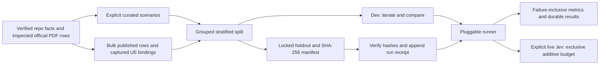

**TL;DR:** Suite v1 freezes 320 curated and 3,652 bulk cases from 227 official servings, with dev-only baselines.

# Restaurant matching and macro evaluation suite

This suite evaluates matching and nutrition estimation separately through pluggable interfaces.
It is an offline research artifact and does not enable a production matching or estimation path.
Spec owner: the execution owner of [#557](https://github.com/dgmolla/fitsy/issues/557).



## Run

Install dependencies with `npm ci` in the repository root.
No command loads environment files, connects to any database, or imports an Anthropic client.
The sole network path is an explicitly selected Jev adapter sending to `https://api.typesafe.ai/v1/systemone`.
Do not configure or connect to production Supabase for this work.

```sh
# Entirely offline, matching only; exact has no estimator.
# This is also the simplest end-to-end smoke test of the real consumer.
npm run eval:suite -w scripts -- --methods=exact --split=dev --tier=both

# Explicit live comparison on dev, in a committed clean source checkout.
# Configure TYPESAFE_API_KEY only in the invoking process; never print the key.
npm run eval:suite -w scripts -- --methods=exact,jev-v3 --split=dev --tier=both --live

# Verify fixtures and the case list without scoring either split.
node --import tsx scripts/eval/suite/build.ts --check
node --import tsx scripts/eval/suite/list-cases.ts --check

npm run lint -w scripts
npm run type-check -w scripts
npm test -w scripts -- --runInBand --runTestsByPath eval/suite/suite.test.ts
```

`--methods` selects a comma-separated set; `--split` accepts `dev` or `holdout`; `--tier` accepts `curated`, `bulk`, or `both`.
Haiku and Qwen names are documented, disabled stubs and cannot make requests.
No actual holdout evaluation is authorized for the construction and baseline work recorded here.
Tests use an unrelated Toy Chain temporary fixture to exercise holdout logging; they never score repository holdout cases.

## Ground truth and provenance

All numerical expectations come from official published rows or independently transcribed official manufacturer labels.
The baseline inputs and labels are frozen before model execution; no model estimate supplies ground truth.
`data/rows.json` retains each canonical ID, chain, published name, section, full serving, region, exact four-macro tuple, source URL, source hash, page, and locator.
Each JSONL case has an ID, task, tier, split, group, input, expected output, category, chain, one-line why, origin, source URL/page, and matching candidate IDs when applicable.
Units are kcal for calories and grams for protein, total carbohydrate, and total fat.
Published decimals remain intact.

| Chain | Verified servings used | Provenance and scope |
| --- | ---: | --- |
| WaBa Grill | 88 | Previously audited official PDF and manufacturer labels from `jev-macro/truth.json`; original source and page retained. |
| Yoshinoya | 71 | Previously audited official PDF and manufacturer label; all 31 fountain/craft drink rows excluded. |
| Wahoo's Fish Taco | 32 | Directly fetched June 2026 official PDF; every used row visually checked on physical pages 62, 63, 70, and 80. |
| Claim Jumper | 36 | Directly fetched official PDF; every used row visually checked on pages 1, 7, 8, and 14; this whole chain is holdout-only. |

The 68 added PDF rows have independently entered observed tuples in `sources/pdf-checks.json`.
They were compared row by row with the fetched PDF, its inspected column headers, and PR [#554](https://github.com/dgmolla/fitsy/pull/554)'s extraction, read from the fetched `pr554` ref.
`source.page` always means the one-based physical PDF page; Wahoo's printed page is one less because its contents page counts physically.
The label sources name the manufacturer product-label page rather than inventing a PDF page number.
Inspected page text and hashes are retained in `sources/pdf-pages.json`; original PDF bytes remain reproducible from the recorded official URLs and raw hashes.

| PDF | Raw SHA-256 |
| --- | --- |
| [Wahoo's](https://www.wahoos.com/wp-content/uploads/2026/06/Wahoos-Nutritional-info-6-26.pdf) | `105423afbefb12ae06fd368596ec974a8ce9935b73c474663432c54f5fee3c21` |
| [Claim Jumper](https://www.claimjumper.com/files/nutrition-guide-pdf.pdf) | `e754c6727379534fec0fff36055933c13730dbc2cc9adb4f5f279cb01f766835` |

Recheck downloaded `wahoos.pdf` and `claim-jumper.pdf` without network or credentials:

```sh
python3 -B scripts/eval/suite/sources/verify-pdfs.py --pdf-dir=/path/to/downloaded-pdfs
```

This is agent source verification, not a claim that the restaurants' published values are laboratory measurements or human-approved truth.
Claim Jumper is an older official document with unresolved current-menu availability; cases target exactly that document's published serving and make no current-availability claim.
The suite does not rescale or correct unusual source facts with 4/4/9 calculations.

## Curated and bulk tiers

[The curated list](eval-suite-cases.md) shows all 160 matching and 160 macro cases for human review.
`sources/curation.json` is the explicit scenario plan, with chain quotas and deliberate category coverage fixed before collection.
Half of curated matching cases are synthetic challenges changing chain, explicit modifiers, configuration completeness, or candidate availability.
Their source citations establish the unchanged reference recipe; they do not claim an official number for an unpublished modified dish.
A no-rice bowl or add-avocado item returns NO MATCH when its modified row is absent; no subtraction or invented modified macro truth occurs.

Bulk includes one macro case for every one of the 227 verified rows and one contextual multi-candidate matching case per row.
It additionally contains 81 captured Uber Eats variants with independent official-row bindings, each with a positive case, up to 24 same-chain negatives and 16 cross-chain negatives ranked by name-token overlap.
The captured input text is preserved except complete nutrition-bearing marketing sentences are removed.
Unresolved or multiply bound observations are excluded.
Equal macro-vector same-chain rows are not used as negative pairs because they may represent equivalent published components under different headings.
Cross-chain identical or near-identical names and same-chain size/recipe variants are explicit negative categories.
Published-row and synthetic inputs are clearly tagged and must not be reported as captured UE traffic.
The bulk tier has 3,425 matching cases and 227 macro cases, including two additional cross-chain identical-published-name negatives.

Repeated candidate pairs share inputs and source servings, so thousands of cases do not constitute thousands of independent dishes.
Use per-category and per-chain results and retain case counts and sampling identity when comparing methods.
An overall matching pass rate is sensitive to the many negative pairs; recall and wrong-match count must accompany it.

## Splits and holdout discipline

| Tier / task | Dev | Locked holdout | Holdout share |
| --- | ---: | ---: | ---: |
| Curated matching | 103 | 57 | 35.6% |
| Curated macro | 103 | 57 | 35.6% |
| Bulk matching | 2,360 | 1,065 | 31.1% |
| Bulk macro | 144 | 83 | 36.6% |

Split assignment groups all cases of a canonical serving across both tiers and all captured aliases.
It stratifies by chain, primary published-serving category, and whether an independently reviewed captured binding exists.
The fixed `suite-v1` hash seed selects 35% in captured strata and 21% in published-only strata, with the entire 36-row Claim Jumper chain assigned to holdout.
Those weights balance repeated UE pairs and macro rows; they were chosen from case counts before any provider result.
Small strata use deterministic rounding, so every rare category/chain combination cannot appear in both splits.
Candidate distractors stay within the target serving's split, keeping the holdout-only chain out of dev prompts.

Tune only on dev.
Run holdout rarely, after freezing a method and an explicit evaluation plan.
Every actual holdout invocation verifies `holdout.sha256` and appends start and terminal receipts to `results/holdout-runs.jsonl`, including failed checksum or preflight attempts.
The three pinned files are both holdout JSONLs and the shared reference-row table.
Each receipt binds run ID, UTC time, source head, options, and, on completion, checksum and selection identities.
Keep that log additive and retain interrupted starts as evidence.

Never add case-specific rules, prompt demonstrations, or examples derived from holdout.
Expected-output changes, exclusions that change the frozen test population, or checksum updates need human review in a versioned PR.
The generator's `--initialize` refuses any existing frozen outputs; normal `--check` is read-only.
Add fresh official cases periodically, especially independent chains and real observed failures, and version the split rather than silently refreshing the old holdout.
This repository-visible holdout is protected by process and checksums, not a claim of cryptographic secrecy from developers.

## Adapter contract

`types.ts` exports `Matcher` (`item + candidate rows -> match ID | none | abstain, confidence`) and `Estimator` (`item -> calories/protein/carbs/fat | null`).
The runner validates output shape, finite nonnegative macros, confidence bounds, and membership of returned IDs in the supplied candidate set.
Matcher candidate projections contain only chain, published name, section, serving and region; target macros, labels, aliases, case IDs, split, category, rationale, and source locators are omitted.
Estimator state contains only chain, item name, section/description/region, and serving; it rejects numeric nutrition-bearing input text.

| Method | Matching | Estimation |
| --- | --- | --- |
| `exact` | Conservative normalized full name, chain, section, region, and explicit serving equality; multiple matches abstain. | Unsupported; displayed as unavailable, never lookup-ground-truth estimates. |
| `jev-v3` | Multi-candidate choice with explicit none/abstain, published-default allowance, and protein/portion/modifier/region constraints; provider argmax, no confidence cutoff. | Existing v3 coarse/fine encoding: exact zero, twelve positive coarse intervals, ten refinements, midpoint decoding, explicit overflow failure. |
| `haiku` | Disabled stub. | Disabled stub. |
| `qwen` | Disabled stub. | Disabled stub. |

The matcher v3 is this suite's multi-candidate extension of the audited published-default experiment; it is not a claim that an earlier production matcher v3 existed.
The estimator reuses v3 question definitions rather than inventing target-dependent bins.
The coarse range stops at 3,000 kcal or 240 g per macro; larger observed overflow is an unsuccessful estimate, with no clipping.
For a new adapter, implement the exported interface in `adapters.ts`, register it in `method` and the CLI allowlist, and test its external boundary before live use.
A future Haiku/Qwen implementation must use its own explicit transport, usage accounting, and authorized budget, maintain the same projections and failure semantics, and never import the historical production pipeline.
No Haiku/Anthropic requests are made by this version.

## Metrics and results

One command prints side-by-side overall and per-category tables for each selected tier/task/method.
Each run saves `run.json`, `predictions.jsonl`, `summary.json`, `report.md`, and, for Jev, raw typed request/response exchanges under `scripts/eval/suite/results/<UTC-run-id>/`.
Metadata pins the executing Git head, protocol, fixture bytes, checksum manifest, complete selection IDs and their digest, population size, and any budget-driven sampling.

Matching pass requires the exact expected ID or explicit NO MATCH.
A wrong-match count includes both false positives on negative cases and a wrong ID on a positive case.
Recall divides correct positive matches by all expected positives, including wrong-ID, abstained, failed, and missing cases in the denominator.
Abstentions include explicit abstention, failed outputs, and omitted cases; abstaining never passes a negative case.

Macro percentage error is absolute error divided by published truth, separately for calories, protein, carbs, and fat.
Against zero truth, exact zero has 0% error and any positive estimate has 100% error.
Per-category macro pass requires every one of the four percentage errors to be at most 25%.
Big miss means strictly greater than 50% calorie error; exactly 50% does not count.
Failed, overflowed, invalid, or unattempted estimates are big misses and contribute infinity to all four full-denominator median errors.
A nonfinite median is serialized as null and displayed as unavailable.
Zero-correctness is the fraction of all zero-valued target macro fields predicted exactly zero, counting failures as incorrect.
Cost per 1,000 uses attempted cases, including both estimator stages and billed failures; unknown usage leaves total cost unavailable while retaining its known subtotal.
Latency is end-to-end per attempted item, with nearest-rank p95; both estimator requests contribute.
No successful-only filtering may replace the frozen-denominator primary metrics.

## Jev cost and transport controls

The price is $0.042 per million input tokens and free output, matching the repository's audited pricing and the [official pricing statement](https://typesafe.ai/) rechecked on October 26, 2026.
Actual spend uses returned input-token counts; cost is not estimated from elapsed time.
Every request reserves 16,384 input tokens inside a 12,000-byte request envelope before sending.
The cumulative suite-wide stop threshold is $4.50, inside the user's $5 hard cap.
The default full dev population fits the conservative reservation budget, so it is not sampled.
When a future bulk run would exceed the remaining envelope, the runner retains the whole selected curated tier and deterministically samples bulk by tier/task/chain/category; compared methods share the resulting selection.
The selected IDs, denominator, and sampling flag remain visible.

`results/spend.jsonl` durably records reserve and settle events across invocations, with an exclusive `.jev.lock` preventing overlapping collectors.
Never reset the ledger, split it by method to gain budget, or retry an unknown bill as a free request.
A pending reservation or missing/invalid usage stops future live collection until actual billing is reconciled with human review.
Model drift from `jev-1.14.0`, invalid typed probabilities, HTTP/transport failure, credential echo, token-envelope violation, or spend exhaustion stops the current collector without automatic retry.
Responses are redacted before disk writes if they echo the key; exception messages and headers are never printed or retained.
Requests use a five-second timeout, no redirects, and no retries.
The reservation assumes provider billing stays within its advertised/requested envelope; a provider violation is recorded honestly and stops collection.

## Exclusions and limitations

`data/manifest.json` retains the original 17 held/derived-serving exclusions and the additional 31 Yoshinoya drink-unit exclusions individually.
The audited 22 regular/large/bottled unit defects and nine 14-oz craft drinks with unresolved volume/mass context are all excluded rather than silently converted.
WaBa shrimp, inconsistent dumpling quantities, K-ribs, family salad, Yoshinoya gyoza/kids/one combo/sweet-and-sour facts, and multiplied two-cookie nutrition remain excluded under their prior audit reasons.
All 2,874 PDF-finder rows outside the 68 individually inspected rows remain unverified and unused.
This includes Wahoo's repeated black-bean salsa portions and competing white-rice rows without a reliable serving distinction.
Old Spaghetti Factory is excluded because the demo source is HTML-only with no PDF page in this verification scope; malformed labels also require a separate review.
No third-party nutrition, production database snapshot query, FatSecret value, inferred modifier arithmetic, or model prediction becomes truth.
Source currency, regional recipe availability, correlated menus, manufacturer rounding, and published-table imperfections limit any production-accuracy claim.

## Baseline evidence

Only dev is evaluated for v1.
Recorded result paths, measured scores, spend, local validation, independent review, and CI state are attached to the PR and the committed result reports.
Reading or checksumming holdout for integrity and rendering the requested human case list does not execute or score holdout.
