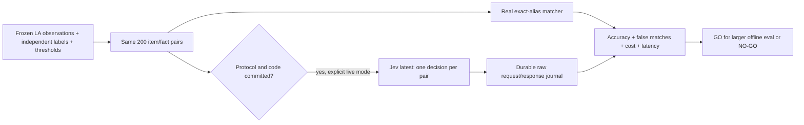

# Jev chain-item decision evaluation (#503)

**TL;DR:** The offline benchmark is ready; live Jev results require committing the labeled protocol first.

The existing `scripts/eval/run-eval.ts` now accepts `--decision=chain-match`.
It shares the existing median metric, spend caps and cost journal while keeping binary identity scoring separate from macro percentage error.
The older macro/hero evaluators lack negative identity labels, false-match scoring and a Jev adapter, so their macro results cannot answer this question.
The baseline imports `buildChainMatcher` directly; no matching rules, production pipeline callers or mobile journeys change.



## Frozen protocol

[`benchmark.json`](../../../scripts/eval/chain-match/benchmark.json) contains all 200 labels, per-pair rationales, prompt, vendor price and thresholds.
Source files are pinned by SHA-256, including the independently transcribed `chainBindingTruth` identities and the audited official-fact catalog.
The LA inventory has 237 contextual variants from WaBa Grill and Yoshinoya; each brand contributes 100 pairs.
All 94 pre-reviewed positive identities and two additional Chicken Bowl section placements form the 96 positives.
For each brand, 52 negative items are selected by ascending SHA-256 of `issue-503-v1:<observation index>` and paired with a specified incompatible or unresolved serving.
Labels were authored before any Jev calls; labels and rationale never enter model requests.
No prompt tuning, training calls, model-driven labeling or post-result threshold selection is allowed on this held-out set.

Accuracy must be at least 95% and must not regress from the measured baseline.
Recall must reach 95% and improve by at least two percentage points over exact aliases.
Both false-positive rate (FP / 104 negatives) and false-discovery rate (FP / predicted matches) must be at most 1%.
The cost ceiling is $0.10 per 1,000 supplied candidate pairs, with p95 request latency at most 1,000 ms.
A match needs match probability at least 0.95 and confidence at least 0.90; a negative needs match probability at most 0.05 and confidence at least 0.90.
Other answers abstain, count as incorrect and fail the complete-coverage requirement.
The scorer uses the complete labeled denominator even after an error or interruption, and unknown usage never becomes zero cost.
Missing Jev evidence is a pending experiment, not a measured model failure.

The [official API reference](https://docs.typesafe.ai/api/system-one) defines the typed choice and usage response.
The [official model/pricing page](https://docs.typesafe.ai/models), checked October 24, 2026, lists $0.042 per million input tokens and free output.
The request uses `jev-latest`; raw responses retain the returned model identity, probabilities, confidence, token usage and HTTP status.
Costs are calculated from reported usage at that frozen price, rather than inferred from elapsed time or an unknown-model free-price fallback.
There is one request per pair, a five-second timeout, no hidden retries, a $0.50 run cap and the existing $25 monthly cap.
The run stops on the first transport, HTTP, parsing or usage failure and retains its partial journal.

## Run and review

```sh
# No database, credentials or provider calls. Output directory must be new.
npm run eval:chain-match -- --mode=baseline --out=/tmp/jev-503-baseline

# Only after the labels, thresholds, sources and executing code are committed.
# TYPESAFE_API_KEY must already be supplied in the environment.
npm run eval:chain-match -- --mode=live --out=/tmp/jev-503-live

# Re-score the original raw journal with the identical frozen benchmark.
npm run eval:chain-match -- --mode=replay --journal=/tmp/jev-503-live/jev-raw.jsonl --out=/tmp/jev-503-replay

# Deterministic tests, with external provider responses simulated only in tests.
npm test -w scripts -- --runInBand --testPathPattern=eval/chain-match
npm test -w apps/api -- --runInBand --runTestsByPath services/jevDecisionService.test.ts
```

Each output directory contains `baseline.json`, `summary.json` and a one-page `report.md`.
Live and replay modes also retain `jev-raw.jsonl`; requests are flushed before sending and raw responses before parsing.
Existing output directories are refused to preserve original evidence.
Live preflight compares committed bytes, including labels and thresholds, and refuses staged or unstaged source changes before reading credentials or sending any request.
Tests are discovered by the existing scripts/API Jest suites, which the registry `test` check already runs through `run.mjs`, hooks and CI.
No workflow, hook, review rule or shipping gate needs an additional live-model check.

## Result and limits

The checked-in [result note](jev-chain-match-result.md) records the measured local baseline and the pending Jev comparison.
No live model call was made because this task explicitly prohibits commits while acceptance requires a commit before calls.
The next authorized owner must commit the reviewed frozen inputs, then run the explicit live command with existing provider access and retain the resulting report and journal.
No production adoption is recommended from an unrun comparison; even a GO authorizes only a larger offline experiment in a separate issue.

The sample deliberately overrepresents known approved aliases and contains only two unaliased positive controls.
It is a small decision smoke test, not an estimate of recall across the roughly 94k unmatched LA rows.
Some contextual variants have a zero older-DB count but were captured from the LA Uber Eats menus; none are invented menu names.
Several variants share a dish name across descriptions or sections, so the 200 pairs are not 200 independent dishes or restaurants.
Many negatives are straightforward incompatible dish types; the sample cannot establish production false-match risk on hard near-neighbor retrieval candidates.
Agent-reviewed source identities do not replace a production serving approval or human precision review.
This compares a supplied candidate with exact aliases; candidate retrieval, Haiku macro error and downstream serving accuracy are outside the measured decision.
Zero false positives among 104 negatives still leaves an approximately 2.8% one-sided 95% upper bound on the false-positive rate.
The frozen empirical thresholds are a screening rule, not a population certification.
