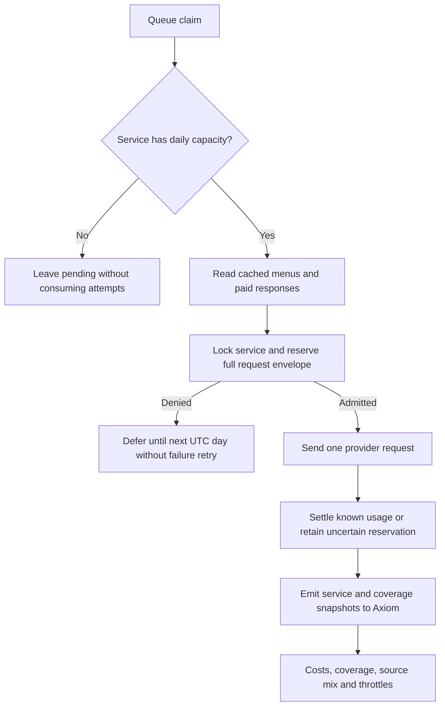

# Pipeline v2 budgets and telemetry

**TL;DR:** Database reservations bound fleet spending before paid transport, and Axiom snapshots expose costs and committed coverage.

The shared [hex and PDF queues](pipeline-v2-queue.md) enforce one budget per service across runs, workers, leases and hosts.
Apply `20261028160000_pipeline_service_budgets` through the existing guarded migration procedure before running these workers or the UE-first Google fallback.
No new required environment variables, deployment credentials, mobile journeys or release approvals are introduced.
The existing DEV-only target and pipeline-role guards remain at the connection entrypoint.



## Daily caps

| Service | Default USD cap | Default request cap | Reservation |
| --- | ---: | ---: | --- |
| Jev | $5 | 100,000 | Existing 16,384-token protocol envelope before each request |
| Google | $5 | 1,000 | $0.032 Text Search Pro or $0.007 photo retrieval before each HTTP call |
| PDF finder | $0 | 10 | One research attempt, using the current free search HTTP and local extraction |

The finite DEV defaults are installed once by the migration.
Worker startup never resets limits, counters or reservations.
Explicit operator configuration changes limits without clearing usage; zero requests disables that service.
The current hex worker uses Jev and the PDF worker uses PDF finder admission; hex claims do not depend on an unused Google service.
The legacy UE-first photo fallback also uses the shared Google budget and its existing cumulative run cap.

```sh
npm run preload:v2:dev -- budgets
npm run preload:v2:dev -- budgets --service=jev --daily-usd=5 --daily-calls=100000
npm run preload:v2:dev -- budgets --service=google --daily-usd=5 --daily-calls=1000
npm run preload:v2:dev -- budgets --service=pdf_finder --daily-usd=0 --daily-calls=10
```

PostgreSQL locks the service row before sampling the UTC day and checking committed spend plus every unresolved envelope.
Reservation and daily counter updates are atomic, using exact decimal arithmetic.
Jev token pricing uses decimal arithmetic before converting to USD numbers, so its $0.000688128 envelope matches the stored cap during queue admission and request settlement.
Exact-cap regressions exercise the real CLI, journal replay and PostgreSQL queue, including refusal when the cap is one nanodollar short.
Daily aggregates keep admission independent of the number of request receipts already written that day.
Independent workers cannot admit another request when the remaining capacity cannot cover its full envelope.
A queue claim is an eligibility check, and every actual provider call must still reserve before transport because capacity can change after claiming.
An exhausted claim does not increment attempts; exhaustion during work defers the job without consuming a failure attempt.
Missing budget state and database errors refuse paid transport.

Daily request counters reset by moving to the next database UTC date, with no destructive reset operation.
Unknown and interrupted reservations remain charged against later days until real billing is reconciled.
Settling one permit cannot create a transport permit, refund another request, or settle the same known charge twice.
Replayed Jev responses require no new reservation.
Retained request receipts preserve the original envelope, day, scope and observed charge.
All three operational tables retain default-deny RLS, pipeline-only writes and audit-only reads.

The current PDF finder has no paid search integration.
Its request limit bounds complete research attempts, including failed attempts, rather than claiming a dollar charge for free search.
Any future paid finder provider must separately reserve its full paid-call envelope before transport.
Google costs are conservative undiscounted list-price estimates, including attempted calls whose billing is uncertain, rather than invoice reconciliation.
The prices follow [Google's current pricing list](https://developers.google.com/maps/billing-and-pricing/pricing), checked 2026-10-28.

## Existing cumulative run cap

The UE-first `--cost-cap-usd` cap now includes Haiku and Google, plus all current in-flight envelopes.
Haiku reserves UTF-8 input bytes plus framing allowance at the existing input rate and the full requested output-token allowance before each chunk.
The observer disables SDK retries; each explicit retry must obtain its own admission.
Measured usage settles that envelope before parsing, so malformed billed responses still count.
Documented pre-inference rejections release their envelope, while transport and uncertain server failures retain it and stop paid retries.
An unresolved reservation restored from the local ledger requires billing reconciliation before more paid work.
Use one process per legacy run/ledger, as in the [existing runbook](runbook.md#ai-spend-accounting-and-resumable-cap).

## Axiom dashboard

Workers use the existing `AXIOM_TOKEN` and `fitsy-pipeline` dataset, flushing the SDK before exit.
Without that optional token, the database and private reports remain the accounting source; no remote dashboard verification is implied.
The setup command prints its maintained definition by default and installs only the stable `fitsy-pipeline-v2` dashboard with explicit `--apply`.
It sends no dummy billing data, Slack messages or monitor changes.
The apply command updates that owned dashboard definition, replacing manual layout changes to it.

```sh
npm run preload:v2:dev -- dashboard
npm run preload:v2:dev -- dashboard --apply
```

The definition follows the [Axiom dashboard API](https://axiom.co/docs/restapi/endpoints/createDashboard).
It has four panels: cost and reservations per service/day, coverage per hex, committed item source mix, and provider throttles.
Service snapshots use `(service, day)` and coverage snapshots use `(runId, hexId)` with `arg_max(_time, *)`, so resume and retry snapshots do not double-count totals.
Settling an older unknown charge updates the snapshot for its original accounting day.
Source mix counts validated items prepared for the successful atomic hex commit, with explicit official, Jev and other buckets.
Failed attempts publish zero committed items and no source mix.
UE 403/429, Google 403/429, Jev 429 and daily budget admission stops emit structured throttle events without bodies, credentials or raw menu data.

## Verification and recovery

Budget admission must run against the migrated disposable PostgreSQL database because PL/pgSQL resolves column references when the function executes.
The concurrency regression preconnects eight independent worker sessions with one connection each and a bounded startup timeout.
This keeps cold connection setup outside the reservation assertions and avoids host-sized pools exhausting the disposable database.

```sh
npm test -w scripts -- --runInBand --runTestsByPath \
  preload-cost.test.ts preload-cost-e2e.test.ts \
  pipeline-v2/cli.test.ts pipeline-v2/journal.test.ts \
  pipeline-v2/service-budget.test.ts pipeline-v2/telemetry.test.ts

# The canonical runner provisions the owned disposable loopback database.
node scripts/verify/focused-tests.mjs --set scripts/pipeline-v2/service-budget.db.test.ts
npm run verify -- --only=focused-tests
```

The database regression uses independent Prisma clients to contend for the last paid envelopes and covers claims, rollover, unknown charges, finder request limits and role isolation.
If the worker cannot access the Docker socket, retain the failed canonical attempt and run database-free regressions while the existing network-enabled execution owner runs this exact database recipe.
Do not substitute a shared DEV/PROD database or call the skipped database suite a pass.
The dashboard transport regression verifies the actual installer payload; live panel queries and ingestion require the existing Axiom credentials and connectivity.
