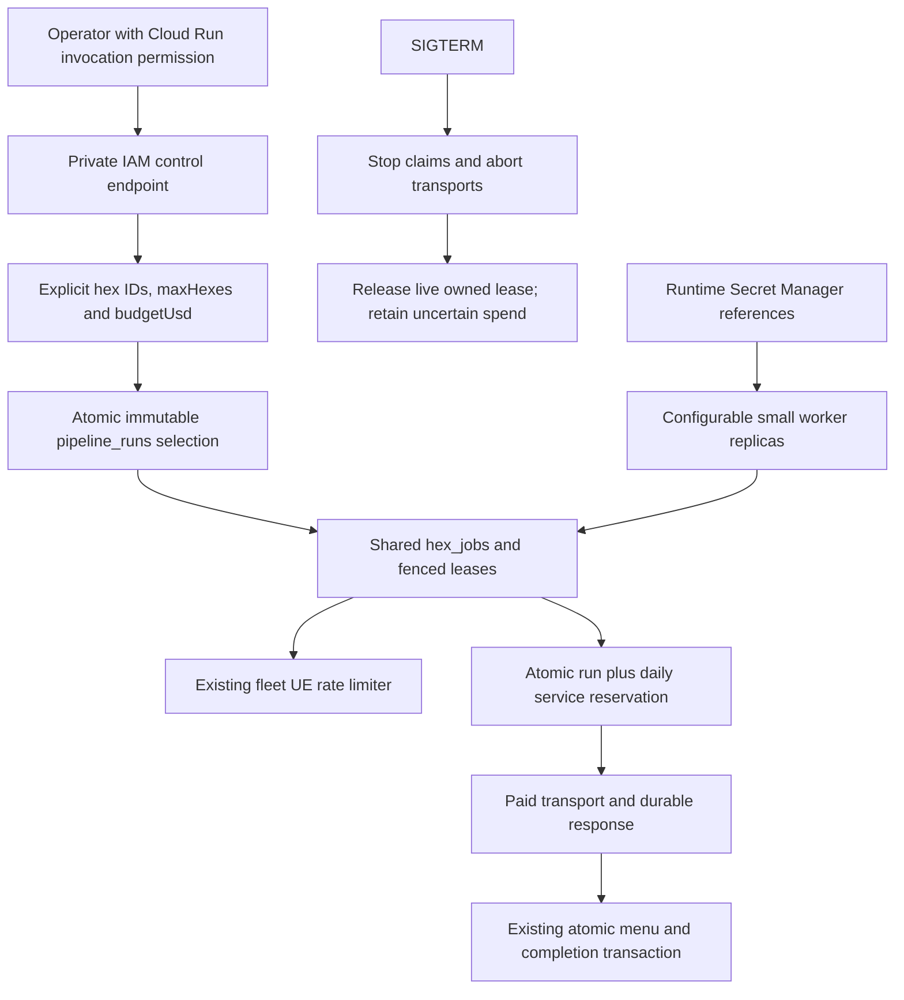

# Pipeline v2 cloud worker

**TL;DR:** An IAM-private Cloud Run service pulls bounded DEV runs from the existing queue and retains accounting across replicas.

The worker reuses the [hex queue and UE limiter](pipeline-v2-queue.md), reviewed official matcher, Jev estimator, atomic persistence, and [daily service budgets](pipeline-v2-budgets.md).
This change supplies the service, control CLI, container, deployment configuration, and executable acceptance scenarios.
Live deployment and DEV acceptance are separate from local unit or packaging checks.
Production remains refused by the existing DEV-only and signed workload identity guards.
The explicit production role approval from #588 and approval of a production cloud workload identity remain prerequisites; this configuration does not grant either.
No App Store, Vercel domain, mobile journey, scheduler, or release changes are involved.



## Runtime and deployment

Apply `20261028170000_pipeline_cloud_runs` and preceding queue/budget migrations through the existing guarded migration owner.
Start existing shared DEV discovery separately when needed; the v2 hex worker consumes already discovered LA restaurants.
Stop legacy ingestion and unrelated refreshes while this fleet operates.
Only one cloud refresh may be active, and a new start also refuses any draining hex lease.

The deployment source is `scripts/pipeline-v2/cloud/main.tf`.
It creates a dedicated DEV service identity, per-secret runtime access, explicit IAM invokers, health probes, and a manually scaled service with continuously allocated CPU.
Each replica uses one CPU, 512 MiB, one active hex, and a default two-connection database pool, configurable to 1-5 in its datasource URL.
Use a reviewed image digest and existing Secret Manager names with numeric versions.
The configuration never accepts secret payloads, creates account keys, or exports database credentials to Terraform state.
The deployer needs existing project and IAM authority; do not apply new grants or production changes as a substitute for required approval.

Build from the repository root using a Linux image compatible with Cloud Run:

```sh
docker build --platform=linux/amd64 \
  --file=scripts/pipeline-v2/cloud/Dockerfile \
  --build-arg SOURCE_REVISION="$(git rev-parse HEAD)" \
  --tag=REGION-docker.pkg.dev/PROJECT/REPOSITORY/pipeline:REVIEWED_REVISION .
```

The Docker-specific ignore file limits build context to source and manifests and excludes local environments, evidence, credentials, fixtures, and dependencies.
The dependency stage derives an exact standalone dependency closure from the maintained root lockfile.
It avoids mobile peer resolution and leaves Expo, React Native, workspace links, Git, TypeScript loaders, and build tooling out of the final runtime.
The final image contains bundled worker/preflight code, a source digest, and the generated Prisma runtime, running as the unprivileged `node` user.
Never supply database URLs or provider keys as build arguments.

The existing required variables are `PIPELINE_DATABASE_URL` using the dedicated DEV `pipeline_writer`, and `TYPESAFE_API_KEY`.
`UE_LOC_COOKIE` and `AXIOM_TOKEN` remain optional runtime secret references.
`PORT` defaults to 8080.
No new required environment variables are introduced.
`scripts/deploy/pipeline-worker-preflight.ts` and the actual service call the same environment and database readiness functions before accepting work.
The preflight verifies target, role, provider secret, connection bounds, migrations, UE singleton, and daily budget configuration without a paid probe or resetting limits.

Provision and rotate writer credentials inside the approved cloud administrative environment directly into runtime Secret Manager versions.
Do not put a production writer value in a laptop environment, Vercel, GitHub, image, command argument, build log, or Terraform input.
Use names-only inventories of those locations and the runtime IAM policy to verify placement after the authorized production rollout.
A secret reference in this repository does not prove live placement, removal of older copies, or production activation.

## Manual start and status

Operators need invocation permission and the private service URL, without database access.
Direct HTTPS invocation obtains an identity token through the existing `gcloud` login.
Alternatively use the local authenticated Cloud Run proxy:

```sh
gcloud run services proxy fitsy-pipeline-dev --project=PROJECT --region=us-west1 --port=8081

npm run preload:v2:cloud-control -- start \
  --url=http://localhost:8081 \
  --run-id=dev-proof-594 \
  --hex-id=8729a1d75ffffff \
  --max-hexes=1 \
  --budget-usd=0.01

npm run preload:v2:cloud-control -- status \
  --url=http://localhost:8081 \
  --run-id=dev-proof-594
```

These map to `POST /runs` and `GET /runs/ID` behind Cloud Run IAM.
Start requires `runId`, `hexIds`, `maxHexes` (1-1000), and `budgetUsd` (0-5000, up to nine decimal places).
There are no default run limits.
Duplicate hexes collapse before selection, and only the first `maxHexes` distinct LA resolution-7 cells are queued.
Cloud run IDs use `pipeline-v2-dev:cloud:`; existing single-hex and queue CLI namespaces cannot select them.
Enqueue and run creation share one transaction, and repeating the same start preserves attempts, journals, checkpoints, and spend.
A changed selection, target, protocol, or limit for an existing ID returns HTTP 409 rather than resetting it.

Run reservations lock one database row before reserving the existing daily service envelope in the same transaction.
Every paid request checks both limits, so adding replicas never multiplies the budget.
Known usage releases only unused envelope capacity, and uncertain charges remain reserved across restarts and days.
Temporary contention waits for live reservations to settle instead of permanently stopping the run.
`budget_cap` stops admission when remaining cumulative capacity cannot cover another request, or an unresolved reservation consumes it after workers drain.
Zero or less than one Jev envelope starts stopped without a claim or provider call.
The fixed $5 per-hex cap and daily service caps still apply.
The run completes after its selected hexes finish, fails when all remaining jobs are parked, and retains partial work for inspection when spending stops.
Partial hexes never receive a completion checkpoint.
This budget bounds provider usage; cloud hosting and storage charges are separate.

## Scale, health, and shutdown

Set `worker_count` in Terraform, or update the existing service without a code change:

```sh
gcloud run services update fitsy-pipeline-dev --project=PROJECT --region=us-west1 --scaling=2
gcloud run services update fitsy-pipeline-dev --project=PROJECT --region=us-west1 --scaling=0
```

Manual scaling to zero disables the service; restore a positive count before invoking control requests.
Reconcile an operational CLI change with Terraform's next desired count.
This follows [Cloud Run manual scaling](https://docs.cloud.google.com/run/docs/configuring/services/manual-scaling) and its [container shutdown contract](https://docs.cloud.google.com/run/docs/container-contract).
No scheduled start is installed.

`GET /healthz` reports liveness and recent worker database failures.
`GET /readyz` probes actual migrated queue/budget state and refuses readiness during shutdown or database failure.
Structured stdout contains run, worker, hex, attempt, and outcome; private raw responses remain in the existing database journal.
Optional Axiom snapshots and coverage use the existing telemetry implementation and flush before exit.
No request bodies, provider exceptions, credentials, or raw menu reports are logged by the control service.

SIGTERM/SIGINT stop claims, abort active provider transports, drain the heartbeat, and release the current live token immediately.
A clean interruption retains the checkpoint without consuming a failure attempt.
An interrupted paid call parks its hex and retains its unknown reservation rather than repeating a potentially billed call.
Lost or expired tokens cannot release another replica's lease.
A transaction already committing may finish atomically; a forced kill rolls back an unfinished transaction, and ordinary lease expiry remains the crash fallback.
The process bounds shutdown at eight seconds within Cloud Run's ten-second termination window.

## Verification and recovery

Database-free checks include the actual control parser, runtime/preflight production refusal before driver construction, standalone dependency extraction, and the bundled entrypoints:

```sh
npm test -w scripts -- --runInBand --runTestsByPath \
  pipeline-v2/cloud.test.ts pipeline-v2/queue.test.ts \
  pipeline-v2/journal.test.ts pipeline-v2/cli.test.ts
node --test scripts/pipeline-v2/cloud-packaging.test.mjs
```

Run database and real local HTTP journeys through the existing owned disposable PostGIS verifier:

```sh
node scripts/verify/focused-tests.mjs --set \
  scripts/pipeline-v2/cloud-runs.db.test.ts \
  scripts/pipeline-v2/cloud-service.db.test.ts \
  scripts/pipeline-v2/ue-rate-limiter.db.test.ts \
  scripts/pipeline-v2/service-budget.db.test.ts \
  apps/api/tests/db/hexJobs.db.test.ts
npm run verify -- --only=focused-tests
```

These scenarios use independent database clients and two real service processes, the control CLI, provider HTTP fixtures, actual UE permits, atomic menu persistence, exact-envelope stops, immediate scale-down recovery, and unknown-charge parking.
They also test idempotent/concurrent starts, role isolation, stale-token fencing, and cumulative budgets across restart.
Shared DEV or production credentials must never be loaded into these test suites.
If the worker sandbox denies Docker or loopback sockets, preserve the canonical failure and assign this same recipe to the existing host execution owner.
Do not retry unchanged permissions or call skipped suites successful acceptance.

For live cloud DEV acceptance, the existing owner must deploy the reviewed digest, verify private invocation and both health endpoints, start an explicit finite run against discovered DEV hexes, and retain run/checkpoint, UE limiter, provider budget, and replica identities.
Scale up and down during that run and demonstrate resume without duplicate paid work or an increased cumulative budget.
Production remains unverified until separately approved identity/grant installation and a names-only credential-placement audit complete.
