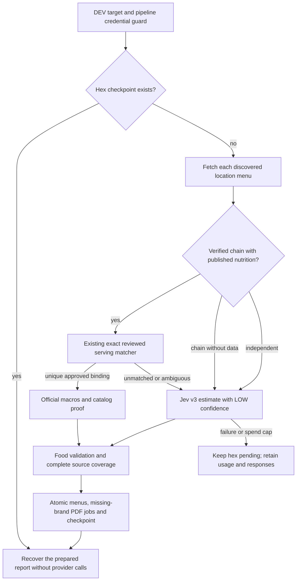

# Pipeline v2 single-hex DEV proof

**TL;DR:** Process one explicit DEV hex using reviewed official matches, Jev estimates, resumable accounting and atomic checkpoints.

This command enriches one explicitly selected resolution-7 LA hex already discovered by the UE-first pipeline.
It does not change the ordinary preload command or deploy either application.
Runtime deployment and DB role activation follow their separate acceptance contracts.
The separate [shared hex queue](pipeline-v2-queue.md) uses this hex implementation with database-backed replay and leased workers.
Both entrypoints reserve Jev calls against the [fleet daily budgets](pipeline-v2-budgets.md) in addition to the per-hex cap.
Both entrypoints use its shared PostgreSQL UE limiter, rate configuration and global 403/429 backoff.



## Run and resume

Configure `PIPELINE_DATABASE_URL` and `TYPESAFE_API_KEY` only in the invoking process.
The datasource must pass both `assertDevDatabase` and the existing `pipeline_writer` credential guard before Prisma construction or provider access.
Loopback PostgreSQL is supported for disposable tests; production and unknown projects are always refused, including with production-write flags.
The existing role contract remains in force; the POC does not install the separate #588 write lock.
The documented legacy `dev_db_url` is an administrator credential and does not satisfy that contract.
Do not silently substitute application, migration or administrator credentials when the pipeline credential is unavailable.

Choose a discovered hex within the LA boundary, then use the same run ID, output directory and cap for every resume.
The output directory contains private usage records and must be retained through acceptance and any usage reconciliation.

```sh
npm run preload:v2:dev -- \
  --hex-id=8729a1d75ffffff \
  --run-id=issue-591 \
  --out=.evidence/pipeline-v2/issue-591 \
  --cost-cap-usd=5
```

The example hex is a valid central-LA cell, not evidence that it contains a suitable DEV sample.
No discovery or additional hex selection happens implicitly.
There is no `--force` override for a completed checkpoint and no billable preflight request.
POC run IDs use the reserved `pipeline-v2-dev:` prefix, which the ordinary pipeline excludes from automatic run selection.
An ordinary preload restart therefore cannot accidentally adopt the POC's one-hex checkpoint as its own run.
UE fetches have no automatic retries; every actual HTTP attempt is journaled by the service wrapper.

The journal holds an exclusive process lock, binds the run/hex/datasource identity and frozen estimator protocol, and refuses a changed cap or identity.
Requests are fsynced before transport and raw responses before parsing.
Successful identical requests replay across resumes without further Jev charges.
Each serialized request reserves 16,384 input tokens at the existing evaluation rate of $0.042 per million input tokens and free output.
Actual cost comes from reported usage; the provider's billing envelope remains an external assumption.
A cap above $5 is refused.
HTTP failures, malformed typed answers, model drift, overflow and transport failures stop the attempt without a checkpoint.
Missing or interrupted usage leaves total cost unknown and prevents further paid work; it never becomes zero-cost usage.
Never delete or replace a ledger to resume around a cap or unknown spend.
After an abrupt process death, inspect the exact recorded lock owner and journal before recovering a stale lock or reconciling usage.

## Matching, estimates and persistence

Verified chain identity is independent of nutrition availability.
A chain has published data only when official catalog rows contain a source URL, serving and all four finite nonnegative macros.
Brand existence, `macroSource`, an `officialUrl` on the brand, or aliases alone do not establish published nutrition.
Published and reviewed-chain counts are reported separately.

Exact matching reuses the existing reviewed catalog index and retains complete name, section, description, serving, source-ID, calorie and geographic safeguards.
It never uses fuzzy names, another chain's facts, an unreviewed catalog row or a Jev matching decision.
Unmatched or ambiguous items, including items at a chain with published but unreviewed facts, go to Jev.
This is deliberately conservative; published coverage is not the same as eligible exact-match coverage.

Estimation reuses the evaluated Jev v3 coarse/fine argmax protocol, pins returned model `jev-1.14.0`, preserves exact zero and refuses overflow.
Only menu text, restaurant identity, serving context and region enter requests.
Nutrition columns and official targets do not enter estimator state.
Jev estimates retain their own `source=jev`, LOW confidence and protocol/quantization provenance.
The shared TypeScript and SQL winner ranking treats Jev and Haiku as estimate peers, with recency breaking ties.
Higher-trust existing sources retain their normal priority.
UE supplies menu membership, reviewed official facts supply matched nutrition, and Jev estimates unresolved servings.
Invalid food is reported with its rejection reason rather than silently counted as persisted coverage.

The single-restaurant and bulk writers preserve an existing reviewed official estimate when its current catalog binding and facts still match.
A changed serving, revoked approval, ambiguous binding, changed restaurant identity or changed official facts still invalidates that stale link.
Both paths recompute winning macros after estimate upsert.
The real-database regression exercises both writers, stable menu IDs, retained official estimate IDs/proof, Jev source rows and official winning macros.

Chains without published nutrition retain `pdf_search_enqueued` intent records in `journal.jsonl`, deduplicated by brand with a stable job ID.
Their shared PDF jobs commit atomically with successfully sourced menus and the hex checkpoint.
The separate [background PDF worker](pipeline-v2-queue.md#background-chain-nutrition) can then claim one job per brand across runs and locations.
Failed sourcing, rejected menus and rolled-back checkpoints publish no new research work.
No PDF request is performed or charged in the hex command.
Keep the journal with its run identity for recovery and accounting; an intent record alone does not establish a committed job.

## Evidence and acceptance

`report.json` contains selected/empty menus, raw/unique/official/Jev/rejected/persisted items, published/missing-data chain locations, coverage ratios, UE/Jev call counts, paid reuses, known/unknown cost and cumulative measured attempt time.
The journal also retains source HEAD, a hash of the relevant current source files, dirty state, catalog counts, request/response records, PDF jobs, prepared reports and outcomes.
A report is prepared durably before the atomic write so a crash after checkpoint commit can recover its metrics without repeating paid work.
Normal resume retains the completed report's measured wall time.
Recovery with only a prepared report sets `wallTimeComplete=false`, because the missing persistence duration cannot be reconstructed honestly.
An interrupted earlier attempt also sets that flag and increments `interruptedAttempts`; `wallMs` then covers only known completed attempts and the current execution.
Database/checkpoint failures leave the hex pending and preserve paid responses for recovery.

Inspect each reported official match against its retained source URL/hash, serving, locator and current menu context before asserting zero wrong matches.
`wrongMatches` remains null until that independent inspection; the matcher does not grade itself.
Simulated CLI fixtures establish orchestration and rollback behavior, not live DEV coverage, paid cost, wall time or real match accuracy.

Local validation uses the real CLI and internal implementations with only HTTP and Prisma boundaries substituted.
The real-database regression requires the canonical disposable PostGIS launcher and never targets shared DEV or production.
No mobile screen or journey changes, so no Maestro YAML is changed.
The conservative product-impact plan can still require native acceptance before a later publication; preserve that requirement.

```sh
npm test -w scripts -- --runInBand --runTestsByPath pipeline-v2/cli.test.ts pipeline-v2/journal.test.ts preload-cost-e2e.test.ts
npm test -w apps/api -- --runInBand --runTestsByPath services/chainWriteGuard.test.ts services/chainPriority.test.ts services/jevDecisionService.test.ts services/menuSources/ueApiClient.test.ts
node scripts/verify/focused-tests.mjs --set apps/api/tests/db/chainServing.db.test.ts
npm run verify -- --only=focused-tests
```

Keep live measurements, source identity, remaining blockers and the accountable execution owner in the task's retained handoff and report.
Use the existing `verify-fitsy` recovery workflow for an unavailable database or provider connection; do not weaken target, role or disposable-test-database guards.
