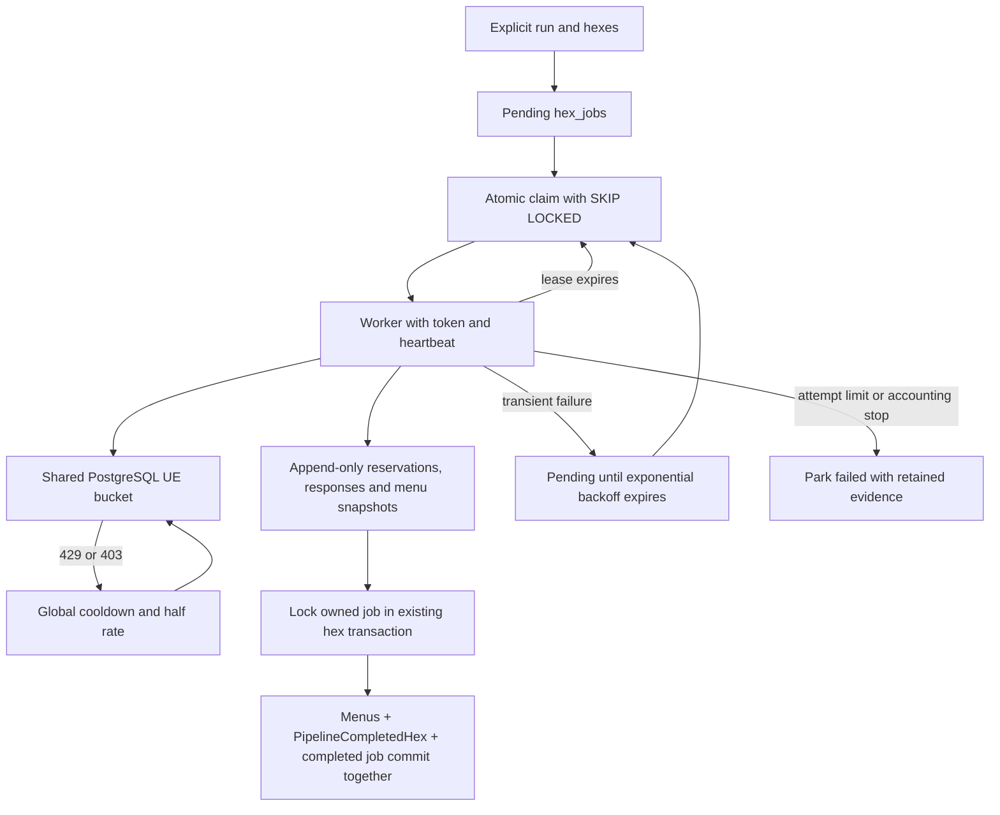

# Pipeline v2 shared hex queue

**TL;DR:** DEV workers share leased hex jobs, paid-call replay, UE throttling, bounded retries and atomic hex completion.

The queue runs the [existing v2 hex implementation](pipeline-v2-dev-poc.md) against explicitly enqueued resolution-7 LA cells.
It retains the DEV-only target guard, dedicated `pipeline_writer` credentials, reviewed official matcher, Jev protocol and cumulative $5 per-hex cap.
Fleet-wide [daily service budgets and Axiom telemetry](pipeline-v2-budgets.md) supplement the per-hex cap.
The [cloud worker service](pipeline-v2-cloud-worker.md) adds immutable fleet run limits, private invocation, health probes, and graceful lease release; deployment acceptance remains separate.
The [US rollout planner](pipeline-v2-us-rollout.md) generates population/density priorities and bounded files loadable with `enqueue --priority-file=FILE` or the private cloud client, retaining current LA scope checks.
No mobile journey changes or App Store actions are involved.



## Commands

Apply the additive Prisma migration through the existing guarded migration procedure before running workers.
Provide `PIPELINE_DATABASE_URL` and `TYPESAFE_API_KEY` in the invoking process, as for the single-hex proof.
The queue entrypoint constructs Prisma only after both target and pipeline-role validation.
Production and unknown projects remain refused, including with production-write flags.

```sh
npm run preload:v2:enqueue -- \
  --run-id=issue-592 \
  --hex-id=8729a1d75ffffff \
  --cost-cap-usd=5 \
  --max-attempts=3 \
  --priority=0

# Invoke independently on each worker, using the same run ID and database.
npm run preload:v2:worker -- \
  --run-id=issue-592 \
  --worker-id=worker-a \
  --out=.evidence/pipeline-v2/worker-a \
  --max-jobs=1
```

Repeat `--hex-id=HEX` to enqueue several explicit LA cells; duplicate hex arguments are deduplicated.
The example hex is a valid cell, not proof of suitable DEV restaurants or live execution.
Jobs are unique by `(run_id, hex_id)` and use reserved run IDs beginning `pipeline-v2-dev:queue:`.
The ordinary preload resumer already excludes this prefix.
Workers for one refresh must use the same run ID; unrelated ingestion and refresh runs must not overlap.
The single-host POC keeps its original local journal and separate run namespace; it does not import or reset shared jobs.

Enqueue is idempotent, can raise priority, and cannot reset attempts, progress or a parked/completed job.
An existing job refuses changes to its target, estimator protocol, cap or attempt limit.
The $5 ceiling is per hex and cumulative across that hex's claims, in addition to the shared daily Jev budget.
Workers read these stored settings rather than supplying new budgets on resume.

`--max-jobs` defaults to one and permits 1-1000 claims per invocation.
A worker exits when no eligible job exists, daily paid capacity is exhausted, the bound is reached or a job does not complete.
A mid-job `daily_cap` stop defers to the next UTC day without consuming a failure attempt.
`idle` means no job is currently claimable; pending backoff, another live lease and exhausted work can all produce it.
This command does not install a daemon or scheduler.
Private per-attempt exports under `--out` are optional recovery evidence; the database journal remains authoritative even on another host.

## Background chain nutrition

Verified restaurant brands without published data receive Jev estimates immediately.
After source validation, their shared PDF jobs commit in the same transaction as the menus, hex checkpoint and fenced hex-job completion.
Other workers cannot claim the research until a corroborating menu exists, and a failed hex leaves no new shared PDF work.
Empty location menus do not enqueue research.
The journal's deduplicated PDF records retain intent for recovery; only the committed shared queue authorizes a research claim.
Discovery runs only in the background worker, after the database claim reserves that chain's retry window.
The fixed three-attempt limit and hourly exponential backoff apply across every worker and location.

```sh
npm run preload:v2:pdf-enqueue -- --brand-id=VERIFIED_BRAND_ID
npm run preload:v2:pdf-worker -- \
  --worker-id=pdf-worker-a \
  --out=.evidence/pipeline-v2/pdf-worker-a \
  --max-jobs=1
```

Automatic approvals require a current official-domain nutrition link, brand and US/California evidence, fresh LA menu evidence, and source-row macro checks.
An alias must match the source name and section, with the exact published serving in its menu description; only case and whitespace are cosmetic.
Missing portions, other sections, and additional configuration abstain and retain their estimates.
Broader serving-to-alias mappings require the existing [explicit chain review path](chain-pdf-pilot.md).
Each corroborated provider item ID retains its own binding, even when several locations share identical menu text.
Same-domain homepage redirects retain the original download as link evidence; page and document final URLs still require the established brand domain.

Landing uses the reviewed catalog and chain rematch writers, adds official estimates, and preserves existing official corrections and unmatched estimates.
Saved verification packets use version 2; version 1 packets lack serving equivalence and fail closed before any resumed catalog write.
Do not rewrite old packets or reset queue history to bypass this check.
Database-free regressions exercise real discovery, extraction, approval planning, and serving with only DNS/HTTP and estimation boundaries substituted.

```sh
npm test -w scripts -- --runInBand --runTestsByPath \
  pipeline-v2/pdf.test.ts eval/pdf-finder/discover.test.ts
```

The [roadmap acceptance guide](pipeline-v2-roadmap.md) adds the real-database journey from queued Jev menus through background official upgrades and exact-match refresh.
It also checks transaction visibility, rollback and paid-response replay through the existing owned-database verifier.

## Shared Uber Eats rate and backoff

The additive `20261028140000_pipeline_ue_rate_limit` migration installs one bucket per database.
Every Pipeline v2 worker and the single-hex command use it through the shared UE transport.
Store requests, feed pagination and transport retries each require admission; saved menu replay does not consume a token.
The bucket has capacity one and defaults to one request per second, so additional workers and idle time cannot accumulate a burst.
It has no worker, run, hex or cookie namespace and no process-local fallback.
Keep legacy ingestion commands stopped while operating the v2 fleet because those separate commands do not use this v2 bucket.

Inspect or configure the shared cap through the existing guarded DEV entrypoint:

```sh
npm run preload:v2:dev -- ue-rate
npm run preload:v2:dev -- ue-rate --requests-per-second=0.5
```

The supported cap is 0.01-10 requests per second.
This is a fleet-wide upper bound, not a per-worker rate or a claim that UE permits that traffic.
Only this explicit configuration command changes the cap; worker startup never resets it.
Lowering it immediately lowers the effective rate and postpones the next admission as needed.
Raising it preserves any reduced rate and active cooldown, then uses the same gradual recovery.
No new required environment variables or deployment preflight credentials are introduced.

PostgreSQL row locks serialize token consumption, configuration and throttle signals.
Database time is sampled after acquiring the row lock; worker clock skew cannot grant extra tokens.
Workers never reserve future tokens and must recheck the shared state after waking.
Waiting releases the database connection and does not consume the HTTP timeout; losing a job lease cancels it.
Missing state, database failures and failed throttle writes withhold further UE transport.
Already admitted requests can still be in flight when another worker reports a throttle.

Every HTTP 429 halves the global effective rate and blocks admission for at least 30 seconds.
HTTP 403 does the same with a five-minute minimum because it signals a block.
`Retry-After` seconds and HTTP dates can extend either minimum, including on the last transport attempt.
The effective rate has a floor of 0.01 requests per second.
After cooldown plus one quiet minute, admission can add 5% of the configured cap, at most once per minute and never beyond the cap.
Idle time earns only one recovery step on the next admission; repeated throttles halve the current reduced rate again.
The existing process-level soft-block circuit breaker remains an additional stop.

The rate command returns durable cumulative `requests`, `waits` and `throttles` counters, plus the cap, effective rate, next admission and cooldown times.
`requests` counts consumed permits, including permits abandoned after cancellation; `waits` counts each acquisition that waited, not each polling query.
Counters are returned as decimal strings so JSON cannot lose bigint precision.
Each throttle emits a structured `ue_throttle` log with status, cap, effective rate, cooldown and cumulative throttle count.
The same event is retained in the current hex journal and contributes to its `ueThrottles` report count.
Structured logs and v2 HTTP failure logs omit provider bodies and cookies.
The pipeline role can read and update the singleton, the audit role can only read it, and application/client roles have no access.

## Ownership, checkpoints and retries

`hex_jobs` stores status, attempts, a fixed maximum, database retry time, priority, cap, lease owner, fresh lease UUID and expiry.
Its checkpoint contains a version, source-bound journal identity and the last committed event sequence.
`hex_job_events` stores the append-only menu snapshots, PDF outbox, request reservations, raw provider responses, usage and prepared/completed reports.
Each event insert and checkpoint advance occur in one SQL statement under the current lease token.
The small checkpoint avoids rewriting an ever-growing paid-call journal for every event.
Missing events, identity changes and unknown spend fail closed.
Both tables enable RLS; only the pipeline role can write queue state, and its event privileges are limited to SELECT and INSERT.
The audit role can read them; the application and client roles receive no access.

Claims use `FOR UPDATE SKIP LOCKED`, increment attempts and install a fresh UUID, even if the worker label is reused.
Eligible jobs sort by descending priority, then retry time and hex ID.
Database time determines eligibility and lease validity.
The default lease is 60 seconds, renewed every 20 seconds and with each durable event.
Failed renewal aborts active provider transports and prevents further journal writes or persistence.
Expired tokens cannot renew, reserve requests, change checkpoints, fail jobs or complete a hex.

Before final persistence, the worker drains its heartbeat and renews once.
The existing hex transaction locks the live job before any menu writes and holds that row until commit or rollback.
Other workers skip this locked job even if its wall-clock lease expires during the bounded transaction.
The transaction writes menus, the existing `PipelineCompletedHex` row and job completion together.
A persistence failure rolls them all back while retaining earlier paid-call events.
A committed job is never claimed again; prepared reports remain available even if the process dies before writing its final timing report.

Each claim consumes one attempt, including a claim whose worker dies.
Transient failures retry after 30 seconds, doubling to a 30-minute maximum; the default third failed claim parks the job as `failed`.
The attempt limit is configurable from 1 to 100 when enqueuing.
An expired lease is immediately reclaimable while attempts remain; an expired final claim is parked without another execution.
Unknown spend, invalid accounting, model drift and cap stops park immediately because another automatic paid attempt cannot resolve them.
There is no automatic reset command for parked work.

Recorded menus and successful identical paid responses replay across workers.
Request hashes canonicalize object keys so PostgreSQL JSONB ordering cannot turn a stored response into a new request.
The local POC can still read its earlier insertion-order request hashes without rewriting history.
Reservations commit before sending and responses before parsing or starting subsequent paid work.
If a worker dies after sending a request but before durably recording its response, its spend is unknown.
Recovery parks that job for reconciliation rather than issuing the request again.
Exactly-once billing across that external acknowledgement gap would require provider-supported idempotency or independent usage reconciliation.
Never delete a journal or recreate a job to bypass its cap or accounting stop.

## Verification

The real-Postgres suite exercises concurrent clients, locked-row skipping, token fencing, heartbeat renewal, expiry reclaim, retry timing, attempt exhaustion, permissions and atomic rollback/completion.
The UE database suite adds independent-client admission contention, idle burst prevention, global backoff for waiting workers, Retry-After, gradual recovery, shared configuration and singleton permissions.
It records grant timestamps inside PostgreSQL and checks every grant span at microsecond precision without a timing allowance, while verifying every HTTP attempt consumed a permit.
A deliberately delayed first database reply covers client scheduling jitter; the test-owned observation schema and trigger are removed after the scenario.
Its CLI recovery tests SIGKILL a worker after durable paid responses, start a worker with a different output directory and assert that the original paid requests are not repeated.
A separate in-flight kill scenario proves unknown spend is parked without a second paid call.
Only provider HTTP is substituted in these real-database CLI scenarios.
Database-free unit tests cover argument bounds, canonical and legacy request replay, transport cancellation and the existing single-hex behavior.

```sh
npm test -w scripts -- --runInBand --runTestsByPath \
  pipeline-v2/queue.test.ts pipeline-v2/journal.test.ts pipeline-v2/cli.test.ts \
  pipeline-v2/ue-rate-limiter.test.ts pipeline-v2/ue-transport.test.ts \
  verify/security-schema.test.ts lib/db-writer-inventory.test.ts
node scripts/verify/focused-tests.mjs --set \
  apps/api/tests/db/hexJobs.db.test.ts \
  scripts/pipeline-v2/ue-rate-limiter.db.test.ts \
  apps/api/tests/db/security.db.test.ts \
  apps/api/tests/db/pipelineRoles.db.test.ts
npm run verify -- --only=focused-tests
```

The canonical focused verifier provisions and retires the owned disposable PostGIS database.
It refuses shared DEV/production test targets.
If managed worker permissions exclude Docker, retain that failure and replay the same selection through the existing host execution owner.
Skipping the database suite during a unit-only invocation does not establish concurrency or crash-recovery acceptance.
