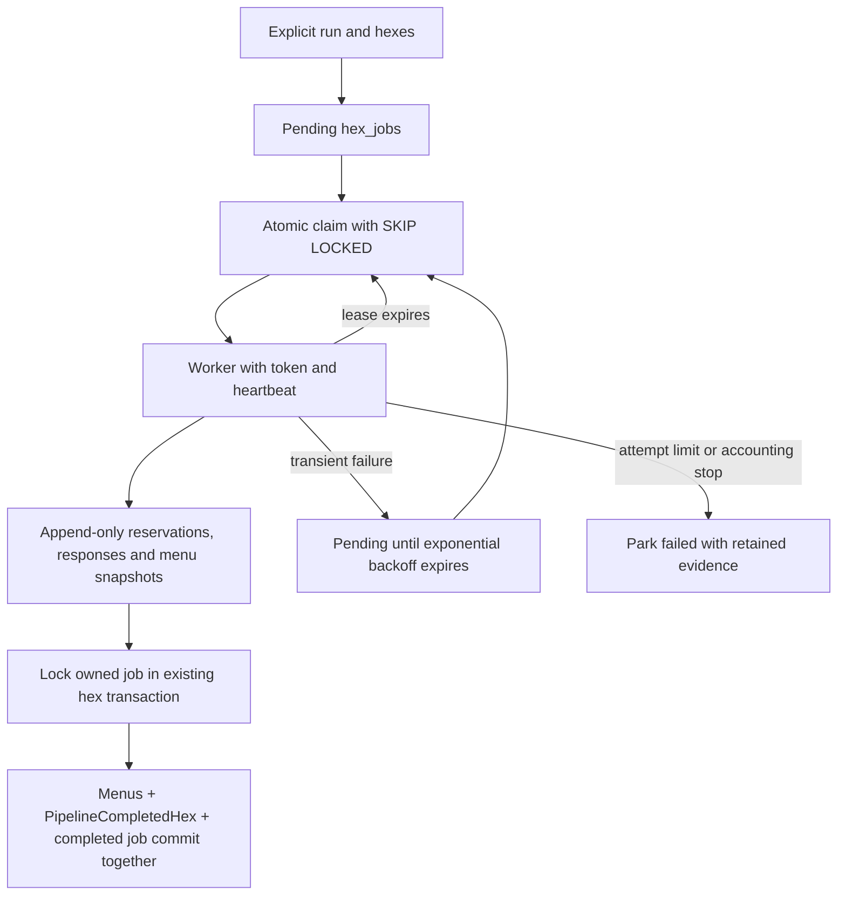

# Pipeline v2 shared hex queue

**TL;DR:** DEV workers share leased hex jobs, durable paid-call replay, bounded retries and atomic hex completion.

The queue runs the [existing v2 hex implementation](pipeline-v2-dev-poc.md) against explicitly enqueued resolution-7 LA cells.
It retains the DEV-only target guard, dedicated `pipeline_writer` credentials, reviewed official matcher, Jev protocol and cumulative $5 per-hex cap.
Cloud hosting, shared UE throttling, PDF execution and fleet-wide budgets remain the later #593-#596 work.
No mobile journey changes or App Store actions are involved.



## Commands

Apply the additive Prisma migration through the existing guarded migration procedure before running workers.
Provide `PIPELINE_DATABASE_URL` and `TYPESAFE_API_KEY` in the invoking process, as for the single-hex proof.
The queue entrypoint constructs Prisma only after both target and pipeline-role validation.
Production and unknown projects remain refused, including with production-write flags.

```sh
npm run preload:v2:enqueue -- \
  --run-id=issue-592 \
  --hex-id=8729a1d75ffffff \
  --cost-cap-usd=5 \
  --max-attempts=3 \
  --priority=0

# Invoke independently on each worker, using the same run ID and database.
npm run preload:v2:worker -- \
  --run-id=issue-592 \
  --worker-id=worker-a \
  --out=.evidence/pipeline-v2/worker-a \
  --max-jobs=1
```

Repeat `--hex-id=HEX` to enqueue several explicit LA cells; duplicate hex arguments are deduplicated.
The example hex is a valid cell, not proof of suitable DEV restaurants or live execution.
Jobs are unique by `(run_id, hex_id)` and use reserved run IDs beginning `pipeline-v2-dev:queue:`.
The ordinary preload resumer already excludes this prefix.
Workers for one refresh must use the same run ID; unrelated ingestion and refresh runs must not overlap.
The single-host POC keeps its original local journal and separate run namespace; it does not import or reset shared jobs.

Enqueue is idempotent, can raise priority, and cannot reset attempts, progress or a parked/completed job.
An existing job refuses changes to its target, estimator protocol, cap or attempt limit.
The $5 ceiling is per hex and cumulative across that hex's claims; it is not a fleet-wide budget.
Workers read these stored settings rather than supplying new budgets on resume.

`--max-jobs` defaults to one and permits 1-1000 claims per invocation.
A worker exits when no eligible job exists, the bound is reached or a job does not complete.
`idle` means no job is currently claimable; pending backoff, another live lease and exhausted work can all produce it.
This command does not install a daemon or scheduler.
Private per-attempt exports under `--out` are optional recovery evidence; the database journal remains authoritative even on another host.

## Ownership, checkpoints and retries

`hex_jobs` stores status, attempts, a fixed maximum, database retry time, priority, cap, lease owner, fresh lease UUID and expiry.
Its checkpoint contains a version, source-bound journal identity and the last committed event sequence.
`hex_job_events` stores the append-only menu snapshots, PDF outbox, request reservations, raw provider responses, usage and prepared/completed reports.
Each event insert and checkpoint advance occur in one SQL statement under the current lease token.
The small checkpoint avoids rewriting an ever-growing paid-call journal for every event.
Missing events, identity changes and unknown spend fail closed.
Both tables enable RLS; only the pipeline role can write queue state, and its event privileges are limited to SELECT and INSERT.
The audit role can read them; the application and client roles receive no access.

Claims use `FOR UPDATE SKIP LOCKED`, increment attempts and install a fresh UUID, even if the worker label is reused.
Eligible jobs sort by descending priority, then retry time and hex ID.
Database time determines eligibility and lease validity.
The default lease is 60 seconds, renewed every 20 seconds and with each durable event.
Failed renewal aborts active provider transports and prevents further journal writes or persistence.
Expired tokens cannot renew, reserve requests, change checkpoints, fail jobs or complete a hex.

Before final persistence, the worker drains its heartbeat and renews once.
The existing hex transaction locks the live job before any menu writes and holds that row until commit or rollback.
Other workers skip this locked job even if its wall-clock lease expires during the bounded transaction.
The transaction writes menus, the existing `PipelineCompletedHex` row and job completion together.
A persistence failure rolls them all back while retaining earlier paid-call events.
A committed job is never claimed again; prepared reports remain available even if the process dies before writing its final timing report.

Each claim consumes one attempt, including a claim whose worker dies.
Transient failures retry after 30 seconds, doubling to a 30-minute maximum; the default third failed claim parks the job as `failed`.
The attempt limit is configurable from 1 to 100 when enqueuing.
An expired lease is immediately reclaimable while attempts remain; an expired final claim is parked without another execution.
Unknown spend, invalid accounting, model drift and cap stops park immediately because another automatic paid attempt cannot resolve them.
There is no automatic reset command for parked work.

Recorded menus and successful identical paid responses replay across workers.
Request hashes canonicalize object keys so PostgreSQL JSONB ordering cannot turn a stored response into a new request.
The local POC can still read its earlier insertion-order request hashes without rewriting history.
Reservations commit before sending and responses before parsing or starting subsequent paid work.
If a worker dies after sending a request but before durably recording its response, its spend is unknown.
Recovery parks that job for reconciliation rather than issuing the request again.
Exactly-once billing across that external acknowledgement gap would require provider-supported idempotency or independent usage reconciliation.
Never delete a journal or recreate a job to bypass its cap or accounting stop.

## Verification

The real-Postgres suite exercises concurrent clients, locked-row skipping, token fencing, heartbeat renewal, expiry reclaim, retry timing, attempt exhaustion, permissions and atomic rollback/completion.
Its CLI recovery tests SIGKILL a worker after durable paid responses, start a worker with a different output directory and assert that the original paid requests are not repeated.
A separate in-flight kill scenario proves unknown spend is parked without a second paid call.
Only provider HTTP is substituted in these real-database CLI scenarios.
Database-free unit tests cover argument bounds, canonical and legacy request replay, transport cancellation and the existing single-hex behavior.

```sh
npm test -w scripts -- --runInBand --runTestsByPath \
  pipeline-v2/queue.test.ts pipeline-v2/journal.test.ts pipeline-v2/cli.test.ts \
  verify/security-schema.test.ts lib/db-writer-inventory.test.ts
node scripts/verify/focused-tests.mjs --set \
  apps/api/tests/db/hexJobs.db.test.ts \
  apps/api/tests/db/security.db.test.ts \
  apps/api/tests/db/pipelineRoles.db.test.ts
npm run verify -- --only=focused-tests
```

The canonical focused verifier provisions and retires the owned disposable PostGIS database.
It refuses shared DEV/production test targets.
If managed worker permissions exclude Docker, retain that failure and replay the same selection through the existing host execution owner.
Skipping the database suite during a unit-only invocation does not establish concurrency or crash-recovery acceptance.
