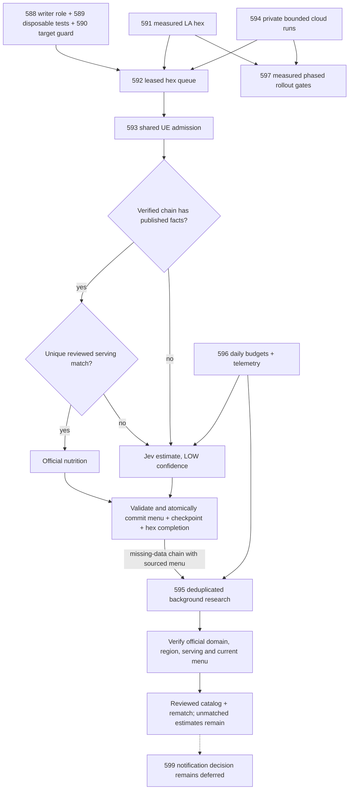

# Pipeline v2 roadmap acceptance

**TL;DR:** The pipeline connects guarded Jev ingestion to reviewed official upgrades; national execution retains separate quality and deployment gates.

[Issue #600](https://github.com/dgmolla/fitsy/issues/600) owns current progress and remaining operational evidence.
This guide connects its existing implementations and acceptance contracts without creating another task queue.
Code in the repository, disposable-database tests, live DEV measurements and production activation are separate claims.



## Contracts and entrypoints

| Issue | Implemented contract | Maintained entrypoint or reference |
| --- | --- | --- |
| [#588](https://github.com/dgmolla/fitsy/issues/588) | Separate pipeline writer; application credentials cannot write pipeline data. | [Role migration and activation](../devops/db-guardrails.md), `apps/api/tests/db/pipelineRoles.db.test.ts` |
| [#589](https://github.com/dgmolla/fitsy/issues/589) | Database tests refuse shared DEV, production and unknown remote targets before loading suites. | `scripts/lib/test-database-guard.ts`, [owned disposable verification](../../../scripts/verify/README.md) |
| [#590](https://github.com/dgmolla/fitsy/issues/590) | Explicit target, role and signed workload checks precede connections and provider work. | `scripts/lib/db-target-guard.ts`, [execution boundary](runbook.md#environment-variables) |
| [#591](https://github.com/dgmolla/fitsy/issues/591) | Reviewed exact matches, Jev fallback, known-cost replay and atomic source persistence. | `npm run preload:v2:dev`, [single-hex proof](pipeline-v2-dev-poc.md) |
| [#592](https://github.com/dgmolla/fitsy/issues/592) | Shared leases, ownership fencing, bounded retry and atomic completion. | `npm run preload:v2:enqueue`, `npm run preload:v2:worker`, [queue contract](pipeline-v2-queue.md) |
| [#593](https://github.com/dgmolla/fitsy/issues/593) | One database UE rate bucket and global 403/429 cooldown across workers. | `npm run preload:v2:dev -- ue-rate`, [rate contract](pipeline-v2-queue.md#shared-uber-eats-rate-and-backoff) |
| [#594](https://github.com/dgmolla/fitsy/issues/594) | Private cloud runtime, immutable run count/budget limits, health and graceful shutdown. | `npm run preload:v2:cloud`, [cloud deployment and acceptance](pipeline-v2-cloud-worker.md) |
| [#595](https://github.com/dgmolla/fitsy/issues/595) | One PDF job per verified brand; reviewed additive upgrades preserve unmatched estimates and existing corrections. | `npm run preload:v2:pdf-worker`, [background nutrition](pipeline-v2-queue.md#background-chain-nutrition) |
| [#596](https://github.com/dgmolla/fitsy/issues/596) | Fleet-wide daily USD/call reservations, retained unknown usage and operational telemetry. | `npm run preload:v2:dev -- budgets`, [budgets and telemetry](pipeline-v2-budgets.md) |
| [#597](https://github.com/dgmolla/fitsy/issues/597) | Offline metro-first priorities, bounded loadable batches, forecasts and phase gates. | `npm run preload:v2:dev -- rollout`, [US rollout](pipeline-v2-us-rollout.md) |
| [#598](https://github.com/dgmolla/fitsy/issues/598) | Retired-provider removal and maintained operator documentation. | `scripts/pipeline-docs.test.ts`, [UE-first source contract](ue-first-pipeline.md) |
| [#599](https://github.com/dgmolla/fitsy/issues/599) | Explicitly deferred notification decision; published facts silently win through source trust order. | No notification, history or versioning is introduced by this roadmap. |

## Combined acceptance

`scripts/pipeline-v2/cli.test.ts` invokes the actual command with external HTTP and database boundaries substituted.
It proves PDF publication occurs inside menu persistence, failed sourcing creates no shared job, and empty chain menus do not consume background work.
It retains checkpoint recovery, paid replay, overflow, unknown usage and cap-stop coverage.

`scripts/pipeline-v2/journey.db.test.ts` uses actual PostgreSQL transactions, queue leases, estimators, catalog verification and both reviewed writers.
Only DNS and external provider HTTP are substituted with explicit synthetic fixtures.
The journey checks:

- Two locations receive sourced Jev estimates and produce one shared brand job after atomic hex completion.
- Background discovery, extraction and serving verification add official nutrition to exactly matching servings at both locations.
- Family meals and items absent from a partial source keep their Jev estimates.
- Stable dish and estimate identities survive upgrades, checkpoint replay and a later exact-match refresh.
- A second database session cannot claim an uncommitted PDF job.
- A failed checkpoint rolls back menus, PDF publication and completion together; retry reuses already paid responses.

Run the combined persistence checks through the existing owned launcher:

```sh
node scripts/verify/focused-tests.mjs --set \
  scripts/pipeline-v2/journey.db.test.ts \
  scripts/pipeline-v2/cloud-service.db.test.ts \
  scripts/pipeline-v2/cloud-runs.db.test.ts \
  scripts/pipeline-v2/service-budget.db.test.ts \
  scripts/pipeline-v2/ue-rate-limiter.db.test.ts
npm run verify -- --only=focused-tests
```

The existing focused-test classifier recognizes `scripts/pipeline-v2/*.db.test.ts` and provisions the guarded disposable PostGIS database.
The ordinary scripts test group also discovers the new journey through its existing Jest configuration.
No workflow, hook, package command, required environment variable or separate execution pipeline is added.
A direct Jest run without database URLs skips these suites and cannot establish persistence acceptance.

For database-free regression and packaging coverage:

```sh
npm test -w scripts -- --runInBand pipeline-v2 pipeline-docs.test.ts
node --test scripts/pipeline-v2/cloud-packaging.test.mjs
```

## Operational acceptance and recovery

Keep the worker DEV-only and within its LA boundary until the [rollout gates](pipeline-v2-us-rollout.md#go-no-go-gates) pass.
The single-hex report and journal must establish actual DEV source identity, complete timing, known paid usage and independently inspected official matches.
Synthetic fixtures supply regression proof rather than live throughput, spend or nutrition accuracy.
The private cloud owner must demonstrate DEV health, bounded starts, replica coordination and graceful recovery using the [cloud acceptance contract](pipeline-v2-cloud-worker.md).
Production role activation and runtime credentials retain their existing external approval boundaries.
The rollout forecast remains an assumption until replaced with accepted live measurements, and the documented estimate-accuracy baseline currently fails the proposed expansion thresholds.
Broader geography and national execution therefore remain gated.

When sandbox permissions block Docker, retain the canonical failure and have the existing host verifier run the same focused selection against this source.
Do not substitute shared DEV, production, an unowned database or a skipped suite for persistence evidence.
Use the selected `verify-fitsy` skill and the [verification recovery instructions](../../../scripts/verify/README.md#diagnostic-logs) to preserve source identity and complete diagnostics.
For unavailable GitHub CLI networking, the authenticated browser can inspect issue comments and post the authorized implementation decision; it does not grant database or deployment access.
Keep execution receipts, the concrete next owner/action and any missing grants in the issue handoff.
