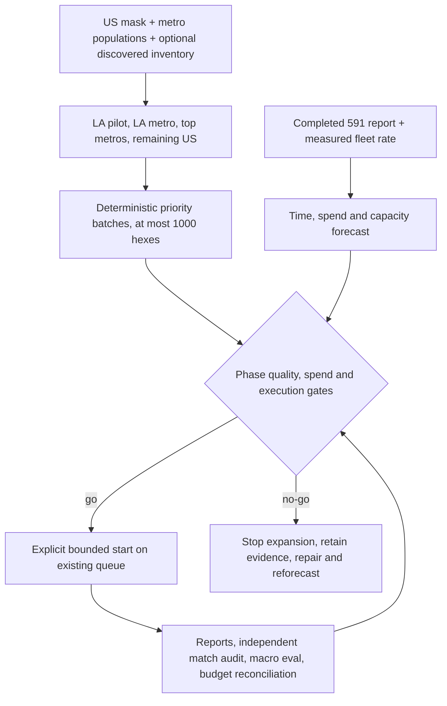

# Pipeline v2 US rollout plan

**TL;DR:** Deliver LA first, then the largest metros, with generated priorities and measured gates before expansion.

This is the rollout plan for [#597](https://github.com/dgmolla/fitsy/issues/597), using the [#591 hex runner](pipeline-v2-dev-poc.md), [shared queue](pipeline-v2-queue.md), [UE limiter and budgets](pipeline-v2-budgets.md), and [#594 cloud worker](pipeline-v2-cloud-worker.md).
Generating a plan is offline and performs no provider calls, database connections, deployments, or production activation.
The implemented worker remains DEV-only and restricted to the original LA discovery boundary.
The later phases are planning inventory until their discovery, regional matching, deployment, and production execution gates are satisfied through the existing owners.



## Coverage and ordering

Use resolution-7 cells for enrichment and resolution-5 parents for discovery planning.
Assign every restaurant to exactly one `homeHex` and deduplicate discovery by provider store UUID before enrichment.
An empty geographic cell needs discovery coverage, not an enrichment job.
The national inventory uses the existing Census-derived state mask in `apps/api/services/chainUsStates.generated.json.gz`, including Alaska, Hawaii, and DC; territories are excluded.
Its center-in-polygon counts are planning coverage, not a claim that every coastal cell or generalized border is covered.
Reconcile coastal, border, and small-island restaurants against actual discovery before declaring a region complete; uncertain geography remains a hold.

The first seven cells are the central-LA resolution-7 cell and its immediate neighbors.
The next phase uses the chosen LA service envelope, clipped to the state mask, excluding those seven cells.
The metro envelopes in `scripts/pipeline-v2/rollout-input.json` are explicit H3 rings around service centers, not official CBSA boundaries or a claim of complete UE delivery availability.
Before a metro gate, reconcile its full discovered service footprint, including populated edges outside the initial envelope, and regenerate from that inventory.
This prevents an attractive city-center result from being reported as complete metro coverage.

After LA, order the other nine largest 2020 metros by [Census population](https://tigerweb.geo.census.gov/tigerwebmain/Files/acs25/tigerweb_acs25_metro_cbsa_2020_tab20_us.html): New York, Chicago, Dallas, Houston, Washington, Philadelphia, Miami, Atlanta, Boston.
Within each metro, order supplied restaurant counts per square kilometer first, then supplied cell population, then proximity to its service center, then H3 ID.
The remainder uses restaurant density, population, and H3 ID.
Without an inventory, density and cell population are unknown; metro population and center proximity provide the explicitly labeled fallback.
Do not spread a metro population uniformly across its cells or present that proxy as observed demand.
Assign unique descending positive integers to `hex_jobs.priority`, matching the queue's existing `ORDER BY priority DESC`.
Overlapping envelopes and state borders never create duplicate jobs.

## Per-phase forecast

The checked-in scenario produces these **incremental** counts and estimates; no phase repeats cells from an earlier phase.
Counts are generated from the frozen mask and envelopes, rather than rounded geographic area calculations.
Wall time is active processing time; independent inspection, repairs, approval waits, provider outages, and UTC budget rollover can add calendar time.

| Phase | Candidate res-7 hexes | Res-5 probes | Expected occupied hexes | Active wall time | Jev | Workers + PDF allowance | Expected total | Phase ceiling |
| --- | ---: | ---: | ---: | ---: | ---: | ---: | ---: | ---: |
| Few LA hexes | 7 | 2 | 7 | 0.07 hours | $0.36 | $0.30 | $0.66 | $5 |
| LA service envelope | 2,013 | 57 | 1,007 | 8.1 hours | $50.84 | $8.96 | $59.80 | $250 |
| Other top-nine metro envelopes | 16,672 | 455 | 8,336 | 66.8 hours | $420.81 | $60.87 | $481.70 | $2,000 |
| Remaining US | 1,763,886 | 37,907 | 141,111 | 1,234.1 hours, about 52 days | $7,123.29 | $1,002.25 | $8,125.60 | $10,000 |

The total is 1,782,578 candidate cells, roughly 150,461 occupied cells, 55 processing days, and $8.7k.
Plan for useful LA coverage in the first accepted day and the initial top-metro footprints within the first accepted week.
A reasonable national target is 8-10 weeks after the pilot passes, with regional gaps and failed jobs reported explicitly.
At half the assumed sustained UE throughput, the UE-bound portion takes twice as long; adding replicas does not fix it.
Doubling restaurant/item volume can exceed the phase ceilings, so this forecast never authorizes spending through a changed workload.
Discovery probe counts are conservative per-phase parent sets; parents straddling a phase boundary can be counted again.

**Measurement status:** neither the #591 issue nor its runbook supplies a live `report.json` with complete time and known cost.
The checked-in numbers are an unmeasured planning scenario, not fixture timings presented as live POC results.
The #591 command already records the fields needed to replace it, and `--poc=REPORT` consumes that actual format.
It refuses failed or partial hexes, unknown bills, interrupted/incomplete timing, missing source hashes, and incomplete item accounting.
Valid non-food rejections remain in the workload/cost denominators; persisted plus explicitly rejected items must account for every unique item.
A source hash and structurally valid report do not independently prove a live run or correctness; inspect its retained journal and environment identity at the gate.

The scenario assumes 10 restaurant locations, 400 unique menu items, 80 reviewed official items, 320 Jev items, 640 Jev requests, 10 UE menu requests, and 180 seconds per occupied hex.
Its Jev cost is $0.040384 per baseline hex, using the curated dev benchmark's $0.1262 per 1,000 estimated items in the [eval report](eval-suite.md#metrics-and-results).
This is a pricing/workload assumption, not a nationwide accuracy claim.
Occupancy is assumed at 100% for the pilot, 50% for metro envelopes, and 8% for the remainder.
With an inventory, the planner instead uses exact restaurant-bearing cell counts and scales baseline work by the observed restaurant count.

Capacity assumptions are eight workers, a shared UE cap of 1 request/second with 50% sustained utilization, five discovery pages per probe, and a 25% retry/work allowance.
The shared cap is an operational upper bound, not evidence that UE permits that rate.
Validate it in the pilot and lower it after any 403/429, keeping the global cooldown and recovery rules.
Discovery must use the same shared limiter before nationwide work; the legacy discovery entrypoint does not, and must remain stopped while the v2 fleet runs.
Five pages per probe is a forecast input, not permission to truncate a non-exhausted feed; record saturated probes and expand or subdivide them before coverage acceptance.

The forecast proposes Jev daily capacity of $250 and 5,000,000 requests for later scale, rather than the installed $5/100,000 defaults.
It does not change those database settings.
At the installed $5/day cap, the rest-phase Jev subtotal alone needs at least 1,425 budget days; the 8-10 week target is therefore a **no-go** without separately accepted capacity.
Worker capacity is provisionally $0.10 per worker-hour for eight continuously allocated workers during processing; replace it with the actual runtime bill before expansion.
PDF allowances are $0.05 per newly encountered brand, with incremental brand allowances of 5/50/150/300.
Cloud billing, PDF search prices, catalog-review labor, and database/storage/network charges are not measured by #591; labor and database/storage/network charges remain outside the table and need a separate accepted allowance.
No new environment variables are required.

For a phase with `H` occupied cells, baseline `U` menu requests, `J` Jev requests, cost `C`, time `T`, retry allowance `R`, workers `W`, and effective UE rate `q`:

```text
discovery hours = ceil(probes * pages * R) / q / 3600
enrichment hours = max(H * U * R / q / 3600,
                       H * T * R / W / 3600000,
                       H * J * R / daily-call-cap * 24,
                       H * C * R / daily-USD-cap * 24)
phase hours = discovery hours + enrichment hours
phase USD = H * C * R + worker-hours * hourly-price + new-brands * PDF-price
```

With observed restaurant counts, replace `H` in the workload terms by `observed restaurants / baseline restaurants`, retaining the actual occupied-cell count separately.
The model takes the maximum of shared enrichment constraints and adds discovery first; it never divides the global UE or budget limit by the replica count.

## Chain dedupe effects

Reviewed official matches avoid Jev estimation at every matching location, while each location still needs its current UE menu and serving checks.
The scenario's 20% official share saves approximately 25% of the Jev subtotal relative to estimating those official items as well, about $1.9k nationally.
That saving is already reflected in the table; do not subtract it again.
Use the POC's observed official/Jev split when replacing the scenario.
The remaining paid-call journal replays identical work after interruption, but its restaurant context does not establish cross-location Jev caching.
No extra speculative cross-location cache discount is included.
PDF search deduplicates by verified brand, so 500 newly encountered brands cost 500 searches under this allowance, even if they appear at thousands of locations.
Keep the existing three-attempt/backoff accounting and include failed/unknown reservations when reconciling that allowance.

## Generate, inspect, and load

```sh
# New output directory each time; national generation can take several minutes.
npm run preload:v2:dev -- rollout --out=.evidence/pipeline-v2/us-plan-001

# Replace assumptions with the retained POC and a read-only discovery snapshot.
npm run preload:v2:dev -- rollout \
  --out=.evidence/pipeline-v2/discovered-plan-001 \
  --poc=.evidence/pipeline-v2/issue-591/report.json \
  --inventory=/private/path/discovered-hexes.json
```

`plan.json` records input/code/lockfile hashes, the population source, the measurement label, per-phase counts, estimates, and batch checksums.
Each `PHASE-NNNN.json` is a strict versioned priority batch containing at most 1,000 `{hexId, priority}` jobs.
Its phase and input source hash remain available for operator review; it carries no credentials or executable arguments.
Existing output directories are refused so a reforecast cannot overwrite prior evidence.
The national output includes geographic candidates, including empty and undiscovered cells; **load restaurant-bearing discovery inventory batches**, rather than enqueueing all land cells for enrichment.

The optional inventory is the complete explicit scope of that generation, not a claim of national completeness:

```json
{
  "source": "UE discovery snapshot identity + Census population source/vintage",
  "capturedAt": "2026-10-28T00:00:00Z",
  "hexes": [
    { "hexId": "8729a1d75ffffff", "restaurants": 40, "population": 2500 }
  ]
}
```

Use deduplicated UE restaurant counts grouped by `homeHex`, and independently sourced per-cell population; use zero when population is unknown and state that in `source`.
Counts must be nonnegative integers, hexes unique and resolution 7, and cell centers unambiguously within a US state or DC.
Border/ocean-center cells need geographic reconciliation before this conservative inventory path admits them.
Cells with zero observed restaurants contribute discovery scope but produce no enrichment job.
Keep the snapshot and its source identity with the phase evidence.

```sh
# DEV LA only, after inspecting the inventory, measurements and pilot gates.
npm run preload:v2:enqueue -- \
  --run-id=la-pilot-001 \
  --priority-file=.evidence/pipeline-v2/discovered-plan-001/la-pilot-0001.json \
  --cost-cap-usd=5 --max-attempts=3

# Existing private service invocation, without exporting a writer credential.
npm run preload:v2:cloud-control -- start \
  --url=https://PRIVATE_SERVICE.run.app \
  --run-id=la-pilot-001 \
  --priority-file=.evidence/pipeline-v2/discovered-plan-001/la-pilot-0001.json \
  --max-hexes=7 --budget-usd=1
```

The examples demonstrate loadability, not authorization to execute a phase.
Do not mix a priority file with explicit hex IDs or a uniform priority.
Both callers validate the complete batch, including every LA scope check, before database writes or cloud invocation; a mixed LA/non-LA batch cannot partly enqueue through this path.
Cloud starts store the selected priorities in their immutable run configuration and preserve the explicit count/budget bounds.
Idempotent starts cannot rewrite them; local enqueue retains its existing priority-raise-only behavior and never resets progress or spend.
Finish and reconcile each bounded run before starting the next batch, preserving one active refresh.
Across batches, sum the phase's existing spend and reservations before allocating the remaining budget; a fresh run ID is not a fresh phase allowance.
The cloud cap covers hex estimation, while PDF daily caps and actual infrastructure cost require separate reconciliation against the phase ceiling.

## Go/no-go gates

Every phase requires zero independently observed wrong official matches, reviewed serving/source/geographic provenance for every new official binding, and no unexplained loss of existing official links.
Audit reuse of an existing binding in the new menu/region context; a successful old-region match is not geographic approval elsewhere.
For estimates, use a frozen, independently sourced truth set spanning calories, protein, carbs, fat, zero targets, sizes, negative matches, chain and independent dishes.
Apply the [full-denominator eval semantics](eval-suite.md#metrics-and-results): failures and omitted cases count, zero truth requires exact zero, and a big miss is greater than 50% calorie error.
Require median percentage error at most 25% for **each** of calories/P/C/F, at least 80% of items within 25% on all four fields, at most 5% big misses, and at least 95% zero correctness.
These are proposed rollout thresholds; they are not evidence that current Jev estimates pass.
The retained curated dev baseline has 11.8% all-four pass and 21.6% big misses, so broader rollout is currently **no-go** under this policy.
Do not relax the thresholds or label estimates official to make a phase pass.

| Phase | Independent quality sample and coverage gate | Budget and execution gate |
| --- | --- | --- |
| Few LA hexes | Inspect all new official bindings and at least 100 distinct estimated servings across the seven cells, including negative/size cases; obtain complete #591 reports and actual UE rate evidence. | $5 total ceiling; known provider usage; shared limiter and daily caps present; live DEV #594 health, graceful release, replay, and atomic completion demonstrated. |
| LA metro | At least 300 estimated servings across at least 20 restaurant identities, both chain and independent; all new official bindings audited; reconcile full LA discovered service footprint, empty/saturated probes, and failed jobs. | $250 total ceiling; update forecast from all seven pilot reports and actual restaurant density; accepted proposed capacity and infrastructure allowance; no unknown spend or unexplained throttles. |
| Top metros | At least 100 estimated servings per new metro plus all new official bindings; include regional menus, multi-state metros and negative cases; satisfy every common macro threshold per metro. | $2,000 incremental ceiling; region-aware discovery/estimator context and catalog geography independently accepted; fleet uses one UE limiter and immutable bounded runs; production activation, if needed, uses its existing separate owner authorization. |
| Remaining US | At least 100 estimated servings per new state/DC scope, with Alaska/Hawaii, rural, border and coastal cases; common metrics pass per regional cohort; reconcile all discovered stores, saturated/empty probes, pending jobs, and excluded geography. | $10,000 incremental ceiling; reforecast from accepted metro measurements and observed occupancy; accepted runtime/daily budgets, resumability, and infrastructure allowance; no unresolved prior-phase correctness or accounting incident. |

Any wrong official match, unknown usage, cap breach, unsafe UE response, unresolved serving/geography ambiguity, or failed mandatory sample is no-go.
Pause new claims through the supported runtime lifecycle, retain leases/journals/reports and unknown reservations, quarantine the affected binding, and repair/revalidate before expansion.
Do not discard failed jobs, reset run identities, change target guards, or increase rate/budget merely to keep the schedule.
The data-lane execution owner retains the exact next action and evidence in the issue handoff; the existing runtime/release owners retain their actual external grants.
This issue does not request App Store submission or confer human sign-off.

## Validation and recovery

```sh
npm test -w scripts -- --runInBand --runTestsByPath \
  pipeline-v2/rollout.test.ts pipeline-v2/queue.test.ts \
  pipeline-v2/cloud.test.ts pipeline-v2/cli.test.ts
node --test scripts/pipeline-v2/cloud-packaging.test.mjs
node scripts/verify/focused-tests.mjs --set scripts/pipeline-v2/cloud-runs.db.test.ts
npm run verify -- --only=focused-tests
```

The offline CLI regression generates inventory batches and exercises both consumers while a database constructor recorder proves no connection occurs during planning, even with a production URL present.
Unit tests cover mask holes and antimeridian handling, ordering/deduplication, malformed batches, report refusal, throughput/cost floors, and SQL priority propagation.
The disposable PostgreSQL regression verifies actual priority claim order and immutable replay; a skipped or inaccessible database is not a passing result.
Use `verify-fitsy` and the canonical owned-database launcher for recovery; do not substitute shared DEV, production, or unowned database credentials.
For a network-restricted checkout with cached dependencies, use an owned writable npm cache and `npm ci --offline --ignore-scripts`; generate Prisma using its supported cached engine path overrides if the global cache is read-only.
Preserve those setup failures in task evidence and have the existing host owner replay any socket-restricted database test.
No mobile journey changes, so no Maestro flows or simulator commands are required.
